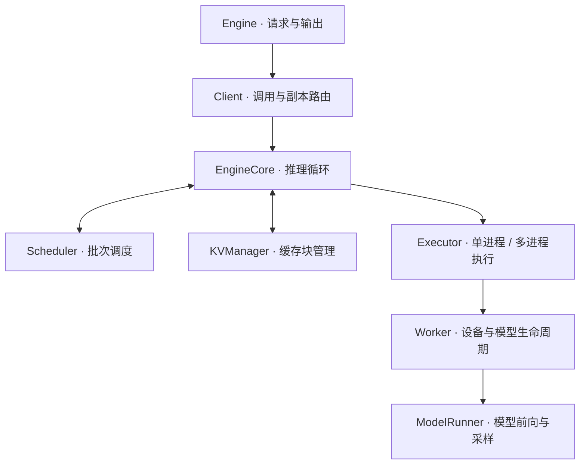

<div align="center">
  
  <h1>xixi-vllm · Only v4</h1>
  <p>从零实现的 Qwen3 Dense 推理引擎，支持连续批处理、分页 KV Cache 与 TP / PP / DP 并行。</p>
</div>

## 项目介绍

xixi-vllm 以 v4 为唯一实现，提供统一的单卡与多卡推理接口。引擎将请求处理、调度、缓存管理、模型计算和进程通信分层组织，支持命令行推理、Python 调用以及独立的基准测试。

- **请求调度**：Continuous Batching，支持 prefill / decode 混合调度与流式输出。
- **缓存管理**：Paged KV Cache，提供 Hash / Radix 前缀缓存和 KV 块复用。
- **计算优化**：FlashAttention 分页注意力、FlashInfer 算子、Decode CUDA Graph 与 prefill `torch.compile`。
- **并行执行**：张量并行 TP、流水线并行 PP、数据并行 DP，以及 TP / PP / DP 组合。

## 架构

推理调用沿 `Engine → Client → EngineCore → Executor → Worker → ModelRunner` 展开。单卡与多卡共享上层接口，执行器负责组织设备和进程。



| 模块 | 职责 |
| --- | --- |
| `src/control/` | 对外接口、请求路由、调度循环与执行器；DP 请求经 ZMQ 分发至独立副本 |
| `src/data/` | 序列状态、调度消息、KV 块账本与前缀缓存索引 |
| `src/compute/` | GPU 批次、KV 张量池、Qwen3 模型、并行算子与采样 |
| `src/distributed/` | rank 与进程组管理、集合通信、流水线通信和控制通道 |
| `src/model_hub.py` / `src/utils/` | 模型路径、权重下载与运行辅助工具 |

每个 EngineCore 内部维护独立的 Scheduler 和 KVManager。Scheduler 生成调度结果，Executor 将任务交给 Worker 执行，计算结果返回后更新请求和缓存状态。KV 块账本位于数据层，GPU 上的实际 KV 张量由计算层持有。

### 并行方式

| 方式 | 划分对象 | 执行与通信 |
| --- | --- | --- |
| TP · 张量并行 | 层内权重、注意力 head 和词表 | 多个 Worker 协作执行同一批请求，使用 NCCL 集合通信 |
| PP · 流水线并行 | 连续的模型层 | stage 之间传递 hidden states / residual，支持自定义层数分配 |
| DP · 数据并行 | 请求 | 独立 EngineCore 副本分别处理请求，Client 负责轮转分发与结果汇总 |

单副本模型并行进程数为 `tp × pp`，本机组合配置使用 `dp × tp × pp` 张 GPU。控制消息通过 Gloo 传递，GPU 张量通过 NCCL 通信，DP 副本通过 ZMQ 连接。

## 安装

运行环境为 Linux x86_64；Windows 用户通过 WSL2 运行。项目使用 Python 3.12、PyTorch 2.13、CUDA 13.0、FlashAttention 和 FlashInfer，具体依赖由 `pyproject.toml` 与 `uv.lock` 管理。

在 WSL 终端中执行：

```bash
git clone https://github.com/xixii421/xixi-vllm.git
cd xixi-vllm

curl -LsSf https://astral.sh/uv/install.sh | sh
uv sync --locked
```

WSL 需要可用的 NVIDIA GPU 驱动支持，可使用 `nvidia-smi` 查看设备。虚拟环境在 WSL 内创建，后续命令均在仓库根目录使用 `uv run` 执行。

### 准备模型

将模型下载到本地目录：

```bash
uv run hf download Qwen/Qwen3-0.6B --local-dir ~/huggingface/Qwen3-0.6B
```

`--model` 支持本地目录，也支持 `Qwen3-0.6B` 这样的名称；模型名默认解析到 `~/huggingface/<模型名>`。使用其他大小的模型时，先将相应权重下载到本地。

## 快速开始

```bash
# 单条推理
uv run python run.py --model Qwen3-0.6B --prompt "介绍一下大语言模型"

# 批量推理
uv run python run.py --model Qwen3-0.6B --batch

# 启用 Decode CUDA Graph 和 prefill 编译
uv run python run.py --model Qwen3-0.6B --cg --compile
```

默认使用 eager 模式。运行参数从根目录 [config.yaml](config.yaml) 读取，命令行参数覆盖对应配置；可通过 `--config` 指定其他 YAML 文件。

### 本机并行

```bash
# TP：两张 GPU 切分模型权重
uv run python run.py --model Qwen3-0.6B --tp 2 --cg

# PP：按层划分模型
uv run python run.py --model Qwen3-8B --pp 2 --cg

# PP：自定义每个 stage 的层数及设备顺序
uv run python run.py --model Qwen3-14B --pp 2 \
  --pp-layer-counts 12,28 --device-ids 1,0

# DP：两个独立副本处理批量请求
uv run python run.py --model Qwen3-0.6B --dp 2 --batch --cg

# DP × TP：每个副本使用两张 GPU
uv run python run.py --model Qwen3-8B --dp 2 --tp 2 \
  --device-ids 0,1,2,3 --batch --cg
```

`--device-ids` 指定当前进程可见的 GPU 编号，长度应等于 `dp × tp × pp`。`--pp-layer-counts` 的各项之和应等于模型层数。

### torchrun 启动

`run_torchrun.py` 用于 TP / PP 的分布式启动：

```bash
uv run torchrun --nproc_per_node=2 run_torchrun.py \
  --model Qwen3-0.6B --tp 2 --pp 1
```

多机运行时，在各节点设置 `--nnodes`、`--node_rank`、`--master_addr` 和 `--master_port`。总进程数应等于 `tp × pp`。DP 通过 `run.py --dp` 启动本机副本。

## Python 接口

```python
from src import Engine, EngineConfig, SamplingParams

engine = Engine(EngineConfig(model="~/huggingface/Qwen3-0.6B"))
try:
    for text in engine.generate("Hello, my name is", max_new_tokens=128):
        print(text, end="", flush=True)
    print()

    outputs = engine.generate_batch(
        ["介绍一下 KV Cache", "解释张量并行"],
        SamplingParams(temperature=0.7, top_p=0.9, max_tokens=128),
    )
    for output in outputs:
        print(output)
finally:
    engine.destroy()
```

对于自定义调度流程，可通过 `add_request()` 提交请求，再调用 `step()` 推进推理。

## 常用配置

| 参数 | 说明 |
| --- | --- |
| `--model` / `--prompt` | 模型目录或名称、输入文本 |
| `--max-new-tokens` | 生成 token 上限 |
| `--temperature` / `--top-p` / `--top-k` | 采样参数 |
| `--tp` / `--pp` / `--dp` | 张量、流水线和数据并行度 |
| `--cg` / `--eager` | 启用 Decode CUDA Graph 或使用 eager |
| `--compile` | 启用 prefill `torch.compile` |
| `--prefix-backend` | 前缀缓存后端：`none`、`hash`、`radix` |
| `--batch` | 批量推理演示 |

上下文长度、批次 token 预算、KV 块大小和显存使用比例等配置见 [config.yaml](config.yaml)。完整命令行选项可通过 `uv run python run.py --help` 查看。

## 目录结构

```text
.
├── src/
│   ├── control/           # Engine、Client、调度器与执行器
│   ├── data/              # 序列、KV 块管理与前缀缓存
│   ├── compute/           # 模型、权重加载、算子与 GPU 执行
│   ├── distributed/       # 进程组与通信
│   ├── utils/             # 运行辅助工具
│   ├── config.py          # 引擎配置
│   ├── model_hub.py       # 模型路径与下载
│   └── sampling_params.py # 采样参数
├── run.py                 # 单卡与本机并行入口
├── run_torchrun.py        # 分布式 TP / PP 入口
├── config.yaml            # 默认运行配置
├── test/                  # 正确性测试脚本
├── bench/                 # 推理基准与通信测量
├── assets/                # 项目图片
├── pyproject.toml
└── uv.lock
```

## 测试与基准

测试脚本独立运行：

```bash
uv run python test/test_sharding.py
uv run python test/test_pp_comm.py
uv run python test/test_parallel.py --tp 1 --pp 1
```

运行吞吐基准并汇总结果：

```bash
uv run python bench/bench_v4.py --model ~/huggingface/Qwen3-0.6B --tp 1 --cg
uv run python bench/report.py
```

基准矩阵、官方 vLLM 对照与硬件探测命令见 [bench/README.md](bench/README.md)。
