# 单机硬件与 GPU 互联

拿到一台多卡服务器，动手写并行代码之前需要先弄清楚整个机器的性能配置情况。例如卡的个数、卡是否同构、卡之间的互联方式等等。
这三个维度决定了我们将采用什么并行策略，并且初步从理论上判断通信会不会成为瓶颈。

整篇文档的结构如下。

- [1] 三个关键维度的讲解：卡数、异构性、互联方式。
- [2] 单机状态的完整分类。

## 1. 三个关键维度
### 1.1 卡数
单卡没有并行，所有优化都只能在算子层面。
多卡才需要思考"怎么切"。

目前主流的训练/推理服务器配置是 4 卡、8 卡单机。
而消费级工作站则五花八门都可能会有。
8 卡是 NVIDIA DGX 系列的标准配置，也是绝大多数分布式训练推理框架默认假设的单机规模。

下图是 NVIDIA DGX H100 的 GPU 托盘。一块基板上放 8 张 H100，旁边是 4 颗第四代 NVSwitch，卡与卡之间全部接到 NVSwitch 上。

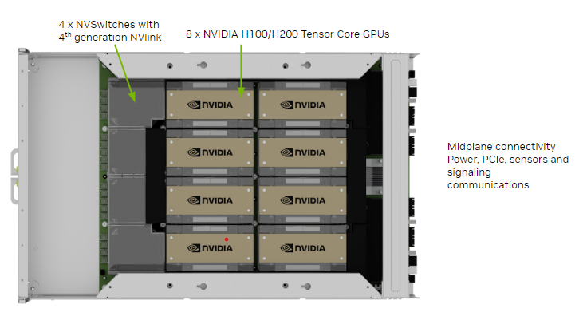

逻辑上看，8 张卡通过 NVSwitch 做成全互联。任意两张卡都能以 NVLink 标称带宽通信，不需要跟别的卡对争抢。下图是 HGX H100 的官方拓扑，上面一排是 8 张 H100，下面四条是 NVSwitch，绿色箭头是第四代 NVLink，棕色箭头是每张卡连到 CPU 的 PCIe Gen5 x16。

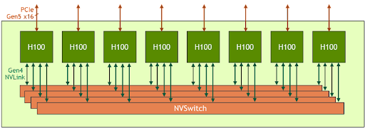

卡数决定了并行的上限。
我们一般来说不可能切出比卡数更多的分片。
但实际中，卡数多不一定意味着全用满，因为还要看互联。8 张卡如果只有 4 张之间有 NVLink，那 TP 大概率只在这 4 张卡上做，另外 4 张跑 DP 或 PP等等。

### 1.2 异构性

同构指一组卡型号相同、算力相同、显存相同。TP 每一步都要做集合通信，所有卡在同一个同步点汇合，整组速度由最慢的那张卡决定。同构时这个同步点对齐，每张卡的利用率一致。

实验室和机房里经常碰不到这种理想状态。异构分两层，一层发生在同一台机器内部，一层发生在机柜和集群之间。

**同一台机器里混型号。** 常见例子是 A100 80GB 和 RTX 3090 24GB 插在同一块主板上。两者都走 CUDA 和 NCCL，虽然协议是统一的，但算力和显存都有明显差距。当把模型放进同一个 TP 组之后，A100 每步都要等 3090 算完，快卡的空闲时间会写进总延迟。
下图把这件事画成两条时间线，上面是高性能卡，灰色段是它在等低性能卡。

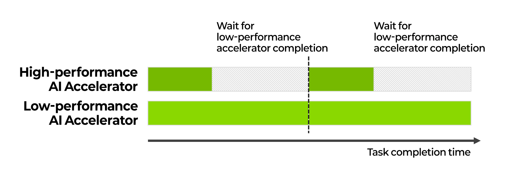

通常来说，对于异构卡普遍都会分开跑模型。A100 单独跑大模型，3090 单独跑中小模型，最多在层边界做 PP，避免把它们绑进同一个 all-reduce 组。

**跨厂商。** NVIDIA、AMD、华为各自有一套从驱动到集合通信的栈。NVIDIA 走 CUDA、cuDNN、NCCL，AMD 走 ROCm、MIOpen、RCCL，华为昇腾走 CANN 和 HCCL。
虽然上层都可以接到 PyTorch，但底层的通信原语互不识别。
NCCL 的 all-reduce 进不了 RCCL 的进程组，HCCS 也接不上 NVLink。
下图给出对照示例：

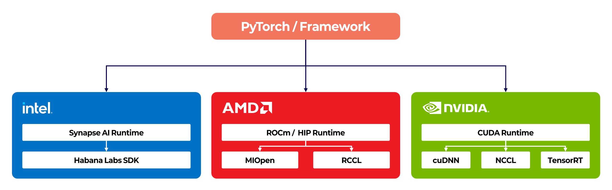

所以跨厂商几乎不会出现在同一台机器的同一组 TP 里。现实里它们以机柜为单位并排放在同一个数据中心里。NVIDIA 的 DGX 走 NVLink 和 InfiniBand，华为的 Atlas 走 HCCS 和 RoCE，AMD 的 MI300X 节点走 Infinity Fabric。机柜内部各自全互联，机柜之间则通过机房网络交换任务。

下图是华为昇腾 910 的集群形态。左侧是节点内部 8 颗芯片的板级互连和上层 cluster network，右侧是 Atlas 机柜阵列。把它和上一节的 DGX H100 托盘并排放，可以看到两边物理结构相似，但通信协议完全独立。

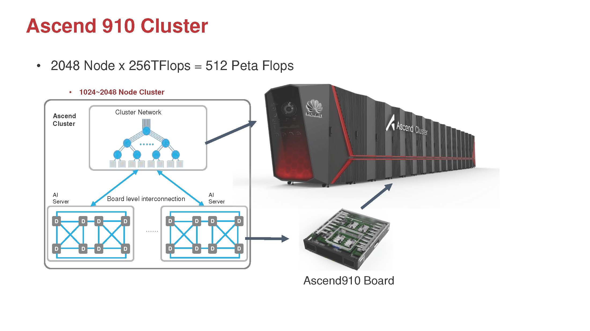

集群调度会把这些机柜划成独立资源池。例如训练任务落到 H100 池，大显存推理落到 MI300X 池，国产训练落到昇腾池。

下图是一个真实的多厂商调度切分：H100 做训练，MI300X 做大模型推理，A100 做开发，旁边再挂 Intel Gaudi 和 Furiosa 的推理池。物理上可以同机房，逻辑上彼此隔离。

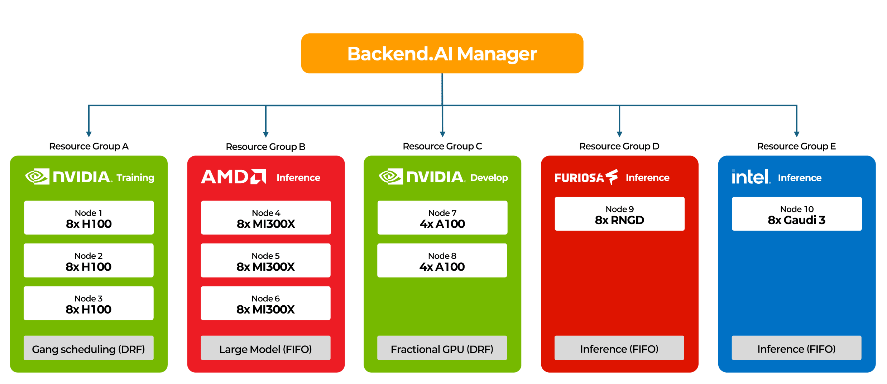

有一类研究（我们组内某些同学的研究）在尝试跨厂商协作，例如把英伟达和华为的卡进行混合推理等等，但这已经超出本项目范围，属于科研范畴，暂做了解即可。

讨论并行策略时，默认假设同构。碰到异构机器，先按型号和厂商拆池，再在每个池内部做 TP 或 PP。

### 1.3 互联方式

这是三个维度里最复杂、也最影响并行效果的一个。两张卡之间传输，究竟走什么物理通路会直接决定通信带宽和延迟，进而决定了 TP 切在这里划不划算。

在讨论具体的并行策略之前，我们需要厘清分布式系统中一对核心概念：**Scale-up（向上扩展）**与 **Scale-out（向外扩展）**。

这两个词最早诞生于传统数据库和企业级 IT 架构领域。
简单来说，Scale-up 的核心思想是“**做强**”。通过增加单节点的 CPU 和内存，构建一个共享统一内存地址空间的紧耦合系统；而 Scale-out 的核心思想是 “**做大**”。通过增加大量普通节点，依靠网络消息传递来协同工作（如 Hadoop 集群）。

在大模型训练的语境下，这对概念被巧妙地映射到了 GPU 集群的物理拓扑上。

- Scale-up 域（紧耦合互联）。对应机内互联。它的本质特征是极高的带宽（如 NVLink 4.0 的 900 GB/s）和硬件级的内存直接访问。在这个域内，多张 GPU 表现得像一张拥有巨大显存的超级 GPU。TP 和 PP 都需要进行高频、细粒度的矩阵切片交换，它们极度依赖 Scale-up 域的低延迟和高带宽。
- Scale-out 域（松耦合互联）。对应跨机的数据中心网络（如 InfiniBand、RoCE v2 或以太网）。它的本质特征是分布式独立内存，依赖网络协议（如 RDMA）进行消息传递。虽然现代 IB 网络（如 400G NDR）已经非常快，但其有效带宽（约 50 GB/s）与 NVLink 相比，依然存在着数量级鸿沟。在训练过程中，DP 的梯度同步发生在反向传播结束后，属于低频、粗粒度的大批量数据交换，因此能够容忍 Scale-out 域的带宽限制。

从快到慢，单机内的 GPU 互联大致可以分为：
> [!NOTE]
> **1. NVLink + NVSwitch 全互联**
>
> 这是目前 NVIDIA 数据中心 GPU 的顶级配置。DGX A100、DGX H100、DGX B200 都是这个拓扑：8 张卡通过板载的 NVSwitch 芯片实现任意两卡之间的全带宽直连。
>
> 所谓全带宽，是指任意一对卡之间都能跑满 NVLink 的标称带宽，不需要跟别的卡对争抢。all-reduce 这类集合通信在这种拓扑下效率最高，因为所有卡对可以同时传输。

下图展示了 NVSwitch 在 H100 托盘上的位置。8 张卡的 NVLink 全部接到这 4 颗芯片上，任意一对卡的流量在 switch 内部转发。

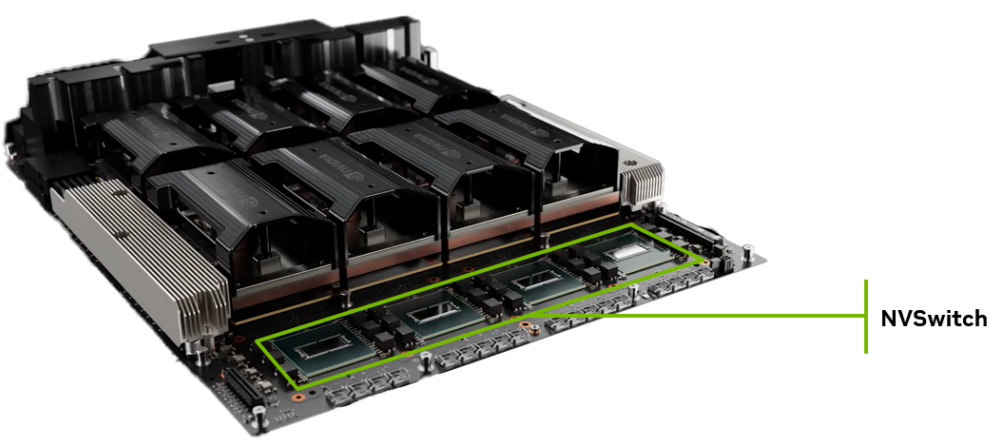

但是 NVLink 本身有代际，带宽差距很大：

| 代际 | 代表 GPU | 每条 link 单向带宽 | link 数 | 单卡总带宽（双向） |
|------|----------|-------------------|---------|-------------------|
| NVLink 2.0 | V100 SXM2 | 25 GB/s | 6 | 300 GB/s |
| NVLink 3.0 | A100 SXM | 25 GB/s | 12 | 600 GB/s |
| NVLink 4.0 | H100 / H200 SXM | 25 GB/s | 18 | 900 GB/s |
| NVLink 5.0 | B200 / GB200 | 50 GB/s | 18 | 1800 GB/s |

> [!NOTE]
> **2. NVLink 直连，无 NVSwitch**
>
> 不是所有带 NVLink 的机器都有 NVSwitch。一些 4 卡工作站只在相邻卡对之间布了 NVLink，不相邻的卡对要么走多跳，要么直接退化到 PCIe。
> 当没有 NVSwitch 时，all-reduce 的效率取决于拓扑。比如 4 张卡只有 0-1、1-2、2-3 三条 NVLink（环形），那 0 和 3 之间通信要经过 1 和 2 中转，有效带宽只有直连的 1/3。
>
> 实际上这一档在实际部署中越来越少，因为NVIDIA 的 SXM 系列基本都搭配 NVSwitch，而PCIe 版本的卡（如 A100 PCIe、L40S）则通常没有 NVLink，直接落到 PCIe 档。

没有 NVSwitch 时，每张卡的 NVLink 条数要分给邻居。8 卡点对点互联时，单对带宽会被拆薄。下图上半是这种直连，下半是经过 NVSwitch 的全互联。任意一对卡要同时跑满，只有下半这种接法做得到。

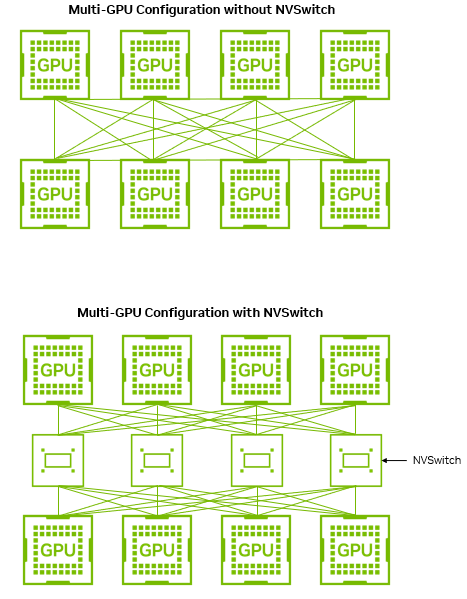

带宽差距会直接变成通信时间。H100 上点对点大约 128 GB/s，NVSwitch 全互联是 900 GB/s。同样的计算量，通信差异巨大。

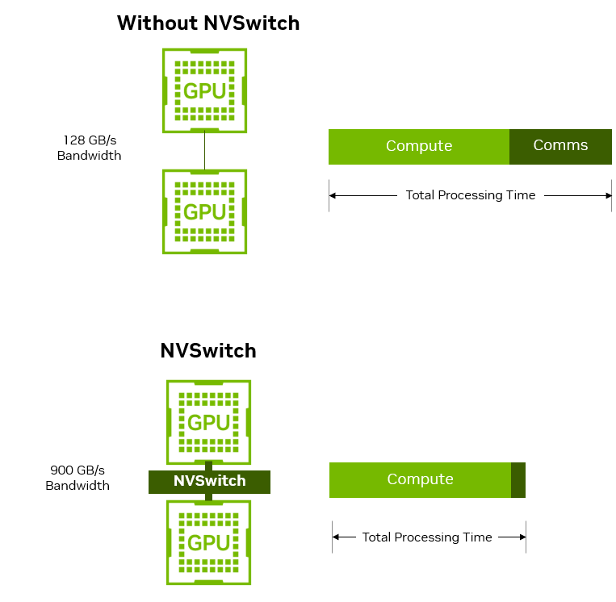

> [!NOTE]
> **3. PCIe 同 switch / 同 CPU**
>
> 没有 NVLink 的卡只能走 PCIe，但是 PCIe 的拓扑也有层级：

- **同 PCIe switch 下**：两张卡挂在同一颗 PCIe switch 上，P2P（peer-to-peer）传输直接在 switch 内部转发，不经过 CPU。延迟最低，带宽接近 PCIe 线速。
- **同 CPU、跨 switch**：两张卡挂在同一个 CPU 的不同 PCIe root port 上，数据要经过 CPU 内部的互联（Intel 的 mesh/ring，AMD 的 Infinity Fabric）转一下。带宽略有损失。

下图是一台 4 卡工作站的典型走线。GPU0 和 GPU1 挂在同一颗 PCIe switch 上，对应 `nvidia-smi topo` 里的 PIX。GPU0 到 GPU2 要经过 MCH 再进另一颗 switch，对应 PXB 或 PHB。注意上游 PCIe x16 会被两张卡分享，这就是同 switch 内部也未必能跑满线速的原因。

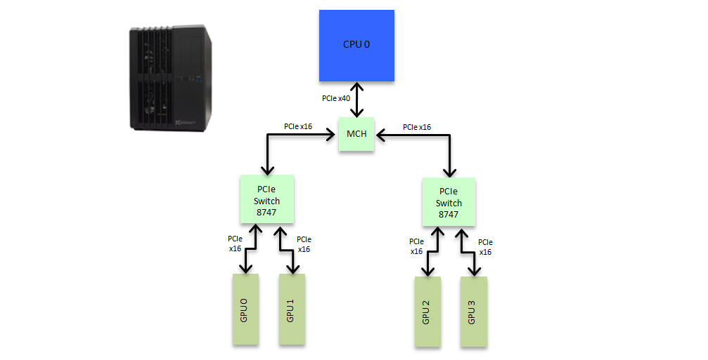

PCIe 的代际决定了带宽上限：

| 代际 | 线速（单向，x16） | 实际有效带宽（单向） |
|------|-------------------|---------------------|
| PCIe 3.0 | 15.75 GB/s | ~12–13 GB/s |
| PCIe 4.0 | 31.5 GB/s | ~25–26 GB/s |
| PCIe 5.0 | 63 GB/s | ~50–55 GB/s |
| PCIe 6.0 | 126 GB/s | ~100+ GB/s（逐步落地中） |

"实际有效"比"线速"低，是因为 PCIe 的 TLP（Transaction Layer Packet）有 header 开销，加上 DLLP ack/nak 等协议开销，通常打 80–85% 的折扣。

PCIe 4.0 同 switch 的 P2P 有效带宽大约 25 GB/s 单向。对比 NVLink 4.0 的 450 GB/s 单向，差了一个 18 倍。这就是为什么 TP 对互联带宽极其敏感，因为 all-reduce 的数据量跟 hidden size 成正比，PCIe 上大概率跑不动大模型的 TP。

> [!NOTE]
> **4. PCIe 跨 NUMA**
>
> 多路服务器（2 路、4 路）里，不同 CPU 各自管着一组 PCIe 通道。如果两张卡分别插在 CPU0 和 CPU1 下面，数据就得从 GPU A → PCIe → CPU0 → 跨 socket 总线 → CPU1 → PCIe → GPU B。
>
> 跨 socket 总线在 Intel 平台叫 UPI（Ultra Path Interconnect），AMD 平台叫 xGMI 的 CPU 侧版本（Infinity Fabric 的一种）。带宽本身不低，但延迟比 PCIe 内部高一截，而且跨 NUMA 的内存访问还会触发远端内存访问，进一步拉高延迟。
>
> 实测中，跨 NUMA 的 GPU P2P 有效带宽通常只有同 switch P2P 的 50–70%。PCIe 4.0 跨 NUMA 大概能跑到 15–18 GB/s 单向。
>
> 这一档做 TP 就已经很勉强了。通信延迟高，all-reduce 时间容易超过计算时间。实际部署中，跨 NUMA 的卡更适合做 PP（层间只传一次 hidden 向量，通信量小）或者 DP（梯度同步可以跟反向计算重叠）。

下图绘制了跨 NUMA 的示意图。左右两颗 CPU 用 QPI/UPI 相连，红圈标出的就是这条跨 socket 路径。GPU0 到 GPU4 必须走 CPU0 → 跨 socket → CPU1，`nvidia-smi topo` 里会显示 SYS。同 CPU 下的 GPU0 和 GPU1 仍然只经过一颗 PCIe switch，还是 PIX。

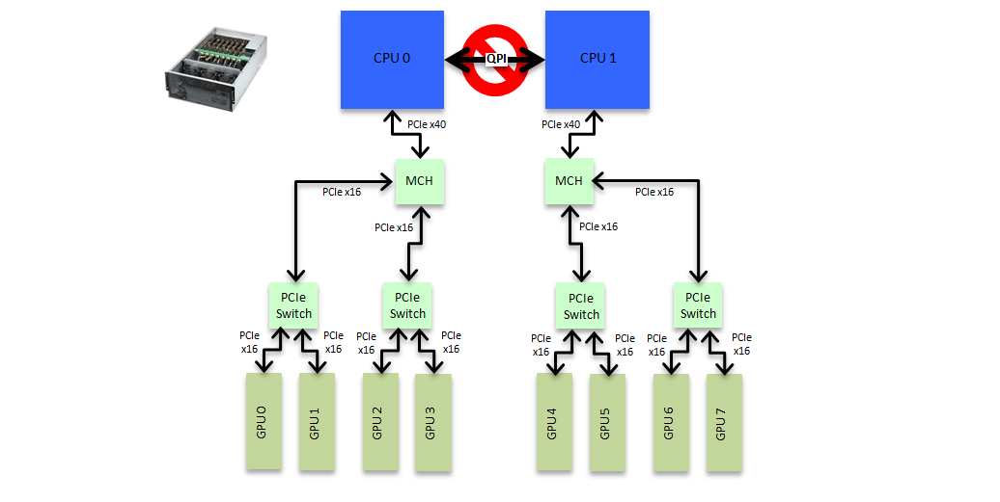

> [!NOTE]
> **5. 无 P2P，走主机内存中转**
>
> 最坏的情况。有些平台因为芯片组限制、IOMMU 配置、或者驱动不支持，GPU 之间无法做 P2P DMA。数据必须走：GPU A 显存 → DMA 到主机内存 → 主机内存 → DMA 到 GPU B 显存。两次 PCIe 传输。
>
> PCIe 4.0 下，这种模式的有效带宽大约 12–13 GB/s 单向，受限于两次传输中较慢的那次，再加上主机内存带宽竞争。消费级显卡（RTX 3090、4090）之间的通信大多走这条路，因为 NVIDIA 在消费级驱动里禁用了 P2P。
>
> 这一档基本告别 TP。8KB 的 all-reduce 消息（bs=1 时的典型大小）传一次要 1 微秒以上，56 次就是几十微秒到上百微秒，跟计算时间差不多甚至更长。

有 P2P 时，两张卡直接在 PCIe 上做 DMA 或 load/store，不经过主机内存。左边是细粒度的直访，右边是 `cudaMemcpy` 整块直拷。

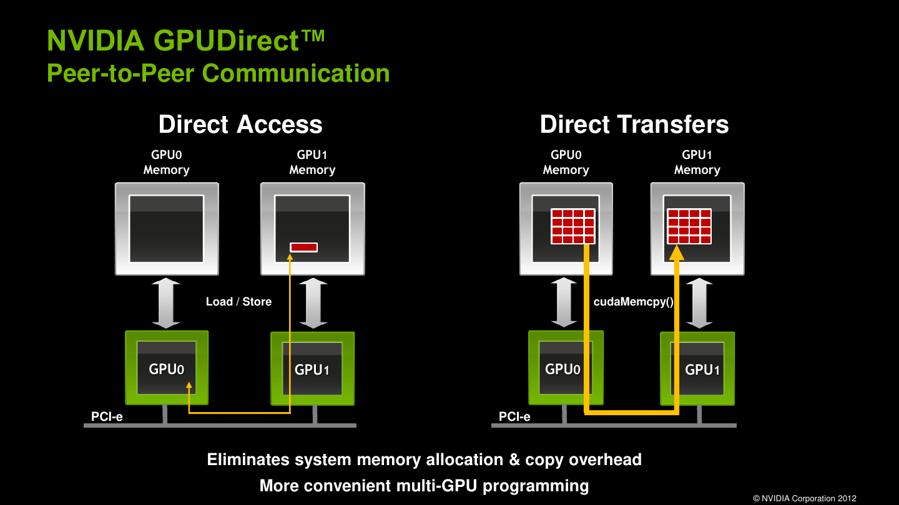

没有 P2P 时，CUDA 会退回 Device-to-Host-to-Device。下图左边标了 Bounce buffer，数据先从设备到主机内存，再从主机内存到另一端。图画的是 GPU 和 NVMe 之间的路径。两张 GPU 没有 P2P 时走同一条路，只是两端都换成 GPU：显存 → 主机内存 → 显存。

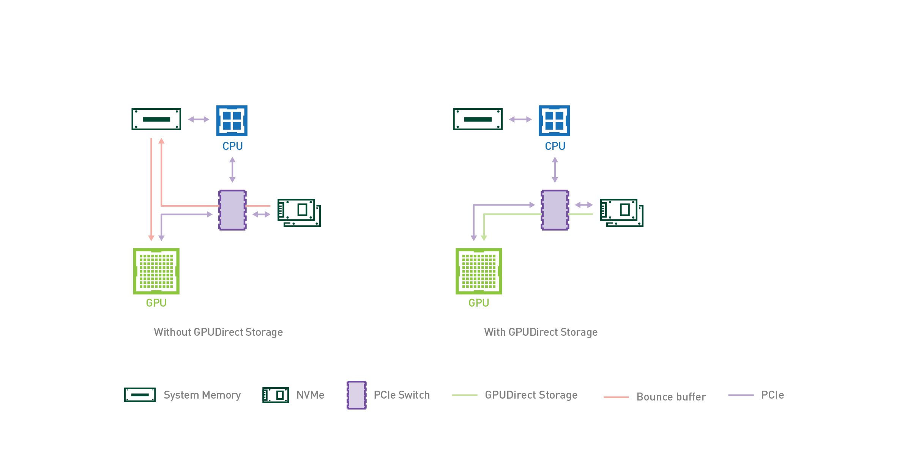

> [!NOTE]
> **One more thing: CXL，一个新的变量**
>
> PCIe 之上，还有一条正在被推上台的互联，CXL（Compute Express Link）。CXL 复用 PCIe 的物理层，但加了缓存一致性协议，CPU、GPU、内存设备可以在一个统一的内存域里互相读写。它分三种设备类型：Type 1 是没有本地内存的加速器，Type 2 是有本地显存的加速器（GPU 属于这一类），Type 3 是纯内存扩展或内存池设备。
>
> CXL 对 GPU 的影响主要在两端。一端是内存池化，CXL 2.0 引入了交换机和内存池，服务器可以按需从池里分配内存，不再把每台机器绑死在自己那点 DRAM 上。另一端是 P2P，CXL 3.0 开始支持设备之间的直连和硬件级的缓存一致性，多个 host 可以共享同一块内存域，CXL 3.0 白皮书里明确提到它面向的负载包括 AI 和 HPC 里的多机协同。
>
> 现在的 GPU 显存（HBM）带宽在 1 TB/s 到 8 TB/s 量级，CXL 的带宽（PCIe 6.0 基础上约 100 GB/s 每 x16）离显存还差一个量级，所以它短期内不会替代 NVLink 去做 TP 的核心通道，更多是补内存容量和做资源池化。但它是目前唯一有希望把"CPU 加多 GPU"的异构系统变成真正统一内存模型的开放标准，值得关注。

下图给出 CXL 在 PCIe 物理层上复用的三条协议，以及对应的三种设备。GPU 落在中间那列 Type 2，CXL.io、CXL.cache、CXL.mem 三条都走。

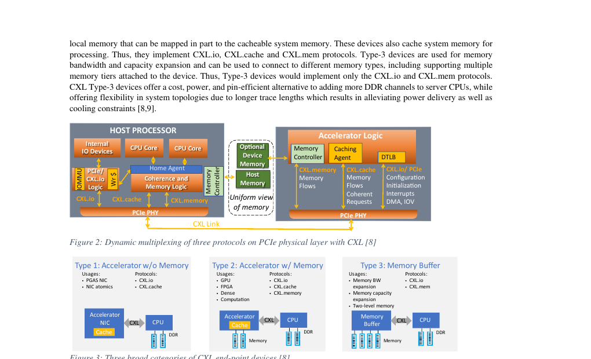

CXL 2.0 开始可以用交换机把内存和加速器做成池，按需分给不同主机。左边是整块设备分给一台主机，中间引入 Fabric Manager 之后，一块物理设备可以切成多段逻辑设备。

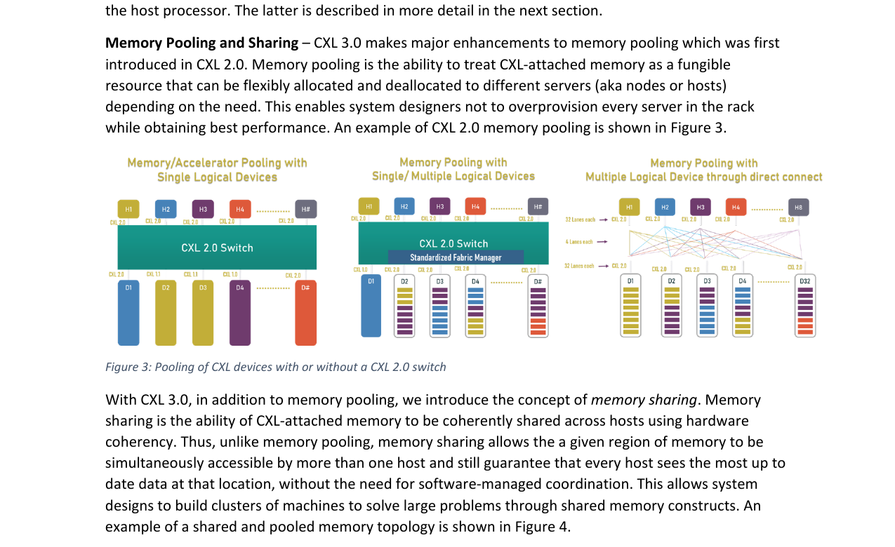

CXL 3.0 进一步允许同一段内存被多个主机同时映射。下图里 D4 上的 S1 同时出现在 H1、H3、H# 里，靠硬件一致性维护副本，这就是白皮书里说的 memory sharing。

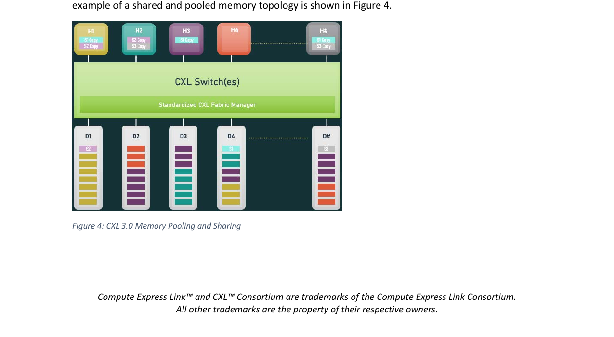

### 1.4 速度差距的直觉

把六档放在一起看量级：

| 互联方式 | 双向有效带宽 | 相对 H100 NVLink |
|---------|-------------|-----------------|
| NVLink 4.0 + NVSwitch（H100） | 900 GB/s | 1× |
| NVLink 3.0 + NVSwitch（A100） | 600 GB/s | 0.67× |
| AMD xGMI（MI300X） | ~1.07 TB/s | 1.2× |
| PCIe 5.0 x16 同 switch | ~100 GB/s | 0.11× |
| PCIe 4.0 x16 同 switch | ~50 GB/s | 0.06× |
| PCIe 4.0 跨 NUMA | ~30 GB/s | 0.03× |
| 无 P2P（主机内存中转） | ~15 GB/s | 0.02× |

其中有无nvlink是能否真正做 TP 并行的关键：
- **NVLink 与 PCIe 之间差一个数量级。** 这是质的区别。有 NVLink 的机器上 TP 是可行的；纯 PCIe 的机器上 TP 的通信开销很容易吃掉并行收益。
- **PCIe 内部各层级之间差 2–3×。** 这是量的区别。同 switch 和跨 NUMA 的差距不算致命，但足以影响 PP 的 bubble 比例和 DP 的梯度同步效率。

## 2. 单机状态的完整分类

把三个维度组合起来，一台单机大致有以下状态。

| 状态 | 卡数 | 异构 | 互联 | 例子 | TP 效果 |
| --- | --- | --- | --- | --- | --- |
| 单卡机 | 1 | 无 | 无 | 个人工作站 | 无 TP |
| NVLink 多卡 | 4~8 | 同构 | NVLink | H200 | 最佳 |
| PCIe 同构多卡 | 2~8 | 同构 | PCIe | 8x3090 训练机 | 好或一般 |
| PCIe 异构多卡 | 2~8 | 异构 | PCIe | A100+3090 | 差 |
| 跨 NUMA 多卡 | 2~8 | 任意 | PCIe+UPI | 双路 CPU 服务器 | 差 |

单机状态还可以按机箱形态继续分。普通塔式工作站通常 1 到 2 卡。4U 机架式服务器能放 4 到 8 张卡，走 PCIe。HGX 基板是 NVIDIA 的 8 卡高密度形态，卡直接连 NVSwitch，走 NVLink。云端 GPU 实例则是虚拟化后的形态，通常看不到底层拓扑。

分类只是纸面判断。真正的通信测试流程见 [02-服务器通信测量.md](02-服务器通信测量.md)。
