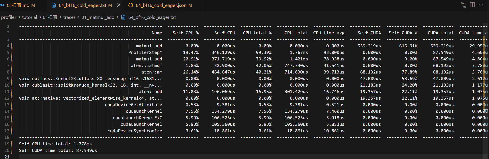
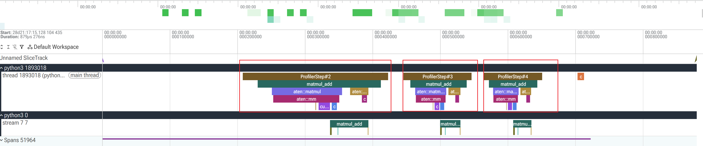
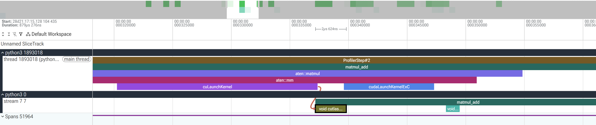
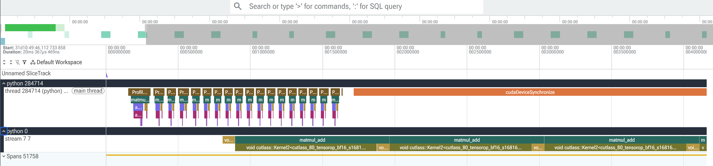

# PyTorch 性能剖析入门指南
> [!NOTE] 无法进行性能剖析(profiling)，就无法进行性能优化。 
> [参考资料](https://huggingface.co/blog/zh/torch-profiler)

在推理框架中，由于其复杂的调度和执行条件，常常无法判断出来性能瓶颈究竟处于哪一侧，因此需要清晰合理的性能剖析方案。
但性能分析的难点在于其工具使用门槛较高，以及现成资料较少。

本节主要讲解Profiler的几种使用方法。

这也是vLLM性能优化系列的开篇文章，本系列会循序渐进地介绍如何详细阅读性能轨迹，并且把这些观察用于指导性能优化。

在阅读本文的时候，需要的背景知识如下：
- 掌握基础的PyTorch入门知识
- 掌握基础的深度学习网络模型
- 掌握基础的底层算子实现方案

整个教程计划如下：
- 初步了解nsight system、nsight compute、torch.profiler以及自定义profiler之间的使用场景。
- 从最简单的算子开始，逐步扩展到单个模型，最终到一个完整的Qwen3模型，探究其可以优化的点。
- 结合自定义的vLLM库，在推理框架中逐步优化，运用上述所学的全部知识。

## 1. 工具定位速览
面对 vLLM 这类复杂的大模型推理引擎，工具选择核心在于**关注的问题在哪个层级**。

整个表格如下：
| 工具 | 分析层级 | 回答的问题 | 典型输出 |
|------|----------|------------|----------|
| **`torch.profiler`** | 框架/算子层 | PyTorch 里哪个算子最慢？`torch.compile` 融合了多少算子？CPU 下发和 GPU 执行有没有流水？”| 算子耗时表、CPU/GPU 时间线、调用栈、形状记录、内存快照 |
| **`nsys`** | 系统层 | CPU 线程在干什么？CUDA 流如何并发？内核间有没有空闲间隔？内存拷贝和 kernel 执行如何重叠？| 全系统时间线（含 CUDA API、kernel、内存拷贝、线程状态、NVTX 标签） |
| **`ncu`** | 内核层 | 这个 kernel 的 SM 占用率多高？用了多少共享内存？全局内存访问是否合并？计算吞吐够不够？”| 单个 kernel 的微架构指标（IPC、带宽、寄存器/共享内存使用、warp 占用） |
| **自定义 profiler** | 业务/组件层 | prefill 阶段实际花了多少时间？调度器开销多大？每个请求的首 token 延迟分布如何？ | 自定义标签的耗时分布、请求级延迟、调度等待直方图 |

在vLLM推理框架中，性能剖析遵循从宏观到微观的流程。先使用 nsys 或 torch.profiler 定位大粒度的性能瓶颈，再使用 ncu 深入分析核心 Kernel。在 CUDA Graph 等场景下 torch.profiler 无法捕获算子事件，需要自定义 profiler 补充监控。

## 2. torch.profiler 初步使用

### 2.1 CPU 调度与 GPU 执行
通常来说，执行一个和深度学习有关的算子或者模型时，主要由两个模块顺序或者交替执行：
1. CPU负责调度并启动各类GPU内核（做预备工作）
2. GPU负责正式计算（启动Kernel）

这一节教学中，无需手动编写GPU内核。在调用PyTorch算子时，PyTorch框架会自动把张量运算转换为一个或者多个GPU内核，并在显卡上完成计算。

### 2.2 手算示例：matmul + add
矩阵乘法是深度学习的基石，用它来作为性能剖析之旅的起点是非常合适的。

```py
def add(x, w, b):
   return torch.add(torch.matmul(x, w), b)
```
一个简单的例子如下，假设我们有一个样本，输入特征为 2 维，输出也为 2 维。
$$
\mathbf{x} = \begin{bmatrix} 1 & 2 \end{bmatrix},
\mathbf{w} = \begin{bmatrix}
3 & 4 \\
5 & 6
\end{bmatrix},
\mathbf{b} = \begin{bmatrix} 0.1 & 0.2 \end{bmatrix}
$$

上述torch代码第一步先实现w和x进行矩阵运算：
$$
\mathbf{z} = \mathbf{x}\mathbf{w} = \begin{bmatrix} 1 & 2 \end{bmatrix}
\begin{bmatrix} 3 & 4 \\ 5 & 6 \end{bmatrix} =  \begin{bmatrix} 13 & 16 \end{bmatrix}
$$

其次加偏置 $\mathbf{z} + \mathbf{b}$：
$$
\mathbf{y} = \mathbf{z} + \mathbf{b} = \begin{bmatrix} 13 & 16 \end{bmatrix} + \begin{bmatrix} 0.1 & 0.2 \end{bmatrix} = \begin{bmatrix} 13.1 & 16.2 \end{bmatrix}
$$

最终输出为：
$$
\boxed{\mathbf{y} = \begin{bmatrix} 13.1 & 16.2 \end{bmatrix}}
$$

### 2.3 打标签：record_function
接下来我们就要对`fn`进行性能分析，在PyTorch中，它的使用方式为：`torch.profiler.xxxx`。

首先是如何标注算法：
```py
def step():
    with torch.profiler.record_function("matmul_add"):
        return fn(x, w, b)
```

它的核心作用是在性能剖析的时间线中打上自定义标签（重命名）。直接通过标签名找到感兴趣的代码段，而不必逐层展开算子堆栈。并且它支持多层嵌套，也几乎不影响性能。（但是会导致代码膨胀）

同时它也可以传递额外的信息：
```py
with torch.profiler.record_function(f"matmul_add_{x.shape}"):
   return fn(x, w, b)
```
这样`matmul_add_(64, 64)`这种标签就会直接出现在时间线上，不需要额外查找日志就知道当前X的形状。

### 2.4 配置剖析器：activities 与 schedule

其次是`torch.profiler.profile`的配置参数。`torch.profiler.profile(...)`创建一个剖析器对象，下边是它的正常用法。

正常的使用方法如下：
```py
  with torch.profiler.profile(
    activities=[
        torch.profiler.ProfilerActivity.CPU,  # the cpu activities
        torch.profiler.ProfilerActivity.CUDA, # the gpu activities
    ],
  ) as prof:
    for _ in range(5):
      step()
      prof.step()
```

`activities`参数决定了剖析器收集哪些设备上的事件，它是一个列表，具有以下枚举值：
```
ProfilerActivity.CPU: 记录 CPU 侧的活动，包括 Python 函数调用、PyTorch 算子下发、内存分配等(必须开启)
ProfilerActivity.CUDA：记录 GPU 侧的活动，包括 CUDA kernel 的启动和执行、显存拷贝等，使用GPU时开启
ProfilerActivity.XPU：类似 CUDA，适用于 Intel GPU（如果 PyTorch 已编译 XPU 支持）
```

`with ... as prof`意思是把这个剖析器对象赋值给变量`prof`，在with代码块内部，可以通过prof来调用剖析器的方法，例如`prof.step()`等。当 with 块结束时，剖析器会自动执行清理工作。

而`prof.step()`是剖析器对象的一个方法，它就是告知当前步骤结束了。

`schedule`是`torch.profiler.schedule`函数返回的一个对象，它定义了一组规则，告诉剖析器在哪些步骤记录数据，哪些步骤被跳过。
```py
schedule = torch.profiler.schedule(
    wait=1,      # 跳过 1 个步骤
    warmup=1,    # 预热 1 个步骤（运行但不记录）
    active=3,    # 正式记录 3 个步骤
    repeat=1     # 整个周期重复 1 次
)
```
假设有这么一个训练循环：
```py
with torch.profiler.profile(
    activities=[...],
    schedule=schedule,
) as prof:
    for step in range(5):
        train_one_batch()
        prof.step()
```
剖析器的行为如下：
|步数|调度器阶段|是否记录|说明|
|---|---|---|---|
|step 0| wait| 否| 跳过，避开模型加载等初始化噪声|
|step 1| warmup| 否|运行但是不记录，让GPU进入稳定频率状态|
|step 2 | active #1|是|第一个正式记录的步骤|
|step 3 | active #2|是|第二个正式记录的步骤|
|step 4 | active #3|是|第三个正式记录的步骤|

如果`repeat=2`，那么step5-7会重复`wait(1) -> warmup(1) -> active(3)`的过程

### 2.5 导出剖析结果

最终导出结果：
```py
# the profiler table
prof.key_averages().table(sort_by="cuda_time_total", row_limit=15)

# the profiler trace
prof.export_chrome_trace(trace_path)

```

完整的代码在[01_matmul_add](./01_matmul_add.py)

## 3. 剖析结果解读

### 3.1 分析 64×64 的性能开销
使用以下命令来运行当前脚本：
```bash
uv run 01_matmul_add.py --size 64
```
运行上述脚本后，会生成`traces/01_matmul_add`文件夹，里边包含两类分析结果：
```bash
*.json
*.txt
```
txt文件存放性能剖析汇总表，打开文件后可以看到一张大的表格。


这张表格是`prof.key_averages().table()`生成的聚合统计结果。它主要是把所有的同名算子，按照次数累加后取平均，查看每个算子的开销。
整个表头的含义如下：
| 列名 | 含义 |
|------|------|
| `Name` | 算子或事件名。`aten::`开头是PyTorch框架算子，`void cutlass::`、`void cublasLt::`开头是真实运行的CUDA kernel，`matmul_add`是`record_function`打的自定义标签，`ProfilerStep`是`prof.step()`划分的步 |
| `Self CPU %` | 该算子**自己**在CPU上消耗的时间，不含其内部调用的子算子 |
| `CPU total %` | 该算子**连同其内部所有子算子**在CPU上消耗的总时间 |
| `CPU time avg` | CPU total除以调用次数，即单次调用的平均CPU时间 |
| `Self CUDA` | 该算子**自己**在GPU上执行的时间。注意只有kernel行（`void xxx::`）才有值，框架算子行通常为0 |
| `CUDA total` | 含子算子的GPU时间 |
| `# of Calls` | 调用次数 |

CPU和CUDA各有一对Self/Total，
**Self = 这个算子自己干活的时间，Total = 自己 + 它调用的所有子算子。**

PyTorch算子是层层嵌套的，`fn`实际调用树如下：

```
matmul_add            ← record_function标签（外层）
└── aten::matmul      ← torch.matmul
    └── aten::mm      ← 底层矩阵乘法算子
        ├── void cutlass::Kernel2<...>       ← 主GEMM kernel
        └── void cublasLt::splitKreduce<...> ← cuBLAS辅助归约kernel
└── aten::add         ← torch.add
    └── vectorized_elementwise_kernel        ← 逐元素加法kernel
```

以`aten::matmul`为例：

- **Self CPU** = 32.9us，只算`matmul`自身做张量检查、分发的工作。
- **CPU total** = 747.7us，等于Self CPU加上`aten::mm`、两个cutlass kernel的启动时间。

一般来说我们可以先看最后两行汇总：
```
Self CPU time total: 1.778ms
Self CUDA time total: 87.549us
```

这是整个剖析期间CPU和GPU各自的总耗时。CPU 1.778ms对GPU 87.5us，CPU是GPU的20倍。
可以看出GPU大部分时间都处于空闲状态，这主要是因为小规模矩阵乘法在GPU上运算极快，程序绝大部分开销都消耗在内核准备、GPU任务启动、发送数据和收集结果等环节。这类受调度开销制约的算法通常称为*开销受限型算法*。

之后可以进一步看一下Pytorch的算子开销：
```
aten::mm    Self CUDA 68.2us   CUDA avg 3.79us
aten::add   Self CUDA 19.4us   CUDA avg 1.08us
```

这两个算子是真正干活的。GPU侧真正执行的只有3个kernel：GEMM主kernel 2.61us、splitK归约kernel 1.18us、加法kernel 1.08us。加起来4.87us，正好等于`matmul_add`的CUDA avg。

```
aten::mm   CPU avg 39.7us   CUDA avg 3.79us
```

CPU平均耗时是GPU执行的10倍。差值就是调度开销，CPU把"启动kernel"的准备工作花掉的时间，比kernel在GPU上真正运行的时间还长。

```
cuLaunchKernel       Self CPU 134.3us    avg 7.46us
cudaLaunchKernelExC  Self CPU 106.5us    avg 5.92us
cudaLaunchKernel     Self CPU 105.4us    avg 5.85us
```

这三个是CUDA驱动层的kernel启动API。它们没有任何CUDA时间（GPU时间都记在kernel行上了），但CPU时间很可观。单次启动约7us，而GEMM kernel在GPU上只跑2.6us。

### 3.2. 查看64×64的性能轨迹

txt 表格看到的是聚合统计，json 才是原始的时间线。把JSON文件拖进 [Perfetto](https://ui.perfetto.dev/),可以看到每个算子在时间轴上的真实排布。


一条 GPU 流上能看到三个 kernel 依次执行：

```
cutlass::Kernel2<...>     ← GEMM 主 kernel, 约 2.6us
cublasLt::splitKreduce<...> ← cuBLAS 辅助归约, 约 1.2us
vectorized_elementwise_kernel ← 加法 kernel, 约 1.1us
```

而 CPU 轨道上每个 kernel 前面都有一小段启动开销（cuLaunchKernel），并且相邻 kernel 之间有空闲间隙。放大任意一个 kernel，可以看到它的 `start time` 远晚于 CPU 提交时刻。

> 使用Tensorboard同样可以实现快速查看，具体使用方式请自行搜索。
> 使用 Perfetto 工具时，推荐使用wasd来控制视图缩放。

这些视图包含两条时序泳道，分别对应CPU和GPU的行为。
可以看到`ProfileStep#2`的时序大于后续轮次。这是因为首次执行时GPU尚未进入稳态：预热结束后的同步会让GPU时钟从高频回落，而第一个正式记录的步骤恰好处于时钟爬升阶段，因此耗时偏高；随着后续步骤连续满载，频率逐步稳定，耗时下降并趋于平稳。

### 3.3 查看4096×4096的轨迹

先跑出 4096 的 profile，跑20轮看看效果：

```bash
uv run 01_matmul_add.py --size 4096
```

txt 里看最后两行汇总：

```
Self CPU time total: 19.728ms
Self CUDA time total: 19.333ms
```
64 是 CPU 20 倍于 GPU，4096 却 CPU 和 GPU 几乎持平。细看之后会发现 CPU 总耗时是被一行假象撑起来的，先看真正的算子开销：

```
aten::mm   Self CUDA 17.697ms   CUDA avg 983us
aten::add  Self CUDA 1.549ms    CUDA avg 86us
```

GPU 上实际只跑了 2 个 kernel：GEMM 主 kernel 单次 983us、加法 kernel 单次 86us。matmul_add 的 CUDA avg 1.070ms 恰好是两者之和。GPU 计算量从 64×64 的 4.87us 膨胀到 1.07ms，增长约 220 倍。

再看 CPU 侧：

```
aten::mm   CPU avg 25.5us   CUDA avg 983us
cuLaunchKernel  avg 6.02us
```

CPU 调度开销几乎没有变化。launch 依然约 6us 一次，mm 的 CPU avg 甚至比 64×64 还低。但 GPU 执行时间从 4us 涨到 983us，CPU 的几十微秒调度完全被 GPU 掩盖。


把 json 拖进 Perfetto 看轨迹，还能发现两个更细的区别：


**1. kernel 数量从 3 个变成 2 个。** 64×64 的 GEMM 拆成了主 kernel + splitK 归约 kernel（因为并行度不够，需要 split-K 把归约分片），4096 只用一个 GEMM kernel 就能填满所有 SM，splitKreduce 消失了。Add 依然是独立 kernel。

**2. 末尾出现一条超长的 `cudaDeviceSynchronize`。** 它的 Self CPU 高达 18.452ms，占 CPU 总耗时的 93.53%：


这是 profiler 结束时 CPU 阻塞等待 GPU 把队列里积压的 kernel 全部执行完。GPU 排了 20 个约 1ms 的 kernel，CPU 早就下发完了，只能干等。对照之下，64×64 的 profile 里这条同步只有 10.9us，因为 GPU 队列瞬间就空了。

总结 64 与 4096 的 eager 差异：

- **GPU 耗时增长约 220 倍**
- **CPU 调度耗时几乎不变**
- **瓶颈反转**：64×64 是*开销受限*，4096² 是*计算受限*；
- **splitK 辅助 kernel 消失**，GPU 流上从 3 个 kernel 变成 2 个；
- **cudaDeviceSynchronize 假象**：4096 的 CPU 总耗时被收尾同步撑大，不代表 CPU 负载高。

理解了这个反转，第 4 章优化方向的选择就顺理成章了。

## 4. 优化上述算法
### 4.1 三种优化方向

先回顾 eager 的执行过程：一个 `matmul + add` 在 CPU 上发起 3 次 kernel 启动，GPU 依次执行 3 个 kernel。
- eager：CPU-》launch-》Kernel1 -》launch -》Kernel2 -》launch -》Kernel3
可以发现每次launch都会有GPU开销，每个Kernel都会有GPU空闲间隙。

因此根据上述分析，优化主要有两条路：**CPU 侧**（让下发更快）和 **GPU 侧**（让计算更快）。

**CPU 侧又分两个层次**
1. **减少启动次数，即算子融合**。把 3 个 kernel 合并成 1 个，CPU 只启动 1 次，同时 kernel 之间不再有调度间隙。
- 融合后：CPU -》launch 融合后的大Kernel （启动次数从3变成1）

对应 `torch.compile` 的算子融合。

2. **消除启动动作，即CUDA Graph**。把一组 kernel 的执行序列预先"捕获"成一张图，运行时 CPU 不再逐个启动 kernel，只调用一次 `cudaGraphLaunch` 提交整张图，GPU 按图中的依赖关系自动执行。启动的工作在捕获阶段一次性做完了，运行时 CPU 只是交出一张图的引用。


**GPU 侧：**

3. **提升 GPU 计算性能**。让单个 kernel 本身在 GPU 上跑得更快，包括 `max-autotune` 的自动调优、手写更优的 kernel、用 ncu 分析访存和占用率后针对性优化。


### 4.2 compile 的五种模式
`torch.compile(fn, mode=...)` 的 `mode` 参数决定了编译策略，五种模式如下：

| 模式 | 内核生成 | 是否套 CUDA Graph | 说明 |
|------|---------|------------------|------|
| `none` | 无（eager） | 否 | 不使用编译，作为基线 |
| `default` | Inductor | 否 | 默认策略，只做算子融合，不开图 |
| `reduce-overhead` | Inductor | 是 | 在 default 基础上套 CUDA Graph，降低启动开销 |
| `max-autotune` | Inductor 自动调优 | 是 | 遍历多种 tile 尺寸选最优 kernel，同样套图 |
| `max-autotune-no-cudagraphs` | Inductor 自动调优 | 否 | 只做 kernel 自动调优，不套图 |

一个容易忽略的细节：套了 CUDA Graph 的模式，输入输出都要**先拷到固定的静态 buffer** 再执行（因为图里记录的指针地址必须保持不变），之后还要把结果拷回来。这两个拷贝在编译产物里体现为 `aten::fill_`、`aten::_foreach_copy_` 和 `Memcpy DtoD` 内核。它们就是 `reduce-overhead` 在 01_matmul_add.py 的 trace 中出现的额外行，也是后续反直觉现象的来源。

用 01_matmul_add.py 可以分别剖析这些模式：

```bash
uv run 01_matmul_add.py --size 64 --mode reduce-overhead
uv run 01_matmul_add.py --size 64 --mode max-autotune-no-cudagraphs
```

但 trace 表只反映单次 profile 的耗时分布。要看稳态性能，用 `01_bench_modes.py` 每种模式各跑 100 次取中位数更可靠：

```bash
uv run 01_bench_modes.py --size 64
uv run 01_bench_modes.py --size 4096
```

### 4.3 实测64与4096的编译差异
```
矩阵 64x64  ×  100 次测量   (中位/平均/p95 均为微秒)
mode                              编译耗时     中位(us)     平均(us)    p95(us)    相对none
------------------------------------------------------------------------------------
none                             0.00s      30.0       30.2       32.3     1.00x
default                          0.82s     136.7      138.4      151.4     4.55x
reduce-overhead                  0.11s     150.5      152.6      162.3     5.01x
max-autotune                     0.06s     148.2      150.0      158.6     4.94x
max-autotune-no-cudagraphs       0.06s      83.1       83.8       90.2     2.77x
```
结论很明确：**64×64 下，所有编译模式都比 eager 慢**。其中 `max-autotune-no-cudagraphs` 最接近 eager，其余三种模式都明显变慢。

因为小矩阵本来就是开销受限的类型，eager的核心瓶颈是CPU下发。
而编译只优化了GPU的kernel启动，但是却在CPU引入了新的开销。

1. **每次调用的 Python 包装层**（`TorchDynamo Cache Lookup`、`Pregraph bytecode`、`AOTDispatcher` 等）。这是所有编译模式都躲不掉的成本，主要来自 Dynamo 每次对输入做形状/属性检查、查编译缓存。
2. **套图模式的静态 buffer 输入拷贝**（`fill_` + `_foreach_copy_`）。只有 `reduce-overhead` 和 `max-autotune` 有，对 CPU 是两笔额外的 kernel 下发。
3. **CUDA Graph 的管理和启动开销**（`cudaGraphLaunch` 单次约 9us）。同样只有套图的两个模式有。
这三笔开销加在一起，远超融合省下的 GPU 时间，于是编译反而更慢。

4096×4096 的结果则完全相反：
```
矩阵 4096x4096  ×  100 次测量   (中位/平均/p95 均为微秒)
mode                              编译耗时     中位(us)     平均(us)    p95(us)    相对none
------------------------------------------------------------------------------------
none                             0.02s    1036.4     1042.3     1057.6     0.98x
default                          1.10s    1051.0     1053.8     1061.9     1.00x
reduce-overhead                  0.15s    1142.0     1138.9     1156.8     1.08x
max-autotune                     0.30s    1115.7     1116.7     1124.4     1.06x
max-autotune-no-cudagraphs       0.08s     936.9      937.5      941.6     0.89x
```

1. **`max-autotune-no-cudagraphs` 反超 eager**。大矩阵是计算受限型，Inductor 自动调优出来的 Triton 融合 kernel 比 cuBLAS 默认的 cutlass kernel 更快。
2. **`reduce-overhead` 反而是最慢的**。4096 的输入有 16MB，每步往静态 buffer 拷贝、再从输出拷回，`Memcpy DtoD` 单次就要若干us，两笔拷贝加图启动，把融合省下的 GPU 时间全部吃光。


## 5. 手动优化
从上述分析可以看出，`torch.compile` 不是万能的。它解决的是GPU 端 kernel 效率，而 CPU 端的启动成本需要 CUDA Graph 能消除，而且需要主动避开它的静态 buffer 拷贝开销。

### 4.4 手动 CUDA Graph

`mode="reduce-overhead"` 之所以在 64×64 反而变慢，问题出在它把编译和套图耦合在一起，并且自动生成的图管理路径带着不小的固定开销。我们完全可以手动完成这件事。

先用 `max-autotune-no-cudagraphs` 拿到融合 kernel，再手动把它捕获进 CUDA Graph。
```py
cf = torch.compile(fn, mode="max-autotune-no-cudagraphs")

xs, ws, bs = x.clone(), w.clone(), b.clone()   # 图要求输入在固定地址
for _ in range(3):
    cf(xs, ws, bs)                             # 预热, 完成编译
torch.cuda.synchronize()

g = torch.cuda.CUDAGraph()
with torch.cuda.graph(g):
    y = cf(xs, ws, bs)                         # 捕获: kernel 只记录不执行
torch.cuda.synchronize()
g.replay()                                     # 捕获后必须 replay 一次, y 才有值
```

三个要点：

1. **输入必须驻留静态 buffer**。图里记录的是捕获那一刻的指针地址，之后每次 `g.replay()` 都往这些地址读写。
2. **捕获只记录不执行**。捕获阶段 kernel 只是被"录"进图里，并没有真正运行，因此捕获完必须 `replay()` 一次，否则输出张量是未初始化的。
3. **预热必须在 profiler 之外完成**。编译和捕获都是准备工作，会污染 profile 数据。

三种方案在 profiler 下的单步耗时对比：

| 方案 | 64×64 CPU | 64×64 GPU | 4096² CPU | 4096² GPU |
|------|----------|----------|-----------|----------|
| eager | 75.3us | 5.63us | 66.1us | 1.034ms |
| compile（无图） | 184.6us | 1.44us | 209.3us | 0.890ms |
| compile + 手动 Graph | **23.2us** | 1.43us | **15.8us** | 0.958ms |

### 4.5 CUDA Graph遇到 Profiler失效

先说结论：**CUDA Graph 不会让 profiler 崩溃，但确实会让 profile 数据"部分失效"**——失效的不是 profiler 本身，而是它赖以分析的两种信息：捕获阶段的 GPU 时间、replay 阶段的 CPU 算子下发。理解失效的前提是记住 CUDA Graph 的两个执行特征：

1. **捕获时 kernel 只"记录"不执行**。`with torch.cuda.graph(g):` 里调用的算子并没有真正在 GPU 上跑，只是被登记进图里。此时 profiler 即使开着，也采集不到任何真实的 GPU 执行事件。
2. **replay 时 CPU 只发一次 `cudaGraphLaunch`**。`g.replay()` 内部没有 `aten::matmul`、`aten::mm` 这些算子调用，CPU 只是把整张图提交给 GPU。profiler 能看到的 CPU 事件只剩图启动本身。

由此可以推导出 CG 与 Profiler 的三种组合，以及各自的数据情况：

#### 场景 1：捕获在 profiler 外，profiler 只包 replay（推荐用法）

```py
with torch.cuda.graph(g):          # 捕获在 profiler 外完成
    y = cf(xs, ws, bs)
torch.cuda.synchronize()

with torch.profiler.profile(activities=[CPU, CUDA]) as prof:
    for _ in range(5):
        g.replay()                 # 真实执行, GPU 时间可采集
        prof.step()
```

**能正常捕获，且数据可信。** GPU kernel 每执行一次都会被 CUPTI 记录时间戳。实测中，`replay()` 的融合 kernel 单次 GPU 耗时 1.43us，与未套图时完全一致。唯一的"损失"是 CPU 侧看不到算子细节——只剩一条 `cudaGraphLaunch`，这是 CG 的本意，不是失效。

#### 场景 2：profiler 包住捕获阶段（常见误用）

```py
with torch.profiler.profile(activities=[CPU, CUDA]) as prof:
    with torch.cuda.graph(g):
        y = cf(xs, ws, bs)         # 捕获时 kernel 只记录不执行
    g.replay()
```

**不报错，但数据是脏的。** 捕获阶段 kernel 没真正执行，profiler 只能记到那一次"登记"（实测 GPU 时间 1.47us，是假的），还会把 `cudaStreamBeginCapture`、`cudaThreadExchangeStreamCaptureMode` 等图捕获 API 混进统计。如果拿这张表分析算子耗时，会得到完全错误的比例。

#### 场景 3：profiler 处于 active 时执行捕获（最危险）

```py
with torch.profiler.profile(activities=[CPU, CUDA], schedule=...) as prof:
    with torch.cuda.graph(g3):
        cf(xs, ws, bs)             # profiler 正在记录时捕获
    g3.replay()
    prof.step()
```

**kernel 事件全部丢失。** 实测中整张输出表的 CUDA 列完全为空，只剩 `ProfilerStep` 和同步调用。原因是捕获与 profiler 的记录循环同时进行，CUPTI 与图捕获机制互相干扰，采样到的 kernel 事件无法关联到任何 step。

#### 三种场景对比

| 场景 | 是否报错 | GPU 时间 | CPU 算子细节 | 数据可用性 |
|------|---------|---------|-------------|-----------|
| 1. profiler 只包 replay | 否 | 准确 | 只剩图启动 | 可用 |
| 2. profiler 包捕获 | 否 | 失真（记录非执行） | 混入捕获 API | 不可用 |
| 3. active 时捕获 | 否 | 丢失 | 丢失 | 不可用 |

#### 规避方法

1. **把捕获隔离在 profiler 之外**——对应场景 1，是最稳的做法。`03_matmul_add_graph.py` 正是这样写的：预热和捕获都放在 `with torch.profiler.profile` 之前。
2. **需要查看图内部 kernel 时**——用 `nsys` 而非 `torch.profiler`。`nsys` 通过 CUDA 驱动层的 API 拦截（与 CUPTI 后端机制不同），能完整看到 replay 时图内每个 kernel 的 GPU 时间线。
3. **replay 的 CPU 开销**——profiler 只能看到 `cudaGraphLaunch` 一条，想量化图启动本身的成本，配合自定义打点（见工具定位速览里"自定义 profiler 补充监控"）更直接。

一句话总结：**CG 让 profiler 失效，只发生在捕获阶段（场景 2、3），本质是"捕获时没有真实执行"这一事实被 profile 误解了；正确的用法是让 profiler 只覆盖 replay，此时 GPU 侧数据依然可靠，CPU 侧只剩图启动**。

