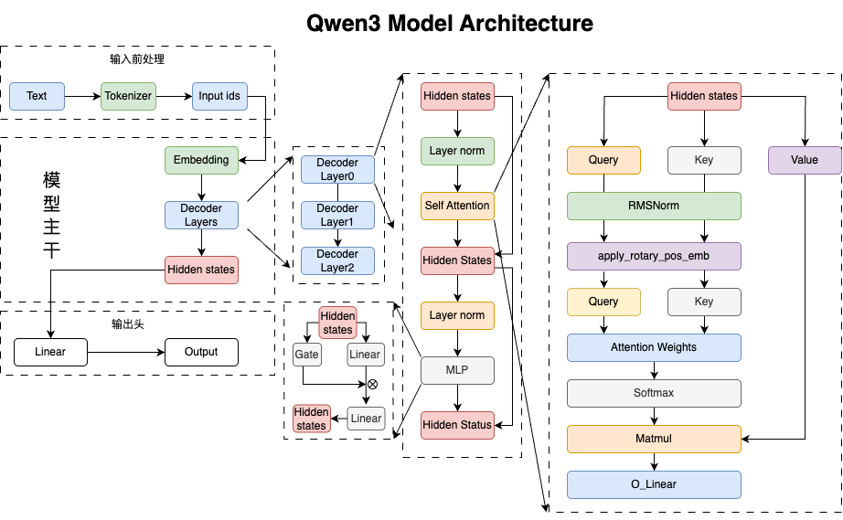

# 模型组装

作为推理最核心的一个模块就是选择大模型进行推理，而对于大模型各个模块的复现则同样是重中之重，因为有了大模型，我们才可以执行后续的优化操作。

因此在写推理框架的第一步就是把模型搭建起来。
本项目我们选择`Qwen3`系列模型，之所以选择它，一方面还是因为开源，方便。另一方面则是`Qwen3`基本涵盖了当前市面上绝大部分主流大模型的常见设计：

- Decoder-only 结构
- 归一化策略 RMSNorm
- 位置编码 RoPE
- 注意力机制 GQA
- Q/K 归一化
- FFN与SwiGLU
- ...



并且Qwen3提供了各种规格不同的模型，方便具有不同硬件性能的用户去选择组装，无论是0.6B、1.5B、7B，它们都共享GQA、SwiGLU、RoPE、Attention、RMSNorm等核心机制，因此从代码的角度来说，它们基本是完全一致的。

但是在`Qwen3Config`的超参数配置上，它们有一些区别：

| 维度 | 0.6B (端侧) | 7B/14B (边缘) | 72B (云端) | 架构影响分析 |
| :--- | :--- | :--- | :--- | :--- |
| **层数** | 约 24 层 | 约 32 - 40 层 | 80 层以上 | 层数决定了模型的逻辑推理深度和“世界观”的复杂度。 |
| **隐藏维度** | 1024 或 1536 | 4096 / 5120 | 8192 以上 | 维度决定了模型**知识容量的宽度**。 |
| **注意力头数** | 16 或 24 | 32 / 40 | 64 以上 | 头数越多，模型能同时关注的**特征子空间**就越丰富。 |
| **GQA 分组比例** | 可能更激进 (如 8个Q共享1个KV) | 标准 (如 4个Q共享1个KV) | 接近 MHA | **小模型为了省显存，会进一步压榨 KV Cache**，牺牲极微小的精度换取端侧的流畅度。 |
| **Head Dim (单头维度)** | 可能非标准 (如 64 或 96) | 标准 (128) | 标准 (128) | 代码中 `head_dim=getattr(config, "head_dim", None)` 就是为了兼容小模型的特殊设计。 |

很多同学会问：“既然 72B 最聪明，为什么还要费力去训 0.6B 和 1.5B 的小模型？” 
实际上是多种因素叠加的结果。

1. **云边端协同**。0.6B的小模型量化后通常占用不到1G内存，可以在手机上快速部署。7B则在单张显卡上，或者本地mac上就可以成功部署，这是本地开发者比较友好的尺寸；而72B+甚至更大的模型，则通常部署在云端，提供更加复杂的推理逻辑。
2. **风洞**。训练一个 72B 的模型需要数千万美元的算力，且周期长达数月。如果直接在大模型上测试新的架构、例如引入一些新的特性，试错成本极高。而小模型则可以快速验证 Loss 曲线更优、收敛更快的技术，才会被最终迁移到更大的旗舰模型上。
3. **全家桶战略**。实际上，现在开源模型中，Qwen几乎可以说是一家独大，生态位明显比单个模型智力更加重要。如果开源不同大小的模型，则开发者只需要学一种架构，就能够在云边端高效切换，并且72B生成出来的数据去蒸馏小模型，也会在特定的领域更加高效。


## 1. 四层嵌套骨架

整个文件有四个 `nn.Module`，自底向上嵌套。

```text
Qwen3ForCausalLM
  └─ Qwen3Model
       └─ Qwen3DecoderLayer × N
            ├─ Qwen3Attention
            └─ Qwen3MLP
```

## 2. 打印架构树

首先我们来查看一下Qwen3-0.6B的整个结构。
```text
Qwen3ForCausalLM(
  (model): Qwen3Model(
    (embed_tokens): Embedding(151936, 1024)
    (layers): ModuleList(
      (0-27): 28 x Qwen3DecoderLayer(
        (self_attn): Qwen3Attention(
          (q_proj): Linear(1024, 2048)
          (k_proj): Linear(1024, 1024)
          (v_proj): Linear(1024, 1024)
          (o_proj): Linear(2048, 1024)
          (q_norm): RMSNorm((128,))
          (k_norm): RMSNorm((128,))
        )
        (mlp): Qwen3MLP(
          (gate_proj): Linear(1024, 3072)
          (up_proj): Linear(1024, 3072)
          (down_proj): Linear(3072, 1024)
          (act_fn): SiLUActivation()
        )
        (input_layernorm): RMSNorm((1024,))
        (post_attention_layernorm): RMSNorm((1024,))
      )
    )
    (norm): RMSNorm((1024,))
    (rotary_emb): Qwen3RotaryEmbedding()
  )
  (lm_head): Linear(1024, 151936)
)
```

可以很清楚看到它的整个架构，类似于一个三明治结构，但是同样也包含了若干模块。


## 3. Qwen3ForCausalLM

```py
class Qwen3ForCausalLM(nn.Module):
    def forward(self, input_ids, positions):
        return self.model(input_ids, positions)

    def compute_logits(self, hidden_states):
        return self.lm_head(hidden_states)
```


Causal LM 有两个核心模块，`forward`负责前向推理产出 hidden states，`lm_head` 则将输出结果投影到词表大小得到 logits。


> [!NOTE] 为什么这里要分开做而不是合在一起呢？
> 这里主要是为了方便后续做 KVCache或者张量并行时可以独立处理，减少耦合性。


## 4. Qwen3Model

```py
def forward(self, input_ids, positions):
    h, residual = self.embed_tokens(input_ids), None
    for layer in self.layers:
        h, residual = layer(positions, h, residual)
    return self.norm(h, residual)[0]
```

从`Qwen3Model`可以看出Qwen是标准的 Decoder Only 堆叠。
它也有三个主要工作：
1. 通过嵌入层把`token id`映射到隐藏维度
2. 逐层执行前向推理
3. 输出结果归一化


## 5. Qwen3DecoderLayer
进一步来看每一层是什么样子的：

```py
def forward(self, positions, hidden_states, residual):
    if residual is None:
        residual = hidden_states
        hidden_states = self.input_layernorm(hidden_states)
    else:
        hidden_states, residual = self.input_layernorm(hidden_states, residual)
    hidden_states = self.self_attn(positions, hidden_states)
    hidden_states, residual = self.post_attention_layernorm(hidden_states, residual)
    return self.mlp(hidden_states), residual
```

从这里可以看出，Qwen3 使用 PreNorm 结构，即每个子层前先做归一化，再进入 Attention 或 MLP。但是残差并不是在子层末尾显式相加，而是在下一次归一化时一起融合。

> [!TIP] 为什么残差要这么设计呢？
> 实际上这种方式可以减少一次中间张量分配和显存读写

如果分开写，它的逻辑是：
```python
tmp = hidden_states + residual
hidden_states = rmsnorm(tmp)
residual = tmp
```

我们发现这里的tmp就是一个中间张量，后续rmsnorm还要再把tmp读取一遍，而我们的写法是：
```python
hidden_states, residual = fused_add_rmsnorm(hidden_states, residual)
```
融合算子把相加和归一化放在一起，直接输出新的残差和归一化结果，省掉中间张量，也省掉一次显存写入和读取。

## 6. Qwen3Attention

`Qwen3Attention` 则是把 QKV 投影、QK 归一化、RoPE、GQA 和输出投影串成一条路径。

```py
qkv = self.qkv_proj(hidden_states)
q, k, v = qkv.split([self.q_size, self.kv_size, self.kv_size], dim=-1)

q = self.q_norm(q.unflatten(-1, (-1, self.head_dim))).flatten(-2)
k = self.k_norm(k.unflatten(-1, (-1, self.head_dim))).flatten(-2)

q, k = self.rotary_emb(positions, q, k)

q = q.view(..., self.num_heads, self.head_dim)
k = k.view(..., self.num_kv_heads, self.head_dim)
v = v.view(..., self.num_kv_heads, self.head_dim)

out = self.attn(q, k, v)
return self.o_proj(out.flatten(-2))
```


三个内部机制分别展开在算子文档。

| 机制 | 文档 |
|---|---|
| QK-Norm 原理与 fused 接口 | [layers/rmsnorm.md](./layers/rmsnorm.md) |
| RoPE 旋转数学 | [layers/rotary.md](./layers/rotary.md) |
| GQA 广播与 SDPA | [layers/attention.md](./layers/attention.md) |

- **细节1** 三个投影矩阵合成一个 `qkv_proj`，一次 GEMM 同时产出 Q、K、V。
- **细节2** `positions` 从外层一路传进来，不在 Attention 内部生成。v0 每次传完整序列位置 `[0, 1, …, seq_len-1]`，为后续只传增量位置、接 KV Cache 留好接口。
- **细节3** `scaling = head_dim ** -0.5` 在初始化时算好，避免 forward 重复开方。

## 7. Qwen3MLP

```py
class Qwen3MLP(nn.Module):
    def forward(self, x):
        return self.down_proj(
            self.act_fn(torch.cat([self.up_proj(x), self.gate_proj(x)], dim=-1))
        )
```

标准 Transformer FFN 的 SwiGLU 变体。`gate_proj` 与 `up_proj` 各做一次线性，最后一维拼接后送 `SiluAndMul`，等价于 `SiLU(gate) × up`，再经 `down_proj` 压回隐藏维。

<span style="color:#059669">**细节**</span> HF 权重里 `gate_proj` 和 `up_proj` 仍是两个独立矩阵，forward 时才 `cat`。这和 Attention 里 QKV 的权重级合并不同，这里只是计算语义上的拼接，加载逻辑无需特殊处理。

ReLU系列演进及其`SiluAndMul` 实现见 [activation.md](./layers/activation.md)。

## 8. 一个 token 穿过 model.py 的路径

```text
input_ids [1, seq]
    ↓
embed_tokens            →  h [1, seq, 1024]
    ↓
DecoderLayer × 28
    input_norm → Attention(qkv → QK-Norm → RoPE → GQA → o_proj)
    post_norm  → MLP(gate∥up → SiLU× → down)
    ↓
final RMSNorm           →  h [1, seq, 1024]
    ↓
lm_head（引擎侧调用）    →  logits [1, seq, 151936]
```

至此，`model.py` 从空骨架到可 forward 的完整 Qwen3 闭环。权重怎么灌进这个骨架见 [05-weights.md](./05-weights.md)。
