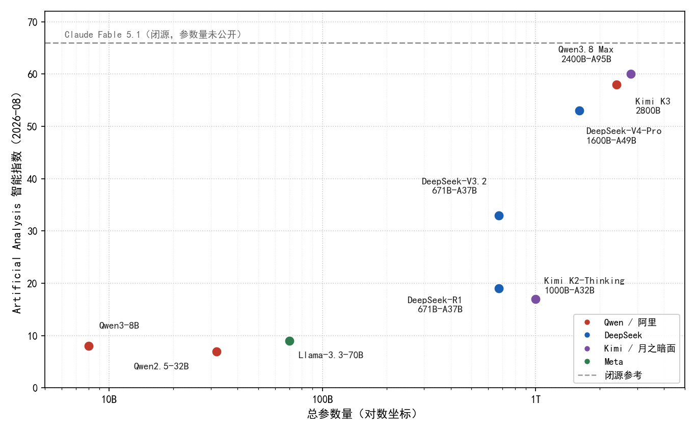
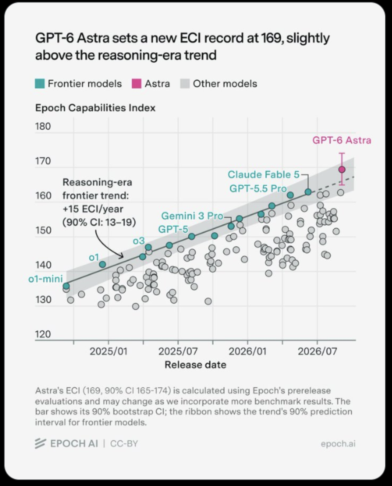
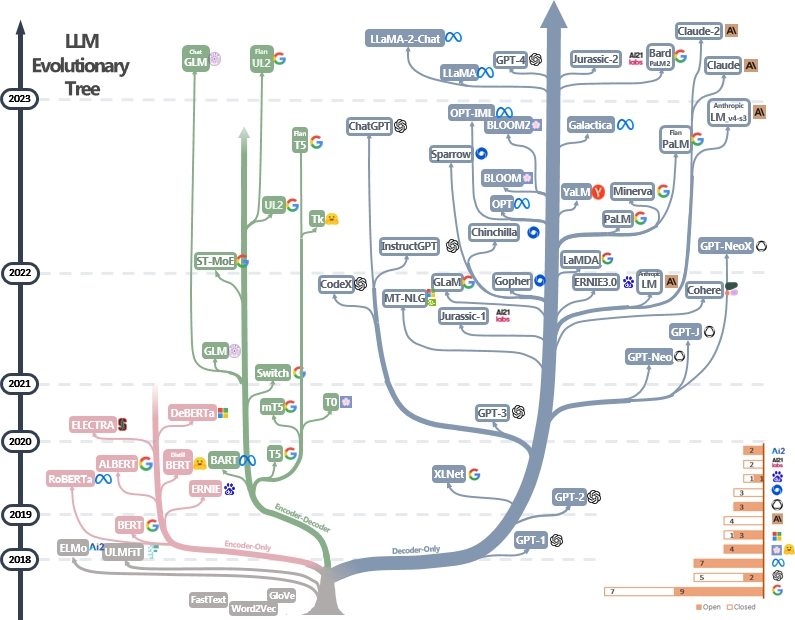
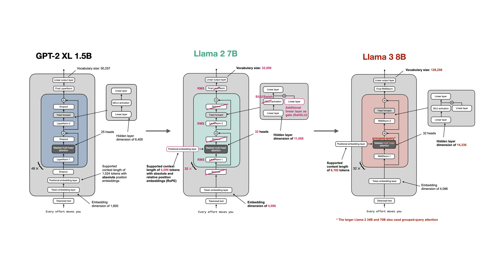
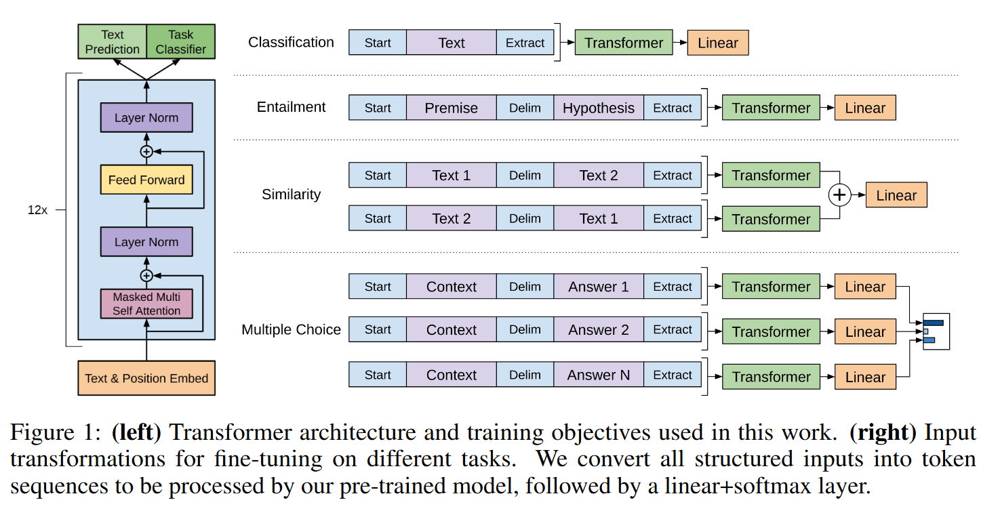
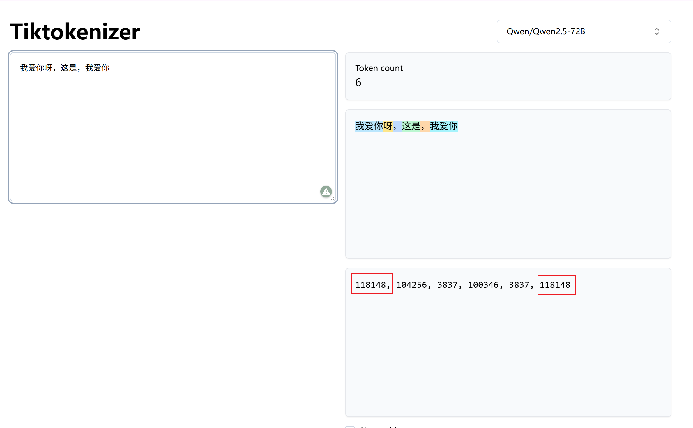

# 究竟什么是大模型？

维基百科将大模型（Large Language Model, LLM）定义为一种基于人工神经网络的深度学习模型。其中，“大”指模型参数量庞大，通常在 B 级以上；通过在海量文本数据上预训练，模型可以理解和生成人类语言。

下边这张图是我整理出来的当前模型智能和参数量的一个关系：

<p align="center"></p>

横轴是总参数量，纵轴是 Artificial Analysis 的智能指数。


> 数据来源：Artificial Analysis Intelligence Index（2026-08 观测值）；参数量取各模型官方发布口径。

上一节我们极其粗略地了解了大模型的整个推理框架，但具体的模型细节对我们来说仍然是黑盒。遗憾的是，人类目前并没有真正弄清**模型为什么会产生智能？这份智能又是从哪里涌现出来的？**

> [!NOTE] 模型智能是否存在清晰的分界线？
> 我们什么时候可以判断一个模型具有智能或不具有智能？**智能**是否具备明显的时刻？

目前大模型的评测基准通常分为这几类：

- **考试型测试**：如 MMLU、GSM8K 等。如果模型得分超过人类基线，我们可以说它具备该领域的专家级智能。
- **通用型测试**：如 ARC 等，测试模型是否具备少样本归纳能力。

站在 2026 年的时间节点，我们仍不能断定模型已经拥有了智能，只能说当前大模型具备了某些能力，仅此而已。


> [!CAUTION] UC Berkeley的马毅教授曾公开指出
> 在多次演讲中，马毅教授强调要区分“**知识**”与“**智能**”。他认为，大模型目前展现出的强大能力，更多是对人类已有知识的高效存储和检索（即数据压缩的结果）；而真正的智能，应当具备在未知环境中建立新因果模型、自我纠错和举一反三的能力。


> [!TIP] One more Thing
> 更巧的是，就在我写这篇文章的时候，OpenAI发布了它们最新的模型——GPT6。而GPT6在复杂工具的处理中展现出了极强的工具通用属性。 发布会上，总裁 Greg Brockman更是直接宣布：**Welcome to the AGI era!** 但这究竟是确有其事，还是为了融资而大肆鼓吹呢？期待各位读者告诉我答案。



 ## 1. 史学家时刻
 上一节，我们梳理了自回归模型的宏观推理框架。
 但是大模型的架构演进并非一蹴而就，而是经历了若干个阶段。

 最明显的就是2017年的Transformer的提出。
 Google最初提出的Transformer架构是专门为了语言翻译设计的，其Encoder-Decoder结构通过自注意力机制把原本RNN的串行修改为了并行训练。

 > [完整的Transformer脉络可以查看我的博客](https://dlog.com.cn/posts/cuda16/attention/)

同年，OpenAI发布了*Improving Language Understanding by Generative Pre-Training(GPT-1)*。该研究摒弃了 Encoder 和交叉注意力机制，仅保留带有因果掩码的 Decoder 堆叠（12层，约1.17亿参数）。通过在 BookCorpus 上进行自回归预训练，并在下游任务微调。GPT-1 在 12 项自然语言理解任务中的 9 项取得了最优性能。尽管当时其影响力不及同期的 BERT，但它成功确立了“生成式预训练 + 下游微调”的 Decoder-only 技术路线。


19年，OpenAI 将模型参数量与训练数据规模扩大十倍(1.5B)，发布了 GPT-2。其核心贡献在于验证了 **Language Models are Unsupervised Multitask Learners**。 首先，GPT-2证明了Zero-shot能力，即只需要将下游任务（机器翻译、阅读理解）等重构为文本续写的格式，模型就可以直接输出合理结果；其次，GPT-2证明了Scaling Law；最牛逼的是，它提出来统一的任务表征框架，把分类、生成、翻译等多种NLP映射到了单一的自回归语言建模中。


20年，参数量跃升至 1750 亿的 GPT-3 进一步证实了 Kaplan 等人提出的缩放定律。**模型损失与参数量、数据量及算力呈近似幂律关系**。更重要的是，规模的扩大催生了上下文学习能力，模型仅需在提示中提供少量示例，即可在权重冻结的情况下完成推理任务。这标志着“**大模型**”概念在学术界的正式确立。

22年，基于GPT-3.5架构，结合人类反馈强化学习，ChatGPT将大模型的能力封装于直观的对话界面中，一举把人类拖入了**人工智能时代**。


> 有人把 2017 年以后主流模型画成一棵树，出处是 Yang 等人 2023 年的综述 *Harnessing the Power of LLMs in Practice*（[arxiv 2304.13712](https://arxiv.org/abs/2304.13712)）。蓝枝是 Decoder-only（GPT 这一脉），粉枝是 Encoder-only（BERT 这一脉），绿枝是 Encoder-Decoder（T5 / BART）。实心方块开源，空心方块闭源，纵坐标是发布时间：

<p align="center"></p>

<p align="center"><sub>图源：<a href="https://github.com/Mooler0410/LLMsPracticalGuide">LLMsPracticalGuide</a> / Yang et al., <em>Harnessing the Power of LLMs in Practice</em>, arXiv:2304.13712。作者明确允许引用。</sub></p>


此后，大模型的叙事就基本围绕着Decoder-only展开，生成式AI几乎成了最为主流的产品。
随着模型规模增大，推理成本成为瓶颈。
量化（GPTQ、AWQ）、蒸馏、稀疏、MoE等技术呗广泛应用。
除此之外，推理框架也第一次进入到大众的眼中。

在GPT之前，大模型更多的是学术界的研究原型；而在此之后，大模型迅速产品化、平台化，并一举推动了开源、多模态、Agent、推理优化等多个方向的快速演进。

站在2026年回来，大模型几乎一脚把传统的NLP、CV、推荐系统等传统算法踢进了历史的垃圾堆，并且扫除了前后端，造成了整个程序员界极大的震动，有人借着这波浪潮一举年薪百万，也有人在一夜之间成了“被优化”的那一个。

时也、运也！
时也、运也！

> [!TIP] 作者有话说
> 很多人希望靠着 vLLM 推理项目找到一份优越的工作，这无可厚非。但是杜子源本身的出发点是希望让更多的人系统性地学到真东西，而不只是应付面试、刷一段简历。赚钱很重要，但是在学会在AI面前如何自处，同样重要。

## 2. 推荐阅读

**杜子源源个人博客**

- [CUDA学习之路[16]：Attention 算子详解](https://dlog.com.cn/posts/cuda16/attention/)
- [Norm 系列详解](https://dlog.com.cn/posts/leetgpu06/norm/)
- [Softmax从入门到进阶](https://dlog.com.cn/posts/leetgpu05/softmax/)

**教材与图解**

- Jay Alammar：[The Illustrated Transformer](https://jalammar.github.io/illustrated-transformer/)
- Jay Alammar：[The Illustrated GPT-2](https://jalammar.github.io/illustrated-gpt2/)
- Harvard NLP：[The Annotated Transformer](http://nlp.seas.harvard.edu/annotated-transformer/)
- Sebastian Raschka：[Build a Large Language Model from Scratch](https://sebastianraschka.com/llms-from-scratch/)
- Andrej Karpathy：[Let's build GPT](https://www.youtube.com/watch?v=kCc8FmEb1nY)（视频）

**论文**

- Vaswani et al., 2017：[Attention is All You Need](https://arxiv.org/abs/1706.03762)
- Radford et al., 2018：[GPT-1](https://cdn.openai.com/research-covers/language-unsupervised/language_understanding_paper.pdf)
- Radford et al., 2019：[GPT-2](https://cdn.openai.com/better-language-models/language_models_are_unsupervised_multitask_learners.pdf)
- Brown et al., 2020：[GPT-3](https://arxiv.org/abs/2005.14165)
- Touvron et al., 2023：[LLaMA](https://arxiv.org/abs/2302.13971)
- Qwen Team, 2025：[Qwen3 Technical Report](https://arxiv.org/html/2505.09388)

## 3. 大模型的基本架构

大模型架构并不是一蹴而就的设计产物，而是理论、算力与工程三者长期博弈与妥协的结果。

从这一节开始，我将从 GPT-1 确立的Baseline出发，系统梳理 Decoder-only 架构的演进脉络，并详细剖析以 Qwen3 为代表的当代开源模型在工程实现上的关键改进。

我们将采用自底向上的视角，将宏观的模型能力逐步拆解，最终可以理解每一层设计背后的数学视角与工程视角。

<p align="center"></p>

<p align="center"><sub>图源：Sebastian Raschka，<a href="https://github.com/rasbt/LLMs-from-scratch/tree/main/ch05/07_gpt_to_llama">Converting GPT to Llama</a>。从左到右是 GPT-2、Llama 2、Llama 3 的 decoder 积木。分别将LayerNorm 变为 RMSNorm、GELU 变为 SiLU/SwiGLU、绝对位置编码 变为 RoPE，以及 Llama 3 换上的 GQA 与更大词表。当代开源模型（含 Qwen3）基本都落在最右这一侧。</sub></p>

### 3.1. 自回归任务的确立
最初，Transformer架构主要是为了解决机器翻译中的序列到序列的问题，其完整的架构包含Encoder-Decoder结构，主要包含了双向自注意力编码器与交叉注意力的解码器。


但对纯粹的无监督文本生成来说，这套双向结构就会存在一些问题。

这里我们提到了两个概念：
- 无监督文本生成
- 双向结构

> [!NOTE] 什么是无监督文本生成？
> 是否有监督，关键在于训练时是否需要人工标注。对于GPT来说，模型的学习目标为：给定已经出现的前缀，预测下一个 token。在这个过程中，语料本身充当监督信号，即句子的一部分作为输入，紧接着后续内容作为预测目标。因为不需要训练时标注，称为无监督；又因为模型是逐个 token 续写，因此称为生成。

> [!NOTE] 上述任务存在的约束是什么？
> 在上述的任务中，当预测位置 t 的 token 时，模型只能利用从1至t-1的信息，而不能访问位置 t 及其之后的内容。而这就会产生第二个问题。

之前 Transformer 中的双向自注意力允许每个位置同时关注左侧信息和右侧信息。对于掩码语言模型等填空任务而言，这种设计是合理的，因为待预测的 token 本来就被上下文所包围，双向信息有助于推断。

但若将其用于下一 token 预测，问题就会立刻暴露。因为模型在预测位置 t 时，已经可以直接看到该位置的真实 token ，相当于在考试中提前看到了答案。训练阶段损失函数可以降得很低，但模型并未学会根据前文进行推理，而是学会了从上下文中复制答案。一旦进入真正的生成阶段，这种作弊路径变会导致模型性能大幅度下降。

因此，用于生成式预训练的模型必须对注意力机制加以限制，使其变为单向的因果注意力（causal attention），即位置 t 只能关注位置 t 及其之前的 token。Encoder的双向视野以及Encoder-Decoder之间的交叉注意力，对于纯文本续写任务不仅没有帮助，反而引入了信息泄漏的风险。

基于这一认识，GPT-1 去掉了Encoder，只保留堆叠的、带有因果掩码的Decoder，从而确立了自回归生成的基本架构。自此，Decoder-only 成为生成式预训练的主流路线。




GPT-1的核心设计哲学在于Decoder-only的技术路线。

一个标准的 Decoder-only 模型在前向传播的过程中，其数据流可以严格定义为以下映射过程：

1. **分词与离散化（Tokenization）**。把连续的自然语言文本映射为离散的整数序列。
2. **词嵌入（Embedding）**。通过查表操作，把离散序列映射为连续高维稠密向量矩阵。
3. **特征提取（Transformer Blocks）**。输入向量依次通过 N 个结构相同的Transformer Decoder Block。
4. **语言模型头（LM Head）**。网络顶层输出的隐藏状态通过线性投影矩阵映射回词表空间，得到 Logits 矩阵。


### 3.2. Tokenization

自然语言文本，也就是我们平时的一大段提示词在输入神经网络前，必须被转换为离散的符号序列。因为大模型本质上还是对数据的处理。而这一过程由分词器（Tokenizer）执行，其核心任务是将连续的字符流切分为子词单元，并映射至预定义的整数编号。

以 Qwen3 采用的字节级 BPE（Byte-level BPE）为例，其词表规模约为 15 万项（V=151936）。对于输入字符串 "Hello, my name is"，分词器将其切分为若干子词，并输出长度为 S 的整数序列。需要强调的是，Token ID 仅为词表中的行索引，其数值大小不携带任何语义或语法信息。例如，编号 8144 与 8145 在数值上相邻，但其对应的子词可能在词性上毫无关联（如动词与标点）。

在推理阶段，词表具有严格的不可变性。同一段文本在相同分词器下的映射结果具有绝对的确定性。

而解码过程则是该映射的逆运算，解码也就是将整数 ID 还原为子词字符串。

一般来说，在流式输出场景中（大模型一个词一个词向外吐就叫做流式输出），若单个 Token 仅覆盖多字节字符的部分字节，终端会短暂显示残缺字符。此现象源于分词宽度与字符编码边界的物理错位，属底层工程实现中的正常现象。

如果大家想自己试切分，可以用 [tiktokenizer](https://tiktokenizer.vercel.app/) 输入一段文字去看一下不同的模型是怎么切开的。可以看到对于“我爱你”来说，两次的输入是一致的。



### 3.3. Embeddinig

Tokenization 把 词变成ID。但是离散的整数 ID 无法直接参与神经网络的代数运算（如点积或矩阵乘法），因为整数间的算术平均或差值在语义空间中无定义。

因此，必须通过词嵌入（Embedding）操作，将离散序列映射为连续的高维稠密向量，使语义相近的子词在几何空间中呈现较小的余弦距离。

该操作本质上是一个查表过程。

假设词表大小为 $V$, 隐藏层维度为 $d_{model}$, 则词嵌入表的维度则为 $[V, d_{model}]$. 对于Qwen3-0.6B来说，它的形状为`[151936, 1024]`。

整个查表操作在代码中由`nn.Embedding`实现，这里主要是涉及到内存读取与访问，具备完全的并行性，因此非常适合后续做到多卡并行中。

为阐明此过程，我们假设词表大小为4，隐藏层维度为3，整个嵌入表如下：

```text
词嵌入表 E（行号 = token id）
id 0  [ 0.10, -0.20,  0.30]
id 1  [ 0.40,  0.50, -0.10]
id 2  [ 0.00,  0.80,  0.20]
id 3  [-0.30,  0.10,  0.70]

输入 ids = [1, 3, 2]
查出     = [
            [ 0.40,  0.50, -0.10],   ← 第 1 行
            [-0.30,  0.10,  0.70],   ← 第 3 行
            [ 0.00,  0.80,  0.20],   ← 第 2 行
           ]
形状 [3, 3]
```

词嵌入表是模型训练的产物。在初始化阶段，表内数值服从随机分布；在反向传播过程中，梯度被分配至对应的嵌入行，逐步重塑高维空间的拓扑结构。推理阶段，该表被冻结并常驻显存。

和词表对应的另一端是 LM Head。最后一层 Decoder 吐出的是隐藏向量，长度仍是 `hidden_dim`。用户要的是下一个词。LM Head 用形状同样为 `[vocab_size, hidden_dim]` 的矩阵，把隐藏向量投到词表上，得到一组分数，叫 logits。分数最高的编号，就是贪心解码选出的下一个 token。

> [!NOTE] Tie Embedding的Trade-off
> 在网络的输出端，语言模型头需将隐藏状态投影回词表空间。对于参数量较小的模型（如 Qwen3 的 0.6B、1.7B、4B 版本），为压缩显存占用，通常采用权重绑定策略，即 LM Head 的投影矩阵与词嵌入表 E 共享同一份物理内存。当参数量达到 8B 及以上时，为释放输出层的表征容量，两者解绑独立存储。


### 3.4. 特征提取/自回归

得到我们的输入张量后，随后便是正式的模型推理阶段，这里会进入N个级联的Transformer Decoder Block。

在这个阶段，模型的核心便是从输入的任务中提取到上下文特征，并且严格遵循自回归生成的因果效应。

在训练过程中，GPT-1在论文中给出了明确的公式，即给定前面 k 个 token，最大化当前 token 的对数概率：

$$
L_1(U) = \sum_i \log P(u_i \mid u_{i-k},\ldots,u_{i-1};\Theta)
$$

在推理过程中，则需要把这条公式反过来用。模型经过前向推理后，对词表上每一个候选打分，选出一个 id，拼接到已有序列的末尾，再跑一遍前向推理，一直到生成终止符为止。

假设现在我们的prompt已经编码为`[t0, t1]`，此时模型要做的就是继续吐词。

- **第一步**。模型给两个位置都算出隐藏向量 `h0, h1`。经过推理后，得到一个新的结果`t2`。
- **第二步**，输入变成 `[t0, t1, t2]`。三个位置再经过最开始的模型入口再算一遍，得到`t3`。
- **第三步**同理，直到生成终止符。

发现了吗？ 模型每生成一个新 token，都仍然需要把 prompt 和已生成部分整段重算一遍。Attention 对长度为 N 的序列是 $O(N^2)$。这就是大模型最初的性能瓶颈，也是引入 KV Cache 的直接原因。


## 4. 预训练、后训练与推理

大型语言模型的能力并非在部署时凭空产生，而是其生命周期中多个训练阶段层层叠加的结果。自 2018 年 GPT-1 确立“预训练-微调”范式以来，大模型的构建流程已逐渐标准化为三个核心阶段：**预训练（Pre-training）**、**后训练（Post-training）** 与**推理（Inference）**。

### 4.1 预训练

预训练是大模型获取基础语言能力和世界知识的核心阶段。其本质是一个无监督（或自监督）的表征学习过程，通过在海量未标注文本语料上优化自回归目标（即预测下一个 Token），迫使模型将人类语言的统计规律、逻辑结构乃至事实知识，压缩至高维参数空间中。


预训练是整个生命周期中算力消耗最为密集的环节。以 GPT-1 为例，其在 BookCorpus 语料库上执行语言建模任务时，采用了严格的超参数调度策略。在当时的硬件条件下，这一过程需要 8 张高端 GPU 持续运行近一个月。这种巨大的算力开销，使得预训练通常仅由少数具备顶级计算资源的机构完成，而下游开发者则通过加载开源或公开权重来跳过此阶段。

除此之外，预训练阶段的超参数设定，往往会对模型的底层架构产生物理层面的硬性约束。GPT-1 的最大序列长度被严格限制为 512，其根本原因在于当时采用了**可学习的绝对位置编码**。
在模型初始化时，位置编码表的行数即与最大序列长度（512）绑定。这意味着，模型在预训练阶段从未见过距离超过 512 的相对位置关系，若在推理阶段强行输入更长的序列，位置索引将发生越界，导致模型崩溃。这一历史遗留问题，直到后续架构引入旋转位置编码（RoPE）等相对位置机制后，才得以在工程上彻底解决。

### 4.2 后训练

预训练赋予了模型强大的通用文本续写能力，但并未直接赋予其解决特定下游任务或遵循人类指令的能力。后训练阶段的目的，便是在不改变模型基础拓扑结构的前提下，通过引入标注数据或人类反馈，重塑模型在高维空间中的激活模式。

**4.2.1 早期范式：有监督微调（Supervised Fine-Tuning, SFT）**
在 GPT-1 时代，后训练主要表现为针对特定自然语言理解（NLU）任务的微调。研究者将分类、自然语言推理、语义相似度等 12 个下游任务的输入重构为模型可接受的序列格式，并在少量标注数据上继续更新模型权重。实验表明，同一副 Decoder 骨架在经过微调后，在 9 个 NLU 任务上超越了当时的专用判别式模型。这一阶段证明了“通用预训练 + 任务特定微调”路线的可行性，免去了为每个任务从零搭建独立网络的工程冗余。

**4.2.2 现代范式：上下文学习与人类对齐**
随着 GPT-2 及后续模型参数规模的指数级跃升，模型展现出了**零样本泛化（Zero-shot）** 与**上下文学习（In-Context Learning）** 能力。这意味着，对于许多任务，模型不再需要通过梯度下降更新权重，仅需在提示词中提供任务描述或少量示例，即可直接输出合理结果。

因此，现代大模型（如 Qwen 系列）的后训练重心发生了转移。
从“适应特定任务分布”转向“对齐人类意图与偏好”。

这一阶段通常包含指令微调以及基于人类反馈的强化学习（RLHF）或直接偏好优化（DPO，注入安全性与价值观约束）。后训练极大地决定了模型在实际交互中的行为边界与输出质量。

> [!TIP] 典型代表
> DeepSeek-4 系列

### 4.3 推理

推理是大模型生命周期的最终阶段，也是本项目及绝大多数工程部署所聚焦的领域。

在推理阶段，模型的所有权重矩阵（包括词嵌入表、注意力投影矩阵、FFN 权重等）均处于完全冻结状态。系统不再计算梯度，亦不执行反向传播，仅进行纯粹的前向张量运算。

简而言之，预训练与后训练是赋予模型“智能”，而推理则是把这份“智能”展现给用户。

## 5. 为什么本项目选择 Qwen3

本仓库选 Qwen3，原因很具体。首先就是其开源属性，HuggingFace 上能直接下载多个版本的模型。
并且还涵盖了多个不同规模的版本，最小的即使在 8G 显存下也可以顺利运行。

并且 Qwen3 基本涵盖了现在主流的绝大部分最新的技术，技术还并没有过时。
以下是Qwen3的整个架构示意：

| 模型 | 层数 | Q / KV 头 | 绑定嵌入 | 上下文 |
| --- | --- | --- | --- | --- |
| Qwen3-0.6B | 28 | 16 / 8 | 是 | 32K |
| Qwen3-1.7B | 28 | 16 / 8 | 是 | 32K |
| Qwen3-4B | 36 | 32 / 8 | 是 | 128K |
| Qwen3-8B | 36 | 32 / 8 | 否 | 128K |
| Qwen3-14B | 40 | 40 / 8 | 否 | 128K |
| Qwen3-32B | 64 | 64 / 8 | 否 | 128K |


Qwen3-0.6B 实际打印如下。

```text
Qwen3ForCausalLM(
  (model): Qwen3Model(
    (embed_tokens): Embedding(151936, 1024)
    (layers): ModuleList(
      (0-27): 28 x Qwen3DecoderLayer(
        (self_attn): Qwen3Attention(
          (q_proj): Linear(1024, 2048)
          (k_proj): Linear(1024, 1024)
          (v_proj): Linear(1024, 1024)
          (o_proj): Linear(2048, 1024)
          (q_norm): RMSNorm((128,))
          (k_norm): RMSNorm((128,))
        )
        (mlp): Qwen3MLP(
          (gate_proj): Linear(1024, 3072)
          (up_proj): Linear(1024, 3072)
          (down_proj): Linear(3072, 1024)
          (act_fn): SiLUActivation()
        )
        (input_layernorm): RMSNorm((1024,))
        (post_attention_layernorm): RMSNorm((1024,))
      )
    )
    (norm): RMSNorm((1024,))
    (rotary_emb): Qwen3RotaryEmbedding()
  )
  (lm_head): Linear(1024, 151936)
)
```

## 6.总结

从 GPT-1 到现在的 GPT-6，尽管不到十年，却又是换了人间。

希望各位在下一个十年中，展现出各自的风采。

