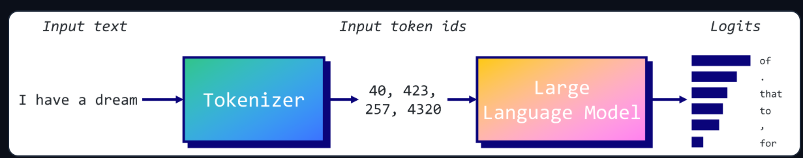
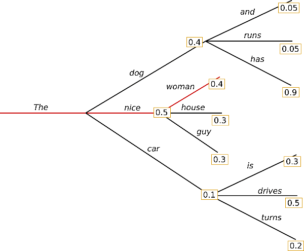
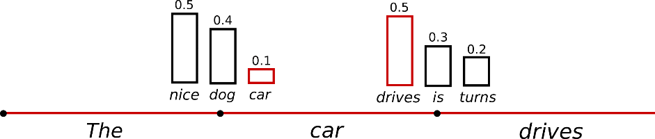
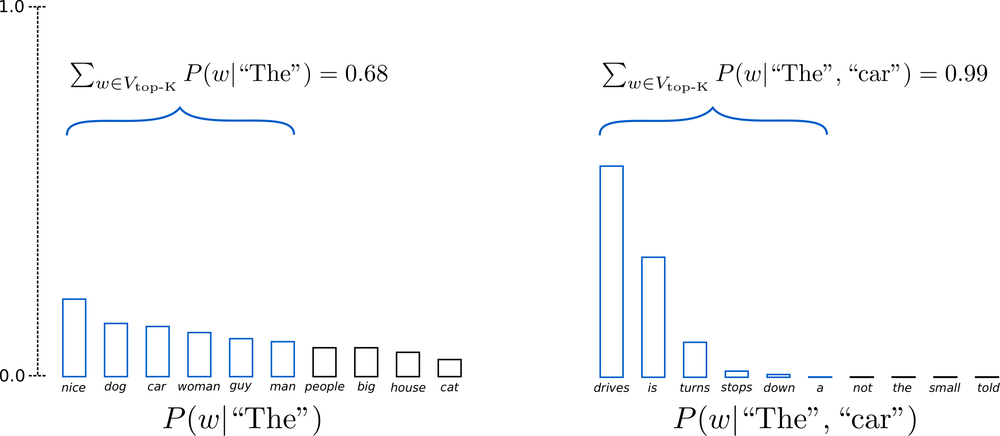
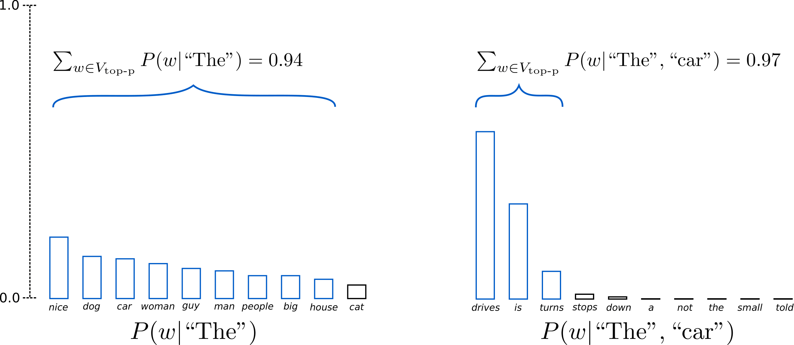
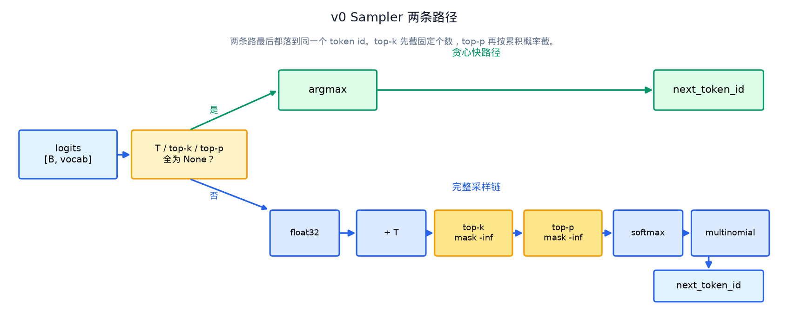
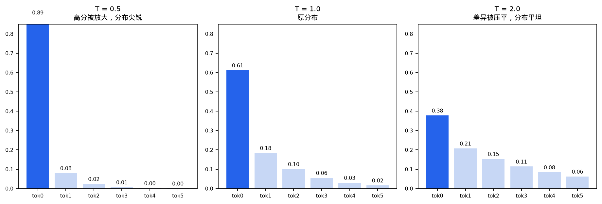
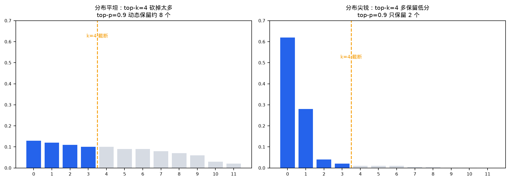

# Sampler 采样器

> [sampler.py 源码](../src/sampler.py) | [engine 推理引擎](./03-engine.md)

模型前向传播结束后，得到的是词表上每个 token 的原始分数，也就是 logits。这些分数还没有概率含义，不能直接当概率用。Sampler 的职责是把这 15 万维度的分数向量转化成一个具体的 token id。这个转化过程决定了生成结果是确定性的，还是带有随机性的。


## 1. 采样在推理链路中的位置

自回归生成的每一步，模型都会输出一个长度为词表大小的向量。向量中的每个元素对应词表中一个 token 的得分。Sampler 接收这个向量，经过一系列处理后返回一个整数，也就是下一个要生成的 token id。这个 id 随后交给 tokenizer 解码成文字。



```
lm_head 输出 logits [1, vocab_size]
    ↓
Sampler.forward
    过滤 · 缩放 · 归一化 · 随机抽取
    ↓
next_token_id (int)
    ↓
tokenizer.decode
生成文本的一个字或词
```

## 2. 采样策略从哪来

最早的自回归生成直接取最高分，也就是贪心。贪心和 beam search 在长文本上会反复吐出同样的短语，甚至陷入循环。seq2seq 时代就有人观察到这个现象。



完全随机采样本来能带来多样性，但直接从完整的 softmax 分布里抽，会频繁抽到概率很低的 token，生成内容前言不搭后语。Holtzman 等人在 2020 年的论文里把这个现象叫作分布尾部不可靠。



解决问题的方向是截断分布，只在高分区域里随机抽。

Hinton 等人在 2015 年做知识蒸馏时给 softmax 加了温度参数，用来软化教师模型的输出。生成里借用了同一个技巧，用温度T放大或压平 logits 的差异，控制分布的尖锐程度。

top-k 出自 Fan 等人在 ACL 2018 的论文《Hierarchical Neural Story Generation》。每一步只在分数最高的 k 个 token 里抽，论文里取 k 等于 10。它解决了随机采样的尾部问题，但 k 是固定的，分布平坦时需要更多候选，分布尖锐时又会混进低分 token。



top-p 叫 `nucleus sampling`，出自 Holtzman 等人在 *ICLR 2020 的论文《The Curious Case of Neural Text Degeneration》*。它按累积概率截断，保留概率和刚好达到 p 的最小集合。候选数量随分布置信度伸缩，比固定的 k 更贴合每一步的实际分布。



v0 的 Sampler 把 temperature、top-k、top-p 三条路径统一到一个 forward 里，用参数控制走哪条。


## 3. 整体设计

Sampler 继承 `nn.Module`，内部没有任何可学习参数，本质是一段跑在 GPU 上的后处理逻辑。写成 Module 是为了和 Engine 里的其他组件保持一致，方便统一调用 `.to(device)` 把数据搬到 GPU 上。

```py
class Sampler:
    def __call__(self, logits, temperatures=None, top_ps=None, top_ks=None):
        ...
```

四个超参数 `temperatures`、`top_ps`、`top_ks` 的类型都是 `Tensor | None`，形状为 `[batch_size]`。这意味着每个请求可以有不同的采样策略。v0 的 Engine 目前只支持 batch size 为 1，但 Sampler 本身已经为批处理预留了接口。

输入 `logits` 的形状是 `[batch, vocab_size]`，输出是一个 `[batch]` 形状的 token id 向量。

forward 里有一个分流。三个参数全为 `None` 时走贪心快路径，否则走完整的五步采样链。



## 4. 贪心快路径

当所有采样参数都为 `None` 时，Sampler 走一条快速路径。

```py
if temperatures is None and top_ps is None and top_ks is None:
    return torch.argmax(logits, dim=-1)
```

这条路径直接对 logits 做 argmax，返回分数最高的 token id。它跳过了 temperature 缩放、过滤、softmax、multinomial 的全部计算，是推理速度最快的模式。

Engine 层在 `temperature <= 0` 时会把 `temp_t` 设为 `None`。如果此时 `top_p` 和 `top_k` 也没有传入，就会命中这条快路径。这也是很多线上服务的默认配置。

快路径不会把数据转成 float32，直接在模型输出的 dtype（通常是 float16 或 bfloat16）上做 argmax。贪心只需要比较大小关系，半精度已经足够，还能省去一次类型转换的开销。

## 5. 完整采样链

只要有一个参数不为 `None`，Sampler 就走进完整的五步流水线。

```
logits [1, 151936]
  ↓
① float32 转换
  ↓
② temperature 缩放     logits /= T
  ↓
③ top-k + top-p 过滤   低分 token 设为 -inf
  ↓
④ softmax             logits 转为概率分布
  ↓
⑤ multinomial         按概率随机抽取 1 个
```

### 5.1 temperature 温度缩放

```py
logits = logits.to(torch.float)
if temperatures is not None:
    temperatures = torch.where(temperatures <= 0, 1.0, temperatures)
    logits.div_(temperatures.unsqueeze(dim=1))
```

温度缩放把 logits 除以温度值 T，这个操作会影响 softmax 之后概率分布的尖锐程度。

T 大于 1 时，分数之间的差异被缩小，softmax 后的分布变得更平坦，低分 token 也有更大的概率被采到，输出更多样。T 等于 1 时分布形状不变。T 小于 1 时分数差异被放大，分布更尖锐，高分 token 的优势更明显，输出更确定。



实现上有两个细节。第一是先把 logits 转成 float32，15 万维的 softmax 在 float16 下容易下溢或丢精度，采样阶段统一用 fp32 是通行做法。第二是 `temperatures <= 0` 的值会被替换成 1.0，不会抛异常。真正的零温度贪心在 Engine 层通过传 `None` 触发快路径，Sampler 内部这个处理只是防御性的兜底。

### 5.2 top-k 与 top-p

```py
logits = _apply_top_k_top_p(logits, top_ps, top_ks)
```

top-k 和 top-p 两个过滤器合并在一个函数里，执行顺序是先 k 后 p。两者都在 softmax 之前对 logits 做 mask，把不符合条件的 token 分数设为负无穷。

top-k 的规则很简单，只保留分数最高的 K 个 token，其余全部设为负无穷。K 小于等于 0 时视为不限制，等价于 K 等于词表大小，top-k 退化为无操作。

top-p 思路和 top-k 不同。它按概率从高到低累加，保留累积概率刚好达到 P 的最小 token 集合。候选集的大小是动态的。分布尖锐时可能几个 token 就累积到 0.95，分布平坦时可能需要几百个。这种动态调整既能砍掉长尾噪声，又不会把合法的低分 token 一刀切掉。



### 5.3 softmax 与 multinomial

```py
probs = torch.softmax(logits, dim=-1, dtype=torch.float)
return torch.multinomial(probs, num_samples=1).squeeze(dim=-1)
```

过滤之后，被 mask 的位置在 logits 中是负无穷，softmax 之后这些位置的概率为 0，不会被采到。`multinomial` 在剩余的概率分布上做一次加权随机抽取，返回一个 token id。

有一种极端情况需要留意。如果所有 logits 都被设为负无穷，`multinomial` 会报错。正常参数配置下不会出现，但把 top_k 设为 1 的同时把 top_p 设得极低，就可能触发。

## 6. `_apply_top_k_top_p` 的实现

这是 Sampler 里最有技巧的一段。

```py
logits_sort, logits_idx = logits.sort(dim=-1, descending=False)
# ... 在排序后的 logits 上做 mask ...
return torch.empty_like(logits_sort).scatter_(dim=-1, index=logits_idx, src=logits_sort)
```

整体思路是先把分数升序排列，在排好序的数组上完成 top-k 和 top-p 的 mask，最后用 `scatter_` 把结果还原回原始词表顺序。这样过滤逻辑多复杂，输出的 logits 维度和输入始终一一对应。

top-k 的 mask 实现。

```py
top_k_mask = logits_sort.size(1) - k.to(torch.long)
top_k_mask = logits_sort.gather(1, top_k_mask.unsqueeze(dim=1))
logits_sort.masked_fill_(logits_sort < top_k_mask, -float("inf"))
```

升序排列后，倒数第 K 个位置的值就是第 K 大的分数。所有比这个值小的分数都 mask 掉，恰好保留 top-k。

top-p 的 mask 实现。

```py
probs_sort = logits_sort.softmax(dim=-1)
probs_sum = probs_sort.cumsum(dim=-1)
top_p_mask = probs_sum <= 1 - p.unsqueeze(dim=1)
top_p_mask[:, -1] = False
logits_sort.masked_fill_(top_p_mask, -float("inf"))
```

这里在升序概率上做累加，mask 掉那些累积概率还没达到 `1 - p` 的低分 token。强制把最后一个位置的 mask 设为 False，保证至少保留一个 token，防止整个词表都被过滤掉。

有一个容易混淆的点。top-p 中的 softmax 是在已排序的 logits 上做的，和最终 forward 里的 softmax 不是同一次计算。这里的 softmax 只用来确定哪些 token 属于 nucleus 集合，不影响最终概率分布的归一化。

## 7. 与 Engine 的参数对接

Engine 里调用 Sampler 的方式。

```py
temp_t = None if temperature <= 0 else _t(temperature, torch.float)
top_p_t = _t(top_p, torch.float)
top_k_t = _t(top_k, torch.int)

next_id = self.sampler(logits, temp_t, top_p_t, top_k_t).item()
```

有两处值得注意。

第一是 `None` 的语义。`None` 表示这一步不做过滤，和参数值为零是两回事。Engine 用 `None` 跳过未设置的过滤器，Sampler 内部用小于等于 0 做退化处理，比如 K 小于等于 0 等价于不限制。

第二是 `.item()` 带来的同步开销。`multinomial` 或 `argmax` 的结果存在 GPU 上，调用 `.item()` 把结果拉回 Python 层变成 int 时，会触发一次 CPU 和 GPU 之间的同步。每生成一个 token 就同步一次，这是 v0 推理延迟的来源之一。

## 8. 典型参数组合的效果

以 `run.py` 中的配置为例。

```py
engine.generate(prompt, max_new_tokens=400, temperature=0.9, top_p=0.95, top_k=20)
```

temperature 设为 0.9，略低于 1，输出偏向确定但不死板。top_k 设为 20，每一步只在分数最高的 20 个 token 里抽。top_p 设为 0.95，在 top-k 的结果上再做一次 nucleus 截断。

top-k 和 top-p 叠加时，先由 K 收窄候选集，再由 P 动态裁剪。K 等于 20 保证不会从 15 万个 token 里随机抽，P 等于 0.95 保证不会强行保留 20 个低概率 token。这个组合是聊天场景里的经典配置。

如果把 temperature 设为 0 且不传其他参数，整条采样链会被跳过，直接走贪心 argmax。这种配置速度最快，输出完全确定，适合对多样性没有要求的场景。

## 9. 一次采样的完整路径

把上面的流程串起来。

```
logits [1, 151936]     ← lm_head 输出，hidden state 投影到词表
    ↓
temperature=0.9
    logits /= 0.9，分布略微变尖锐
    ↓
top_k=20
    151936 个候选缩减为 20 个
    ↓
top_p=0.95
    20 个候选可能进一步减少
    ↓
softmax
    候选 token 的概率之和归一化为 1
    ↓
multinomial
    按概率随机抽取一个，假设 id=16840
    ↓
.item() → 16840
    ↓
decode → " Alice"
```

Sampler 的代码不到 60 行，却承载了 LLM 在创造性和确定性之间的全部调节手段。理解它的过滤顺序、快路径分流机制、mask 还原技巧，对后续做投机采样、批量采样优化、CUDA Graph 集成都用得上。
