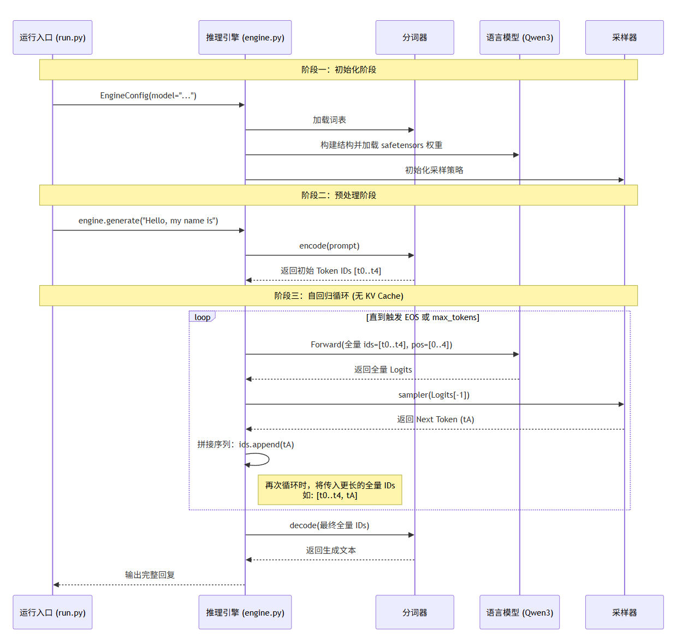

# vllm-v0 架构文档
我们究竟为什么需要推理框架呢？原生的模型为什么不能做推理？

1. **计算冗余极大**。如果每次生成新的Token都把包含历史所有的Token重新进行一次完整的Attention计算，那么时间复杂度就为`O(N*2)`.对于128K甚至1M的长上下文，这种重复计算会导致生成速度极慢。
2. **显存碎片化**。为了解决第一个问题，业界引入了KV Cache，用来缓存历史 Token 的 Key 和 Value。但是这又带来了更加严重的问题。传统的 HuggingFace 的 transformers 在请求到来时，会按照请求的最大可能长度一次性静态预先分配连续的显存空间。由于无法提前知道用户是输入10个字还是1000个字，因此会提前按照最大预先分配，结果会有大量的显存被闲置，同时，长短不一的显存块分配和释放会产生大量外部碎片。研究表明，原生框架中只有 20%~40% 的显存真正用于存储 KV Cache，剩余全部被浪费。 这导致单卡能同时处理的并发请求数极低。
3. **静态批处理**。为了提高吞吐量，我们需要将多个用户的请求拼成一个 Batch 丢进 GPU。传统的批处理需要等待同一个批次里最长的那个句子生成完毕，才能整体返回并且进入下一批请求，提前生成完的短句子只能进行等待，造成了巨大的算力闲置。

vLLM之所以能够成为当前LLM推理的标杆，核心就在于针对上述三个痛点，它引入了类似于操作系统级别的内存管理和细粒度的调度算法。

1. **PagedAttention**。这是vLLM的灵魂，灵感完全来源于操作系统的虚拟内存与分页管理。vLLM 不再为每个请求分配一块连续的巨大显存，而是将显存划分为固定大小的“块（Block）”。请求的逻辑 KV Cache 被映射到物理上不连续的 Block 中。只有当真正生成新的 Token 并填满当前 Block 时，系统才会去动态申请下一个 Block。这意味着在相同的 GPU 上，vLLM 可以把 Batch Size 撑大好几倍，从而极大地提升了系统的总吞吐量。此外，它还允许不同的请求共享前置 Prompt 的 KV Cache。
2. **Continuous Batching**。这是一种迭代调度，简单来说在 GPU 每次前向传播生成一个 Token 后，调度器会立刻检查：如果有请求遇到了 <EOS>（生成完毕），就立刻把它从 Batch 中踢出，腾出位置；如果有新请求在排队，就立刻把它塞进当前的 Batch 中，参与下一次的 Token 生成。这样 GPU 永远处于高负载的“饱和工作”状态，不存在因为长短句造成的算力浪费。
3. **分布式与高性能算子**。真实的模型动辄 70B、405B，单张 GPU 根本塞不下，且原生 PyTorch 算子开销过大。因此需要多种并行策略：张量并行（Tensor Parallelism）、FlashAttention集成、与CUDA Graph加速。
4. **异步多进程架构**。实际上接收请求、维护调度队列和GPU进程，这些都是需要解耦合的，因此完全可以使用异步架构。

而我们如果一上来就学习这么复杂的内容，会直接让我们淹没在巨大的学习成本中，接下来我就带大家一步一步实现每一个版本，并且进行性能和功能完整的测试。

## 一、核心推理循环
在当前的版本中，我们的核心是一个实现LLM的自回归生成。
### 1.1 最简循环

```python
# engine.py — 整个推理系统的核心
for _ in range(max_new_tokens):

    # 1. 构造输入：把整个序列（prompt + 已生成的所有 token）拼成 [1, current_len]
    ids = torch.tensor([input_ids], device="cuda", dtype=torch.long)

    # 2. 位置：[0, 1, 2, ..., current_len-1]
    positions = torch.arange(len(input_ids), device="cuda").unsqueeze(0)

    # 3. 完整 forward
    h = self.model(ids, positions)

    # 4. 取最后一个位置的 hidden state → 投影到词表 → 采样
    logits = self.lm_head(h[:, -1:]).squeeze(1)
    next_token = self.sampler(logits, ...).item()

    # 5. 输出新 token，拼回序列，准备下一次循环
    yield self.tokenizer.decode([next_token])
    input_ids.append(next_token)
```

**关键点**：每次生成一个新 token，都要把**整个序列**（prompt + 所有已生成 token）重新跑一遍完整的 transformer forward。

### 1.2 数据流图



## 二、文件结构

```
vllm-v0/
├── run.py                    入口脚本
└── src/
    ├── config.py              配置类
    ├── engine.py              推理引擎（模型加载 + generate 循环）
    ├── model.py               Qwen3 模型定义 + 权重加载
    ├── model_loader.py        safetensors 权重读取
    ├── sampler.py             采样器
    └── layers/
        ├── attention.py       多头 / 分组查询注意力
        ├── rotary.py          RoPE 旋转位置编码
        ├── layernorm.py       RMSNorm
        └── activation.py      SiLU激活函数
```


## 三、模型结构速览
本教程会实现单文本的Qwen系列、与Deepseek系列，包括多模态的Qwen系列。下边以典型的Qwen3-0.6B为例：

### Qwen3-0.6B
[Qwen系列学习链接](https://modelscope.cn/models/Qwen/Qwen3-0.6B-Base)
[查看整个架构的脚本](../test/test_qwen.py)

