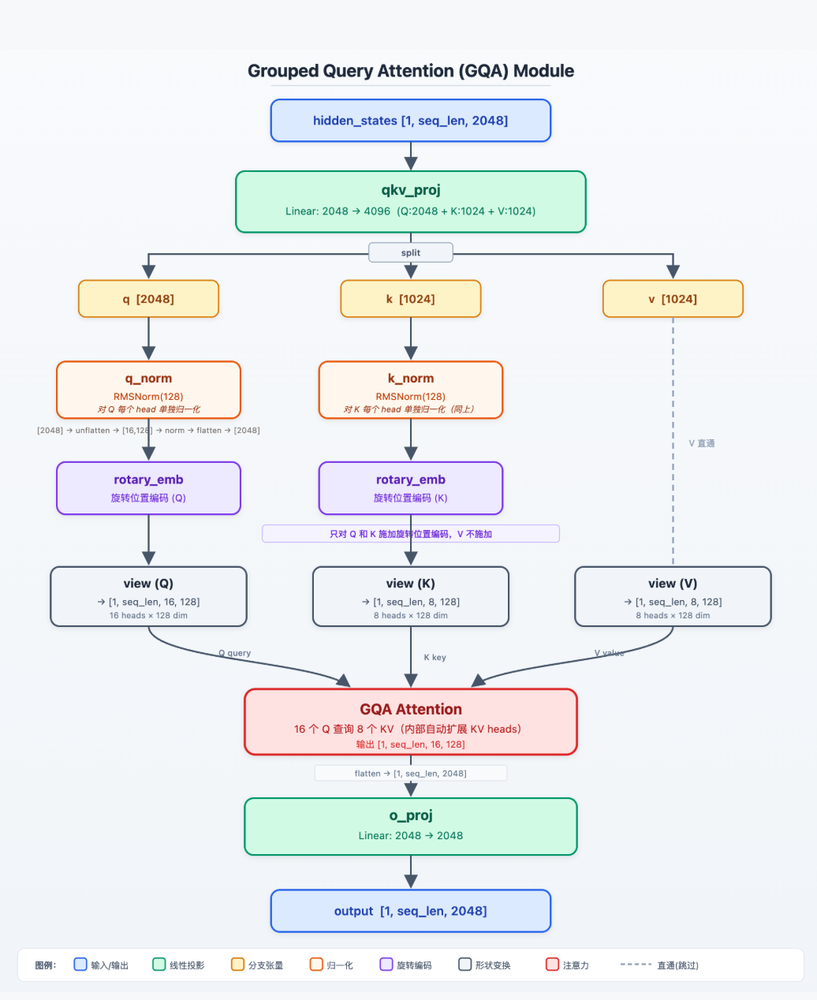
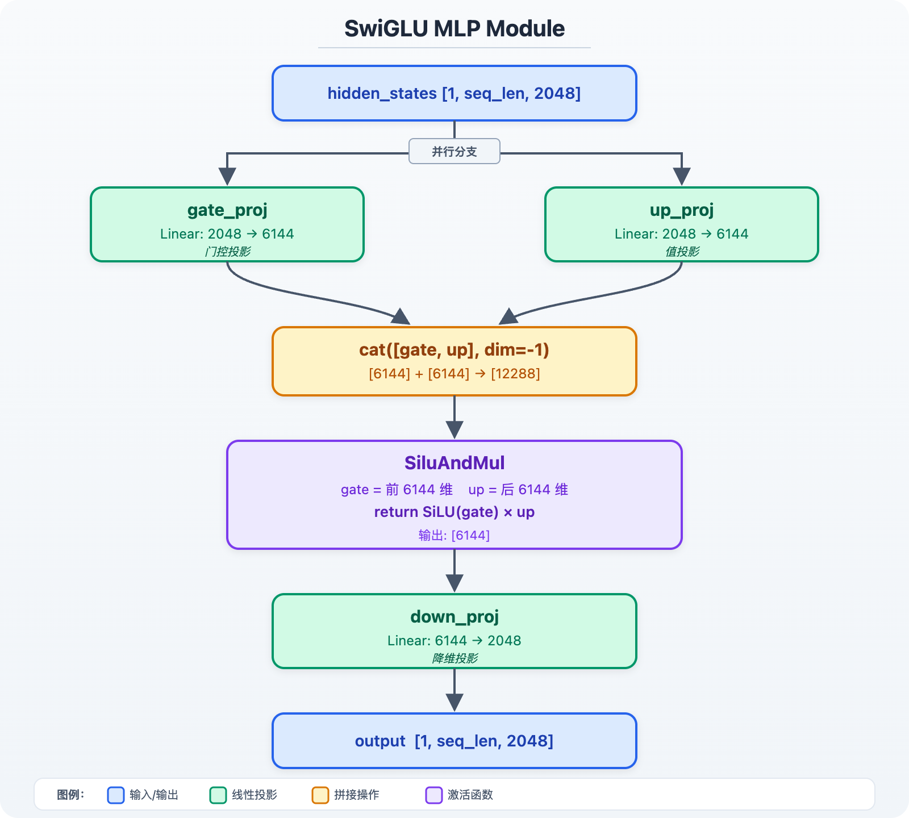
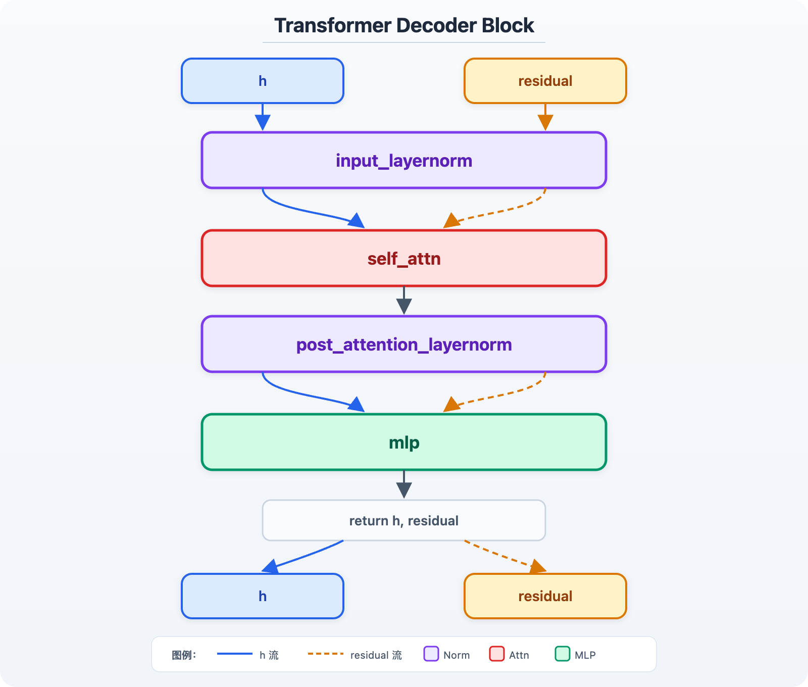
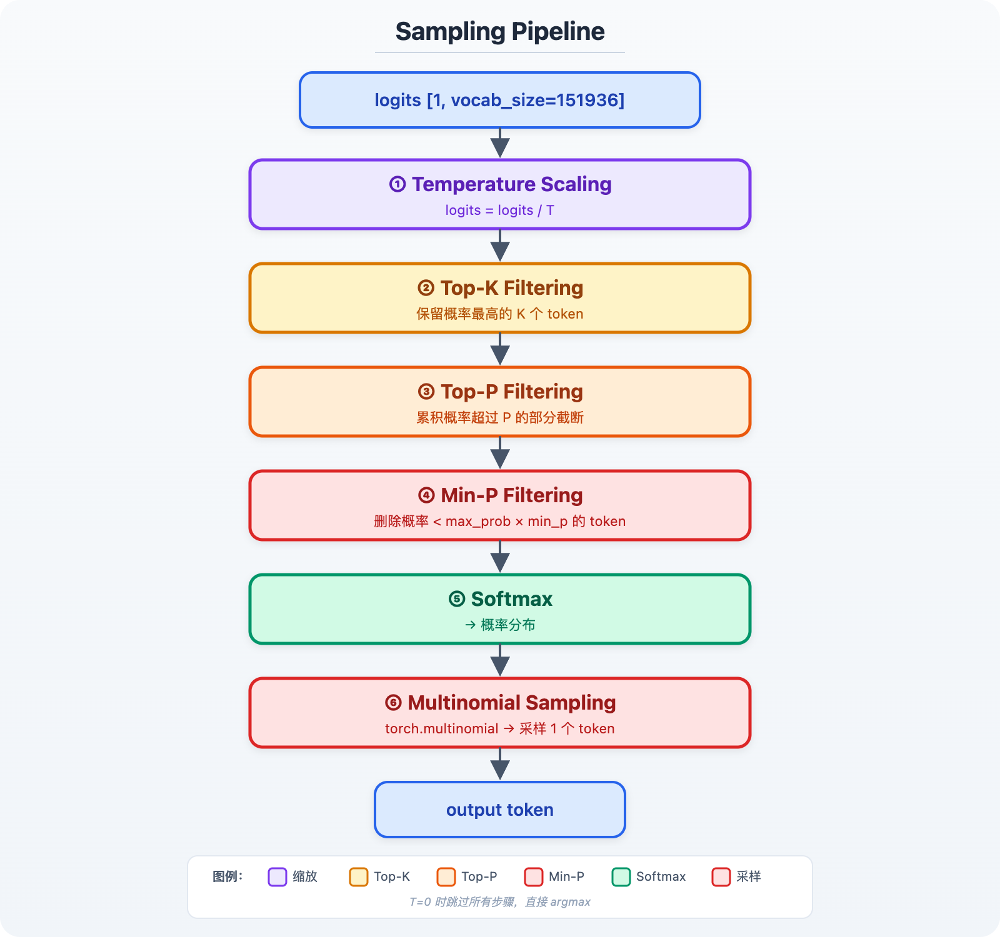
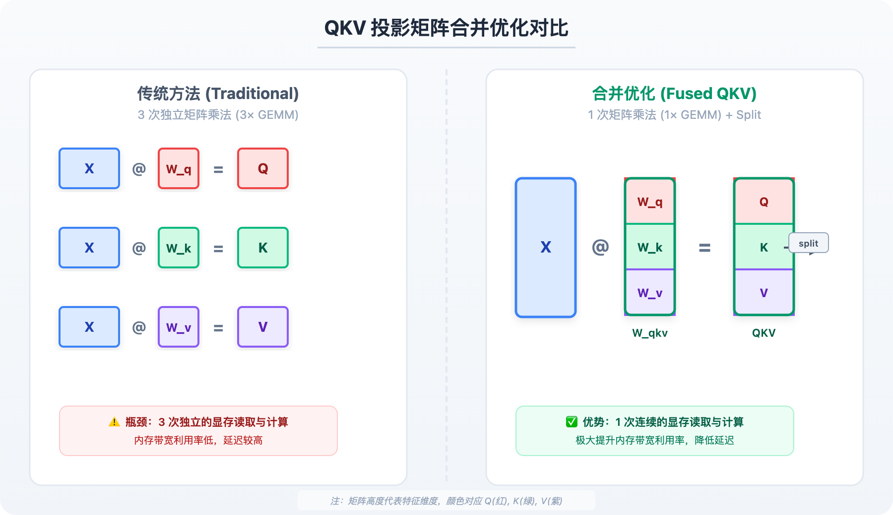
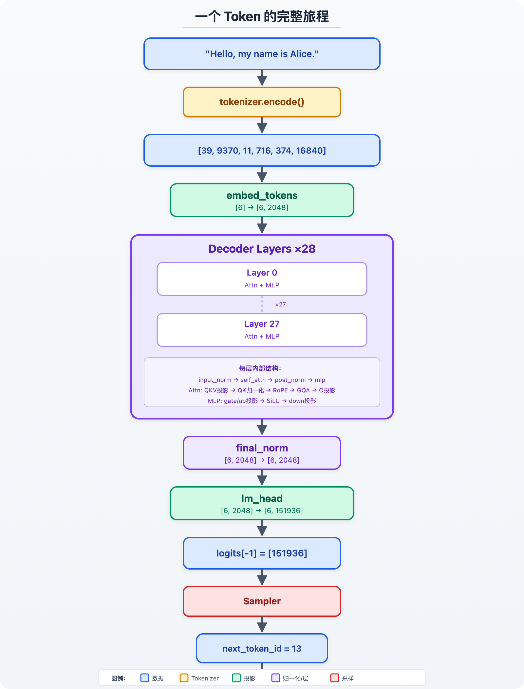

# vllm-v0 各层详解

本文档逐层解释 `src/layers/` 和 `src/model.py` 中每一层的设计。


- [RMSNorm](./layers/rmsnorm.md)
- [RotaryEmbedding](./layers/rotary.md)
- [Attention](./layers/attention.md)
- [SiluAndMul](./layers/activation.md)
- [Qwen3-0.6B Model](./model.md)


## 4. Qwen3Attention

### 作用

<span style="color:#1d4ed8">**模块名**</span> 
`Qwen3Attention` 是模型中对一层自注意力的完整封装。它把 QKV 投影、QK 归一化、RoPE、GQA Attention 和输出投影串成一条路径。

<span style="color:#b45309">**核心机制**</span>
它的职责不是单独实现某一种算子，而是将**输入 hidden state**转换成**融合历史上下文后的 attention 输出**。
其中 Q 决定当前 token 想查询什么，K 决定每个历史 token 提供什么索引，V 则携带被加权聚合的内容。

### 数据流（一个 token 为例）

<span style="color:#7c3aed">**数据流**</span> 下面以 Qwen3-0.6B 的张量形状为例。`hidden_states` 先被投影成 Q、K、V；Q 和 K 注入位置；随后 GQA 让多个 Q head 共享较少的 KV head；最后通过 `o_proj` 回到 hidden size。



### QK 归一化

<span style="color:#b45309">**核心机制**</span> Qwen3 在 attention 投影后对每个 head 的 Q 和 K 施加 RMSNorm。它不是对完整的 2048 维向量做一次归一化，而是先按 head 拆分，让每个 128 维 head 独立归一化：

```python
q = self.q_norm(q.unflatten(-1, (-1, self.head_dim))).flatten(-2)
"""
初始:  [1, seq_len, 2048]
       ↓ unflatten(-1, (-1, 128))
中间:  [1, seq_len, 16, 128]   ← 每个 head 独立
       ↓ q_norm (RMSNorm on last dim)
中间:  [1, seq_len, 16, 128]   ← 每个 head 被归一化
       ↓ flatten(-2)
最终:  [1, seq_len, 2048]      ← 恢复原始形状
"""
```

<span style="color:#059669">**实现细节**</span> 这被称为 **QK-Norm**，是 Qwen2/Qwen3 系列使用的技术。它控制 Q 与 K 点积的数值尺度，减少 attention logits 过大导致 softmax 过于尖锐的问题，从而让训练和长序列推理更稳定。


## 5. Qwen3MLP

### 作用

<span style="color:#1d4ed8">**模块名**</span> `Qwen3MLP` 是 Transformer 中逐 token 独立运行的前馈网络（FFN），使用 SwiGLU 激活函数。

<span style="color:#b45309">**核心机制**</span> Attention 负责让 token 之间交换信息，MLP 则在每个 token 自己的 hidden vector 上进行非线性变换。`gate_proj` 产生门控分支，`up_proj` 产生内容分支；两者经 SiLU 门控相乘后，再由 `down_proj` 投回 hidden size。

### 数据流

<span style="color:#7c3aed">**数据流**</span> MLP 不改变序列长度，只在最后一个 hidden 维度上先扩张、再压缩：



## 6. Qwen3DecoderLayer（`model.py`）

### 作用
`Qwen3DecoderLayer` 是一个完整的 Transformer 解码层，包含 Attention 和 MLP 两个子层。

<span style="color:#b45309">**核心机制**</span> 每层先用 Attention 混合序列上下文，再用 MLP 变换每个位置的特征；两处子层前后都通过 RMSNorm 和残差连接保持训练稳定，并让信息能跨越很多层传播。

### 数据流
代码使用 fused residual 写法，因此 `h` 与 `residual` 会一起在层间传递：




### Fused Residual 的完整轨迹

```
Layer 0（第一层）:
  residual = h₀                                 ← 保存 embedding 输出
  h = norm(h₀)                                   ← 归一化
  h = attn(h)                                    ← attention
  h, residual = post_norm(h, h₀)                 ← h = norm(attn_out + h₀), residual = attn_out + h₀
  h = mlp(h)                                     ← FFN
  return (mlp_out, attn_out + h₀)

Layer 1（第二层）:
  h, residual = input_norm(h, attn_out + h₀)     ← h = norm(mlp_out + attn_out + h₀), 保存新残差
  h = attn(h)
  h, residual = post_norm(h, 新残差)
  h = mlp(h)
  return (mlp_out, ...)
```

这个 fused 模式与传统的 `x = x + sublayer(norm(x))` 写法数学等价，但把残差相加和归一化放在同一个模块中，减少了中间 tensor 的读写与显存访问。

## 7. Sampler（`sampler.py`）
### 作用
`Sampler` 将模型输出的 logits 转换为下一个 token id。

<span style="color:#b45309">**核心机制**</span> logits 只是词表中每个 token 的未归一化分数；Sampler 通过 temperature、Top-K、Top-P 和 Min-P 控制候选集合与概率分布，最后才能按策略选出一个 token。

### 采样策略链
过滤器按以下顺序作用于同一份 logits。每一步都会缩小或重塑候选分布，最后再交给 softmax 与随机采样：





### Greedy 采样策略
当 `temperature=0` 且所有其他参数为 None 时，直接 `argmax(logits)`，不做任何过滤和采样。这是最快、也最确定的模式，在对比 v0 与后续 KV Cache 版本的正确性时，应优先使用它。


## 8. 权重加载（`model_loader.py` + `model.py:load_weights`）

### 流程
加载器逐个读取 checkpoint tensor，将 HuggingFace 中分开的 Q、K、V 权重按本项目 `qkv_proj` 的布局合并，再复制到模型参数中：

```python
# 1. 遍历所有 *.safetensors 文件
for name, tensor in safetensors_iterator(model_dir):
    # 2. 合并 QKV 权重
    if "q_proj" in name:
        qkv_proj[0:q_size] = tensor       # Q 放到前段
    elif "k_proj" in name:
        qkv_proj[q_size:q_size+kv_size] = tensor  # K 放到中段
    elif "v_proj" in name:
        qkv_proj[q_size+kv_size:] = tensor  # V 放到后段
    # 3. 其他权重直接匹配
    elif name in model_params:
        model_params[name].copy_(tensor)
```

### 为什么要合并 QKV？
HuggingFace 的 Qwen3 存储了三个独立的投影矩阵 `q_proj`、`k_proj`、`v_proj`。在推理时，把它们**合并成一个 `qkv_proj`** 可以用一次矩阵乘法同时计算 Q、K、V，这减少了 kernel launch 次数，也让 GPU 在一次更大的 GEMM 中完成原本三次独立投影，提高推理阶段的利用率。


### Gate/Up 的处理

Qwen3 的 `gate_proj` 和 `up_proj` 在 HF 中是分开存储的，在本项目中也保持为分开的 `nn.Linear` 层。forward 时通过 `torch.cat` 合并后送入 `SiluAndMul`。这和 QKV 合并不是同一回事：QKV 合并是为了减少 Attention 的 GEMM 次数；Gate/Up 在运行时拼接是为了贴合 SwiGLU 的计算语义。


## 九、总结：一个 token 的完整旅程

<span style="color:#7c3aed">**数据流**</span> 下面把 tokenizer、模型层、最终 logits 和采样器接起来。序列中的每个 token 都会经过相同的 decoder layer 堆栈，但只有最后一个位置的 logits 用于决定下一个 token：

