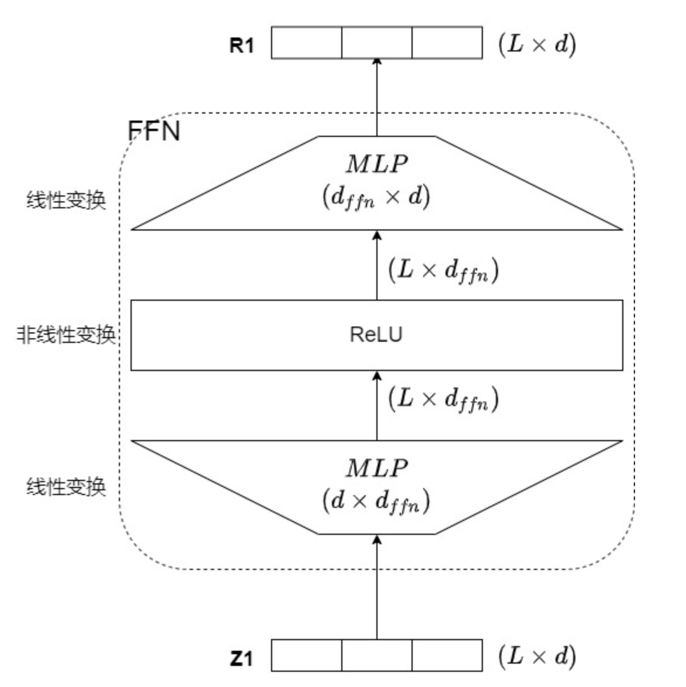
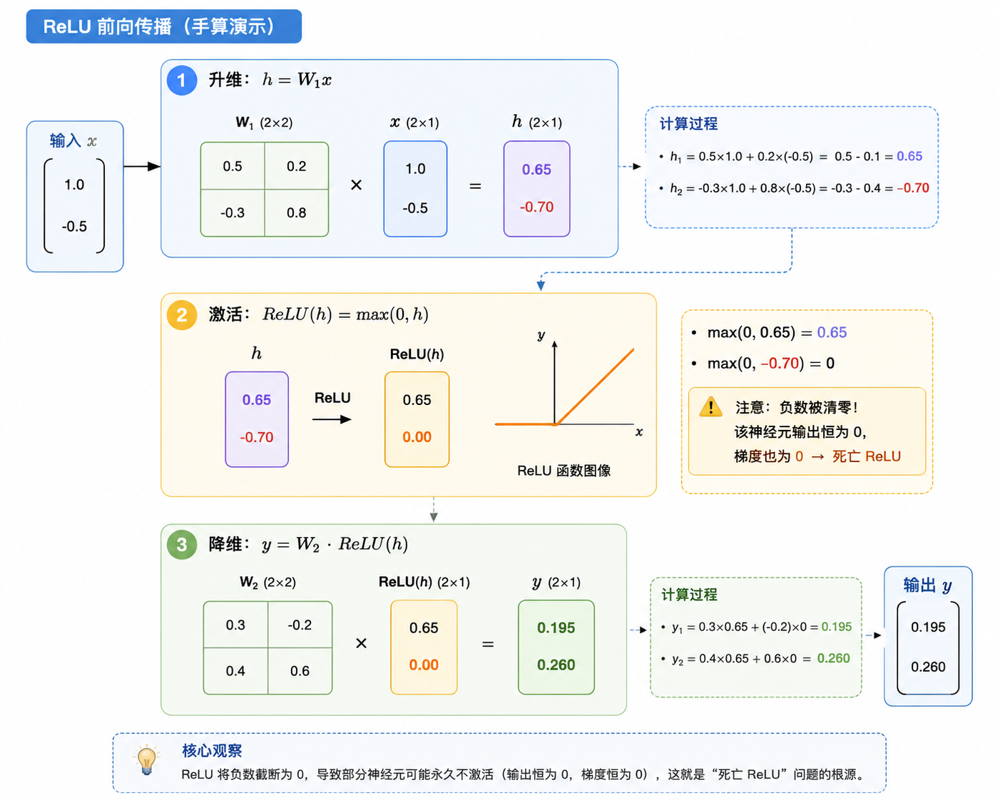

# Activation
## 为什么需要激活函数？
如果神经网络只有线性变换（矩阵乘法+偏置），无论堆多少层，实际上都等价于一层线性变换。

```math
W_3(W_2(W_1x+b_1)+b_2)+b_3 = \tilde{W}x + \tilde{b}
```

但是我们需要让模型具有更加复杂的表达能力，因此需要在每一层之间进行“弯折”，让神经网络能够拟合复杂的非线性模式。


在 Transformer 架构中，FFN 承担了 70% 以上的参数量，而激活函数的选择直接决定了模型的**表达能力、训练稳定性、计算效率**。

## 预备知识
一个 Transformer Block 包含 Attention 和 FFN 两个子层，其中 FFN 对每个位置独立作用：


数学形式：

```math
\text{FFN}(x) = W_2 \cdot \sigma(W_1 x + b_1) + b_2
```

下边我做一个简单的示例：

- 输入向量 $x = [1.0, -0.5]$ （2维）
- 中间层维度也设为 2（实际中会扩到 4~8 倍，这里为计算方便）
- 权重矩阵定义如下（偏置全部取 0）：

```math
W_1 = \begin{bmatrix} 0.5 & 0.2 \\ -0.3 & 0.8 \end{bmatrix},\quad
W_2 = \begin{bmatrix} 0.3 & -0.2 \\ 0.4 & 0.6 \end{bmatrix}
```

在涉及门控机制时，我们还会增加一个门控权重矩阵 $W_g$，后面会逐步引入。

现在，让我们从 ReLU 开始，一步步推动进化。

## 2. ReLU

**定义**：  

```math
\text{ReLU}(x) = \max(0, x)
```




ReLU的优点很明显：
- 计算简单高效，只需要进行一次比较和一次取最大值运算，适合大规模深度网络
- 缓解梯度消失，对于正区间来说，不会像sigmoid产生梯度衰减
- 稀疏性，ReLU将一部分输出置0，可以提升模型的泛化能力
- 收敛速度快，使用ReLU的网络相对来说收敛速度更快，能够更好地拟合非线性数据。

> [!NOTE]  
> 为什么负区间梯度为0会带来问题？
> 
> 梯度为0意味着权重之后不会再更新，如果某个神经元一直处于负区间，它就会永久地退出学习；在深层网络中，这种情况会累积，导致神经元数量大幅度减小，最终导致模型有效容量下降，表达能力受限，泛化性能变差。

后续有Leaky ReLU、ELU、GELU、Swish等改进激活函数来缓解上述问题。


## 3. SiLU / Swish
SiLU（Sigmoid Linear Unit）也被称为 Swish，定义为：

```math
\text{SiLU}(x) = x \cdot \sigma(x), \quad \sigma(x) = \frac{1}{1+e^{-x}}
```

这个形式非常有趣：**输入 $x$ 自己控制自己通过的比例**，Sigmoid 输出一个 0~1 的门控值，再乘回 $x$ 本身。这就是“自门控”的来历。

我们用同一个 $h = [0.65, -0.7]$ 计算 SiLU：

1. 计算 sigmoid：
   - $\sigma(0.65) \approx 0.657$
   - $\sigma(-0.7) \approx 0.332$

2. 计算 SiLU：
   - $\text{SiLU}(0.65) = 0.65 \times 0.657 \approx 0.427$
   - $\text{SiLU}(-0.7) = -0.7 \times 0.332 \approx -0.232$

   负数仍然在，它得到一个微弱的负输出。梯度也依然存在。

3. 降维：
   - $y = W_2 \cdot [0.427, -0.232]^T$

```math
y \approx \begin{bmatrix} 0.3\times0.427 -0.2\times(-0.232) \\ 0.4\times0.427 +0.6\times(-0.232) \end{bmatrix} = \begin{bmatrix} 0.174 \\ 0.032 \end{bmatrix}
```

对比 ReLU 的输出 $[0.195, 0.26]$，SiLU 的输出完全不同。更重要的是，**SiLU 处处光滑、非单调**，允许梯度稳定流动，训练深层网络时表现显著优于 ReLU。在 LLaMA 等模型中，即便后来有了 SwiGLU，SiLU 本身作为激活函数也曾被直接使用。


## 4. GLU
但 SiLU 仍然有一个局限，整个门控仍然来自同一个输入。也就是说 $\text{gate}=f(x)$，$\text{value}=x$。门控和内容共享同一份特征，因为它们都是同一个 $x$ 表征出来的。

于是研究者开始思考：如果门控和内容分别由两条独立路径生成，会发生什么？

这便引出了 `GLU`。前面的激活函数都是“单路径”。
输入经过一个线性层后，用一个函数压一下。

GLU（Gated Linear Unit）改变了游戏规则：**把信息流拆成两条路，一路提供内容，另一路充当门控，逐元素相乘**。

```math
\text{GLU}(x) = \underbrace{\sigma(x W_g)}_{\text{gate}} \odot \underbrace{(x W_v)}_{\text{value}}
```

这需要额外引入一个权重矩阵 $W_g$。我们设：

```math
W_g = \begin{bmatrix} 0.8 & -0.4 \\ 0.1 & 0.3 \end{bmatrix}, \quad
W_v = W_1 = \begin{bmatrix} 0.5 & 0.2 \\ -0.3 & 0.8 \end{bmatrix}
```

### 手算GLU
1. **计算 gate**: $g_{\text{raw}}=x W_g=[1.0,-0.5]\cdot W_g=[0.75,-0.55]$, 
   门控使用激活函数: $\sigma(0.75)\approx 0.679$, $\sigma(-0.55)\approx 0.366$，所以 $\text{gate}=[0.679, 0.366]$。

2. **计算 value**: $v=x W_v=[0.65, -0.7]$。

3. 逐元素乘（加权）: $h_{\text{GLU}}=\text{gate}\odot v=[0.679\times 0.65,\ 0.366\times(-0.7)]\approx[0.441, -0.256]$。

4. **降维输出**：

```math
y = W_2 \cdot h_{\text{GLU}} \approx \begin{bmatrix} 0.3\times0.441 -0.2\times(-0.256) \\ 0.4\times0.441 +0.6\times(-0.256) \end{bmatrix}
```

门控使得 value 的第二维 `-0.7` 被门控值 `0.366` 削弱，相当于网络自己学会了“这个特征不太重要”。

但激活函数 sigmoid 门控**永远非负**，只能削弱或放行，不能反转符号。这限制了门控的表达能力。


## 5. SwiGLU

2019 年，Shazeer 在《GLU Variants Improve Transformer》中系统比较了多种门控激活，发现**将 sigmoid 换成 SiLU**（即 Swish）能取得最佳效果。这就是 SwiGLU：

```math
\text{SwiGLU}(x) = \underbrace{\text{SiLU}(x W_g)}_{\text{gate}} \odot \underbrace{(x W_v)}_{\text{value}}
```

我们用完全相同的数据，只改变门控函数，再算一遍：

1. **gate 原始值不变**，只换 SiLU 激活：
   - $\text{SiLU}(0.75)=0.75\times\sigma(0.75)=0.509$
   - $\text{SiLU}(-0.55)=-0.55\times\sigma(-0.55)=-0.201$

   这里门控出现了负值 `-0.201`。

2. **value 不变**

3. **调制**: $h_{\text{SwiGLU}}=[0.509\times 0.65,\ (-0.201)\times(-0.7)]\approx[0.331, 0.141]$。

   第二维原本是 `-0.7`，门控是 `-0.201`，负负得正，输出变成了 `+0.141`。**信息不仅被调制，符号都可能翻转**。

4. **降维输出**：

```math
y = W_2 \cdot h_{\text{SwiGLU}} \approx \begin{bmatrix} 0.3\times0.331 -0.2\times0.141 \\ 0.4\times0.331 +0.6\times0.141 \end{bmatrix} = \begin{bmatrix} 0.071 \\ 0.217 \end{bmatrix}
```

> [!NOTE]  
> 为什么SwiGLU更强？
> SiLU 的非单调性和负值区间让门控可以“反向激活”，实现更复杂的特征选择。实验证明，在同等训练 FLOPs 下，SwiGLU 的困惑度明显低于 ReLU、GELU、GLU 等变体。PaLM、LLaMA、Mistral 等几乎所有主流 Decoder-Only 大模型都采用了 SwiGLU。

---

## 6. 工程实现

数学上的 SwiGLU 需要用两个权重矩阵 $W_g$ 和 $W_v$ 分别做两次矩阵乘法。但在实际部署中，这两次矩阵乘法**读取的是同一个输入 $x$**，完全可以合并为一个更大的矩阵乘法，从而节省一半的内存带宽。

### 6.1 权重合并

将 $W_v$ 和 $W_g$ 按列拼接：

```math
W_{\text{fused}} = [W_v \mid W_g] = \begin{bmatrix} 0.5 & 0.2 & 0.8 & -0.4 \\ -0.3 & 0.8 & 0.1 & 0.3 \end{bmatrix} \quad (2\times4)
```

一次矩阵乘法得到拼接结果：

```math
x W_{\text{fused}} = \begin{bmatrix} 0.65 & -0.7 & 0.75 & -0.55 \end{bmatrix}
```

前两维是 value，后两维是 gate。

### 6.2 融合算子 `SiluAndMul`

```python
class SiluAndMul(nn.Module):
    def forward(self, x: torch.Tensor) -> torch.Tensor:
        x, y = x.chunk(2, -1)   # 拆成 value 和 gate 两半
        return F.silu(y) * x    # SiLU(gate) * value
```

注意：通常约定后半是 gate，前半是 value，但顺序不重要，只要保持一致即可。

对于我们的例子，输入这个算子的就是拼接后的 4 维向量：
- `x` (前半) = `[0.65, -0.7]`
- `y` (后半) = `[0.75, -0.55]`

`F.silu(y) * x` 正好得到 `[0.509*0.65, (-0.201)*(-0.7)] = [0.331, 0.141]`，与上一节 SwiGLU 的结果完全一致。

在 `model.py` 中，MLP 先用 `torch.cat` 把 `up_proj` / `gate_proj` 的输出拼成一个向量（**后半是 gate**，与 `SiluAndMul` 约定一致），再送入 `SiluAndMul`：

```python
def forward(self, x: torch.Tensor) -> torch.Tensor:
    return self.down_proj(self.act_fn(torch.cat([self.up_proj(x), self.gate_proj(x)], dim=-1)))
```

### 6.3 效果

- **减少显存读写**：输入 `x` 只需从显存读取一次，而不是两次，中间结果在寄存器/共享内存中直接完成激活和乘法。
- **减少 kernel 启动**：`split + silu + multiply` 三个小操作融合成一个 CUDA kernel，省去两次中间结果的发射与读写。

因此，在vllm中看到的 `SiluAndMul`，正是 SwiGLU 算法在工程上的形态。


