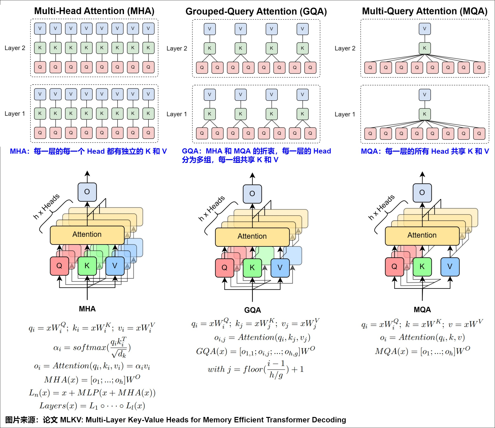

## 3. Attention
[Attention代码](../../src/layers/attention.py)


> [!NOTE]
> **参考资料**
>
> [罗西的思考：探秘Transformer系列](https://www.cnblogs.com/rossiXYZ/p/18823734) | [图神经网络公社：Attention进阶史](https://www.gnn.club/?p=2729)

Transformer模型最核心的就是自注意力机制。自注意力机制会告诉模型在处理每个单词的表示时，特别关注在句子中传递给它的某些单词，并或多或少地忽略其它单词。简单来说，就是给句子中不同单词分配不同的权重。

MQA和GQA是基于MHA进行改进，下图展示了三者的区别。可以看到，通过缩减注意力头数目，MQA/GQA会降低KV Cache存储，让不同的注意力头或者同一组的注意力头共享一个K和V的集合，因为只单独保留了一份（或者几份）查询参数。因此K和V的矩阵仅有一份（或者几份），这大幅度减少了显存占用，使其更高效。另外，传统的基于MHA的Attention算子过于卡访存带宽，MQA和GQA，乃至后续的MLA都可以提计算访存比，这样也是对性能的极大提升。


Qwen是使用GQA进行实现的，下边我们来看一下是如何具体实现的。

标准 Multi-Head Attention (MHA) 中，Q、K、V 的 head 数相同。GQA 中，**K 和 V 的 head 数少于 Q**，多个 Q head 共享同一组 K/V head。

```
MHA:  Q₁..₁₆  K₁..₁₆  V₁..₁₆      ← 16 个独立 head
GQA:  Q₁..₁₆  K₁..₈   V₁..₈       ← 仅 8 个 KV head
      Q₁,Q₂ 共享 K₁,V₁              ← 每 2 个 Q head 共享 1 组 KV
```


### 3.1. 初始化
```py
def __init__(self, num_heads: int, head_dim: int, num_kv_heads: int):
    super().__init__()
    self.num_heads = num_heads          # Q 的头数 (e.g., 16)
    self.head_dim = head_dim            # 每个头的维度 (e.g., 128)
    self.num_kv_heads = num_kv_heads    # K/V 的头数 (e.g., 8)
    
    # 确保 Q 的头数可以被 K/V 的头数整除
    assert num_heads % num_kv_heads == 0, "num_heads must be divisible by num_kv_heads"
    self.scaling = head_dim ** -0.5     # 缩放因子 (1 / sqrt(head_dim))，内部推导
```

分组大小（每个 KV 头对应多少个 Q 头）为 `num_heads // num_kv_heads`。例如 `num_heads=16`，`num_kv_heads=8` 时，每 2 个 Q 头共享 1 个 K 头和 1 个 V 头。GQA 的展开由 SDPA 的 `enable_gqa` 原生完成（见 3.3），代码里无需再存 `num_kv_groups`。


### 3.2. 前向传播
```py
def forward(self, q: torch.Tensor, k: torch.Tensor, v: torch.Tensor):
    # 输入形状假定为: [batch, seq, num_heads/num_kv_heads, head_dim]
    # 转换为 PyTorch SDPA 期望的标准形状: [batch, heads, seq, head_dim]
    q = q.transpose(1, 2)
    k = k.transpose(1, 2)
    v = v.transpose(1, 2)
```

输入的 Tensor 形状通常是序列优先的 `[Batch, SeqLen, Heads, HeadDim]`。由于矩阵乘法发生在 SeqLen 维度上，我们需要将 Heads 维度提到前面，转换成 `[Batch, Heads, SeqLen, HeadDim]`，以便进行后续的批量矩阵乘法。

### 3.3. GQA的广播与展开
如果 num_kv_groups > 1（即启用了分组，不是普通的 MHA），我们需要将较少数量的 K 和 V 复制/广播到与 Q 相同的头数，以便进行点积计算。
```py

if self.num_kv_groups > 1:
        batch, _, seq, head_dim = k.shape # 此时 k 的形状为 [batch, num_kv_heads, seq, head_dim]
        
        # 1. 在第 2 维（头数维度后面）插入一个新维度
        k = k.unsqueeze(2) # 形状变为: [batch, num_kv_heads, 1, seq, head_dim]
        
        # 2. 利用 expand 将 1 扩展为 num_kv_groups
        # 注意：expand 只是创建了新的视图（stride=0），并没有在内存中真正复制数据
        k = k.expand(batch, self.num_kv_heads, self.num_kv_groups, seq, head_dim)
        
        # 3. 将形状重构（Flatten）回 4D Tensor
        # 形状变为: [batch, num_kv_heads * num_kv_groups, seq, head_dim] 即 [batch, num_heads, seq, head_dim]
        k = k.reshape(batch, self.num_heads, seq, head_dim)
        
        # 对 v 进行完全相同的操作
        v = v.unsqueeze(2)
        v = v.expand(batch, self.num_kv_heads, self.num_kv_groups, seq, head_dim)
        v = v.reshape(batch, self.num_heads, seq, head_dim)
```

> [!NOTE]
> **repeat 和 expand 的区别？**
>
> repeat会复制数据，生成新的tensor，而expand只是创建一个新的视图，几乎不增加内存。expand仅仅是修改了步长，但是只能扩展size=1的维度，


```py
     # 调用 PyTorch 的 SDPA 实现
    attn_output = F.scaled_dot_product_attention(
        q, k, v, 
        is_causal=True, # 启用因果遮罩（Causal Mask），常用于自回归语言模型（如 GPT、LLaMA）
        scale=self.scaling
    )
    
    # 将形状还原为: [batch, seq, num_heads, head_dim]
    attn_output = attn_output.transpose(1, 2).contiguous()
    
    return attn_output
```

### 3.4. 核心概念
#### Causal Mask
`is_causal=True` 告诉 PyTorch：第 i 个 token 只能看到第 0 到第 i 个 token，不能看到后面的。这在**内部自动生成**一个上三角为 `-inf` 的掩码矩阵：

```
     t0  t1  t2  t3  t4
t0 [ ✓   ✗   ✗   ✗   ✗ ]    t0 只能看到自己
t1 [ ✓   ✓   ✗   ✗   ✗ ]    t1 看到 t0, t1
t2 [ ✓   ✓   ✓   ✗   ✗ ]
t3 [ ✓   ✓   ✓   ✓   ✗ ]
t4 [ ✓   ✓   ✓   ✓   ✓ ]    t4 看到所有
```

#### Scaling
`scale = 1 / sqrt(head_dim) = 1 / sqrt(128) ≈ 0.088`。Q 和 K 做点积后除以这个缩放因子，防止点积值过大导致 softmax 梯度消失。

#### 计算流程

```text
假设：
  B = 批次大小
  S = 序列长度
  D = 每个头的维度
  num_q_heads = 16
  num_kv_heads = 8

输入投影后已得到分头张量：
  Q : [B, S, 16, D]
  K : [B, S,  8, D]
  V : [B, S,  8, D]
```

```
======================================================================
步骤1：GQA 扩展 KV 头（repeat）
======================================================================
将 K, V 的头数从 8 扩展到 16，以便与 Q 的 16 个头一一对应。
通常使用 repeat_interleave 或 expand + reshape。

K ← K.repeat(..., 2, 1)   → 形状 [B, S, 16, D]
V ← V.repeat(..., 2, 1)   → 形状 [B, S, 16, D]

此时 Q, K, V 形状统一为 [B, S, 16, D]。

======================================================================
步骤2：为点积注意力准备张量
======================================================================
标准批量矩阵乘法要求“头”维度在 batch 和 seq 之间：
  目标形状：[B, 16, S, D]

所以将 Q, K, V 从 [B, S, 16, D] 转置为 [B, 16, S, D]
具体操作：transpose(1, 2)  或  permute(0, 2, 1, 3)

Q = Q.transpose(1, 2)   → [B, 16, S, D]
K = K.transpose(1, 2)   → [B, 16, S, D]
V = V.transpose(1, 2)   → [B, 16, S, D]


======================================================================
步骤3：计算注意力分数 Scores
======================================================================
Scores = Q @ K^T
即对 K 的最后两维进行转置：K^T 形状 [B, 16, D, S]
矩阵乘法: [B, 16, S, D] × [B, 16, D, S] → [B, 16, S, S]

Scores : [B, 16, S, S]


======================================================================
步骤4：缩放 + Causal Mask
======================================================================
Scores = Scores / sqrt(D)          # 缩放
Scores = Scores + causal_mask      # 因果遮罩（上三角置 -∞）


======================================================================
步骤5：Softmax（在最后一维）
======================================================================
AttnWeights = Softmax(Scores, dim=-1)   # 形状仍为 [B, 16, S, S]


======================================================================
步骤6：加权求和（AttnWeights × V）
======================================================================
V 的形状是 [B, 16, S, D]
AttnWeights @ V  →  [B, 16, S, D]

Context = AttnWeights @ V   # [B, 16, S, D]


======================================================================
步骤7：输出转置（核心转置②）
======================================================================
为了把各个头的结果合并回序列特征维度，需要先将“头”维度移回
序列维度旁边，即从 [B, 16, S, D] 变回 [B, S, 16, D]。

Context = Context.transpose(1, 2)   →  [B, S, 16, D]


======================================================================
步骤8：合并多头（reshape）
======================================================================
将最后两个维度合并（16 × D），得到每个位置的拼接向量。

Context = Context.reshape(B, S, 16 * D)   →  [B, S, 16*D]


======================================================================
步骤9：线性输出投影
======================================================================
Output = Linear_out(Context)   # [B, S, 16*D] → [B, S, d_model]

最终得到与输入模型维度相同的输出。
======================================================================
```

> [!NOTE]
> **两次转置的作用**
>
> - **转置①（`[B,S,16,D] → [B,16,S,D]`）**：让“头”成为批量矩阵乘法的独立维度，每个头在 `S×D` 的矩阵上独立计算，这是 GPU 高效并行的关键。
> - **转置②（`[B,16,S,D] → [B,S,16,D]`）**：把并行计算的结果重新组织成“每个位置、所有头”的布局，为后续的 reshape + 线性投影做准备。
