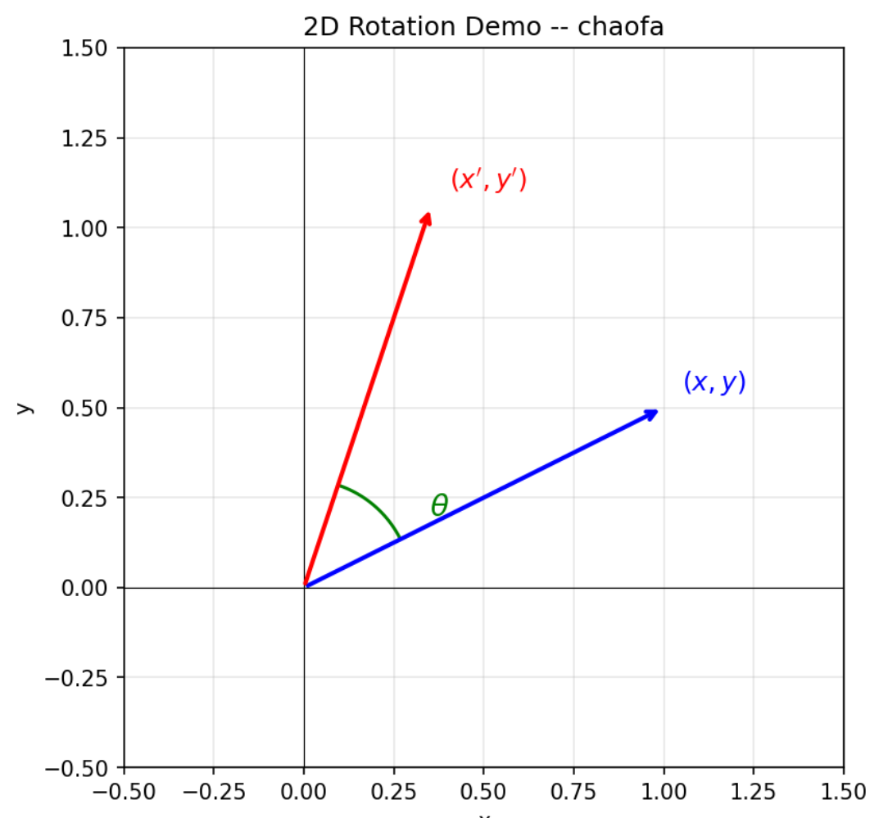

## 2. RotaryEmbedding
[RotaryEmbedding代码](../../src/layers/rotary.py)

> [!NOTE] 参考阅读
> [苏神的RoPE blog](https://www.spaces.ac.cn/archives/8265) | [袁朝发的Blog](https://yuanchaofa.com/post/hands-on-rope-position-embedding) |

我在博客中提到过，Attention机制本身是没有位置信息的，因此需要显式的注入位置信息。
经过研究表明，相对位置的重要性是要比绝对位置更加重要的。
什么意思呢？

例如：我 爱 你。
其中我的位置是0，你的位置是2，它们的相对位置是2，这个距离实际上更加重要。

因此这也是RoPE的核心思想：**通过旋转变换为向量注入位置信息，使得两个向量的内积只依赖于它们的相对位置。**


假设我们在二维平面上有一个向量`q=(x, y)`, 如果我想要把这个向量逆时针旋转一个角度 $\theta$ ，在线性代数中，我们需要乘以一个二维旋转矩阵$R(\theta)$:

```math
R(\theta) =
\begin{pmatrix}
\cos\theta & -\sin\theta \\
\sin\theta & \cos\theta
\end{pmatrix}
```

向量左乘这个矩阵，就可以得到旋转后的新的向量$q'$:

```math
q' = R(\theta) \cdot \begin{pmatrix} x \\ y \end{pmatrix} =
\begin{pmatrix}
x\cos\theta - y\sin\theta \\
x\sin\theta + y\cos\theta
\end{pmatrix}
```

整个代码实现如下：
```py
    # 这里就是上边乘法的展开式
    x1, x2 = torch.chunk(x, 2, dim=-1)
    return torch.cat((x1 * cos - x2 * sin, x2 * cos + x1 * sin), dim=-1)
```

现在，我们有一段文本，每个 Token 都有一个物理上的**绝对位置编号** $m$（比如第 $m=0, 1, 2...$ 个词）。

RoPE 的做法是：**我在第 $m$ 个位置上，就把向量旋转 $m \cdot \theta$ 这么多角度。**
也就是说，向量在这个句子中越靠后，它被旋转的角度就越大。

此时，位置 $m$ 处的旋转矩阵变成了：

```math
R(m\theta) =
\begin{pmatrix}
\cos(m\theta) & -\sin(m\theta) \\
\sin(m\theta) & \cos(m\theta)
\end{pmatrix}
```

把 Query 向量放在位置 $m$ 旋转，把 Key 向量放在位置 $n$ 旋转：
* $\tilde{q}_m = R(m\theta) \cdot q$
* $\tilde{k}_n = R(n\theta) \cdot k$

到这一步为止，我们赋予 $q$ 和 $k$ 的都只是**绝对位置信息**。


Transformer的核心是Attention，而Attention的核心是计算Query和Key的内积来决定注意力分数。
我们算一下，带有绝对位置 $m$ 的 $\tilde{q}_m$ 和带有绝对位置 $n$ 的 $\tilde{k}_n$ 的内积是什么：

```math
\tilde{q}_m \cdot \tilde{k}_n = (R(m\theta) q)^T (R(n\theta) k) = q^T R(m\theta)^T R(n\theta) k
```

根据旋转矩阵的几何性质，**一个旋转矩阵的转置，等于反向旋转**，即 $R(m\theta)^T = R(-m\theta)$。
而两个旋转矩阵相乘，等于它们的**角度相加**：

```math
R(-m\theta) \cdot R(n\theta) = R(n\theta - m\theta) = R((n-m)\theta)
```

所以，上面的内积公式化简为：

```math
\tilde{q}_m \cdot \tilde{k}_n = q^T \cdot R((n-m)\theta) \cdot k
```

可以看到，现在它们只和两个Token的相对距离有关。


我们接着来思考多维向量的情况。
刚才讲的都是 2 维向量。但大模型里，每个 Attention 头（Head）的维度通常是 128 维。怎么办？

RoPE 的做法非常简单粗暴但有效：**把 128 维切分成 64 个 2 维对**。
（这就是为什么代码里 `rotary_dim` 必须是偶数，且需要 `torch.chunk(x, 2, dim=-1)`）

对于第 $0, 1$ 维，按照一个角度 $\theta_0$ 去转；
对于第 $2, 3$ 维，按照角度 $\theta_1$ 去转；
...以此类推，组成了一个由 64 个二维旋转矩阵拼成的对角矩阵。

**不同的维度，旋转的速度（频率）不一样**
RoPE 借用了原版 Transformer的频率衰减公式：

```math
\theta_i = 10000^{-\frac{2i}{d}}
```

> 这就是代码里的 `inv_freq = 1.0 / (base ** (arange / rotary_dim))`。

* **前面的维度（低维）**：频率高，转得极快。这就像时钟的**秒针**，稍微错开一个位置，角度就差很多，用来感知**局部、近距离**的依赖关系。
* **后面的维度（高维）**：频率极低，转得很慢。这就像时钟的**时针**，甚至越过成百上千个 Token，角度也没怎么变，用来感知**全局、长距离**的上下文关系。


回过头再看RoPE的代码，就可以很好的理解。

### 2.1. 准备阶段
在这一步，我们要在模型初始化时，**提前算好**所有可能位置上的 $\cos$ 和 $\sin$ 值（即预先计算好旋转矩阵的核心元素），存进 `Cache` 里。这样在真正推理时，直接查表就能拿来用。

```py
    def __init__(self, head_size: int, rotary_dim: int, max_position_embeddings: int, base: float):
        super().__init__()
        self.head_size = head_size
        self.rotary_dim = rotary_dim
        
        assert rotary_dim % 2 == 0, "rotary_dim must be even"
        
        inv_freq = 1.0 / (base ** (torch.arange(0, rotary_dim, 2, dtype=torch.float) / rotary_dim))
        t = torch.arange(max_position_embeddings, dtype=torch.float)
        freqs = torch.einsum("i,j -> ij", t, inv_freq)
        cache = torch.cat((freqs.cos(), freqs.sin()), dim=-1)
        self.register_buffer("cos_sin_cache", cache, persistent=False)

```

这里的 `base` 在Qwen3中是1,000,000（即 1M）因为Qwen3-0.6B支持32768个token的上下文，采用更大的base就可以让模型在长序列中更加有效地编码位置信息，防止位置编码在远端位置出现重叠。

这里的`t` 是一列绝对位置，`inv_freq` 是一行基础频率。通过 `einsum` 进行外积，我们得到了一个形状为 `[最大句子长度, 旋转维度的一半]` 的矩阵。矩阵的第 $m$ 行，就是**第 $m$ 个 Token 在各个特征维度上应该旋转的真实角度**。


最后把 $\cos$ 放在前半部分，$\sin$ 放在后半部分，拼接起来当做字典（Cache）存入 GPU 的常驻内存中。

### 2.2. 执行旋转
当q或者k传入时，就进行旋转：
```py
def _apply_rotary_emb(x: torch.Tensor, cos: torch.Tensor, sin: torch.Tensor):
    cos = cos.unsqueeze(-2)
    sin = sin.unsqueeze(-2)
    
    x1, x2 = torch.chunk(x, 2, dim=-1)
    return torch.cat((x1 * cos - x2 * sin, x2 * cos + x1 * sin), dim=-1)
```


RoPE 的核心操作是：  
对输入向量 `x`，将其最后一维（维度大小记为 `rotary_dim`）看成是由 **`rotary_dim/2` 个二维向量** 拼接而成。  
每个二维向量 `(x_{2i}, x_{2i+1})` 独立地绕原点旋转一个角度 `θ`，角度取决于该维度对的索引 `i` 和 token 的绝对位置 `m`。

旋转一个二维向量 `(a, b)` 逆时针旋转角度 `θ` 的公式是：

```

a' = a * cosθ - b * sinθ
b' = a * sinθ + b * cosθ    （注意这里是 a*sin + b*cos，与标准逆时针旋转一致）
```

如果用矩阵表示就是：
```

[a']   [cosθ, -sinθ] [a]
[b'] = [sinθ,  cosθ] [b]
```

由于不同维度对的 `θ_i` 不同，我们需要为每一对提供各自的 `cosθ_i` 和 `sinθ_i`。


#### (1). cos 和 sin 的形状是怎样的？

在调用 `_apply_rotary_emb` 前，代码已经做了如下操作：

- 输入 `x` 形状为 `(n_tokens, num_heads, rotary_dim)`
- `cos` 和 `sin` 形状均为 `(n_tokens, rotary_dim//2)`

也就是说：
- 第一维是 token 数，不同 token 的位置不同，所以 cos/sin 值不同。
- 第二维就是 `rotary_dim//2`，依次对应每一对维度的 cos 或 sin 值。

例如 `rotary_dim = 4`，那么 `cos` 形状 `(n_tokens, 2)`，其中 `cos[:, 0]` 是第 0 对维度（索引 0,1）的 cos 值，`cos[:, 1]` 是第 1 对维度（索引 2,3）的 cos 值。


现在的第一步是扩展其形状：
```python
cos = cos.unsqueeze(-2)   # 形状变为 (n_tokens, 1, rotary_dim//2)
sin = sin.unsqueeze(-2)   # 形状变为 (n_tokens, 1, rotary_dim//2)
```

原因是我们要将 cos/sin 正确地广播到 `x` 上。

`x` 的形状是 `(n_tokens, num_heads, rotary_dim)`，我们需要把 `rotary_dim` 分成两半后，对每一半分别乘上 cos 和 sin（它们是 `(n_tokens, rotary_dim//2)` 的）。  
如果直接做乘法，维度不匹配：`x1` 形状 `(n_tokens, num_heads, rotary_dim//2)`，而 `cos` 形状 `(n_tokens, rotary_dim//2)`。  
虽然有广播机制，但需要让 `cos` 的 `rotary_dim//2` 能够对齐，同时 `num_heads` 维度我们希望 cos 对所有 head 都是一样的（即沿 head 维度复制）。

插入一个大小为 1 的维度到倒数第二的位置，即 `unsqueeze(-2)`，将 `(n_tokens, rotary_dim//2)` 变成 `(n_tokens, 1, rotary_dim//2)`，此时：
- `x1` 形状 `(n_tokens, num_heads, rotary_dim//2)`
- `cos` 形状 `(n_tokens, 1, rotary_dim//2)`

两者相乘时，PyTorch 会广播第二维，将 `cos` 的 `1` 扩展到 `num_heads`，使得每个 token 的所有 head 共享同一个旋转角度。这完全符合 RoPE 的要求：同一 token 的不同 head 旋转角度相同（因为位置相同）。


#### (2) 为什么需要Chunk？
RoPE 并不是对整个 `head_size` 维的向量做一个整体的高维旋转，而是把它分解成若干对，**每一对独立地在其 2D 平面内旋转一个特定的角度**。

> [!NOTE] 这里为什么要使用chunk拆分成为两瓣呢？
为了**一次性对所有 2D 平面执行批量旋转**。

假设 `rotary_dim = 4`，里面的元素是 `[a0, b0, a1, b1]`，其中 `(a0, b0)` 是第一对 2D 向量，`(a1, b1)` 是第二对。

我们要做的运算是：
- 第一对：`a0' = a0*cos0 - b0*sin0`，`b0' = b0*cos0 + a0*sin0`
- 第二对：`a1' = a1*cos1 - b1*sin1`，`b1' = b1*cos1 + a1*sin1`

如果你直接用 `x` 和 `cos, sin` 做整体运算，由于 cos0 和 cos1 不同，你没法写成一个简单的张量乘法。

而 `chunk(x, 2, dim=-1)` 做的事情，就是把偶数位置的 `a` 全部取出来拼成 `x1 = [a0, a1]`，把奇数位置的 `b` 全部取出来拼成 `x2 = [b0, b1]`。然后：

```python
x1 * cos - x2 * sin   # 一次性算出了所有 a'： [a0', a1']
x2 * cos + x1 * sin   # 一次性算出了所有 b'： [b0', b1']
```

这里的 `cos = [cos0, cos1]`，`sin = [sin0, sin1]`，整个计算是**逐元素相乘**，完全向量化。


想象你有 100 个点 `(x_i, y_i)`，你想把它们全部绕原点旋转同一个角度。你当然可以写一个循环，每次取一个点单独计算。但更高效的做法是：

1.  把所有 `x` 坐标放到一个数组 `X` 里。
2.  把所有 `y` 坐标放到一个数组 `Y` 里。
3.  一次性计算：`X_new = X*cos - Y*sin`，`Y_new = Y*cos + X*sin`。

RoPE 里的 `chunk` 就是这个 “把坐标分量分离到两个数组” 的操作。只不过每个点旋转的角度 `θ_i` 不同，所以我们使用了相同形状的数组 `cos` 和 `sin`，里面每个位置存储了对应点的旋转角度参数。


> [!NOTE] 如果不用 chunk，代码会是什么样？


你只能写一个低效的循环：

```python
for i in range(0, rotary_dim, 2):
    a = x[..., i]
    b = x[..., i+1]
    c = cos[..., i//2]
    s = sin[..., i//2]
    x[..., i]   = a * c - b * s
    x[..., i+1] = b * c + a * s
```

而现在的写法只用几行向量化代码就完成了所有维度对的旋转，速度差了上千倍。


#### (3) 拼接后的公式

```python
return torch.cat((x1 * cos - x2 * sin, x2 * cos + x1 * sin), dim=-1)
```

这完全就是逐对应用旋转公式：

- 旋转后的第一个坐标（新偶数列）：`a_new = a*cos - b*sin` → `x1 * cos - x2 * sin`
- 旋转后的第二个坐标（新奇数列）：`b_new = b*cos + a*sin` → `x2 * cos + x1 * sin`

注意这里 `sin` 和 `cos` 都是 `(n_tokens, 1, rotary_dim//2)` 形状，与 `x1`、`x2` 对应相乘时，最后一维对齐，每个元素乘上属于自己那一对的 cos/sin。整个乘法是 element-wise 的。

最后 `torch.cat(..., dim=-1)` 把新的偶数列和奇数列在最后一维拼回去，恢复 `rotary_dim` 的长度，形状仍是 `(n_tokens, num_heads, rotary_dim)`。


#### (4) 整体流程示意图

假设 `n_tokens=2`, `num_heads=3`, `rotary_dim=4`。

```

x 形状: (2, 3, 4)
cos/sin 原始: (2, 2)

cos.unsqueeze(-2) -> (2, 1, 2)
sin.unsqueeze(-2) -> (2, 1, 2)

x1, x2 = chunk(x) -> 各形状 (2, 3, 2)

计算:
  x1*cos - x2*sin  -> (2, 3, 2)  【广播第二维】
  x2*cos + x1*sin  -> (2, 3, 2)

cat -> (2, 3, 4)
```


### 2.3. 查表与融合
```py
    def _rotary(self, x: torch.Tensor, positions: torch.Tensor):
        positions_flat = positions.flatten().to(self.cos_sin_cache.device)
        cos_sin = self.cos_sin_cache.index_select(0, positions_flat)
        
        cos_sin = cos_sin.to(dtype=x.dtype)
        cos, sin = cos_sin.chunk(2, dim=-1)
        
        x_shape = x.shape
        n_tokens = positions_flat.numel()
        
        x_reshaped = x.reshape(n_tokens, -1, self.head_size)
        
        x_rot = _apply_rotary_emb(x_reshaped[..., :self.rotary_dim], cos, sin)
        
        if self.rotary_dim >= self.head_size:
            x_out = x_rot
        else:
            x_out = torch.cat((x_rot, x_reshaped[..., self.rotary_dim:]), dim=-1)
            
        return x_out.reshape(x_shape)
```


在 Transformer 中，`positions` 最常见的情况是：
```py
positions = torch.arange(seq_len).unsqueeze(0).expand(batch_size, -1)
```

**形状：`(batch_size, seq_len)`**，每个元素是对应 token 的绝对位置编号（从 0 开始）。

而 `x` 是要注入位置信息的 query 或 key，来自注意力计算中的线性投影输出。在多头注意力中，它的典型形状是 4 维：
- `(batch_size, seq_len, num_heads, head_size)`，或
- `(batch_size, num_heads, seq_len, head_size)`

我们以最常见的 **`(B, S, H, D)`** 为例（`D` 即 `head_size`），逐步拆解 `_rotary` 是如何将预计算的旋转参数“融合”进张量的。


#### 第一步：展平位置并查表

```python
positions_flat = positions.flatten().to(self.cos_sin_cache.device)
cos_sin = self.cos_sin_cache.index_select(0, positions_flat)
```

- `positions.flatten()` 将 `(B, S)` 展平成 `(B*S,)`，得到一维的位置索引序列。  
  比如 `B=2, S=3`，则 `positions_flat = [0,1,2,0,1,2]`。
- `self.cos_sin_cache` 是在 `__init__` 中预计算好的表格，形状为 `(max_position, rotary_dim)`，每一行存储着某个位置下所有维度对的 cos 和 sin 值（先 cos 后 sin 拼接而成）。
- `index_select(0, positions_flat)` 根据位置索引取出对应的行，结果 `cos_sin` 形状为 `(B*S, rotary_dim)`，**每一行对应一个 token 的全部旋转参数**。

#### 第二步：拆分 cos 与 sin

```python
cos_sin = cos_sin.to(dtype=x.dtype)
cos, sin = cos_sin.chunk(2, dim=-1)
```

- 先将查表结果转换为与 `x` 相同的数据类型（如 fp32→bf16）。
- `chunk(2, dim=-1)` 沿最后一维均匀切成两半，因为缓存是 `[cos, sin]` 交替拼接，所以：
  - `cos` 形状 `(B*S, rotary_dim // 2)`
  - `sin` 形状 `(B*S, rotary_dim // 2)`
- 此时，每一对维度都拿到了属于自己那一对的 `cosθᵢ` 和 `sinθᵢ`。

#### 第三步：重塑输入张量

```python
x_shape = x.shape          # 备份原始形状，如 (B, S, H, D)
n_tokens = positions_flat.numel()   # n_tokens = B*S
x_reshaped = x.reshape(n_tokens, -1, self.head_size)
```

- `n_tokens` 就是总的 token 数量，这里等于 `B*S`。
- `reshape(n_tokens, -1, D)` 将原本混合在一起的 `batch` 和 `seq` 维度全部压平到第一维，而把 `num_heads` 留在第二维。  
  因为总元素数为 `B*S*H*D`，所以自动推导出中间维度为 `H`，最终 `x_reshaped` 形状为 **`(B*S, H, D)`**。
- 现在，**每一行就是一个 token 的所有 head 向量**，第一维的索引与 `positions_flat` 完全对齐。

#### 第四步：对部分维度施加旋转

```python
x_rot = _apply_rotary_emb(x_reshaped[..., :self.rotary_dim], cos, sin)
```

- `x_reshaped[..., :rotary_dim]` 取出每个 token 每个 head 的前 `rotary_dim` 个维度，形状 `(B*S, H, rotary_dim)`。
- 调用 `_apply_rotary_emb`，内部会通过 `unsqueeze(-2)` 将 `cos`、`sin` 变成 `(B*S, 1, rotary_dim//2)`，然后在 head 维度上广播，**使同一个 token 的所有 head 使用完全相同的旋转角度**。
- 旋转完成后，`x_rot` 形状仍为 `(B*S, H, rotary_dim)`。

#### 第五步：处理全旋转与部分旋转

```python
if self.rotary_dim >= self.head_size:
    x_out = x_rot
else:
    x_out = torch.cat((x_rot, x_reshaped[..., self.rotary_dim:]), dim=-1)
```

- 如果 `rotary_dim >= D`（绝大多数情况就是等于），说明对所有维度都进行了旋转，`x_rot` 就已经是完整的输出。
- 如果 `rotary_dim < D`，说明只有前 `rotary_dim` 维参与了旋转，后面的维度保持原样、不注入位置信息。  
  此时将旋转后的部分与 `x_reshaped[..., rotary_dim:]` 在最后一维拼接回去，恢复成 `D` 维。

#### 第六步：恢复原始形状

```python
return x_out.reshape(x_shape)
```

- 将 `(B*S, H, D)` 重新变回原来的 `(B, S, H, D)`（或其他原始形状）。
- 因为 `reshape` 只是改变视图而不改变内存顺序，所以经过这一系列“变形 → 旋转 → 变形”后，每个 token 的 query/key 中被指定的维度已经悄悄旋转过了，而其他部分原封不动。


#### 整体数据流

```

输入：
  x:        (B, S, H, D)
  positions: (B, S)

处理后：
  positions_flat:   (B*S,)                  # 位置编号
  cos_sin 查表:     (B*S, rotary_dim)       # 取对应行的 cos/sin
  cos, sin 拆分:    各 (B*S, rotary_dim//2) # 每个 token 的旋转参数
  x_reshaped:       (B*S, H, D)             # 展平 token 维度
  旋转部分:          (B*S, H, rotary_dim)   # 施加 RoPE
  拼接(如需):        (B*S, H, D)             # 补回未旋转维度
  reshape 输出:     (B, S, H, D)            # 恢复原形
```

整个 `_rotary` 先根据 token 的位置编号查到对应的旋转角度，再将输入张量拆成偶数位和奇数位，用向量化公式一次性把所有 2D 平面旋转完毕，最后拼回去。


