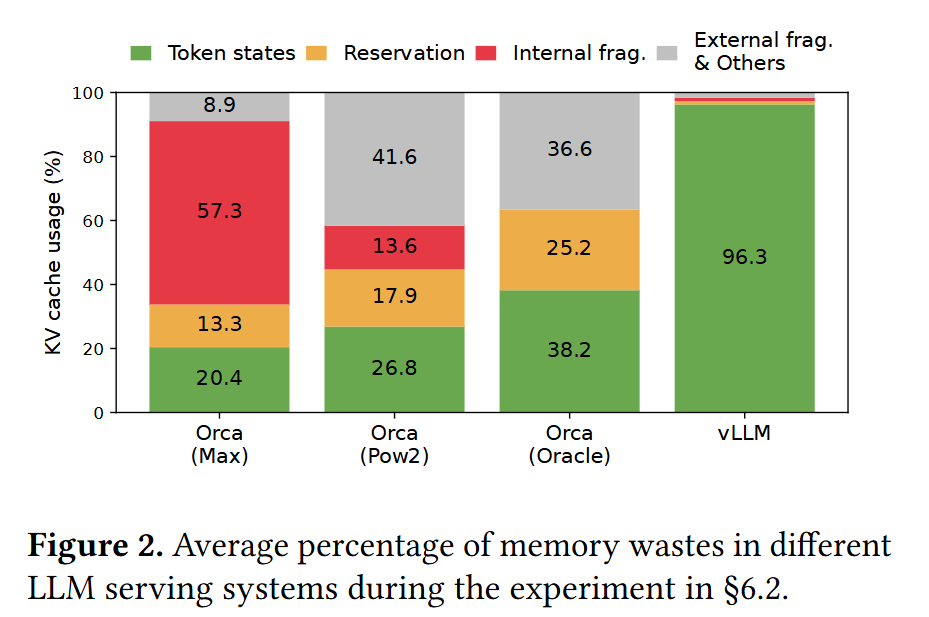
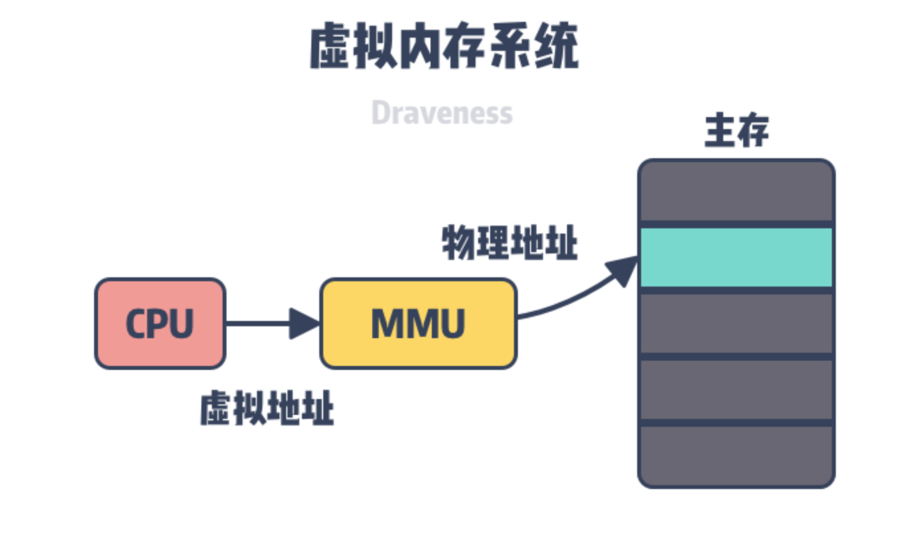

# vllm-v1
> **核心设计**：KV Management

> [上一节](../README.md) | [下一节](./ADDED_vs_v0.md)

v0 解决的是怎样把 Qwen3 从权重到逐字输出这条链路跑通。
v1 的核心是把历史 Token 的 Key / Value 存下来，并让这条缓存真正接到 Engine 与 Model 上。


## 1. 回顾 v0
v0 的自回归循环可以压成五步：

```text
拼整段序列 → 整段 forward → 取最后一位 logits → 采样 → append → 再来一轮
```

每一步模型看到的都是**从第一个 prompt token 到当前最后一个 token**的完整输入。Attention 里 Q/K/V 都是当场算出来的，算完即丢。结果是：
| 现象 | 后果 |
| :--- | :--- |
| 第 N 步仍要算前 N−1 个历史位置的 K/V | 计算量随长度平方涨 |
| 没有跨请求状态 | 两次 `generate` 即使 prompt 相同，也各算各的 |


## 2. KV Cache Management

在设计 vllm-v1 版本的时候，最核心的是思考这4个问题：
1. 没有 Cache 时缺什么？
2. Management究竟是如何管理KV Cache的？
3. 我们按什么理念设计？
4. 最终换来什么效果？

### 2.1 当前 V0 缺点

自回归里，第 $t$ 步要预测下一个 token，Attention 必须看见位置 $0\ldots t-1$ 的 Key / Value。这件事数学上没问题。v0 也确实是这么实现的：
**每一步都把整段序列重新送进模型，让每一层现场重算全部历史的 K/V。**

但是，这会直接带来两类问题：
1. **计算重复**。生成第 $N$ 个新 token 时，前面 $N-1$ 个位置的 K/V 在上一步其实已经算过了，但因为没有地方存放，下一步只能再算一遍。decode 的 Attention 工作量随长度近似按 $O(N^2)$ 涨，长上下文时延迟暴涨。
2. **显存碎片化**。如果按最大输出长度给每条请求预留一整段连续 KV，这倒是可以消除重算，但长度不可预知时会大量预留、碎片化。KV缓存不能只做一个大 tensor 粘在模型上，而是应该设计一个类似内存池的东西，高效的对整个池子进行管理。

所以 v1 要同时解决两件事：**存储 KV**， **管理 KV**。

### 2.2 KV Cache 的核心作用
为了解决重复计算的问题，KV-Cache应运而生。它的思想非常简单：
KV Cache可以让模型在输出过程中，每个 token 的 K/V 只算一次；之后每一步生成只负责算新 token 的 K/V 并追加，计算Attention的时候 再把缓存里的历史 + 当前生成的新token拼起来做注意力。

KV-Cache是典型的空间换取时间，对应到两阶段：

- **Prefill**：把 prompt尚未在缓存里的那一段过一遍模型，把得到的 K/V 写入缓存。这一步仍可能处理较长序列，但是一次性计算。
- **Decode**：每一轮模型输入长度变为 **1**。新算出的 K/V 添加进缓存；做 Attention 时 读出长度为当前总序列的 K/V，再和长度为 1 的 Q 做 SDPA。

因此 Cache 的第一性收益是 **算力**。decode 从每步重算整段，变成每步只算增量。  
第二性收益是 **显存形态**与 **跨请求复用**。页式存放可以减少预留浪费；前缀索引让相同 prompt 前缀不必再 prefill 一遍。

### 2.3 KV 管理的设计理念
既然KV Cache这么好用，那为什么还有有VLLM的PagedAttention呢？
这是因为最初的KV Cache特性（**连续的物理内存**）会带来严重的显存管理问题。
1. **内部碎片**。为了保证有足够的空间，每一个模型通常都会申请开一块非常大的连续内存，例如一次性可以容纳2048个词的Cache。如果一个用户的请求很短，例如只发了一个：你好。那么剩下的大部分空间就被彻底浪费掉了。
2. **外部碎片**。上述问题还只是针对单个用户和单个模型。而当我们扩展到多个用户并发处理请求时，情况就又发生了更严重的变化，显存会被切割成为许多不连续的小块。当一个长请求到来时，即使剩下的显存还是很多，但是系统却没办法找到一块足够大的连续空间来满足它。


实际上，vllm之前的方法都很难完全利用到整个显存，但是vllm却几乎能够把显存完全占满，那这是怎么做到的呢？

vllm通过一种名为PagedAttention的技术，动态地在内存池中为KV Cache分配显存，以提高显存的利用率。

简单来说，这就是**GPU版本的虚拟内存分页管理技术**。



这一项技术首先被UC Berkley的研究者提出来，它对KV Cache的管理机制进行了彻底的重构：
- **分块**。将KV Cache不再视为一个整体，而是在逻辑上切分成许多固定大小的Block，每个Bock可以存储固定数量Token的Key和Value。
- **页表**。系统为每一个请求（Sequence）都维护一个独立的页表。它的核心作用是记录该请求的每一个逻辑Block分别存储在物理的哪一个Block上，也就是**地址映射**。
- **内存管理器**。有了页表，有了逻辑，还需要对GPU的实际显存进行管理，什么时候进行分配，什么时候进行回收，都需要一个Manager进行操作。


> 这个时候我们要阅读vllm源码了吗？ 不！我们需要自己手写，把上述说到的所有模块都自己实现。当然，这个地方存在很多涉及到性能、百花齐放的架构适配，这些我们先暂时忽略，只保留核心主干。

明确了要缓存 K/V，还要管得住显存，真正难的其实不是阅读vllm，而是我们怎么把这一套设计划分好任务边界。如果把所有事塞进一个超级 `Manager`，后面任何改动都会牵一发而动全身。

因此我在这里的设计方案是**三条理念**：

我用一个例子来带大家体会一下KV Management的逻辑设计：北邮旁边有一个金谷园饺子店，有很多桌位，人们会来这里吃饺子。


**理念一：逻辑与物理分开**
从顾客的角度来说，每一个人拿到的都是一个连续的号码，例如A01、A02等号码，但是实际上坐到的地方可能是33号、68号桌子等等，物理位置和逻辑位置是分离的。
顾客只需要知道自己是逻辑第几位就可以了，并不关心桌子在哪，对照着表来映射即可。
同理，操作系统管理内存的关键，并不是把一块巨大的 RAM 直接裸给进程，而是让进程看见连续的虚拟地址，每一个进程都有完整的地址映射空间，但是硬件上是一页一页不连续的物理页，中间靠页表翻译。
KV 也一样。一条请求在逻辑上拥有从第 0 个 token 往后连续增长的地址空间；GPU 上则是预先划好的**固定大小页池**，请求变长就多拿几页，用完再还。请求不需要知道某页落在显存的哪一片连续区间。

**理念二：管资源与做存储分开。**  
在金谷园有一个非常特殊的岗位，门口查看监控的阿姨。她实际上是在管理资源，谁来了坐哪张桌子？是坐小桌子还是大桌子？前边一桌的人是不是已经吃完空出来了等等？这个其实是资源管理。

而还有保洁员，需要对上一桌子的残羹剩饭进行清理，以及摆放新的餐具，并且通知给前台阿姨。这个阿姨是实际上在管理各个桌子的”读写“。
那么从KV的角度来说，一旦有了页，就会分成两类问题。第一类偏**资源与生命周期**：这页现在归谁，前缀能不能复用，请求结束是留下还是回收？第二类偏**存储怎么访问**：已经知道页号之后，怎样把算出来的 K/V 写进张量，怎样按逻辑顺序读回来给 Attention？对应到代码，KVManager就是前台，PagedStore就是保洁员。

**理念三：编排与计算分开。** 
保洁不需要知道来了多少人，前台也并不关心保洁的工作，顾客更是不担心桌子是否收拾好，因此它们都是有权责边界的。
并且它们之间是有状态切换和先后顺序调度的，因此Engine就需要管理，什么时候告诉保洁、什么时候告诉顾客，什么时候更新前台信息等等。
**编排层告诉计算层这一步的规则，计算层按规则读写 Cache。** 


### 2.4 KV management的效果
1. **Decode 吞吐提升**。历史 K/V 直接读 Cache，每步只算当前 token；Attention 输入长度从整段 $N$ 降到 $1$。这是 tok/s 提升的主因。
2. **显存利用率提高**。K/V 按页按需占用：短请求少占页，结束后页回池，同一块物理显存可被多轮请求轮转使用，减少「按最长序列预留」的浪费。
3. **多请求可共池调度**。页池在请求间共享，变长序列不必各占一块连续大缓冲，为后续 Continuous Batching 提供显存侧基础。
4. **相同前缀的 Prefill 可被跳过**。满块 K/V 可经 hash/radix 索引跨请求复用；命中时直接接在已有 Cache 上继续算，省掉重复 Prefill 的算力与时间。


> 参考资料：[vllm原论文](https://arxiv.org/pdf/2309.06180) | [从KV Cache到PagedAttention的全部细节](https://www.cnblogs.com/sio2zyh/p/18978864) | [图解大模型加速系列](https://zhuanlan.zhihu.com/p/691038809)