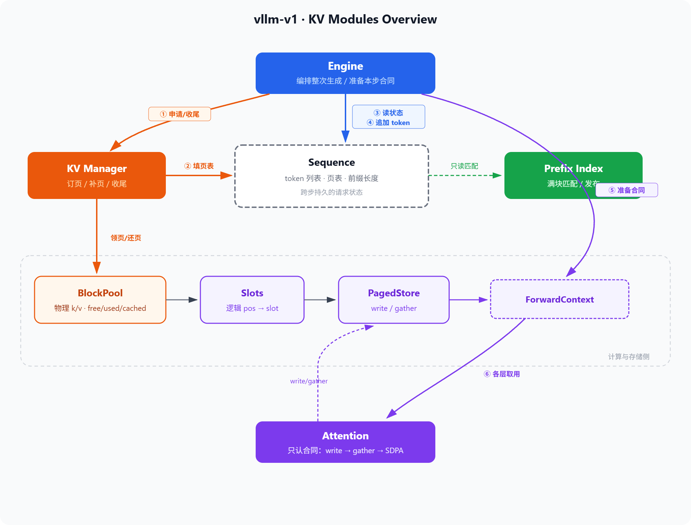
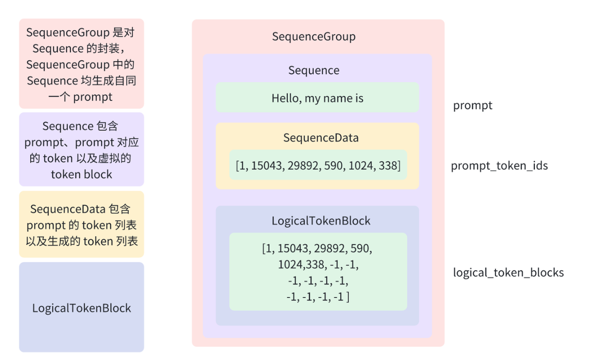
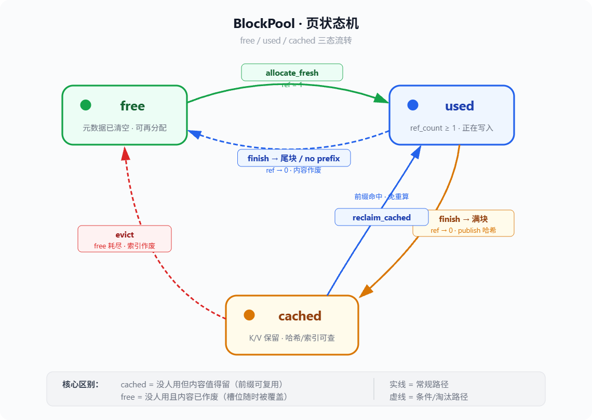

# v1代码架构详解
> 参考资料：[vllm调度器的细节](https://zhuanlan.zhihu.com/p/692276562) | 


## 1. 总览
上一个文档中写了三个设计理念，对应到代码就是三个层级：
- 逻辑页表与物理页表分开
- 资源管理与存储管理分开
- 编排与组装分开

当一个请求到来时，它会依次经过以下模块：
```
Engine
    → Sequence: 把请求变为Sequence
    → KVManager.allocate 
    → Engine 提供 ForwardContext
    → Attention.write 新计算出来的KV放进页表 → gather历史KV → SDPA
    → KVManager.ensure_blocks decode变长时补充页
    → KVMaganer.finish 块满发布到前缀索引，页归还池子
```

后续我们按照请求的流动顺序逐步展开：
状态 → 物理页 → 寻址 → 读写 → 契约 → 计算 → 编排 → ...


在代码中，我单独写了kv模块和pagedattention模块，这两个是相比较v1新增的，[新增模块示意](./02-相比v0的增改.md)

主要由以下这么几个模块：KV manager, Pool, Slots, Store, Sequence, Prefix等等，下边我来逐一讲解。


## 2. Sequence：一条请求的逻辑状态
> 源码：[src/kv/sequence.py](../src/kv/sequence.py)

分页 KV 有两套地址。逻辑上 token 按 0、1、2… 连续编号；物理上对应的 K/V 却可能落在互不连续的页里。每个请求需要同时记住“自己有哪些token”和“逻辑页和物理页的映射关系”。
Sequence就是这份状态。

vllm本身对Sequence进行了充分的封装，它是一个独立的文本生成流，即一个从输入prompt到输出completion的完整过程，核心就是对数据与状态的封装。




我们在这里进行简化，Sequence只需要记录请求侧的逻辑信息，包含以下内容：
```py
@dataclass
class Sequence:
    """ 一条生成请求的 tokens 与物理页表。 """

    token_ids: list[int]                              # 已有 prompt + 已生成 token
    block_size: int                                   # 每页 token 数
    seq_id: int = 0                                   # 进程内唯一 id（radix 引用用）
    block_table: list[int] = field(default_factory=list)  # 逻辑页 → 物理块号
    num_cached_tokens: int = 0                        # 前缀命中跳过的 token 数

```
各个模块对于Sequence的使用方式不同：
- Engine：创建Sequence、追加Token并且获取页表
- KVManager：填写管理页表
- Prefix索引：通过token列表计算哈希

Token列表、页表、前缀跳过长度必须跟着同一条请求一起创建、变长、销毁。
因此把他们单独创建成一个对象可以让这份状态和请求同生命周期。


## 3. Pool：物理内存池
> 源码：[src/kv/pool.py](../src/kv/pool.py)

Sequence 记下了请求侧的逻辑状态，但它手里只有页表，没有真正的物理地址。
数据要放进 GPU 显存，而请求长度事先未知、请求来了一拨又一拨，
显存要能拆开再拼、用完再还。所以所有请求共享一个固定大小的物理内存池。

这个对象叫 `BlockPool`，负责两样东西：两块巨大的 k/v 张量，以及内存池的管理。

代码中，k 和 v 形状都是五维：

```py
[num_layers, num_blocks, block_size, num_kv_heads, head_dim]
```

1. 第一维是层，因为每一层 Transformer 都有自己的一套 K/V；
2. 第二维是物理页号，从 0 数到池子大小减一；
3. 第三维是一页里能装几个 token；
4. 后两维是每个 token 上 KV head的布局。引擎启动时根据模型层数和头维一次性创建，页数由配置给定。

> Block size对于前缀的影响
前缀命中的最小单位是一个完整块。两条请求共享 N 个 token 前缀，实际能复用的是`N // block_size`个整块，剩下的`N % block_size`个token无法对齐，全部浪费掉。

假设两个请求共享前100个Token
- block_size=16, 可以复用100//16=6个块，剩下4个浪费
- block_size=256, 可以复用100/256=1个块，100个Token全部浪费。

可以看到block_size越大，前缀命中率相对来说就越低。但是页表小就全是优点吗？也不一定，小的块大小会影响页表大小和管理开销，包括Kernel的启动效率等等，因此这实际上就是命中率和吞吐的Trade-off。


页主要有三种状态：free、used、cached。

要理解这三种状态，还是需要理解清楚物理层和逻辑层的区别：
- 物理层：pool.k 和 pool.v两块五维张量。只要页写入了，KV数值就会存在张量里。
- 逻辑层：有三个集合 free、used、cached。这三个表示当前的页属于哪一种状态，一个页在同一个时刻只能属于其中一个集合。

| 状态 | 物理数据 | 元数据 | 前缀索引 |
| ---  | --- | --- | --- |
| free | 可能残留旧值，无意义 | 已清空 | 不指向 |
| used | 有效，某请求的 K/V | 有效 | 可能指向（别的请求正共用） |
| cached | 有效，保留了历史 K/V | 有效（hash、token_ids 在） | 指向 |

free和used比较好理解，但对于cached来说，从**占用**来看，它并不在任何请求的block_table中，used_ids已经移除，ref_count为0，它可以被新请求重新分配，也可以被淘汰。从**数据**来看，KV数值还在显存里，等待未来被引用。


页的整个生命周期主要有4个动作
- allocate_fresh: free -> used. 新请求要写KV时，从free集合中取一页，引用置为1，并且清除掉旧的数据，放到used集合中。如果free集合空了，就先在cached集合中淘汰一批放到free中，再从中选择一个来领取。
- release: used -> cached / free. 请求结束时需要逐页处理，先把引用减一。如果还有别的请求共用就继续留在used。之后如果发现这一页对应的块是满的，并且已经进了哈希，就放到cached集合里；如果是尾块就直接进free。
- reclaim: cached -> cached. 如果新请求的前缀命中了某块 cached 页，直接把它拉回 used集合，引用设置 1。这是前缀缓存省算力的关键。





### 3.1. 一个完整例子

设 `block_size=4`，请求 A 最终有 10 个 token，页表 `[3, 7, 1]`，开 hash 前缀：

```text
逻辑:  0 1 2 3 | 4 5 6 7 | 8 9
物理:     3    |    7    |  1
         满块     满块     尾块
```

**假设A：请求结束**。`finish` 先 `publish` 满块，只登记页 3、7。随后 `release_to_cached_or_free` 逐页处理：

- 页 3、7：满块并且已发布哈希，则进cached集合。K/V 留在显存，索引指向，等下一个同前缀请求来命中。
- 页 1：尾块，没发布则清元数据进free集合，可被覆盖。

**假设B：请求B有8个相同的token**。查询前缀索引，命中页 3、7，`reclaim_cached`把这两页放到used集合，K/V直接复用。页 1 是新领的 free 页。

**假设C：free页耗尽**。请求C到来，`allocate_fresh` 发现free集合为空，从cached集合挑一页（hash 后端是 `next(iter(cached_ids))` 任意取）淘汰，即回调删掉索引映射，清元数据进free集合，然后转交给C。这块cached页的K/V被C的新数据覆盖。

### 3.2. cached页什么时候被释放
实际上，cached集合的数据不会被主动删除，它会一直放置在显存里直到被新数据覆盖。cached页只有两条离开路径：

1. **被命中**（`reclaim_cached`）：放到used集合继续用。
2. **被淘汰**（`_evict_cached`）：free集合耗尽时被挑中，清元数据进 free集合，随后被新请求覆盖。

所以 cached页是被动释放。只要池子里free还够用，cached页就一直在。

而hash 和 radix 对 cached 失效的处理不同：
- **hash**：页被淘汰时 `invalidate` 立刻删掉哈希映射，索引立即断联。一旦淘汰，前缀就命中不了了。
- **radix**：`invalidate` 在这个版本中是空实现，后续我们会进一步完善LRU方案。


## 4. Slots 逻辑位置如何映射为物理行号
> 源码见 [src/pagedattention/slots.py](../src/pagedattention/slots.py)

上边已经说明，内存池提供了存放 K 与 V 的物理空间，Sequence 中的页表则记录了逻辑页号到物理块号的对应关系。仅有这两项信息仍不足以完成写入。模型给出的是按逻辑顺序编号的 token，而内存池按物理行存放数据。因此还必须把每一个逻辑位置翻译成内存池中的一个全局行号。本仓库将这个行号称为 slot。

此问题与经典的虚实地址转换属于同一类问题。给定页大小与页表，对任意逻辑位置 pos，先用整除得到它所在的逻辑页号，再用取余得到页内偏移，最后用页表查出物理块号，并与页内偏移合成为 slot。实现上只依赖整数除法与取模，不涉及张量运算。
设页大小为 block_size，页表为 block_table。则有

```text
physical = block_table[pos // block_size]
offset   = pos % block_size
slot     = physical * block_size + offset
```

其中 physical 为物理块号，offset 为块内下标，slot 为展平后的全局行号。写入时以 slot 作为目标行索引。

下面用一个最小实例说明虚实分离。取页大小等于 2，页表等于 [1, 0]。于是逻辑页 0 映射到物理块 1，逻辑页 1 映射到物理块 0。四个逻辑位置的计算结果如下。

```text
逻辑位置      0    1  |  2    3
所在逻辑页    0    0  |  1    1
物理块号      1    1  |  0    0
页内偏移      0    1  |  0    1
slot         2    3  |  0    1
```

由此可见，逻辑上连续的位置 0、1、2、3，对应的物理行号依次为 2、3、0、1。对模型而言历史仍是连续的，对物理内存池而言各页不必相邻。

运行时通常不是逐点调用，而是对一段逻辑区间批量计算。给定区间的起止位置后，对其中每个逻辑下标应用同一公式，得到与区间等长的一维整型向量。该向量中第 i 个元素，即本步第 i 个新 token 应写入的 slot。单点翻译与区间翻译遵循同一组规则。


## 5. Store 按地址写入并按页表读回
> 源码见 [src/pagedattention/store.py](../src/pagedattention/store.py)

slots 解决了地址翻译，但仍缺少对内存池的实际访问。
本步新算出的 K 与 V 需要按 slot 写入物理张量。
Attention 计算之前，又需要把已经写入的历史按逻辑顺序读出。
本仓库将这两种操作封装为 PagedStore。
该对象在构造时绑定一个 BlockPool，此后所有读写都作用于该池中的 k 与 v。
PagedStore 只接受调用方给出的参数并完成访存，是一个纯粹的写入与读取操作。

先讨论**写入**。调用方提供本步的 k、v，以及与之等长的 slot 向量。实现上将 k、v 规范为每个 token 占据一行的布局，并将指定层的池子张量展成二维表，使行号与 slot 一一对应。随后执行按行拷贝，使第 i 个新 token 的内容落到第 slot_i 行。由于 slot 可以指向互不相邻的物理行，写入结果在显存中不必连续。本仓库使用框架提供的索引写入完成上述分散存储，而不另行实现专用 CUDA 核。其语义是按已翻译好的物理行号完成散射写。（后续会有优化的空间）

再讨论**读回**。Attention 需要的是从逻辑位置 0 到当前序列长度的一段有序 K 与 V。这些数据在内存池中可能分布在不同物理块上。读回时，调用方给出页表以及待读取的逻辑长度。对每一个逻辑位置，采用与 slots 相同的整除与取模规则，得到物理块号与页内偏移，再通过高级索引一次性取出对应元素，并按逻辑顺序拼接。于是写入路径以 slot 向量为索引，读回路径以页表与长度为索引。二者依据同一套虚实地址关系，只是索引形式不同。

PagedStore 的职责止于访存。谁准备 slot，谁准备页表，读多长，写哪一层，均由调用方决定。

v1教学实现里，gather 会先把分散在各页上的历史收成一段连续张量，再交给普通 SDPA，后续同样会进行性能优化。


## 6. Context 本步前向的访存契约
> 源码见 [src/kv/context.py](../src/kv/context.py)

至此，存放与寻址所需的模块已经齐备。
- Sequence 记录请求的逻辑状态，
- BlockPool 提供物理空间，
- slots 完成地址翻译，
- PagedStore 提供按 slot 写入与按页表读回。


```py
@dataclass
class ForwardContext:
    """ Attention 只用页表合同。 """

    is_prefill: bool              # 是否 prefill 步
    cache_len: int                # 本步开始前已有 KV 长度
    seq_len: int                  # 本步写完后的总 KV 长度（= gather 的长度）
    slot_mapping: torch.Tensor    # 本步要写入的物理 slot
    block_table: list[int]        # 逻辑页 → 物理块号
    store: PagedStore             # 物理读写模块


```
要把这些能力接到 Attention，还必须回答一个计算问题。Attention 在每一步都需要对全部历史位置的 Key 与 Value 做加权。若没有缓存，历史只能在当步重算。引入缓存之后，历史可以先写入内存池，再在后续步骤中读回。

Prefill 与 Decode 使用同一套内存池与同一套读写接口，差别在于本步新写入的长度以及读回的长度。Prefill 通常一次处理较长的新 token 段。该阶段既要把新位置的 K 与 V 写入内存池，又要基于已写入的历史完成注意力，从而得到供采样使用的表示。Decode 通常每次只处理一个新 token。该阶段只需计算当前位置的 Q、K、V，将新的 K 与 V 追加写入，再读出截至当前的全部历史，与长度为 1 的查询做注意力。

模块功能清楚之后，仍缺少计算层与资源层之间的对接方式。Attention 的每一层若在 forward 中直接查询管理器，或把整份 Sequence 沿网络向下传递，则计算依赖会与生命周期管理缠结在一起。因此需要一个尽量窄的接口。该接口只携带本步读写缓存所必需的信息，在一次前向开始前安装，供各层以统一方式读取。本仓库将该接口实现为 `ForwardContext`。

ForwardContext 不是跨请求的长期状态，而只是单次前向有效的临时契约。其内容由六个字段组成，并通过 set_forward_context 与 get_forward_context 安装或清除。调用模型之前安装契约。模型内部各层通过 getter 读取。本步或整次生成结束时再清除，以免后续请求误用上一份数据。

- cache_len 表示本步开始前，逻辑上已有多少 token 的 KV 位于内存池中。
- seq_len 表示本步写完后的总长度，也即 gather 应读取的长度。二者之差等于本步新 token 的个数。该差值必须与 slot_mapping 的长度相等，也必须与模型本步输入序列的长度相等。任一不等都表明契约填写错误。
- slot_mapping 给出本步待写入的物理行号。
- block_table 给出整段请求的页表，供读回历史使用。
- store 指向绑定在内存池上的 PagedStore。
- is_prefill 为阶段标记。实际分支更多地依据长度关系，而不是单独依赖该标记。

因此 Context 的作用可以概括如下。它把本步所需的 store、页表、写入槽位与读回长度收成计算层唯一依赖的输入。


## 7. Attention 消费契约并完成注意力
> 源码见 [src/layers/attention.py](../src/layers/attention.py)

Context 给出了本步访存所需的全部参数。Attention 的职责是在 forward 中消费这份契约。

整个forward拿到q、k、v之后先读契约，分为两种情况。

**没有契约**。q、k、v 是完整的整段序列，直接做一次因果注意力计算。
```py
if ctx is None:
    out = self._sdpa(q, k, v, is_causal=True)
    return out.transpose(1, 2).contiguous()
```

**有契约**。这时Attention的流程如下：write、gather和attend。

第一步write，把本步新算出来的 K 和 V 写进内存池。写入的时候会覆盖新增的位置，也就是契约里 cache_len 到 seq_len 这一段。至于写到物理的哪一行，由slot_mapping决定，Attention只需要调用接口即可。

```py
start, n, total = ctx.cache_len, q.shape[2], ctx.seq_len
ctx.store.write(self.layer_id, ctx.slot_mapping, k.transpose(1, 2), v.transpose(1, 2))
```

第二步gather，把历史K/V从内存池里按顺序读回来。Attention需要从位置0到当前全部的历史。内存池里这些数据分散在不同物理页上，gather 根据 block_table 把它们拼回一段连续的张量。

```py
k_c, v_c = ctx.store.gather(self.layer_id, ctx.block_table, total)
```

第三步attend，用本步的 Q 和读回来的历史做注意力。这一步的掩码要分三种情况，差别在"本步的 Q 能看见多长的历史"。

```py
if start == 0 and n == total:
    out = self._sdpa(q, k_c, v_c, is_causal=True)      # 整段 Prefill
elif n == 1:
    out = self._sdpa(q, k_c, v_c, is_causal=False)     # Decode
else:
    q_pos = torch.arange(start, start + n, device=q.device)[:, None]
    kv_pos = torch.arange(total, device=q.device)[None, :]
    attn_mask = torch.zeros(n, total, device=q.device, dtype=q.dtype)
    attn_mask = attn_mask.masked_fill_(kv_pos > q_pos, torch.finfo(dtype).min)
    out = self._sdpa(q, k_c, v_c, is_causal=False, attn_mask=attn_mask)
```

三种情况大类有两种情况：prefill和decode，在prefill中又可以分为缓存命中与未命中两种情况。

**整段 Prefill**。条件是 `start == 0 and n == total`，意思是这一步一次把整段 prompt 都喂进来。每个位置能看的位置 0 到它自己，`is_causal=True`。

**Decode**。条件是 `n == 1`，本步只有一个新 token。它只有一个 Q，到目前位置K/V位置都在它前边，所以不会出现"后面的位置偷看前面"的问题。`is_causal=False`。

**部分 Prefill**。这种情况是前缀命中的场景。缓存里已经有前面一段 token的K/V，本步只需要计算新增的那一段。此时历史张量比本步Q长，比如Q是位置100到120，历史是位置0到120。每个新Q依然只能看它自己及以前的位置，不能看到后面的位置。代码里逐元素比较，把越界的位填充负无穷，SDPA 里这些位置算出的权重就归零。


## 8. Manager 页的生命周期编排
> 源码见 [src/kv/manager.py](../src/kv/manager.py)

前边我们讲述的模块都各自负责一件事情：

- Sequence 负责请求的逻辑状态（tokens + 页表）
- Pool 负责物理页池（大张量 + free/used/cached）
- Store 负责按 slot 读写物理页
- Prefix 负责跨请求复用（后续讲解）

但页需要一个入口来编排。这个入口就是 `KVManager`，而且整个项目里只有 Engine 会调用它。

### 8.1 为什么只有 Engine 需要它
页生命周期的每一步都是请求级事件，全系统只有`Engine.generate()`知道请求的完整时间线。

| 生命周期事件 | 谁才知道它发生了 |
|------|------|
| 请求到达，需要领页 | Engine 收到 prompt 时 |
| Prefill开始计算，需要确定页表 | Engine 调 `_bind_ctx` 前 |
| Decode 每步变长，可能需要补充页 | Engine 每采样一个 token 后 |
| 请求结束，需要还页 | Engine 走到 `finally` 时 |

Manager 的设计因此遵循两条原则：
1. **单一入口**：所有会改变页状态的调用，都收敛到Manager的四个方法（new / allocate / ensure / finish）。
2. **依赖方向单向**：`Engine → Manager → (Pool, Index)`；数据读写走另一条链 `Engine → ForwardContext → Attention → Store → Pool`。两条链共用同一块物理页池，但视角不同。管理者视角关注资源，使用者视角关注地址与数据。


### 8.2 构造时组装什么

```py
self.pool = BlockPool.allocate(model, ...)   # 物理内存池
self.store = PagedStore(self.pool)           # 给 Attention 的唯一读写口
self.index = _make_index(prefix_backend)     # none | hash | radix
self.pool.on_evict = lambda bid: self.index.invalidate(bid, self.pool)
```

Pool 负责物理空间，Store 设计访存规则，Index 按配置设计前缀策略。淘汰回调保证 cached 页被挤掉时，索引不会继续指向已失效的块。

### 8.3 四个对外动作

一条请求从进入引擎到离开，管理器在四个时刻被使用。按请求的生命周期排序如下。

**① 登记：`new_sequence`**

请求到达时调用。输入只有prompt转化出来的token列表，Manager据此造出一条 `Sequence`（含 `seq_id` 和页大小）。此时页表为空，它只登记这条请求的归属，不分配任何物理页。

**② 订页：`allocate`**

在Prefill计算之前调用，这是页表第一次扩展。主要负责两个模块：
1. **查前缀**：查看当前 prompt 有没有可以整页复用的块。如果发现在 cached 集合，就变为 used，若正被别的请求占用就加引用计数。
2. **领新页**：前缀用完后仍缺的页，逐个从池子里领取新的地址页。

最后根据命中满块数写下 `num_cached_tokens`，告诉引擎**Prefill 可以从第几个 token 开始提供**。

这里有个容量细节。命中很长并不总是好事。复用页占住池子后，剩余空闲可能不够放尚未命中的那一段，因此 `allocate` 会主动缩短命中长度。保证新页领得到手：

```py
hit = self.index.match(seq, self.pool)
max_cached = min(len(hit), need)
while max_cached >= 0:
    new_needed = need - max_cached
    reclaimable = sum(1 for b in hit[:max_cached] if b in self.pool.cached_ids)
    # free + 即将 reclaim 的 cached，必须够放下未命中的新页
    if len(self.pool.free_ids) + reclaimable >= new_needed:
        break
    max_cached -= 1
if max_cached < 0:
    raise RuntimeError("not enough KV blocks for sequence")
```

> 注意：订页只决定数据将写在哪。新领来的页此时往往是空的，数字要等 Attention 写入之后才有。

**③ 补页：`ensure_blocks`**

进入Decode后，每生成一个新token序列都可能跨过页边界，所以引擎在 `append_token` 之后调用它。算当前长度需要几页，页表不够就继续向池子领新页、追加到页表末尾。

```py
def ensure_blocks(self, seq: Sequence) -> None:
    while len(seq.block_table) < seq.num_blocks:
        seq.block_table.append(self.pool.allocate_fresh())
```

多出来的永远是本请求自己的尾部，别人无法共享；也正因为如此，这个动作在 Decode 循环里可以被调用很多次。

**④ 还页：`finish`**

请求结束（正常或异常）时在 `finally` 里调用。分两段：

- **发布**：把已填满的页登记进前缀索引，供以后相同前缀复用。未填满的尾页不能登记。值得注意的是，前缀只共享满块。
- **归还**：逐页释放。已登记的满块在开启前缀时进 cached，其余回 free。最后清空页表，这条 Sequence 与物理页彻底脱钩。若使用 radix 后端，还要额外释放该请求在树上的引用。

```py
def finish(self, seq: Sequence) -> None:
    n_full = seq.num_full_blocks()
    if n_full > 0:
        self.index.publish(seq, n_full, self.pool)   # 只登记满块

    if isinstance(self.index, RadixPrefixIndex):
        self.index.release_seq(seq.seq_id)

    published = set(seq.block_table[:n_full]) if n_full > 0 else set()
    for bid in list(seq.block_table):
        keep = bid in published and self.prefix_backend != "none"
        if not keep and self.prefix_backend == "hash":
            self.index.invalidate(bid, self.pool)
        self.pool.release_to_cached_or_free(bid, keep_cached=keep)

    seq.block_table.clear()
    seq.num_cached_tokens = 0
```

## 9. Engine 一次生成的时间线
> 源码见 [src/engine.py](../src/engine.py)

Engine负责把一层把整次生成串起来。

运行时真正驱动缓存路径的，是 `_bind_ctx` 与 `generate`。

### 9.1. 安装本步契约：`_bind_ctx`

每一步前向之前，引擎必须告诉各层 Attention本步新写入从哪写到哪、历史读多长、页表是什么、store 在哪。这些信息搜集成 `ForwardContext`，由 `_bind_ctx` 安装：

```py
def _bind_ctx(self, seq, *, is_prefill, cache_len, write_end):
    slots = slots_tensor(
        seq.block_table, cache_len, write_end,
        self.kv.block_size, device=self.device,
    )
    set_forward_context(ForwardContext(
        is_prefill=is_prefill,
        cache_len=cache_len,
        seq_len=write_end,          # gather 读到这里
        slot_mapping=slots,         # 写入 [cache_len, write_end)
        block_table=seq.block_table,
        store=self.kv.store,
    ))
```

`cache_len` 是本步开始前内存池里已有的逻辑长度；`write_end` 是写完后的总长度。二者之差等于本步新 token 个数，也等于 `slot_mapping` 的长度。装好之后，模型每一层通过 `get_forward_context` 读到同一份契约。

### 9.2. 一次 `generate` 完整逻辑

入口先把 prompt 编成token，再交给管理器：

```py
seq = self.kv.new_sequence(input_ids)
self.kv.allocate(seq)
cached = seq.num_cached_tokens
prompt_len = len(input_ids)
```

订页完成后，按前缀命中情况分成两支，目的都是得到第一个新 token 的 logits。

**普通 Prefill**（`cached < prompt_len`）：只把未缓存后缀送进模型，契约覆盖区间 `[cached, prompt_len)`。

```py
self._bind_ctx(seq, is_prefill=True, cache_len=cached, write_end=prompt_len)
ids = torch.tensor([input_ids[cached:]], ...)
positions = torch.arange(cached, prompt_len, ...).unsqueeze(0)
h = self.model(ids, positions)
logits = self.model.compute_logits(h[:, -1:]).squeeze(1)
```

**整段前缀命中**（`cached == prompt_len`）：页里已有全部 prompt 的 K/V，但仍需一次长度为 1 的前向才能取出 logits 做采样。契约写成只覆盖最后一个位置：

```py
self._bind_ctx(seq, is_prefill=False, cache_len=prompt_len - 1, write_end=prompt_len)
# 只喂 input_ids[-1]，再采样
```

采出首个新 token 后，将其追加进 Sequence，并 `ensure_blocks` 补页。随后进入 Decode 循环：每步输入长度为 1，契约为 `[cache_len, cache_len + 1)`，前向、采样、追加、补页，直到 EOS 或达到长度上限。

```py
self._bind_ctx(seq, is_prefill=False, cache_len=cache_len, write_end=cache_len + 1)
ids = torch.tensor([[next_id]], ...)
positions = torch.tensor([[cache_len]], ...)
# forward → sample → append_token → ensure_blocks
```

整次生成包在 `try/finally` 里。无论正常结束还是中途返回，都会清掉契约并还页，避免下一趟请求误用上一份 Context，或页泄漏在 used 里：

```py
finally:
    set_forward_context(None)
    self.kv.finish(seq)
```

把引擎视角的时间线压缩如下：

```text
encode prompt
    → new_sequence / allocate
    → Prefill（或全命中时的单 token 前向）→ sample
    → append / ensure_blocks
    → Decode 循环：bind → forward → sample → append / ensure_blocks
    → finally：清 Context + finish
```


### 9.3. 示例

设定 `block_size = 4`，prompt 10 个 token（记作 `p0..p9`），无前缀命中；随后生成 3 个新 token（记作 `g0..g2`），最终长度 13。物理页表 `[2, 5, 0, 7]` 表示逻辑页 i 的数据放在物理块 table[i]。

**页池内容演变**（`·` = 空位，**加粗** = 本阶段新写入）：

| 物理块 | 2 | 2 | 2 | 2 | 5 | 5 | 5 | 5 | 0 | 0 | 0 | 0 | 7 | 7 | 7 | 7 |
|:---:|---|---|---|---|---|---|---|---|---|---|---|---|---|---|---|---|
| 逻辑位置 | 0 | 1 | 2 | 3 | 4 | 5 | 6 | 7 | 8 | 9 | 10 | 11 | 12 | 13 | 14 | 15 |
| ② Prefill 后 | p0 | p1 | p2 | p3 | p4 | p5 | p6 | p7 | p8 | p9 | · | · | · | · | · | · |
| ③ Decode1 后 | p0 | p1 | p2 | p3 | p4 | p5 | p6 | p7 | p8 | p9 | **g0** | · | · | · | · | · |
| ④ Decode3 后 | p0 | p1 | p2 | p3 | p4 | p5 | p6 | p7 | p8 | p9 | g0 | **g1** | **g2** | · | · | · |

> 对比一眼可见：Prefill 一步填 10 格，Decode 每步只填 1 格；位置 12 落在补页后才存在的第 4 块（块 7）。

**⑤ finish 的块去向**：

| 物理块 | 填满情况 | 去向 |
|:---:|------|------|
| 2 | 满（p0..p3） | **cached** — publish 进前缀索引，供复用 |
| 5 | 满（p4..p7） | **cached** |
| 0 | 满（p8..p11） | **cached** |
| 7 | 只填 1/4（p12） | **free** — 未满，不能登记，数据作废 |

**全程一览**

| 时刻 | L | 页数 | 契约 `[cache_len, write_end)` | 写入 | 页表 |
|------|----|----|------------------------------|------|------|
| ① allocate | 10 | 3 | — | 空页 | `[2, 5, 0]` |
| ② Prefill | 10 | 3 | `[0, 10)` | `p0..p9` | `[2, 5, 0]` |
| append(`g0`) | 11 | 3 | — | — | `[2, 5, 0]` |
| ③ Decode 1 | 11 | 3 | `[10, 11)` | `g0` | `[2, 5, 0]` |
| Decode 2 | 12 | 3 | `[11, 12)` | `g1` | `[2, 5, 0]` |
| append(`g2`) | 13 | 4 | — | — | `[2, 5, 0, 7]` |
| ④ Decode 3 | 13 | 4 | `[12, 13)` | `g2` | `[2, 5, 0, 7]` |
| ⑤ finish | 13 | — | — | — | 清空 |


## 10. Prefix 跨请求的满块复用
> 源码见 [src/kv/prefix/](../src/kv/prefix/) · 细读见 [Prefix 详解](./03-Prefix详解.md)


本教学 v1 **有意保持简单**：单请求 `generate`，gather 成 dense 再 SDPA，同步单卡。后续优化版本我们会逐步优化现在存在的性能瓶颈和批处理方案，以及更加丰富的前缀和淘汰协议，使其效果更好。