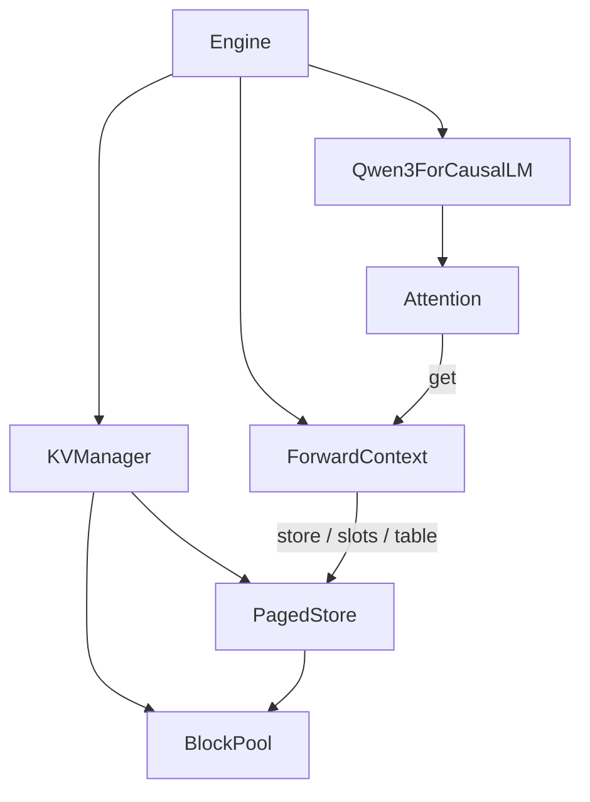
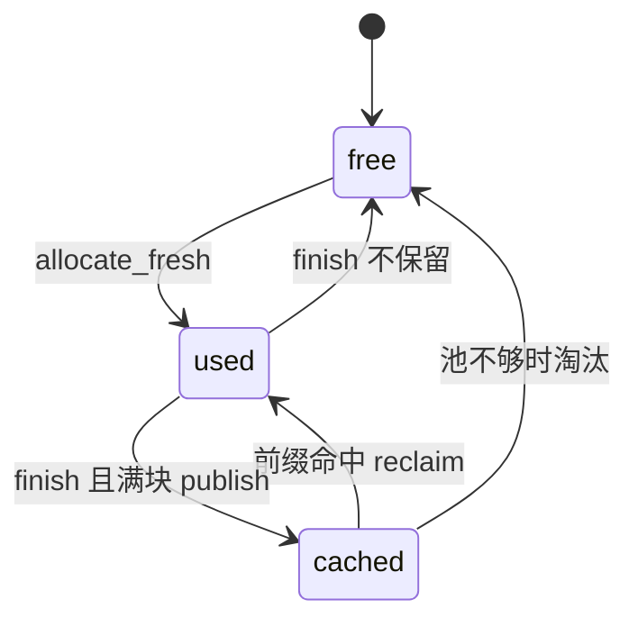
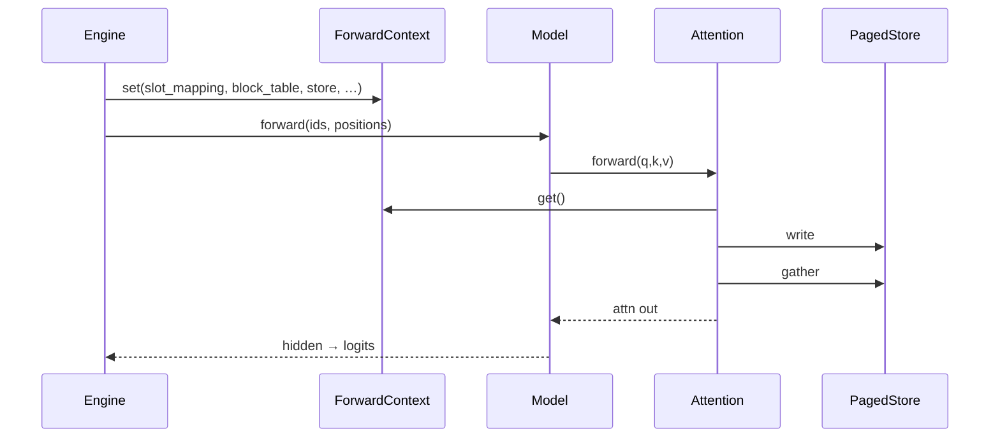

# vllm-v1
> KV Management

> [上一节](../README.md) · 图示备查见本文后半 · 细节可对照源码

v0 解决的是怎样把 Qwen3 从权重到逐字输出这条链路跑通。

v1 的核心是把历史 Token 的 Key / Value 存下来，并让这条缓存真正接到 Engine 与 Model 上。


## 1. 回顾 v0
v0 的自回归循环可以压成五步：

```text
拼整段序列 → 整段 forward → 取最后一位 logits → 采样 → append → 再来一轮
```

每一步模型看到的都是**从第一个 prompt token 到当前最后一个 token**的完整输入。Attention 里 Q/K/V 都是当场算出来的，算完即丢。结果是：
| 现象 | 后果 |
| :--- | :--- |
| 第 N 步仍要算前 N−1 个历史位置的 K/V | 计算量随长度平方涨 |
| 没有跨请求状态 | 两次 `generate` 即使 prompt 相同，也各算各的 |


## 2. KV Cache

在学习vllm-v1版本的时候，最核心的是思考这4个问题：
1. 没有 Cache 时缺什么
2. Cache 到底优化什么
3. 我们按什么理念设计
4. 最终换来什么效果。

### 2.1 当前缺点

自回归里，第 $t$ 步要预测下一个 token，Attention 必须看见位置 $0\ldots t-1$ 的 Key / Value。这件事数学上没问题。v0 也确实是这么实现的：
**每一步都把整段序列重新送进模型，让每一层现场重算全部历史的 K/V。**

但是，这会直接带来两类问题：
1. **计算重复**。生成第 $N$ 个新 token 时，前面 $N-1$ 个位置的 K/V 在上一步其实已经算过了，但因为没有地方存放，下一步只能再算一遍。decode 的 Attention 工作量随长度近似按 $O(N^2)$ 涨，长上下文时延迟暴涨。
2. **显存碎片化**。如果按最大输出长度给每条请求预留一整段连续 KV，这倒是可以消除重算，但长度不可预知时会大量预留、碎片化。KV缓存不能只做一个大 tensor 粘在模型上，而是应该设计一个类似内存池的东西，高效的对整个池子进行管理。

所以 v1 要同时解决两件事：**缓存 K/V**，以及 **管理KV**。

### 2.2 KV Cache 的核心作用
KV Cache可以让模型在输出过程中，每个 token 的 K/V 只算一次；之后每一步生成只负责算新 token 的 K/V 并追加，Attention的时候 再把缓存里的历史 + 当前生成的新token拼起来做注意力。

对应到两阶段：

- **Prefill**：把 prompt尚未在缓存里的那一段过一遍模型，把得到的 K/V 写入缓存。这一步仍可能处理较长序列，但是一次性计算。
- **Decode**：每一轮模型输入长度变为 **1**。新算出的 K/V 添加进缓存；做 Attention 时 读出长度为当前总序列的 K/V，再和长度为 1 的 Q 做 SDPA。

因此 Cache 的第一性收益是 **算力**。decode 从【每步重算整段】变成【每步只算增量】。  
第二性收益是 **显存形态**与 **跨请求复用**。页式存放可以减少预留浪费；前缀索引让相同 prompt 前缀不必再 prefill 一遍。

### 2.3 KV Management的设计理念


**第一刀：逻辑地址与物理显存分离（PagedAttention）。**  
请求眼里只有「我这条序列第几个 token、第几页」；GPU 上则是固定大小的物理页池。页可以不连续，用时再分配，用完可回池。这借鉴操作系统虚拟内存，避免「按最大长度连续预留」。

**第二刀：生命周期与张量读写分离。**  
「谁占用哪些页、前缀能否命中、请求结束页去哪」是**调度 / 资源**问题；「给定页号如何把 K/V 写进大张量、如何按逻辑顺序读回」是**存储契约**问题。两者不应糊在同一个类里，否则 Attention、分配器、前缀树会互相 import 到失控。

**第三刀：编排与计算分离，用「本步合同」对接。**  
Engine 负责决定：这一步要算哪段 token、页表是什么、从哪写到哪。Model / Attention 仍应尽量只做「算」，但必须能看见 Cache。我们不把 `KVManager` 塞进 `Attention.__init__`，也不改 `Qwen3ForCausalLM.forward` 的外壳；而是让 Engine 在每次 `model(...)` **之前**放入一份短命的 `ForwardContext`，Attention `forward` 时取用。**融合点只有这一处合同，而不是把 Cache 状态散进每一层参数。**

### 2.4 如何设计：映射到本仓库的四个模块

按上面三刀，代码落成四块，读目录就能对上理念。

```text
src/kv/pool.py            物理页池 BlockPool（大张量 k/v + free/used/cached）
src/kv/sequence.py        逻辑序列 Sequence（token_ids + block_table）
src/kv/manager.py         生命周期 KVManager（allocate / ensure / finish + 前缀）
src/kv/context.py         本步合同 ForwardContext（set/get_forward_context）
src/pagedattention/       存储契约 PagedStore.write / gather + slots_tensor
src/layers/attention.py   消费合同：write → gather → SDPA
src/engine.py             编排：Prefill/Decode、绑合同、喂增量 ids/positions
```

用「一次 token 的 K/V 从诞生到被看见」串起来：

1. **`BlockPool`**：引擎启动时按模型层数、KV 头维，预开一整块  
   `[num_layers, num_blocks, block_size, num_kv_heads, head_dim]`。  
   真正的数值住在这里；`_Block` 只挂元数据（引用计数、块哈希等）。页在 `free → used → cached` 间流转。

2. **`Sequence` + `KVManager.allocate`**：请求到来时先建立逻辑对象，再向池子要页，填好 `block_table`（逻辑页号 → 物理块号）。可选地问 `PrefixIndex` 能不能直接认领别人留下的满块。**这一步还不跑 Attention，只解决「住哪里」。**

3. **`Engine._bind_ctx`**：真正 `model.forward` 前，根据 `block_table` 算出本步 `slot_mapping`（新 token 写到哪些物理 slot），连同 `store / cache_len / seq_len` 打进 `ForwardContext`，`set_forward_context`。**这一步解决「Model 本步该看见什么合同」。**

4. **`Attention` + `PagedStore`**：层内仍先算当前输入的 Q/K/V（与 v0 相同）；接着 `store.write` 把本步 K/V 按 slot 写入池子，`store.gather` 按 `block_table` 读回 `[0, seq_len)` 的历史，再 SDPA。**这一步解决「算一次、写入；读全量、做注意力」。**

5. **Decode 变长时 `ensure_blocks`，结束时 `finish`**：新 token 跨页就追加物理页；请求结束把满块 `publish` 进前缀索引并进入 `cached`，未满尾块回 `free`。池子跨多次 `generate` 存活，**禁止**每次生成 `zero_()` 整池。

一张职责表方便对代码：

| 模块 | 设计上负责什么 | 刻意不负责什么 |
| :--- | :--- | :--- |
| `KVManager` / `BlockPool` / `Sequence` | 页的占用、补页、结束回收、前缀 match/publish | Attention 数值、SDPA |
| `PagedStore` / `slots_tensor` | 页表地址 ↔ 张量下标的读写 | 请求何时开始结束 |
| `ForwardContext` | Engine → Attention 的短命合同 | 长期存储 |
| `Attention` | 执行 write→gather→SDPA | 是否前缀命中、页是否够用 |
| `Engine` | Prefill/Decode 切分、绑合同、增量 ids/positions | 哈希树内部、物理 index_copy 细节 |

### 2.5 效果：相对 v0 立刻能感知到什么

1. **Decode 计算量质变**。模型每步输入从长度 $N$ 变为长度 $1$；历史 K/V 来自 Cache。这是打开 tok/s 的主因，也是「KV Cache 核心作用」的可观测结果。

2. **显存按需长页，而不是按 `max_length` 预留一整条连续缓冲**。请求短就占少量 `used` 页；结束后满块可留在 `cached` 供复用，空页回 `free`。同一块物理显存被多请求、多轮次轮转使用，为后续 Continuous Batching 留出同一套页表语义。

3. **模型骨架几乎不用为 Cache 改接口**。`forward(ids, positions)` 仍在；变的是 Engine 喂什么，以及 Attention 是否走合同。排错时边界清晰：页不够找 `KVManager`，写错位找 `slot_mapping` / `PagedStore`，算子不对找 `Attention`。

4. **前缀命中是叠加收益，不是主路径本身**。`prefix_backend=hash|radix` 时，第二次相同前缀的 `allocate` 可跳过已缓存满块的 Prefill；关掉后端则退化为「单请求内 Paged KV」，主链路不变。

一句话收束本节：

> **KV Cache 的核心作用是让每个 token 的 K/V 只算一次；  
> 本仓库的设计理念是「页式物理池 + 生命周期管理 + 本步合同接入 Attention」；  
> 代码上就是 `kv` 管住哪、`pagedattention` 管怎么读写、`Engine` 管何时绑定、`Attention` 管按合同完成 write/gather/SDPA。**

---


## 三、整条流程：从 prompt 到逐字输出

下面按一次 `Engine.generate` 走完整路径。这是读 v1 时最该先建立的心理模型。

### 3.1 启动时多出来了什么

相对 v0，`Engine.__init__` 在 model / sampler 之外，会构造一个常驻的：

```text
KVManager
  ├─ BlockPool     物理 k/v + free/used/cached 三态
  ├─ PagedStore    绑在 pool 上的写/读 API
  └─ PrefixIndex   none | hash | radix（可选）
```

模型权重仍按 v0 方式加载；**KV 池按层数、KV 头数从模型结构推出来**，与权重并行存在。

### 3.2 请求进入：从字符串到有页表的 Sequence

```text
prompt
  → tokenizer.encode → input_ids
  → kv.new_sequence(input_ids)   得到 Sequence（token_ids，尚无可靠页表）
  → kv.allocate(seq)
        ├─ 问 PrefixIndex：满块前缀能否命中已有物理页？
        ├─ 命中：reclaim / 加引用，写入 block_table 前缀
        └─ 未命中部分：allocate_fresh 新页接到 block_table 后面
  → seq.num_cached_tokens = 命中满块 × block_size
```

此时还没有算任何 Attention。只是：**这条请求已经知道「逻辑上第几页对应物理上哪一块」**。

### 3.3 Prefill：把「还没在缓存里的 prompt」算进去

分两种常见情况：

**A. 未命中或只部分命中**（`cached < prompt_len`）

```text
Engine._bind_ctx(seq, is_prefill=True, cache_len=cached, write_end=prompt_len)
  → 用 block_table 生成 slot_mapping（只覆盖要新写入的那段）
  → set_forward_context(ForwardContext(...))

模型输入只给「未缓存段」：
  ids       = input_ids[cached : prompt_len]
  positions = cached … prompt_len-1

model.forward → 各层 Attention：
  算出本段 K/V → store.write(slot_mapping)
  store.gather(整段 0…prompt_len) → 与当前 Q 做 SDPA
  （若有前缀：Q 短、K/V 长，用位置 mask 保因果）

取末位 hidden → logits → 采出第一个生成 token
```

**B. 整段 prompt 都在前缀缓存里**（极少见的「满命中」边界）

历史上的 K/V 都在，但最后一位的 hidden / logits 仍要落到「下一个生成 token」。v1 会退成：只对最后一个 prompt token 再走一步类似 decode 的 forward，然后采样。

无论 A/B，**Prefill 结束后，pool 里已经放好了这条请求当前所需的物理 KV。**

### 3.4 Decode：每步只喂一个新 token

```text
seq.append_token(next_id)
kv.ensure_blocks(seq)          # 可能跨过页边界，需要新物理页

循环：
  _bind_ctx(cache_len → cache_len+1)   # slot_mapping 只有 1 个 slot
  ids = [[next_id]]
  positions = [[cache_len]]
  model.forward
      Attention: write 这一步的 K/V → gather 全长 → SDPA（通常 q_len=1）
  logits → sample → yield
  append + ensure_blocks
  cache_len += 1
```

与 v0 对比一句话：

| | v0 | v1 decode |
| :--- | :--- | :--- |
| 模型输入长度 | 整段历史 | **恒为 1**（新 token） |
| positions | `0…N-1` 整段重编 | **只给新位置** `cache_len` |
| Attention 历史 | 当场重算 | **从 PagedStore gather** |

### 3.5 收尾：finish，而不是把池子扔掉

```text
finally:
  set_forward_context(None)
  kv.finish(seq)
      ├─ 把「满块」的元数据 publish 进 PrefixIndex（若开启）
      ├─ 满块页 → cached（供下次 match）
      └─ 尾块未满 / 或 none 后端 → free
```

下一次 `generate`，若 prompt 共享相同满块前缀，`allocate` 就能直接复用那些 `cached` 页，Prefill 跳过对应 token——这是 v1 的第二层收益（跨请求），建立在第一层（页内 KV 缓存）之上。

---

## 四、KV 如何「长进」Engine：编排职责对照

可以把 Engine 理解成导演，KV 是场务，Model 是演员。

```text
run.py
  └─ Engine
       ├─ tokenizer / model / sampler     （与 v0 相同角色）
       ├─ kv: KVManager                   （v1 新增：场务）
       └─ generate()
            ├─ kv.new_sequence / allocate
            ├─ 每步 _bind_ctx + model(...) + sample
            ├─ kv.ensure_blocks
            └─ finally: kv.finish
```

Engine 相对 v0 **改写的部分**，说到底只有这些：

1. **循环拆成 Prefill + Decode**，不再每步喂整段 `input_ids`。
2. **每步 forward 前绑定 ForwardContext**（页表合同）。
3. **用 Sequence 管理 token 与 block_table**，而不是只拿一个 Python list。
4. **结束时 finish**，把页退回池子 / 交给前缀索引。

Engine **仍然不实现** Attention 数学，也 **不直接** `index_copy_` 物理张量；它只调用 `KVManager` 与 `slots_tensor`，再调 `model`。

---

## 五、KV 如何「长进」Model：只改 Attention 契约

模型堆叠方式与 v0 一致：`Embedding → N × DecoderLayer → Norm → lm_head`。  
Decoder 里仍是 RMSNorm → QKV → RoPE → **Attention** → 残差 → MLP。

v1 真正改掉的模型侧文件，几乎就是 `layers/attention.py`：

```text
v0 Attention.forward(q, k, v):
    当场 SDPA(q, k, v)          # 历史全在这一次的 k/v 里

v1 Attention.forward(q, k, v):
    ctx = get_forward_context()
    if ctx is None:
        退回 v0 行为（无缓存路径）
    else:
        store.write(本层, slot_mapping, k, v)   # 追加进物理池
        k_c, v_c = store.gather(本层, block_table, seq_len)
        SDPA(q, k_c, v_c)                       # 历史来自缓存
```

因此：

- **上层 `Qwen3ForCausalLM.forward(ids, positions)` 签名可以不变**——仍然是「当前这批 token 的 id 与位置」。
- **变的是 ids/positions 的语义**：v0 是整段；v1 Prefill 是未缓存段，Decode 是单 token。
- **Attention 从「自给自足」变成「读合同」**；合同由 Engine 写好，与层编号 `layer_id` 一起决定写到池的哪一层。

这就是融合方式的全部要点：**Model 不算生命周期，只认本步合同；合同由 Engine 在调用 Model 之前放进线程局部上下文。**

---

## 六、一次完整调用的路径（总图）

```text
EngineConfig + 权重
    │
    ▼ Engine.__init__
    │   tokenizer / model / sampler
    │   KVManager → BlockPool + PagedStore + PrefixIndex
    │
    ▼ engine.generate(prompt)
    │
    │  ┌─ new_sequence + allocate ─┐
    │  │  Sequence.block_table     │
    │  │  num_cached_tokens        │
    │  └───────────────────────────┘
    │
    │  ┌─ Prefill ──────────────────────────────┐
    │  │  _bind_ctx → set_forward_context       │
    │  │  model(未缓存 ids, 对应 positions)      │
    │  │     Attention: write → gather → SDPA   │
    │  │  sample → 第一个新 token               │
    │  └───────────────────────────────────────┘
    │
    │  ┌─ Decode × N ───────────────────────────┐
    │  │  append + ensure_blocks                │
    │  │  _bind_ctx（单 slot）                   │
    │  │  model([[token]], [[pos]])             │
    │  │     Attention: write → gather → SDPA   │
    │  │  sample → yield                        │
    │  └───────────────────────────────────────┘
    │
    ▼ finally: clear context + finish(seq)
         满块 → PrefixIndex + cached；尾块 → free
```

读代码时建议按这个顺序跟：

1. `src/engine.py` 的 `generate` / `_bind_ctx`（编排）
2. `src/kv/manager.py` 的 `allocate` / `ensure_blocks` / `finish`（页生命周期）
3. `src/layers/attention.py` 的 `forward`（合同消费）
4. `src/pagedattention/store.py` 的 `write` / `gather`（物理读写）
5. 需要时再进 `src/kv/prefix/*`（跨请求）

---

## 七、前缀缓存在整条故事里站在哪

前缀不是另一套管线，而是挂在 **allocate / finish** 两端的加速器：

```text
请求结束 finish ——publish→ 索引记住「这些满块 token ↔ 这些物理页」
下一次 allocate ——match→  直接拿回物理页，Prefill 跳过对应长度
```

- 粒度是 **满 block**，尾块不共享（没写满就无法安全当公共前缀）。
- `none`：只有单次请求内的 KV Cache，无跨请求复用。
- `hash` / `radix`：索引结构不同，对 Engine / Attention 完全透明。

理解主流程时，可以先当成「allocate 总是全 miss」；主链路通了再打开前缀后端。

---

## 八、v1 刻意还没做的事

| 能力 | v1 现状 | 留给后续 |
| :--- | :--- | :--- |
| Continuous Batching | 仍是单请求 `generate` | 调度器 + 迭代组 batch |
| 真·PagedAttention kernel | gather 成连续张量再 SDPA | FlashInfer / 内核内按页打分 |
| 多卡 / 异步服务 | 单卡同步 | TP、多进程 |
| 调度驱逐策略 | free 不够才挤 cached | 更完整的 eviction |

<span style="color:#b45309">**机制**</span> 先把「历史 K/V 存在哪、谁分配、Model 怎么看见」这条主脊梁立住；吞吐向优化应落在调度与算子，而不是再把 Attention 与页管理耦死。

---

## 九、文件结构（相对 v0）

```text
vllm-v1/
├── run.py
├── docs/
│   ├── architecture.md      ← 本页（流程总览）
│   ├── kv_cache.md          分包与前缀对照（偏短）
│   └── ADDED_vs_v0.md       相对 v0 增改清单
└── src/
    ├── engine.py            编排：Prefill/Decode + bind ForwardContext
    ├── kv/                  页生命周期 + 前缀 + Context
    │   ├── manager.py
    │   ├── pool.py
    │   ├── sequence.py
    │   ├── context.py
    │   └── prefix/
    ├── pagedattention/      纯页表读写（写 slot / 读 block_table）
    ├── layers/attention.py  消费 ForwardContext
    └── …                    其余与 v0 对齐（model / sampler / …）
```

---

## 十、对照图（备查）

下面几张图与上文同一套逻辑，便于扫一眼回忆边界；细节仍以源码为准。

### 10.1 分层依赖



### 10.2 页的三态



### 10.3 单步合同如何进到 Attention



---

## 十一、一句话收束

- **v0**：Model 每步看见整段历史，K/V 用完即弃。  
- **v1**：Engine 用 `KVManager` 管页、用 `ForwardContext` 把页表合同塞进当步；Model 的 Attention 按合同把 K/V 写入物理池并读回历史，从而 Prefill 写缓存、Decode 只算新 token。  
- **前缀**：只是把 finish 留下的满块页，在下一次 allocate 时再认领回来。

读完本文，应能不看代码说出一次 `generate` 里「谁在什么时候写 KV、谁在什么时候读 KV」。再下钻时，用文末图 + `engine.py` → `attention.py` → `manager.py` → `store.py` 这条路径即可。
