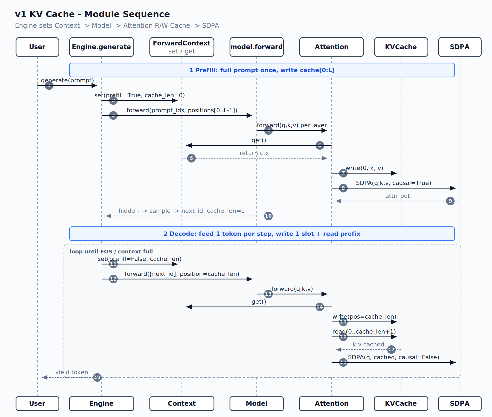

# v1：从零实现一个单序列 KV Cache

> 相关代码：[kv_cache.py](../src/kv_cache.py) · [context.py](../src/utils/context.py) · [attention.py](../src/layers/attention.py) · [engine.py](../src/engine.py)

<span style="color:#1d4ed8">**模块名**</span> · <span style="color:#b45309">**核心机制**</span> · <span style="color:#059669">**实现细节**</span> · <span style="color:#7c3aed">**数据流**</span> · <span style="color:#dc2626">**边界与注意事项**</span>

v0 已经具备了一个语言模型推理引擎最小的闭环：输入 prompt，模型前向计算，取最后一个位置的 logits 采样，再把新 token 拼回输入继续生成。它的结果是正确的，但随着上下文变长，生成速度会明显下降。原因不在模型权重，也不在采样器，而在于 v0 每生成一个 token 都重新处理整段历史。

v1 现在主要解决的是让已经计算过的历史 Key 和 Value 不再重复计算。这就是 KV Cache。这里不会直接引入真正 vLLM 的 PagedAttention、BlockManager 或连续批处理；我们先实现一个只有单请求、单 batch、连续内存的版本。

## 1. 从 v0 的生成循环开始

<span style="color:#7c3aed">**数据流**</span> v0 的 `Engine.generate` 是典型的自回归循环。假设 prompt 已经被 tokenizer 转成 `input_ids`，每一轮都会把 `input_ids` 的完整内容放到 GPU，构造从 `0` 到当前长度减一的位置，再执行一次完整的 Transformer forward。

```python
for _ in range(max_new_tokens):
    ids = torch.tensor([input_ids], device=self.device, dtype=torch.long)
    positions = torch.arange(len(input_ids), device=self.device).unsqueeze(0)

    h = self.model(ids, positions)
    logits = self.model.compute_logits(h[:, -1:]).squeeze(1)
    next_id = self._sample(logits, ...)

    yield self.tokenizer.decode([next_id])
    input_ids.append(next_id)
```

因果语言模型要预测下一个 token，确实要利用当前序列末尾位置的 hidden state；而这个 hidden state 又依赖它之前的所有 token。问题在于，第二轮和第三轮 forward 中，大部分历史 token 的中间结果其实和前一轮完全相同。

例如 prompt 是 `[A, B, C]`。模型先处理 `[A, B, C]` 并采样出 `D`；为了预测 `E`，v0 又会处理 `[A, B, C, D]`；为了预测 `F`，它继续处理 `[A, B, C, D, E]`。

```text
生成 D：计算 A、B、C 的整层 Transformer
生成 E：再次计算 A、B、C、D 的整层 Transformer
生成 F：再次计算 A、B、C、D、E 的整层 Transformer
```

以 Attention 为例，历史 token 的 Key 和 Value 在第一次计算后就已经固定。后续轮次中，`A`、`B`、`C` 的 K/V 不会因为新生成了 `D` 而改变；但 v0 仍会一遍遍重新投影、归一化并施加 RoPE。上下文长度为 $L$ 时，完整 self-attention 的 score 矩阵大小是 $L \times L$，单轮的主要计算量约为 $O(L^2)$。所以在无 Cache 的实现中，越往后生成，每个 token 的延迟越高。

## 2. Attention 中究竟哪些东西可以缓存

<span style="color:#b45309">**核心机制**</span> 一层 self-attention 从输入 hidden states 投影出 Query、Key 和 Value。对序列位置 $t$ 来说，最终输出可以写为：

$$
out_t = Softmax(Q_t · K_{0..t}^T / sqrt(d)) · V_{0..t}
$$

当我们正在生成第 $t$ 个 token 时，`Q_t` 必须在本轮产生，因为它来自当前 token 的 hidden state。`K_t` 和 `V_t` 同样要新算一次，然后放入历史序列中。但此前已经生成的 `K_0 ... K_{t-1}` 与 `V_0 ... V_{t-1}` 都是稳定的：它们在之前经过各层投影和位置编码后，其数值不会再改变。

KV Cache 的思路因此很直接：每一层为历史 token 保存已经计算好的 K/V；下一次 decode 时，模型只处理当前的一个 token，得到当前 `Q_t`、`K_t`、`V_t`，把 K/V 追加到缓存中，再让 `Q_t` 去关注缓存里的完整历史。

这项优化不会改变模型数学语义。若采样方式是贪心解码，v0 和 v1 理论上应逐 token 产生相同的结果。实际上，它改变的是计算顺序：历史 K/V 从“每轮重算”变成“首次计算一次，之后反复读取”。

这里需要区分两个概念。KV Cache 消除了 Transformer 层中历史 K/V 的重复计算，但 decode 阶段仍然要让当前 Query 与所有历史 Key 做注意力计算，因此单 token decode 的 attention 工作量约为 $O(L)$，而不是常数。随着上下文增长，读 Cache 和 `Q @ K^T` 仍会变慢；只是相比 v0 每轮处理 $L$ 个 Query 所形成的 $O(L^2)$，成本已经小得多。

## 3. Cache 应该接在模型的什么位置

<span style="color:#7c3aed">**数据流**</span> 要决定 Cache 的挂载点，先沿着一层 Qwen Attention 的数据流看 K/V 从哪里来：

```text
hidden_states
    │
    ├── qkv_proj / split
    ├── q_norm、k_norm
    ├── RoPE(q, k)
    ├── Attention(q, k, v)      ← 本版本的 Cache 在这里读写
    └── o_proj
```

K 必须在经过 RoPE 后再写入 Cache。RoPE 会按照 token 的绝对位置旋转 Q 和 K，使注意力分数携带相对位置信息。若缓存的是未旋转的 K，decode 阶段当前 Q 已按新位置旋转，却要同未旋转的历史 K 点积，位置关系就不成立了。V 不经过 RoPE，但和对应的 K 同一时刻写入，保证同一个 slot 中的 K/V 始终来自同一 token、同一层。

读写逻辑放在 `layers/attention.py` 的 `Attention.forward` 中，而不是 Engine 或模型外层。这个位置已经拿到了当前层的 `q`、`k`、`v`，也正好要调用 `torch.nn.functional.scaled_dot_product_attention`。Cache 不需要知道 QKV 投影、RMSNorm、RoPE 或输出投影的细节；它只负责按层和位置保存 tensor。这样的职责划分使得 `KVCache` 本身保持简单，也使 Attention 仍然是唯一决定“这一步用哪些 K/V 做 SDPA”的模块。

## 4. 四个模块如何协作

<span style="color:#1d4ed8">**模块名**</span> KV Cache 改动涉及四个核心模块。它们不是都参与矩阵计算，而是各自承担不同的工程职责：Engine 拥有一次请求的生命周期和长度状态；`ForwardContext` 传递本次 forward 的元信息；`KVCache` 管理 GPU 上的 K/V 存储；Attention 在合适的时机把它们组合成正确的 SDPA 输入。

整体调用时序如下：



Prefill 阶段，Engine 把 Context 设置为 `is_prefill=True`，随后将完整 prompt 送进 `model.forward`。每个 Transformer 层到达 Attention 时，从 Context 中取得同一个 Cache，把本层 prompt 的 K/V 写入对应区域，然后仍用完整 prompt 的 K/V 执行带因果掩码的 SDPA。模型返回末位 hidden state 后，Engine 采样出第一个新 token。

Decode 阶段是一个循环。Engine 每轮只向模型传一个 token 和它的绝对位置，同时把 Context 设置为 `is_prefill=False`。Attention 为这个 token 计算 K/V，先写入 Cache，再取回从位置 0 到当前位置的 K/V。此时 Query 的序列长度是 1，它只代表当前 token；让它对全部已填充 K/V 做一次无因果掩码的 SDPA，就得到与完整因果 attention 相同的结果。

图中的 `ForwardContext` 是控制信息，不是模型计算的一部分。它携带“本次是 Prefill 还是 Decode”“当前写入前已经填了多少 slot”“要访问哪一个 Cache”这三项信息。这样做避免给 `model.forward`、每个 decoder layer 和每个 Attention 都新增函数参数，v1 对模型结构的侵入较小。

<span style="color:#dc2626">**边界与注意事项**</span> `_forward_ctx` 是模块级全局变量，因此这版实现只适合单线程、单请求的同步执行。多个请求若并发进入同一进程，会互相覆盖 Context。真正的服务端实现需要把这类状态绑定到请求或调度批次，而不能依赖一个全局变量。

## 5. `KVCache`：连续显存上的 K/V 存储模块

<span style="color:#1d4ed8">**模块名**</span> `src/kv_cache.py` 是本版本最小的存储层。构造函数在 GPU 上预分配两块 tensor，一块放 K，一块放 V：

```python
self.k = torch.zeros(
    num_layers, max_len, num_kv_heads, head_dim, device=device, dtype=dtype
)
self.v = torch.zeros(
    num_layers, max_len, num_kv_heads, head_dim, device=device, dtype=dtype
)
```

整体形状为：

```text
[num_layers, max_len, num_kv_heads, head_dim]
```

第一维 `num_layers` 很重要。Transformer 的每一层都有独立的投影权重，因此 Layer 0 产生的 K/V 绝不能拿给 Layer 1 使用。Attention 构造时获得 `layer_id`，访问 Cache 时通过 `self.k[layer_id]` 和 `self.v[layer_id]` 精确定位本层。

第二维 `max_len` 是 token 的逻辑位置。v1 采取连续布局，位置 `0` 的 token 写到物理位置 `0`，位置 `1` 写到物理位置 `1`，没有页表、块表或逻辑地址到物理地址的转换。`max_len` 由 Engine 的 `context_len` 决定，因此同一请求最多填满整个上下文窗口。

后两维遵循模型的 GQA 配置。Qwen3 的 Query head 数通常大于 KV head 数；多个 Q head 会共享一组 K/V head。Cache 只保存紧凑的 `num_kv_heads`，而不保存扩展到 `num_heads` 后的副本。这样既符合 K/V 的原始语义，也避免为了 GQA 展开额外占用显存。真正调用 SDPA 前，Attention 才通过 `_expand_gqa` 将读取出的 K/V 视图扩展为与 Q head 数一致的形状。

### 5.1 `allocate`：由模型配置创建 Cache

<span style="color:#059669">**实现细节**</span> Engine 不手工传入层数和 head 维度，而是调用 `KVCache.allocate`：

```python
self.kv_cache = KVCache.allocate(
    self.model, self.context_len, device=self.device, dtype=self.dtype
)
```

`allocate` 从模型第一层 Attention 中读取 `num_kv_heads` 与 `head_dim`，并从 `model.model.layers` 读取层数。这个方法将“如何从当前模型导出 Cache 规格”的知识收在 Cache 模块内部，Engine 只需要表达“请为这个模型、这个上下文长度创建 Cache”。

这种写法的前提是各层的 KV head 数和 head dim 一致；标准 Transformer / Qwen3 满足这个前提。若未来要支持层间结构不同的模型，Cache 就需要改为逐层独立分配，而不能只读取 layer 0 的规格。

### 5.2 `write`：按逻辑位置追加新 K/V

<span style="color:#059669">**实现细节**</span> Attention 在写入前传入的 K/V 形状为 `[batch, seq, kv_heads, head_dim]`。`write` 根据本次 `seq` 的长度计算结束位置，并把这段连续 token 写到对应层：

```python
def write(self, layer_id, start, k, v):
    n = k.shape[1]
    end = start + n
    if end > self.max_len:
        raise ValueError(...)

    self.k[layer_id, start:end] = k[0]
    self.v[layer_id, start:end] = v[0]
```

Prefill 的 `seq` 等于 prompt 长度，所以一次将整段 K/V 写到 `[0:L)`；decode 的 `seq` 恒为 1，所以每轮只向下一个空 slot 写一个 K/V。`start:end` 使用 Python 的左闭右开区间，这也是文中 `cache_len` 要定义为“写入前已填充长度”的原因：若当前已经有 `L` 个 token，下一项自然应该写入 slot `L`。

代码中的 `k[0]` 和 `v[0]` 表明 v1 只支持 batch size 为 1。它不是一个偶然的写法，而是连续单序列设计的直接结果：Cache 的存储形状没有 batch 或 request 维度。要支持 continuous batching，未来需要引入请求到物理 block 的映射，或至少显式管理多个序列的独立写入位置。

### 5.3 `read`：读取当前有效前缀

`read(layer_id, length)` 返回 `self.k[layer_id, :length]` 与对应 V。它不复制 tensor，而是得到连续前缀的切片视图。对 decode 来说，写完当前位置 `pos` 后调用 `read(layer_id, pos + 1)`，得到的正是从第一个 prompt token 到当前 token 的完整历史。

`read` 和 `write` 都检查 `max_len`，防止因 Engine 逻辑错误或调用方越界而静默写坏内存。Engine 也会在 decode 循环开始前检查 `cache_len >= context_len`，正常路径下不会碰到这个异常；这里的检查属于存储模块自己的边界保护。

### 5.4 `reset`：开始新请求前清空

<span style="color:#dc2626">**边界与注意事项**</span> 每次 `generate` 开始时，Engine 调用 `self.kv_cache.reset()`，对 K 和 V 执行 `zero_()`。这保证新请求不会读取上一个请求留下的数据。严格来说，当前版本的 `read` 永远只读由 `cache_len` 描述的有效前缀，因此只要长度管理完全正确，清零不是计算正确性的必要条件；但它让“未写区域都是零”这一状态直观可见，也避免调试时将旧内容误认为有效缓存。

它也有成本：`zero_()` 会写完整个预分配 Cache，`context_len` 很大时会产生额外的显存带宽开销。生产级 Cache 通常通过 block 分配、引用计数或有效长度管理避免每请求清整块显存。v1 保留这个简单实现，目的是先让生命周期容易理解。

## 6. `ForwardContext`：把一次 forward 的状态传到 Attention

<span style="color:#1d4ed8">**模块名**</span> `src/utils/context.py` 定义了一个很小的 dataclass：

```python
@dataclass
class ForwardContext:
    is_prefill: bool
    cache_len: int
    kv_cache: KVCache
```

`is_prefill` 决定 Attention 应走哪一种计算路径。Prefill 中一次输入多个 token，需要因果掩码；decode 中一次只输入一个 token，需要从 Cache 取历史 K/V。`cache_len` 表示本次 forward **开始之前**已经写入 Cache 的 token 个数；它不是本次 forward 的总长度，也不是数组的最后一个下标。这个约定同时消除了 off-by-one 歧义：写入位置就是 `cache_len`，写完一个 decode token 后的读取长度就是 `cache_len + 1`。

Engine 在执行 `model(...)` 之前调用 `set_forward_context(...)`，Attention 内调用 `get_forward_context()`。当生成结束、遇到 EOS 或 prompt 已经填满上下文时，Engine 必须执行 `set_forward_context(None)`，否则下一次不希望使用 Cache 的模型调用仍可能读取到旧状态。

这个 Context 还有一个兼容作用。`Attention.forward` 检测到 `ctx is None` 时，会保留 v0 的 causal attention 路径。因此单独测试 Attention、或者不经 Engine 直接调用模型时，模型仍可像 v0 一样工作。这条回退路径也是检查“Cache 是否改变数学结果”的方便基线。

## 7. `Attention`：Cache 真正接入计算的位置

<span style="color:#059669">**实现细节**</span> Attention 收到的 Q/K/V 初始形状是 `[batch, seq, heads, head_dim]`。为了匹配 PyTorch SDPA 的接口，它先转置为 `[batch, heads, seq, head_dim]`：

```python
q = q.transpose(1, 2)
k = k.transpose(1, 2)
v = v.transpose(1, 2)
```

这一步之后，K/V 的 token 维在第 3 维。Cache 的 `write` 接口采用更直观的 sequence-first 形状 `[batch, seq, kv_heads, head_dim]`，所以写入时又使用 `k.transpose(1, 2)` 转回去。读出 Cache 后，它的形状是 `[seq, kv_heads, head_dim]`，Attention 再通过 `unsqueeze(0).transpose(1, 2)` 恢复为 SDPA 所需的 `[1, kv_heads, seq, head_dim]`。

这些转置不会改变元素含义，只是在不同模块间选择更方便的维度排列：存储时希望 token 下标在前，读取连续区间直观；计算时希望 head 在前，SDPA 可以对每个 head 并行计算。

### 7.1 无 Context：保留 v0 行为

```python
if ctx is None or ctx.kv_cache is None:
    k, v = self._expand_gqa(k, v)
    attn_output = F.scaled_dot_product_attention(
        q, k, v, is_causal=True, scale=self.scaling
    )
```

这条分支不读取也不写入 Cache。K/V 直接经过 GQA 展开后和当前 Q 做因果 attention，与 v0 的 Attention 逻辑一致。它让 Cache 成为可选优化，而不是强制要求所有调用者都配置 Context。

### 7.2 Prefill：写入整段，但仍对整段做 causal attention

```python
start = ctx.cache_len
cache.write(layer_id, start, k.transpose(1, 2), v.transpose(1, 2))

k, v = self._expand_gqa(k, v)
attn_output = F.scaled_dot_product_attention(
    q, k, v, is_causal=True, scale=self.scaling
)
```

在当前 Engine 中 Prefill 从空 Cache 开始，所以 `start=0`。整段 prompt 的 K/V 被写入 `[0:L)`，然后 attention 仍直接使用本次 forward 的 K/V，而不回读 Cache。这是合理的：prefill 本来就必须处理完整 prompt，直接使用手中的连续 tensor 最简单；写 Cache 的目的在于为后续 decode 留下历史。

`is_causal=True` 不可省略。Prefill 一次输入了多个 Query，例如 Query `A` 不能看到未来的 `B`、`C`，否则训练时的因果语言模型语义会被破坏。因果掩码保证 prompt 中每个位置只能关注自己及其左侧 token。

### 7.3 Decode：先写当前 token，再读完整前缀

```python
pos = ctx.cache_len
cache.write(layer_id, pos, k.transpose(1, 2), v.transpose(1, 2))

k_cached, v_cached = cache.read(layer_id, pos + 1)
k_cached = k_cached.unsqueeze(0).transpose(1, 2)
v_cached = v_cached.unsqueeze(0).transpose(1, 2)
k_cached, v_cached = self._expand_gqa(k_cached, v_cached)

attn_output = F.scaled_dot_product_attention(
    q, k_cached, v_cached, is_causal=False, scale=self.scaling
)
```

“先写，再读”不是实现细节，而是正确性的关键。当前 token 也应当能关注自己；如果先读 `0:pos` 再写，那么 `Q_t` 只能看到历史 `0..t-1`，与标准 causal self-attention 不一致。写入 slot `pos` 后读取 `pos+1` 个元素，缓存 K/V 正好覆盖 `0..t`。

这里使用 `is_causal=False` 常常令人困惑，但它是正确的。decode 阶段 Query 的长度只有 1，唯一的 Query 就是序列末尾的当前 token；传入的 K/V 都是它左侧的历史加上它自己，没有任何未来 token。因此不需要再施加三角形掩码。若对一个长度为 1 的 Q 与更长的 KV 使用 PyTorch 的 causal mask，掩码的对齐语义反而需要格外小心；这里关闭掩码最直接地表达了“当前 Query 可以看所有提供的 K/V”。

GQA 展开也放在 Cache 读取之后。这保证 Cache 始终以紧凑的 `num_kv_heads` 存储；每轮 decode 只为当前 SDPA 临时构造面向 Q head 的视图，而不是把扩大后的重复 K/V 永久写进显存。

## 8. `Engine`：将生成循环拆成 Prefill 与 Decode

<span style="color:#1d4ed8">**模块名**</span> Engine 在模型加载完成、进入生成前分配 Cache：

```python
self.kv_cache = KVCache.allocate(
    self.model, self.context_len, device=self.device, dtype=self.dtype
)
```

这块显存属于 Engine 实例，而不是某个临时 forward。因此在一次 `generate` 中，它会跨越 Prefill 和所有 Decode 步骤持续存在。当前单请求设计下，新的 `generate` 调用会先 `reset()`，再复用同一块 GPU 内存。

生成开始后，Engine 先完成 Prefill：

```python
self.kv_cache.reset()
prompt_len = len(input_ids)

set_forward_context(
    ForwardContext(is_prefill=True, cache_len=0, kv_cache=self.kv_cache)
)
ids = torch.tensor([input_ids], device=self.device, dtype=torch.long)
positions = torch.arange(prompt_len, device=self.device).unsqueeze(0)
h = self.model(ids, positions)
next_id = self._sample(self.model.compute_logits(h[:, -1:]).squeeze(1), ...)
```

这里的 `ids` 形状是 `[1, prompt_len]`，`positions` 的值为 `[0, 1, ..., prompt_len - 1]`。所有层都在这次 forward 中将 prompt K/V 写入自身的 Cache 区域。Engine 只从最后一个 hidden state 计算 logits，因为因果语言模型的下一个 token 由 prompt 最后位置的状态决定。

得到第一个 `next_id` 后，Engine 将 `cache_len` 设为 `prompt_len`，随后进入 decode 循环：

```python
set_forward_context(
    ForwardContext(is_prefill=False, cache_len=cache_len, kv_cache=self.kv_cache)
)
ids = torch.tensor([[next_id]], device=self.device, dtype=torch.long)
positions = torch.tensor([[cache_len]], device=self.device, dtype=torch.long)

h = self.model(ids, positions)
next_id = self._sample(self.model.compute_logits(h[:, -1:]).squeeze(1), ...)
cache_len += 1
```

和 v0 最根本的不同在这两行：decode 输入的 `ids` 始终是 `[1, 1]`，`positions` 也只包含当前 token 的一个绝对位置。历史 token 没有再传入 `model.forward`，因为历史 K/V 已经存在每层 Cache 中。模型仍然会为当前 token 完整执行 embedding、所有 decoder layer、MLP 和输出层；被省掉的是历史 token 在各层中重复进行的计算。

`cache_len` 的所有权在 Engine。它负责在每次 decode 完成后加一，并在下一轮 forward 前把新值写进 Context。Attention 不更新这个全局长度，因为所有层在同一轮中都要写入同一个逻辑位置；若某一层提前更新，后续层就会错位。这个“Engine 管时间线，Attention 管每层读写”的分工，是 Cache 正确对齐的核心。

## 9. 用 `[A, B, C]` 走完整个过程

<span style="color:#7c3aed">**数据流**</span> 现在用一个具体例子检查各处下标。设 prompt 为 `[A, B, C]`，因此 `L=3`；`max_len=8`。为方便阅读，只画出一层，真实模型中的每层都执行相同的逻辑，只是写入自己 `layer_id` 对应的那一块。

请求开始时，K 和 V 都已经预分配为长度 8 的连续空间：

```text
slot:   0    1    2    3    4    5    6    7
K/V:   [.]  [.]  [.]  [.]  [.]  [.]  [.]  [.]
```

Prefill 将 `[A, B, C]` 和位置 `[0, 1, 2]` 送入模型。RoPE 后，这层获得 `K_A`、`K_B`、`K_C` 以及对应的 V。`cache_len=0`，所以 `write(layer_id, start=0, ...)` 将三项放进 `[0:3)`：

```text
slot:    0      1      2      3    4    5    6    7
K/V:   A 的K/V B 的K/V C 的K/V  [.]  [.]  [.]  [.]  [.]
```

同时，本次 Prefill 的三个 Query 仍使用因果掩码：

```text
          K_A   K_B   K_C
Q_A        ✓     ×     ×
Q_B        ✓     ✓     ×
Q_C        ✓     ✓     ✓
```

最后位置 `Q_C` 所在的 hidden state 经 lm head 和采样器后得到第一个生成 token `D`。此时 Engine 令 `cache_len=3`，意思是 slot `0`、`1`、`2` 已经有效，下一次写入应从 slot `3` 开始。

第一轮 decode 的输入不再是 `[A, B, C, D]`，而只有 `[[D]]`，位置为 `[[3]]`。模型为 `D` 算出新的 `Q_D`、`K_D`、`V_D`；本层 Attention 先把 `K_D/V_D` 写入 slot `3`，再读取前四个 slot：

```text
写入后：
slot:    0      1      2      3      4    5    6    7
K/V:   A 的K/V B 的K/V C 的K/V D 的K/V  [.]  [.]  [.]  [.]

本轮实际 attention：
Q_D  ×  [K_A, K_B, K_C, K_D]
```

`Q_D` 已处在序列末尾，因此可以看见这四个 K；SDPA 关闭因果 mask。采样得到 `E` 后，Engine 才把 `cache_len` 更新为 4。下一轮完全重复同样的步骤：只传 `E` 和位置 4，写 slot 4，读取 `[0:5)`，让 `Q_E` 关注 `A` 到 `E` 的 K/V。

与 v0 对照，区别不在“生成的 token 数”，而在“每步送进 Transformer 的 token 数”：

```text
v0:  [A,B,C] → [A,B,C,D] → [A,B,C,D,E] → ...
v1:  [A,B,C] →       [D] →         [E] → ...
                     ↑历史由各层 KV Cache 提供
```

## 10. 显存代价、性能收益与版本边界

<span style="color:#b45309">**核心机制**</span> KV Cache 用显存换计算。K 和 V 各一份，额外显存可粗略写为：

```text
2 × num_layers × max_len × num_kv_heads × head_dim × sizeof(dtype)
```

这个公式也解释了为什么 GQA 对推理非常重要：Cache 的大小由 `num_kv_heads` 决定，而不是 `num_heads`。减少 KV head 数可以直接降低每个 token、每一层所需的缓存空间。对长上下文和高并发场景，KV Cache 往往会成为比模型权重更主要的显存消费者。

v1 通过一次 Prefill 填充 Cache，避免 decode 重算历史 token，因此主要收益出现在长上下文的逐 token 生成。Prefill 本身并不会神奇地变成常数时间：prompt 的每个 token 仍需要经过模型，因果 attention 仍需要处理完整 prompt。Cache 优化的是 prefill 之后的“一个接一个生成”阶段。

这个版本刻意采用连续 `[layers, max_len, kv_heads, head_dim]` 布局，代价是必须为单个请求预留一段固定长度空间，并且只能服务一个 batch。真正 vLLM 的 PagedAttention 将 Cache 切成固定大小的物理 block，用 block table 将请求的逻辑 token 位置映射到可能不连续的物理内存；这能降低不同请求长度带来的浪费，并让多个请求共享 GPU 的 Cache 池。Continuous batching、prefix cache、专用 attention kernel 和 CUDA Graph 也都建立在更完整的调度与内存管理之上。

因此，v1 的边界应当明确：它是一个用于理解 KV Cache 正确语义的单序列实现，不是高并发推理服务。它还没有请求隔离、并发调度、页式分配或前缀共享，但这些后续能力都依赖本章已经建立的基本不变量。每一层独立保存 K/V、位置必须对齐、当前 token 必须先写再读、Engine 必须唯一维护有效长度。

## 11. 如何验证实现没有改变结果

<span style="color:#dc2626">**边界与注意事项**</span> 最直接的正确性检查是固定输入，并使用 `temperature=0` 的贪心解码分别运行 v0 与 v1。逐 token 比较输出，而不是只比较最终字符串，因为 tokenizer 的增量 decode 可能让文本边界看起来不同。若第一个不一致 token 出现，通常应优先检查三个地方：当前 decode 的 position 是否等于写入前的 `cache_len`；K 是否在 RoPE 后写入；decode 是否在写入当前 K/V 后读取了 `cache_len + 1` 个 slot。

还应检查上下文边界。prompt 长度达到 `context_len` 时，v1 已经没有 slot 可以放入第一个生成 token；Engine 在输出首 token 后会停止。decode 循环也会在 `cache_len >= context_len` 时退出。`KVCache.write` 和 `KVCache.read` 中的溢出检查是最后一层保护，不应依赖它们作为正常控制流。

## 12. 总结

v1 的设计可以浓缩成一条数据流：

```text
完整 prompt
    │ Prefill：每层计算 K/V，写入 cache[0:L)
    ▼
第一个新 token
    │ Decode：每层只计算当前 token 的 Q/K/V
    │         写入 cache[cache_len]
    │         读取 cache[0:cache_len+1]
    ▼
当前 Q 对全部历史 K/V 做 attention
    │
    └── 采样下一个 token，cache_len 加一，循环
```

从代码职责看，`KVCache` 只负责保存和切片；`ForwardContext` 只负责把本轮模式和长度送到深层 Attention；Attention 决定本层 K/V 何时写入、何时读取并执行 SDPA；Engine 负责一次请求的生命周期、位置和长度推进。四个模块各自独立，组合起来则把 v0 的“整段序列不断重算”变成 v1 的“历史留在 Cache，只处理新 token”。

## 13. v0 与 v1 的实测性能和结果一致性

<span style="color:#059669">**实现细节**</span> 本节数据由 [`scripts/compare_v0_v1_bench.py`](../../scripts/compare_v0_v1_bench.py) 于 2026-07-14 运行获得。两版均使用 Qwen3-0.6B、RTX 4090 D（24 GB）、PyTorch 2.6.0 + CUDA 12.4、`enforce_eager=True`、`context_len=1024`；延迟套件使用 2 次 warmup 和 5 次测量，报告 CUDA median。端到端测试使用脚本内置的长 prompt，最多生成 64 个 token。

### 13.1 端到端生成：用户实际感知到的指标

<span style="color:#7c3aed">**数据流**</span> 端到端指标覆盖 Engine 的整条生成链路：Python 侧循环、模型 forward、采样器、GPU/CPU 同步和 tokenizer decode。它回答的是“用户等待逐字生成时快了多少”。

| 指标 | v0 | v1（KV Cache） | v1 相对 v0 | 含义 |
| --- | ---: | ---: | ---: | --- |
| 生成 token 数 | 64 | 64 | 相同 | 两版完成同样长度的生成 |
| TTFT（首 token 延迟） | 63.435 ms | 62.127 ms | ≈1.0× | Prefill 仍处理完整 prompt；Cache 主要不加速这一步 |
| Decode 总耗时 | 4.0301 s | 2.099 s | **1.92×** | 从第 2 个 token 到生成结束 |
| Decode 吞吐 | 15.63 tok/s | 30.01 tok/s | **1.92×** | 完整 `generate` 循环的平均吞吐 |

<span style="color:#b45309">**核心机制**</span> 在 4B 上，端到端 decode 吞吐接近翻倍。原因很直接：v0 每一步都把「长 prompt + 已生成 token」整段重新送进模型；v1 每一步只喂当前 1 个 token，历史 K/V 从 Cache 读取。模型越大、prompt 越长，被省掉的重复计算越多，收益也就越明显。

<span style="color:#dc2626">**边界与注意事项**</span> TTFT 几乎不变是预期行为：首 token 来自 Prefill，两版都要过一遍完整 prompt。本节强调的是 **decode**，不是 prefills。此外这是单请求、eager 模式、连续 Cache 的教学实现；生产级 paging / continuous batching 后吞吐尺度会不同。

### 13.2 随着序列变长，v0 变慢得更明显

<span style="color:#7c3aed">**数据流**</span> 延迟套件单独测量 CUDA 上的 forward，尽量剥离 Python 开销。v0 做「整段重算」；v1 做「单 token + Cache」。

| 场景 | v0 median | v1 median | 说明 |
| --- | ---: | ---: | --- |
| 固定长度 forward @128 | 44.498 ms | —（latency suite prefill OOM） | 短序列基线 |
| 固定长度 forward @512 | 44.263 ms | — | 与 128 接近，短上下文时算力未成主瓶颈 |
| 固定长度 forward @1024 | 77.442 ms | — | v0 已明显变慢 |
| Growing decode step=512（seq≈640） | 50.055 ms | 50.863 ms | 中等长度上两者接近 |
| Growing decode step=1024（seq≈1152） | 85.282 ms | OOM | v0 继续变慢；v1 套件在预分配 2K Cache + 多档测量下显存吃紧 |


<span style="color:#dc2626">**边界与注意事项**</span> v1 的 latency suite 在 `context_len=2048` 下为 4B 一次性预分配完整连续 KV，再叠加多档 prefill / decode 测量，容易在 24 GB 卡上 OOM；这也是为我们后续实现PagedAttention实现了基础

### 13.3 输出结果是否改变

<span style="color:#059669">**实现细节**</span> 使用同一份本地 Qwen3-4B 权重，对 v0 / v1 做贪心解码对比：prompt 为 `KV cache correctness check:`，`temperature=0`，`context_len=2048`，最多生成 32 个 token。两版产生的 **32 个增量 token 完全一致**，拼接文本也完全一致：

```text
 The KV cache is a crucial component in the decoding process of large language
models, and its correctness is essential for the model's performance. The KV
cache is used
```

这说明 v1 的「RoPE 后写入 → decode 先写再读前缀 → 当前 Q 对缓存 K/V 做 SDPA」没有改变贪心结果。非零 temperature 的随机采样只有在 RNG 与过滤参数完全对齐时才能逐 token 对比，因此正确性基线固定使用 `temperature=0`。

### 13.4 如何复现

<span style="color:#7c3aed">**数据流**</span> 使用 `vllm-v0` 的 uv 环境即可，不需要 miniconda：

```bash
# 方式 1：直接调用 uv venv 的 Python
./vllm-v0/.venv/bin/python scripts/compare_v0_v1_bench.py \
  --model Qwen3-4B \
  --context-len 2048 \
  --warmup 2 --iters 5 \
  --max-new-tokens 64 \
  --lengths 128 512 1024 \
  --decode-steps 1024 \
  --sample-every 256

# 方式 2：先 source 再跑
source ./vllm-v0/.venv/bin/activate
python scripts/compare_v0_v1_bench.py --model Qwen3-4B --context-len 2048 ...
```

贪心一致性可单独验证：

```bash
./vllm-v0/.venv/bin/python - <<'PY'
# 分别在 vllm-v0 / vllm-v1 目录下运行 generate(..., temperature=0)
PY
```

本节对应的原始结果目录：

```text
vllm-v0/bench/results/20260714_110350_Qwen3-4B/   # e2e decode
vllm-v1/bench/results/20260714_110439_Qwen3-4B/
vllm-v0/bench/results/20260714_110522_Qwen3-4B/   # latency suite
vllm-v1/bench/results/20260714_110601_Qwen3-4B/
```

修改 Cache 或 Attention 后应重新跑脚本，不要继续引用本节数字。
