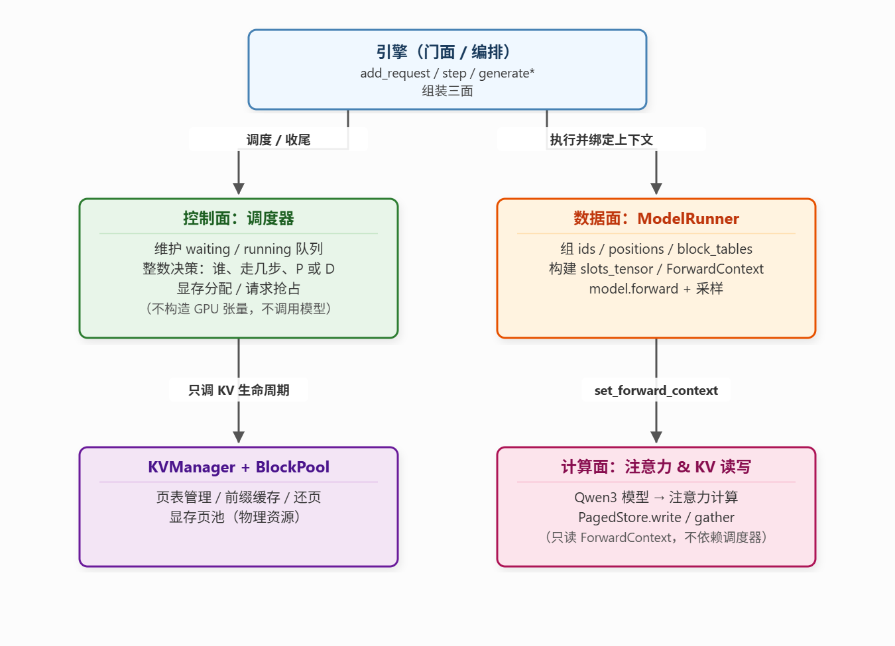

# vllm-v2 代码架构
> 文档暂未修改完成，存在 AI 写作问题，待修改！！！！
> [CB 动机](./00-v2版本设计.md) | [增改清单](./01-相比v1的增改.md)

上一节讲 Continuous Batching 要解决什么问题。本文按源码从外到内，说明 v2 如何把这些想法落成可运行模块，以及控制面、数据面、计算面如何协作。

## 0. 本文怎么读（如何查看架构）

先给一条最短路径，跟着走一遍就能建立整体感：

1. **入口 `run.py`**：`Engine(...)` → 只看两个方法 `generate`（流式单条）和 `generate_batch`（阻塞多条）。它们内部都只干一件事：循环 `step()`。
2. **`Engine.step()` 是全书主线**：一次迭代 = `scheduler.schedule()`（选人）→ `model_runner.run()`（算）→ `scheduler.postprocess()`（收尾）。把这三行记住，架构就抓住了。
3. **顺着调用往下钻**：`schedule()` 进 `engine/scheduler.py`（控制面，全是整数决策，不碰张量）；`run()` 进 `engine/model_runner.py`（数据面，把决策翻译成 `torch.Tensor`）；前向过程里 Attention 从 `kv/`（资源面）拿页读写 KV。
4. **对照 v1 看差异**：v1 是单请求、Engine 单文件、KV 绑定逻辑写在 `engine.py` 里；v2 把调度拆成独立 `Scheduler`、把张量化拆成独立 `ModelRunner`，并用 `SamplingParams` 让每个请求带上自己的采样参数。

阅读时建议抓三条"流"：

| 流 | 经过的模块 | 关注点 |
| :--- | :--- | :--- |
| 控制流 | `Engine.step` → `Scheduler` → `Engine.step` | 谁被选中、给多少 token 预算 |
| 数据流 | `Scheduler` → `ModelRunner` → `Attention` → `PagedStore` | 决策如何变成张量、KV 写哪读哪 |
| 状态流 | `Sequence` ↔ `KVManager` ↔ `BlockPool` | 页的领、用、还，前缀复用 |

## 0.1 v2 相比 v1 改了什么（模块对照）

**新增模块**

| 路径 | 说明 |
| --- | --- |
| `src/engine/` | 把 v1 的单个 `engine.py` 拆成三个文件：门面 / 控制面 / 数据面 |
| `src/engine/scheduler.py` | 全新：`waiting`/`running` 双队列、chunked prefill、PD 混合调度、抢占 |
| `src/engine/model_runner.py` | 全新：把 v1 里散在 `generate()` 中的 forward 逻辑收敛为 Prefill 串行 + Decode 合批 |
| `src/sampling_params.py` | 全新：每请求独立的采样参数 + `max_tokens`/`ignore_eos` |
| `src/kv/gather.py` | ⚠️ 死代码：`_write_kv`/`_gather_kv` 无任何调用方，见第 6 节问题 ① |

**从 v1 继承并扩展**

| 路径 | v1 | v2 |
| --- | --- | --- |
| `src/kv/sequence.py` | 纯逻辑态（tokens + 页表） | + `SequenceStatus`、`num_scheduled_tokens`、`is_prefill`、采样参数、`last_token` |
| `src/kv/manager.py` | `allocate`/`ensure_blocks`/`finish` | + 准入 `can_allocate`/`can_append`/`may_append`、`deallocate(publish)`、`sync_prefix` |
| `src/layers/attention.py` | 单请求三种掩码 | + 前缀命中后部分 Prefill、Decode 逐序列 gather 循环 |
| `src/pagedattention/store.py` | 只支持 `[1,S]` 写入 | + decode batch `[B,1]` 展平（`_coerce_kv_token_major`） |
| `src/sampler.py` | temperature/top-k/top-p | + `min_p` |
| `src/config.py` | 单请求参数 | + `max_num_seqs`/`max_num_batched_tokens`/`mix_prefill_decode` |

**行为差异（一句话）**：v1 一次只跑一条请求，v2 在每一步动态组织多条请求，让短请求能挤进长请求的 Decode 空隙（PD 交错），并让新请求随时入队。

## 1. 源码目录

```text
src/
  engine/
    engine.py           # 用户 API + step 编排
    scheduler.py        # 控制面
    model_runner.py     # 数据面
  kv/
    sequence.py
    manager.py          # 页生命周期 + 前缀索引入口
    pool.py
    context.py
    gather.py 
    prefix/
  pagedattention/
    slots.py            
    store.py            
  layers/attention.py   
  model.py              
  sampler.py           
  sampling_params.py
  config.py
```

相对 v1，计算面与分页契约大体同构；v2 主要新增 `engine/` 包，以及 Sequence 上的多请求状态与 admission API。文件清单见 [01-相比v1的增改.md](./01-相比v1的增改.md)。


## 2. 三面总览



| 平面 | 模块 | 职责 | 对外交出什么 |
| :--- | :--- | :--- | :--- |
| 门面 | `engine/engine.py` | 接请求、循环调用三个面 | 文本流 / batch 结果 |
| 控制面 | `engine/scheduler.py` | 维护队列，决定本步谁走、走几步 | `(prefills, decodes)` |
| 数据面 | `engine/model_runner.py` | 把调度结果变成张量与合同 | 各序列本步 token id |
| 计算面 | `layers/attention.py` + `pagedattention/` | 按合同读写 KV 并算注意力 | 隐状态 / logits |
| 资源层 | `kv/manager.py` + `pool.py` | 领页、还页、前缀 | 页表与 `PagedStore` |

依赖方向固定为：

```text
用户 → Engine → Scheduler（整数决策）
              → ModelRunner（张量 + ForwardContext）
                    → Model → Attention → PagedStore
              → Scheduler.postprocess（改状态、还页）
```
## 3. Engine
Engine是整个推理服务的总入口，它核心是为上层提供一个易用的编程接口。

当用户创建一个Engine实例时，`__init__`会完成以下准备工作：

1. 加载分词器与模型
2. 创建采样器
3. 初始化核心组件
    - KVManager
    - Scheduler
    - ModelRunner

```py
    def __init__(self, config: EngineConfig) -> None:
        self.config = config
        self.device = torch.device("cuda:0" if torch.cuda.is_available() else "cpu")
        self.dtype = self._resolve_dtype()

        self.tokenizer = AutoTokenizer.from_pretrained(
            config.model, trust_remote_code=True
        )
        if self.tokenizer.pad_token is None:
            self.tokenizer.pad_token = self.tokenizer.eos_token
        self.eos_token_id = int(self.tokenizer.eos_token_id)
        self.context_len = config.context_len
        self.block_size = config.block_size

        self.model = Qwen3ForCausalLM(config.hf_config)
        load_model(self.model, config.model)
        self.model = self.model.to(dtype=self.dtype, device=self.device).eval()

        self.sampler = Sampler()
        self._init_kv()
        self.last_num_cached_tokens = 0
```
### 3.1. 添加请求
当用户向引擎提交一条新的生成请求时，只需调用 `add_request` 方法。该方法接收一个提示文本或 token id 列表，以及可选的 SamplingParams，内部完成以下动作:
```py

    def add_request(
        self,
        prompt: str | list[int],
        sampling_params: SamplingParams | None = None,
    ) -> Sequence:

        # 如果是字符串，使用分词器将其编码为Token列表
        token_ids = (
            list(prompt) if isinstance(prompt, list) else self.tokenizer.encode(prompt)
        )
        # 如果长度超过模型最大上下文，则截断保留最后 context_len 个token
        if len(token_ids) > self.context_len:
            token_ids = token_ids[-self.context_len :]
        # 创建一个Sequence对象，记录token序列和采样参数
        seq = Sequence.from_prompt(
            token_ids, block_size=self.block_size, sampling=sampling_params
        )
        # 将请求放入到Scheduler的waiting队列当中，等待后续调度
        self.scheduler.add(seq)
        return seq
```

上层一次性可以添加多条请求，再由后续逐步推进。

### 3.2. 单步推进
`step()`是引擎执行一次完整迭代的入口，它的内部逻辑如下：

```py
def step(self) -> tuple[list[tuple[int, list[int]]], int]:
    # 从 Scheduler 获取本步要执行的 Prefill 分块和 Decode 序列列表。
    prefills, decodes = self.scheduler.schedule()

    # 如果本步没有任何需要推进的序列，直接返回空结果。
    if not prefills and not decodes:
        return [], 0

    # metric 用于观测本步实际处理的 token 数量：
    #   prefill_toks：本步将要计算的 token 总数; len(decodes)：Decode 序列每个只处理 1 个 token,直接计数
    prefill_toks = sum(s.num_scheduled_tokens for s in prefills)
    metric = prefill_toks + len(decodes)

    # 记录本步由 allocate() 产生的前缀命中大小（不是 Prefill 后的 num_cached）
    self.last_num_cached_tokens = self.kv.last_num_cached_tokens

    # ModelRunner.run 内部会：
    #   1. 先把所有 decodes 合并成一个 Decode batch，执行一次前向传播；
    #   2. 再逐条对 prefills 执行 Prefill 前向传播；
    #   3. 对每个序列的 logits 进行采样，得到新生成的 token id。
    p_ids, d_ids = self.model_runner.run(prefills, decodes)

    finished: list = []
    # 处理 Decode 序列：将采样出的 token 追加到序列中，更新缓存长度；
    # 若命中 EOS 或达到最大生成长度，序列会被标记为 FINISHED 并释放 KV 页。
    if decodes:
        finished.extend(
            self.scheduler.postprocess(decodes, d_ids, is_prefill=False)
        )
    # 处理 Prefill 序列：推进已缓存的 token 游标。
    # 如果这个 Prefill chunk 没有覆盖整个 prompt，序列仍保留在 waiting 队列中；
    # 如果已经完成整个 Prefill，序列会转入 running 队列，开始参与后续 Decode。
    if prefills:
        finished.extend(
            self.scheduler.postprocess(prefills, p_ids, is_prefill=True)
        )

    # 对每个 finished 序列，提取它在生成阶段产生的新 token 列表
    outputs = [
        (seq.seq_id, seq.token_ids[seq.num_prompt_tokens :]) for seq in finished
    ]
    return outputs, metric
```
step是Engine的原子操作，所有请求的生成功能都通过step进行推进推理，它在Engine内部被两个方法调用：

```py
def generate_batch(
    self,
    prompts: list[str | list[int]],
    sampling_params: SamplingParams | list[SamplingParams] | None = None,
) -> list[str]:
    if sampling_params is None:
        sps = [SamplingParams() for _ in prompts]
    elif isinstance(sampling_params, (list, tuple)):
        sps = list(sampling_params)
        if len(sps) != len(prompts):
            raise ValueError("sampling_params length must match prompts")
    else:
        sps = [sampling_params for _ in prompts]

    seqs = [self.add_request(p, sp) for p, sp in zip(prompts, sps)]
    finished_text: dict[int, str] = {}

    # 核心调度循环，每次迭代调用step，循环结束后，所有请求的完整生成结果被一次性返回
    while not self.scheduler.is_finished():
        outputs, _ = self.step()
        for seq_id, completion_ids in outputs:
            finished_text[seq_id] = self.tokenizer.decode(completion_ids)
    return [finished_text[seq.seq_id] for seq in seqs]

def generate(
    self,
    prompt: str | list[int],
    max_new_tokens: int = 128,
    temperature: float = 0.0,
    top_p: float | None = None,
    top_k: int | None = None,
    min_p: float | None = None,
) -> Iterator[str]:
    sp = SamplingParams(
        temperature=temperature,
        top_p=top_p,
        top_k=top_k,
        min_p=min_p,
        max_tokens=max_new_tokens,
    )
    seq = self.add_request(prompt, sp)
    emitted = 0
    while not seq.is_finished:
        self.step()
        while emitted < seq.num_completion_tokens:
            tid = seq.token_ids[seq.num_prompt_tokens + emitted]
            emitted += 1
            yield self.tokenizer.decode([tid])

```

在这段代码中，`generate` 和 `generate_batch` 是对外提供的两种不同风格的生成接口。它们的核心区别在于**处理请求的数量**、**输出的形式（流式 vs 阻塞）**以及**底层调度效率的侧重**。

以下是详细的区别和使用场景分析：

| 维度 | `generate` | `generate_batch` |
| :--- | :--- | :--- |
| **输入规模** | **单个** Prompt。 | **多个** Prompts。 |
| **输出类型** | **迭代器**。返回一个生成器，逐个产出 token。 | **列表**。返回一个包含所有完整生成文本的字符串列表。 |
| **执行模式** | **流式输出**。边生成边返回（Yield），不需要等全部生成完。 | **同步阻塞**。必须等待所有请求全部生成完毕，才一次性返回结果。 |
| **参数传递** | 直接传入具体的采样参数（如 `temperature`, `top_p` 等），方法内部自动构建 `SamplingParams`。 | 需要传入已经构建好的 `SamplingParams` 对象（或对应数量的列表）。 |
| **底层调度** | 每次只推进一个 Sequence，主要关注单请求的响应速度。 | 将多个请求加入 `scheduler`，利用 CB 机制，合并 Prefill 和 Decode 阶段。 |


## 4. 控制面 Scheduler
Scheduler 通过两个双端队列来管理所有请求的生命周期状态。
```text
waiting : deque[Sequence]   # Prefill 未完成，或 preempt 回来的请求
running : deque[Sequence]   # Prefill 已完成，正在 Decode
```
当新请求通过 add 方法加入时，其状态被标记为 WAITING 并放入 waiting 队列。当两个队列均为空时，`is_finished` 方法返回真，表示所有请求处理完毕。

Sequence是Scheduler操作的逻辑实体，Scheduler修改其控制面字段，包括：
```
token_ids：             包含 Prompt 和已生成的 Token 序列。
block_table：           逻辑页到物理块号的映射表。
num_cached_tokens：     已经写入 KV Cache 的长度，包含前缀命中的部分。
num_scheduled_tokens：  当前调度步分配给该序列的 Token 数量。
is_prefill：            标记当前调度步是否处于 Prefill 阶段。
status：                序列状态，取值为 WAITING、RUNNING 或 FINISHED。
```

在Scheduler中，`schedule`方法是Scheduler的核心，负责产出当前Step的执行名单，返回`prefills`和`decodes`两个列表，具体策略由`mix_prefill_decode`参数控制。

> **混合调度模式** 这是默认且高效的模式，旨在最大化 GPU 利用率。
> 1. **优先保障 Decode 进度**：首先遍历 running 队列，为尽可能多的序列各分配 1 个 Decode Token。此过程受最大序列数和最大 Token 预算限制。
> 2. **触发抢占机制**：如果在分配 Decode Token 时发现 KV Cache 空间不足，Scheduler 会触发抢占，将队列末尾的序列踢回 waiting 队列，释放其占用的显存。
> 3. **填充 Prefill 预算**：如果当前步有 Decode 任务，Scheduler 会利用剩余的 Token 预算，从 waiting 队列头部拉取一个 Prefill 请求进行分块处理。

> **Prefill 优先模式**
> 是一种较为基础的调度策略。
> 1. 尽可能将 waiting 队列中的请求塞满当前步的 Token 预算。
> 2. 如果剩余预算不足以容纳完整的 Prompt，则对首个请求进行切块，仅处理部分 Token。
> 3. 如果当前步已经安排了 Prefill 任务，则直接返回，不再调度 Decode 任务。


postprocess 方法在模型完成一次前向计算和采样后被调用，负责消费采样结果并更新序列状态。


Scheduler 与 KVManager 构成了典型的控制面与数据面分离架构。
Scheduler 负责制定策略，决定谁先执行、分配多少 Token 预算、何时触发抢占。它通过调用 KVManager 的接口来查询和修改显存状态：
- 使用 can_allocate 和 allocate 处理新请求的显存准入。
- 使用 can_append 和 may_append 处理 Decode 阶段的显存追加。
- 使用 deallocate 处理请求结束或抢占时的显存回收。
- 使用 sync_prefix 和 publish 维护前缀缓存账本。


## 5. 数据面 ModelRunner
在推理引擎的架构中，控制面 Scheduler 只负责做整数决策，决定这一步哪些序列参与计算以及分配多少 token 预算。数据面 ModelRunner 的核心职责，就是把这些决策翻译为 GPU 能够理解的张量运算。
### 5.1 契约ForwardContext
在深入具体代码前，我们需要理解数据面与底层计算面 Attention 层之间的沟通契约。ModelRunner 通过 ForwardContext 传递一份施工图纸。

```py
@dataclass
class ForwardContext:
    is_prefill: bool                # 识别当前是P还是D阶段
    store: PagedStore               # 指向低层的PagedStore
    block_tables: list[list[int]]   # 当前批次所有序列逻辑页到物理页映射表
    slot_mapping: torch.Tensor      # 本次新产生的KV需要写入的物理槽绝对索引
    query_lens: list[int]           # 
    context_lens: list[int]         # 注意力的计算范围与可见历史长度
    cached_lens: list[int] = field(default_factory=list) # 已经缓存的历史长度
```

通过这份契约，Attention 层只需按照契约在指定的物理显存位置读写数据。


### 5.2. Prefill路径

在教学实现中，P阶段采用逐条序列处理的策略。run_prefill_one 方法负责处理单个序列的 prompt 计算。
1. **确定计算区间**：根据序列已缓存的 token 数量和本步调度的 token 数量，截取需要计算的 prompt 片段。
2. **计算物理槽位**：调用 slots_tensor，将逻辑 token 索引映射为物理显存中的绝对 slot 索引。这是分页注意力机制的核心。
3. **构建上下文**：将页表、槽位映射、长度信息填入 ForwardContext，并设置为全局上下文。
4. **执行前向与采样**：将 token 和位置编码送入模型，提取最后一个 token 的隐状态计算 logits，最后进行采样。

```py
    @torch.inference_mode()
    def run_prefill_one(self, seq: Sequence) -> int:
        # 1. 确定当前Step需要计算的token区间 [start, end)
        start = seq.num_cached_tokens
        end = start + seq.num_scheduled_tokens
        tokens = seq.token_ids[start:end]

        # 2. 计算物理槽位映射
        slots = slots_tensor(
            seq.block_table, start, end, self.block_size, device=self.device
        )
        # 3. 构建并设置ForwardContext
        set_forward_context(
            ForwardContext(
                is_prefill=True,
                store=self.kv.store,
                block_tables=[seq.block_table],
                slot_mapping=slots,
                query_lens=[end - start],
                context_lens=[end],
                cached_lens=[start],
            )
        )
        try:
            # 4. 准备模型输入张量
            ids = self._tensor([tokens])
            positions = self._tensor([list(range(start, end))])
            # 5. 执行模型前向传播
            h = self.model(ids, positions)
            # 6. 计算logits并采样
            logits = self.model.compute_logits(h[:, -1:]).squeeze(1)
            return self._sample_one(logits, seq)
        finally:
            # 7. 清理全局上下文，防止污染后续计算
            set_forward_context(None)
```

### 5.3. Decode路径
Decode 阶段需要处理多个正在生成的序列，因此 run_decode_batch 采用批量处理策略以最大化 GPU 利用率。
```py
@torch.inference_mode()
    def run_decode_batch(self, seqs: list[Sequence]) -> list[int]:
        # 1. 收集每个序列的最后一个 token 和对应的位置索引
        input_ids = [seq.last_token for seq in seqs]
        positions = [len(seq) - 1 for seq in seqs]
        
        # 2. 计算每个序列新 token 需要写入的物理槽位
        # 槽位 = 物理块号 * 块大小 + 块内偏移
        slots = [
            seq.block_table[-1] * self.block_size + ((len(seq) - 1) % self.block_size)
            for seq in seqs
        ]
        
        # 3. 构建批量前向上下文
        set_forward_context(
            ForwardContext(
                is_prefill=False,
                store=self.kv.store,
                block_tables=[list(s.block_table) for s in seqs], # 所有序列的页表
                slot_mapping=self._tensor(slots),                 # 批量物理槽位
                query_lens=[1] * len(seqs),                       # Decode 阶段 query 长度恒为 1
                context_lens=[len(s) for s in seqs],              # 各序列的总长度
            )
        )
        
        try:
            # 4. 准备批量输入张量
            # ids 形状: [batch_size, 1]
            ids = self._tensor(input_ids).unsqueeze(-1)
            # pos 形状: [batch_size, 1]
            pos = self._tensor(positions).unsqueeze(-1)
            
            # 5. 执行批量前向传播
            # h 形状: [batch_size, 1, hidden_dim]
            h = self.model(ids, pos)
            
            # 6. 计算 logits
            # logits 形状: [batch_size, vocab_size]
            logits = self.model.compute_logits(h[:, -1:]).squeeze(1)
            
            # 7. 对 batch 中的每一行分别进行采样
            return [self._sample_one(logits[i : i + 1], seq) for i, seq in enumerate(seqs)]
        finally:
            set_forward_context(None)
```

### 5.4. Run统筹执行
run 方法是 ModelRunner 的总入口。它接收 Scheduler 传来的 prefills 和 decodes 列表。为了保证 Decode 序列的生成延迟，代码优先执行 run_decode_batch，随后再逐条执行 run_prefill_one。这种执行顺序在逻辑上落实了控制面 Decode 优先的调度策略。
```py
def run(self, prefills: list[Sequence], decodes: list[Sequence]) -> tuple[list[int], list[int]]:
        """
        ModelRunner 的总入口。
        接收 Scheduler 的调度结果，执行前向计算并返回采样的 token id。
        """
        # 优先执行 Decode 批次，保障在途请求的生成延迟
        d_ids = self.run_decode_batch(decodes) if decodes else []
        
        # 随后逐条执行 Prefill，利用剩余算力处理新请求
        p_ids = [self.run_prefill_one(s) for s in prefills] if prefills else []
        
        return p_ids, d_ids
```

ModelRunner 只关注如何高效地将当前步的序列列表转化为张量，如何正确填写 ForwardContext，以及如何从模型输出中提取结果。

## 6. 当前代码存在的问题

### 6.1 死代码：`kv/gather.py` 与 Manager 的 write/gather/ensure_blocks

`src/kv/gather.py` 的 `_write_kv` / `_gather_kv`，以及 `KVManager.write` / `KVManager.gather` / `KVManager.ensure_blocks` **没有任何调用方**。

- 数据面实际路径是 `Attention.forward → ctx.store.write/gather`，走的是 `PagedStore` 直连，不经过 `KVManager`。
- `ensure_blocks` 在 v1 里由 Engine 在 decode 变长时调用；v2 改由 `Scheduler.may_append` 负责补页，`ensure_blocks` 因此变成遗留。
- 建议：删除 `kv/gather.py`，删除 `manager.py` 中 `write`/`gather`/`ensure_blocks` 三个方法，让 `kv/manager.py` 只保留生命周期与准入接口，与 `pagedattention/` 的职责划分更清晰。

### 6.2 `run_prefill_one` 对 Prefill 中间 chunk 也执行采样

```py
# engine/model_runner.py
def run_prefill_one(self, seq: Sequence) -> int:
    ...
    h = self.model(ids, positions)
    logits = self.model.compute_logits(h[:, -1:]).squeeze(1)
    return self._sample_one(logits, seq)   # ← 每个 chunk 都会采样
```

`Scheduler` 会把长 Prompt 切成多个 chunk，只有覆盖到 `num_prompt_tokens` 的**最后一个 chunk** 才需要产生新 token（`postprocess` 里 `if is_prefill and num_cached_tokens < num_prompt_tokens: continue` 会把中间 chunk 的 token 直接丢掉）。

因此中间 chunk 的 `_sample_one` 是纯浪费——做了采样算子的前向与 argmax，结果立刻被丢弃。正确做法是在 `run_prefill_one` 里判断 `end >= seq.num_prompt_tokens` 才采样，否则直接返回 `0`（占位）。这不会改变正确性，但对超长 Prompt 的 Prefill 能省掉每次采样算子的开销。

### 6.3 Decode 的注意力仍是逐序列 gather + SDPA，batch 优势未落到 Attention

```py
# layers/attention.py
def _decode(self, q, ctx) -> torch.Tensor:
    outs = []
    for b in range(q.shape[0]):          # ← 逐条 gather，batch 未真正利用
        ctx_len = ctx.context_lens[b]
        k_c, v_c = ctx.store.gather(self.layer_id, ctx.block_tables[b], ctx_len)
        ...
        outs.append(self._sdpa(q[b : b + 1], k_c, v_c, is_causal=False))
    return torch.cat(outs, dim=0).transpose(1, 2).contiguous()
```

ModelRunner 已经用 `[B,1]` 合批前向，但 `Attention._decode` 又把批次拆回一条条 `gather → SDPA`，B 次 kernel 启动 + B 次 gather 无法共享。

这是 v2 阶段**教学取舍**：v3/v4 用 `FlashInfer` 的 `BatchDecodeWithPagedKVCacheWrapper` 一次性处理整个 batch。若在 v2 内优化，需要把"每条序列的物理页表不同"这一约束张量化——最直接的办法是构造 `block_table` 为 `[B, max_blocks]` 的稠密页表（padding），一次 `gather` 后再按 `context_lens` 切回，或直接引入 FlashInfer。

### 6.4 Prefill-first 与混合模式的行为差异

两种模式对"长 Prompt 切不完"的处理不同：

```py
# _schedule_prefill_first
while self.waiting and self._room(prefills, decodes):
    remaining = self.max_num_batched_tokens - tokens_used
    if remaining <= 0:
        break
    seq = self.waiting[0]
    if not self._try_alloc(seq):
        break
    need = seq.num_tokens - seq.num_cached_tokens
    if need <= 0:
        self._promote_full_hit(seq)
        continue
    if remaining < need and prefills:
        break                    # ① 排过完整 prefill 后剩余预算不够下一个
    chunk = min(need, remaining)
    seq.num_scheduled_tokens = chunk
    seq.is_prefill = True
    tokens_used += chunk
    prefills.append(seq)
    if seq.num_cached_tokens + chunk == seq.num_tokens:
        ...
    else:
        break                    # ② 队头请求只切了部分
if prefills:
    return prefills, []
self._schedule_decode(prefills, decodes, 0)
```

- 情况②是 chunked prefill 的正确语义：队头超长请求占满预算后 `break`，下轮继续切。**但注意**：此时 `seq` 并未被移出 `waiting`，`tokens_used` 也只在本步有效，所以超长请求会连续多轮独占整条 Prefill 预算，排在其后的短请求只能等它切完——这是 prefill-first 的**固有队头阻塞**（没有 `mix_prefill_decode` 的典型表现）。
- 情况①在 `prefills` 非空时直接 `break`，把剩余预算让给已排的 prefill。这里 `_try_alloc(seq)` 在 `break` 之前已经执行——若 `seq` 之前未分配页，会先为它 `allocate` 再 break，`block_table` 已绑定但本步不算，下轮从 `num_cached_tokens` 续算。逻辑正确，但**资源提前绑定**。

`_schedule_mixed` 则用 `_pull_prefill_chunk` 只在 Decode 之后拉**一个** chunk，每步至多一条 Prefill，队头阻塞的粒度被限制到单步，这也是它作为默认模式的原因。若希望 prefill-first 也避免长请求拖死短请求，可参照 vLLM 的做法：按长度优先 / 允许跳过队头。

### 6.5 抢占仅回滚，不保留前缀

```py
# engine/scheduler.py
def preempt(self, seq: Sequence) -> None:
    seq.status = SequenceStatus.WAITING
    seq.is_prefill = True
    self.kv.deallocate(seq, publish=False)   # ← 整个序列的 KV 全部释放
    self.waiting.appendleft(seq)
```

抢占走的是 `deallocate(publish=False)`，已算好的 KV 全部丢弃，重新 Prefill。教学上没问题（preempt = recompute），但意味着：

- 被抢占序列的 KV 页即使之前已经 `publish` 到前缀索引，`deallocate` 里 `n_full = 0`（因为 publish=False）导致**不会保留任何满块**，前缀缓存对抢占场景完全失效。
- 一个已 decode 到第 N 个 token 的长序列被抢占后，需要从第 0 个 token 重算。在 `max_num_seqs` 大、页池紧张时，抢占会频繁发生，吞吐抖动明显。

优化方向：`preempt` 至少保留 `seq.num_full_blocks()` 的满块进前缀索引（`deallocate(seq, publish=True)`），只丢弃尾部不满块，重算时从 `num_cached_tokens` 续算，而不是整个重来。这也是 vLLM 抢占策略（swap/recompute）的雏形。

### 6.6 radix 后端的封装退化：`pin_match` 被内联、私有成员被直接访问

v1 里 radix 前缀命中的引用管理是收敛在 `RadixPrefixIndex.pin_match` 一个公共方法里的：

```py
# v1: kv/prefix/radix_index.py
def pin_match(self, seq: Sequence, num_blocks: int) -> None:
    key = self._block_hashes(seq, num_blocks)
    _ids, node = self._tree.match_prefix(key)
    self._tree.inc_ref(node)
    self._seq_node[seq.seq_id] = node
```

v2 把这个逻辑**内联进 `KVManager.allocate`**，并直接访问 radix 索引的私有成员：

```py
# v2: kv/manager.py
if isinstance(self.index, RadixPrefixIndex) and max_cached > 0:
    key = self.index._block_hashes(seq, max_cached)  # noqa: SLF001
    _ids, node = self.index.tree.match_prefix(key)
    self.index.tree.inc_ref(node)
    self.index._seq_node[seq.seq_id] = node          # noqa: SLF001
```

问题在于：

- **封装被破坏**：`manager` 依赖 `_block_hashes`/`_seq_node` 这些下划线私有名，`radix_index.py` 里 `publish` 又依赖 `_seq_node` 的 pop 逻辑。两处对同一字段的读写散落两个文件，改其中一处容易漏另一处。v1 的 `pin_match` 接口被删掉后，hash 与 radix 两套后端的 `allocate` 逻辑不再对称。
- **跨 seq 引用配对依赖隐式约定**：`allocate` 记 `_seq_node[seq_id] = node` + `inc_ref`，`publish` 里 `pop` 旧 node + `dec_ref` + `inc_ref(last)`，`release_seq` 里再 `pop` + `dec_ref`。三条路径（命中后从未 publish / publish 多次 / 抢占后重新 allocate）都必须恰好配对，否则 radix 树引用泄漏。当前代码在这些路径上恰好配对，但没有任何断言或注释说明这一不变量。

建议：把 v1 的 `pin_match` 恢复为公共接口，`manager.allocate` 只调 `self.index.pin_match(seq, max_cached)`，并让 `publish`/`release_seq` 内部自洽地维护 `_seq_node`。

### 6.7 文档与实际代码的同步问题

- 本文档 3.2 节中 `step()` 的注释写 `self.last_num_cached_tokens = max((s.num_cached_tokens for s in prefills), default=0)`，实际 v2 代码是 `self.kv.last_num_cached_tokens`（从 `allocate()` 时记录的命中大小读取），已在本文档修正为注释说明。
- `docs/00-v2版本设计.md` 的链接在本文档 header 处写成了 `00-V2版本设计解释.md`（旧文件名），已修正为 `00-v2版本设计.md`。

### 6.8 建议的清理清单（按优先级）

| 优先级 | 事项 | 位置 |
| :--- | :--- | :--- |
| P0 | 删除死代码 `gather.py` 与 `write`/`gather`/`ensure_blocks` | `kv/` |
| P1 | `run_prefill_one` 只在末 chunk 采样 | `engine/model_runner.py` |
| P1 | 统一 prefill-first 与 mixed 的切块语义 | `engine/scheduler.py` |
| P2 | 抢占保留满块前缀 | `engine/scheduler.py` / `kv/manager.py` |
| P2 | 恢复 radix `pin_match` 公共接口，收敛 `_seq_node` 维护 | `kv/manager.py` + `kv/prefix/radix_index.py` |
| P3 | Decode 注意力张量化 / 换 FlashInfer | `layers/attention.py` |


