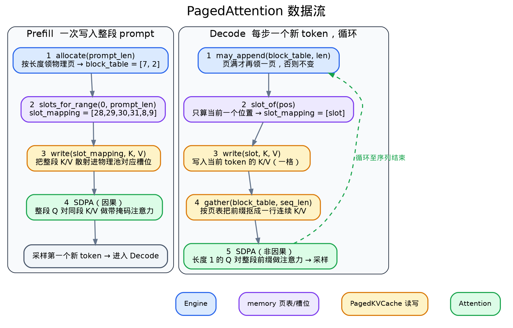
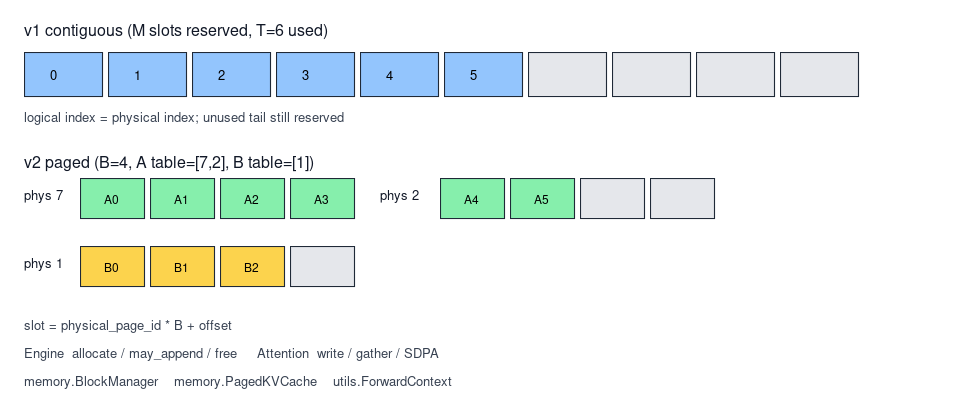
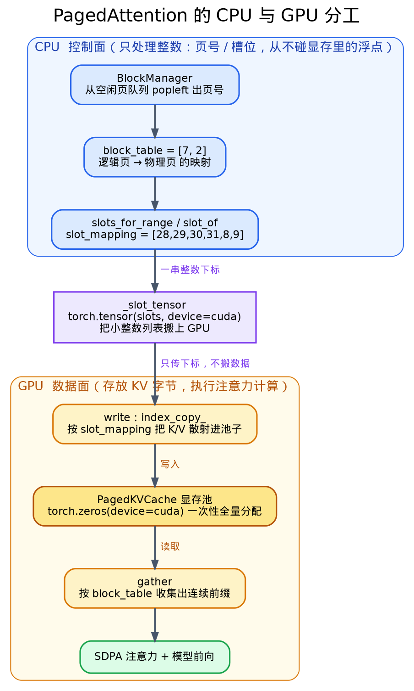

# v2 从连续 KV Cache 到 PagedAttention

> 代码路径 `src/memory/` · `src/engine/engine.py` · `src/layers/attention.py` · `src/utils/context.py`  
> 参照 [nano-vllm BlockManager](../../nano-vllm/nanovllm/engine/block_manager.py) · [nano-vllm Attention](../../nano-vllm/nanovllm/layers/attention.py)

<span style="color:#1d4ed8">**模块名**</span> · <span style="color:#b45309">**核心机制**</span> · <span style="color:#059669">**实现细节**</span> · <span style="color:#7c3aed">**数据流**</span> · <span style="color:#dc2626">**边界**</span>

v1 把历史 K 和 V 缓存在连续张量中，Decode 每步只计算当前 token。生成正确性与计算量已由该设计覆盖。本文写 v2。v2 改的是 K/V 在 GPU 上如何占位与寻址，不改 Transformer 的数学形式，也不引入 Scheduler。


## 1. 原理

<span style="color:#b45309">**核心机制**</span> 无论 v1 还是 v2，Attention 在第 $t-1$ 个位置都要用当前 token 的 Query，以及位置 $0$ 到 $t$ 的全部 Key 与 Value。数学关系不变。变的是这些 K/V 在 GPU 显存里怎么排。

### 1.1 v1 怎么存

v1 为每个请求在 GPU 上开一段连续数组。数组长度等于配置项 `context_len`，下文记为 $M$。请求里第 $0$ 个 token 的 K/V 放在下标 $0$，第 $1$ 个放在下标 $1$，依此类推。逻辑序号与物理下标是同一个数，所以读写就是切片。

用一个请求说明。设 $M = 8$，这个请求现在只有 $4$ 个 token。v1 的占用是

```text
下标   0   1   2   3   4   5   6   7
内容  K0  K1  K2  K3  ·   ·   ·   ·
```

真正有数的只有前 $4$ 格，后 $4$ 格空着，但仍占显存。原因是这块数组在请求开始时就按长度 $M$ 一次性分好了。

若同时有 $R$ 个这样的请求，且每个请求都各自持有长度 $M$ 的连续数组，则 K/V 槽位总量按 $R · M$ 计。把第 $i$ 个请求实际用到的长度记为 $T_i$。当每个 $T_i$ 都小于 $M$ 时，$R · M$ 会大于 $\sum_i T_i$。多出来的格子都锁在各自那一段连续数组里，别的请求用不了。

### 1.2 v2 怎么存

v2 不再给每个请求预留一整段长度为 $M$ 的连续区。GPU 上只有一个共享的大池，池被切成许多等长小段。每一小段叫一页，一页能放 $B$ 个 token（本仓库默认 $B = 16$，下面例子为书写方便取 $B = 4$）。

每个请求另有一张表，叫 `block_table`。表的第 $j$ 项写出「这个请求的第 $j$ 个逻辑页，对应共享池里的哪一个物理页」。请求里第 `pos` 个 token 要落到哪个物理格子，按下面四步算

```text
逻辑页号   = pos // B
页内偏移   = pos %  B
物理页号   = block_table[逻辑页号]
物理槽位   = 物理页号 * B + 页内偏移
```

仍用「长度 $4$、且 $B = 4$」的请求。只需 $1$ 页。若 `BlockManager` 分到物理页号 $7$，则 `block_table = [7]`，四个 token 落在

```text
物理槽位  28  29  30  31
内容      K0  K1  K2  K3
```

也就是物理页 $7$ 里的四个位置。请求结束时把页号 $7$ 还回空闲队列，下一个请求可以再领走这一页。

若同一时刻还有另一个请求，长度也是 $3$，它会领另一页，例如物理页 $1$，写自己的 `block_table = [1]`。两个请求共用一个池，各占各的页，互不要求在内存里首尾相连。

长度不是 $B$ 的整数倍时，最后一个逻辑页里会剩几格写不满。这叫内部碎片，每个请求最多不满一页。这与 v1「按整段 $M$ 预留」的空闲量不是同一量级。

### 1.3 两种计费差在哪里

设每个 token 在全部层上的 K+V 合计占 $b$ 字节。比较「同时撑住 $R$ 个请求」时，两侧在公式上的占位是

```text
v1 连续布局   R * M * b
v2 分页布局   (Σ_i ceil(T_i / B) * B) * b
```

左侧按每个请求的上限 $M$ 计。右侧按每个请求实际长度向上取整到页边界后的总格数计。v2 的PagedAttention实际上是在讲如何维护 `block_table`、如何把 K/V 写进物理槽位、以及 Decode 时如何按表把前缀再取出来。


## 2. Insight

<span style="color:#7c3aed">**数据流**</span> PagedAttention 解决的是 KV 怎么存放。逻辑上连续的 token，在物理上可以落在不相邻的页里。写入和读取前都要用页表把逻辑位置对到物理槽位。下面按 Prefill 和 Decode 两条流水线走一遍，例子取 $B=4$，请求长度 $6$，分到物理页 $7$ 与 $2$。



图分左右两栏，颜色对应四类角色。蓝色是 `Engine`，紫色是 `memory` 里的页表与槽位换算，橙色是 `PagedKVCache` 的读写，绿色是 `Attention`。

左栏 Prefill 一次写入整段 prompt。请求有 $6$ 个 token，每页装 $B=4$ 个，所以需要 $\lceil 6/4 \rceil = 2$ 个物理页。`allocate` 向 `BlockManager` 要两页，`BlockManager` 从空闲队列里弹出两个页号，这一轮弹到的是 $7$ 号和 $2$ 号。这两个数字就是物理池里两块页的编号，本身没有先后含义。填进 `block_table = [7, 2]` 后，逻辑页 $0$（前四个 token）指向物理页 $7$，逻辑页 $1$（后两个 token）指向物理页 $2$。

`slot_mapping` 里有六个数字，因为每个 token 都要占一个槽位，六个 token 就有六个槽位。单个 token 的槽位按 `slot = block_table[pos // B] * B + pos % B` 算，`pos // B` 是它落在第几个逻辑页，查 `block_table` 换成物理页号，`pos % B` 是页内第几格。逐个代入，`T0` 到 `T3` 在物理页 $7$ 上得 $7 \times 4 + 0,1,2,3 = 28,29,30,31$，`T4`、`T5` 换到物理页 $2$ 上得 $2 \times 4 + 0,1 = 8,9$，合起来 `slot_mapping = [28,29,30,31,8,9]`。`write` 就按这六个槽位把整段 K/V 散射进物理池。最后整段 Query 与同段 K/V 做因果 Attention，采样出第一个新 token。

右栏 Decode 每步只处理一个新 token 并循环。`may_append` 只在当前页写满时才再领一页。`slot_of` 算出这一个位置的槽位。`write` 把当前 token 的 K/V 写进那一格。`gather` 再按 `block_table` 把分散的页抠成一行连续前缀，交给长度为 $1$ 的 Query 做非因果 Attention，采样下一个 token，直到序列结束。K 都写在 RoPE 之后。

## 3. 设计思路

<span style="color:#1d4ed8">**代码结构**</span> 整个 PagedAttention 落在 `src/memory/` 三个文件里，各管一件事。
- `block_manager.py` 管物理页的发放与回收，
- `sequence.py` 管逻辑位置到物理槽位的换算，
- `kv_cache.py` 管真正的显存池以及散射写入和按页读取。
- `ForwardContext` 把前两者的产物带进模型，`Attention` 消费，`Engine` 在合适时机调用它们。下面按这几个文件依次看。

### 3.1 物理池的形状 `PagedKVCache.__init__`

v1 的连续 `KVCache` 形状是 `[num_layers, max_len, num_kv_heads, head_dim]`，每个请求各自预留一段到 `max_len`。v2 换成所有请求共享的一个大池，一次 `torch.zeros` 建好后只被覆盖写，不再扩容。

```py
        # [2, layers, blocks, block_size, kv_heads, head_dim]
        self.kv = torch.zeros(
            2,
            num_layers,
            num_blocks,
            block_size,
            num_kv_heads,
            head_dim,
            device=device,
            dtype=dtype,
        )
```

第一维 $0$ 是 K，$1$ 是 V。`num_blocks` 是全局页数，默认 `ceil(context_len / block_size) * max_num_seqs`。`block_size` 默认 $16$，即每页装 $16$ 个 token。把大小固定为 `num_blocks * block_size` 个槽位，之后所有请求都在这块池子里抢页。

### 3.2 发页与还页 `BlockManager`

`BlockManager` 内部只有一个空闲页号队列 `free_block_ids`，初始是 `0..num_blocks-1`，于是“哪块显存空着”就变成一个出队入队问题。

```py
    def blocks_for_tokens(self, num_tokens: int) -> int:
        if num_tokens <= 0:
            return 0
        return (num_tokens + self.block_size - 1) // self.block_size

    def _alloc_one(self) -> int:
        if not self.free_block_ids:
            raise RuntimeError(
                f"KV block pool exhausted: used={self.num_used}/{self.num_blocks}"
            )
        return self.free_block_ids.popleft()

    def ensure_capacity(self, block_table: list[int], num_tokens: int) -> None:
        need = self.blocks_for_tokens(num_tokens)
        while len(block_table) < need:
            block_table.append(self._alloc_one())

    def allocate(self, num_tokens: int) -> list[int]:
        table: list[int] = []
        self.ensure_capacity(table, num_tokens)
        return table
```

`blocks_for_tokens` 向上取整算出装 $n$ 个 token 需要几页。`allocate` 在 Prefill 前一次领够整段 prompt 的页，返回 `block_table`。`may_append` 每个 Decode 步调用 `ensure_capacity`，只有当前页写满、页数不够时才 `popleft` 补一页，否则什么都不做。`free` 在请求结束时把页号原样还回队列，供后续请求复用。领不到页时 `_alloc_one` 直接抛出池耗尽错误。

### 3.3 逻辑位置译成物理槽位 `slot_of`

`block_table` 只记逻辑页对哪块物理页，具体到某个 token 落在哪个扁平槽位，由 `slot_of` 算。

```py
def slot_of(block_table: list[int], pos: int, block_size: int) -> int:
    block_idx = pos // block_size
    if block_idx >= len(block_table):
        raise IndexError(
            f"pos={pos} needs block_idx={block_idx}, but block_table has {len(block_table)} pages"
        )
    return block_table[block_idx] * block_size + (pos % block_size)


def slots_for_range(
    block_table: list[int],
    start: int,
    end: int,
    block_size: int,
) -> list[int]:
    return [slot_of(block_table, pos, block_size) for pos in range(start, end)]
```

`pos // block_size` 是这个 token 在第几个逻辑页，查 `block_table` 换成物理页号；`pos % block_size` 是它在页内第几格；两者拼成 `物理页号 * block_size + 页内偏移`。`slots_for_range` 只是对一段位置逐个调用，Prefill 用它一次算整段 `[0, prompt_len)`，Decode 用它算当前一个位置。

### 3.4 散射写入与按页读取 `PagedKVCache.write / gather`

写入是散射。`write` 把本步 K/V 展平成 `[n, kv_heads*head_dim]`，用 `index_copy_` 按 `slot_mapping` 把每一行放进池里对应的槽位。

```py
        flat_dim = self.num_kv_heads * self.head_dim
        flat_k = self.kv[0, layer_id].reshape(-1, flat_dim)
        flat_v = self.kv[1, layer_id].reshape(-1, flat_dim)
        # Detach + no_grad: pool is not a Parameter; advanced-index
        # inplace under GradMode otherwise raises on leaf tensors.
        with torch.no_grad():
            flat_k.index_copy_(0, slot_mapping, k.reshape(n, flat_dim).detach())
            flat_v.index_copy_(0, slot_mapping, v.reshape(n, flat_dim).detach())
```

`reshape(-1, flat_dim)` 把 `[num_blocks, block_size, ...]` 拉平成 `[num_blocks*block_size, ...]`，槽位号正好是这条扁平轴的下标，`slot_mapping` 里的每个数直接就是写入行号。池子不是 `Parameter`，所以用 `no_grad` 加 `detach` 避免原地写触发梯度报错。

读取是按页 gather。Decode 要拿逻辑上连续的前缀 `[0, seq_len)`，但它们物理上分散在多页，`gather` 用同一套 `pos // block_size` 和 `pos % block_size` 反查出每个位置的物理页与页内偏移，一次高级索引取出，拼回连续的 `[seq_len, kv_heads, head_dim]`。

```py
        positions = torch.arange(seq_len, device=self.device, dtype=torch.long)
        block_idx = positions // self.block_size
        offsets = positions % self.block_size
        physical = table[block_idx]
        k = self.kv[0, layer_id, physical, offsets]
        v = self.kv[1, layer_id, physical, offsets]
```

### 3.5 串起来 `ForwardContext` 到 `Attention` 到 `Engine`

`ForwardContext` 带四个和 KV 有关的字段 `is_prefill`、`seq_len`、`block_table`、`slot_mapping`，`seq_len` 是本步写完后的有效长度，取代 v1 的连续 `cache_len`。`Attention.forward` 拿到 Context 后先无条件 `write` 当前 K/V，Prefill 直接用本步 K/V 做因果 SDPA，Decode 先 `gather` 出整段前缀再做非因果 SDPA，K 都写在 RoPE 之后。`Engine.generate` 是调度方，Prefill 前 `allocate` 领页并 `slots_for_range` 算整段槽位，每个 Decode 步 `may_append` 补页并算单个槽位，`finally` 里 `free` 还页。`models/qwen3.py` 只多传一个 `layer_id`，权重路径和 Sampler 都不变。

下图把 v1 的连续预留和 v2 的共享分页放在一起对比。




## 4. CPU 与 GPU 的分工

<span style="color:#7c3aed">**控制面与数据面**</span> 理解 v2 的关键是把“管理显存”和“搬运数据”分开。管理显存只是决定每个逻辑页对应哪块物理页，处理的是一堆整数（页号、槽位号），这件事完全在 CPU 上用 Python 完成。真正的 KV 字节、模型权重、矩阵乘和注意力，才跑在 GPU 上。CPU 是控制面，负责做决定、维护小的元数据表；GPU 是数据面，负责存放和计算大块张量。两者之间只传很小的整数张量。

下面把 v2 里的组件按运行位置分开。

| 组件 | 位置 | 处理的东西 |
| --- | --- | --- |
| `BlockManager` 的空闲页队列、`allocate` / `may_append` / `free` | CPU | 物理页号（`int`）的出队入队 |
| `block_table`（`list[int]`） | CPU | 逻辑页到物理页的映射 |
| `slot_of` / `slots_for_range` 的槽位算术 | CPU | 由 `pos` 算出的整数槽位号 |
| `Engine.generate` 的循环、采样调度、tokenizer 解码 | CPU | 控制流与少量标量 |
| `PagedKVCache.kv` 这块大张量 | GPU | 全部请求的 K/V 字节 |
| 模型权重与前向（RoPE、LayerNorm、matmul、SDPA） | GPU | 激活与注意力计算 |
| `write` 的 `index_copy_`、`gather` 的高级索引 | GPU | 在池张量上按下标读写 |
| `slot_mapping`（`long` 张量） | 先 CPU 后 GPU | CPU 算好，`_slot_tensor` 搬到 GPU 供索引 |

<span style="color:#1d4ed8">**为什么 CPU 能管 GPU 的显存**</span> 因为管理显存并不需要碰到显存里的数据。GPU 上那块池子在 `Engine` 初始化时用一次 `torch.zeros(..., device=cuda)` 就全量分配好了，之后再也不调用 `cudaMalloc`。所谓“给请求分配一页”，只是从 `BlockManager` 的空闲队列里 `popleft` 出一个整数页号，交给这个请求记在它的 `block_table` 里。这一步没有任何显存被新分配，也没有任何字节被拷贝，它只是对那块已经存在的池子的一次逻辑认领。CPU 从头到尾操作的都是整数，从不读写页里的浮点数。

这和操作系统管内存是同一个道理。操作系统跑在 CPU 上，用页表记录虚拟页到物理页的映射，但真正的数据待在物理内存里，取数由 MMU 硬件完成。这里 `BlockManager` 加 `block_table` 就是那张页表，`slot_of` 就是地址翻译，而 PyTorch 的索引核（`index_copy_` 和高级索引）扮演 MMU，负责在 GPU 上按 CPU 给出的下标做真正的读写。

<span style="color:#059669">**两端怎么交接**</span> 一次 forward 的分工是这样。CPU 先决定页号，`slots_for_range` 把逻辑位置逐个换算成整数槽位，得到一个 Python 列表。`_slot_tensor` 用 `torch.tensor(slots, device=cuda)` 把这个小列表搬成一个长度等于 token 数的 `long` 张量，放到 GPU 上。这个张量很小，传输开销可忽略。随后 GPU 上的 `write` 拿着它，用 `index_copy_` 把本步 K/V 散射进池子；Decode 时 `gather` 同样在 GPU 上用 `block_table` 换成的张量做高级索引，把分散的页收集成连续张量。CPU 只负责算出“写到哪、读哪些”，真正的数据搬运和注意力计算全部落在 GPU。

下图从上到下走完这条控制流。上半段在 CPU，全程只倒腾整数；中间 `_slot_tensor` 把一小串下标搬上 GPU；下半段在 GPU，`write` 和 `gather` 拿着这些下标在共享显存池上做真正的读写与计算。



## 5. 现在实现的缺点

这一版是教学实现，目标是把 PagedAttention 的原理讲清楚，所以为了可读性牺牲了不少工程能力。下面这些是它现在做不到、或者做得比真正的 vllm 差的地方。

<span style="color:#dc2626">**一次只能跑一个请求**</span> `ForwardContext` 是一个模块级全局变量，一次 forward 只装得下一个请求的元数据，`PagedKVCache.write` 也直接写死了只接受 batch 为 1。所以多个请求只能一个跑完再跑下一个，没法塞进同一个 batch 一起算。真实 vllm 的核心卖点“连续批处理”正是把不同请求、不同阶段的 token 拼进一个 batch 喂给 GPU，这一版完全没有，GPU 大部分时间是闲着的。

<span style="color:#dc2626">**Decode 每步都要 gather 一次**</span> 我们在 Decode 时先把分散在各页的历史 K/V 用高级索引收集成一块连续张量，再交给 PyTorch 的 SDPA。这一步会临时申请一块连续显存并把数据拷过去，序列越长拷得越多。真正的 PagedAttention 是一个定制 CUDA kernel，注意力计算时直接照着页表去各页里读，根本不 gather。所以这一版省下了预留显存，却没省下这部分读取的带宽和临时开销，速度上是吃亏的。

<span style="color:#dc2626">**页不能跨请求共享**</span> `free` 只是把页号原样塞回空闲队列，没有引用计数，也没有写时复制。真实 vllm 里，多个请求如果有相同的前缀（比如同一段 system prompt），可以共享同一批物理页，只在要写不同内容时才复制。这一版每个请求的页都是独占的，重复前缀会重复占显存。

<span style="color:#dc2626">**显存不够就直接报错**</span> 空闲页领完时，`BlockManager` 直接抛异常。真实系统会做抢占和换出，把某些请求的 KV 暂时挪到 CPU 内存，等有空间了再挪回来，从而在显存紧张时仍能推进。这一版没有这套机制，超了就崩。

<span style="color:#dc2626">**槽位是 Python 逐个算的**</span> `slots_for_range` 是一个纯 Python 列表推导，prompt 有多长就循环多少次，都在 CPU 上跑。prompt 很长时这段 CPU 循环会成为额外开销。工程实现会把这步向量化，或者干脆放进 kernel 里算。

<span style="color:#dc2626">**没有算子层面的优化**</span> 全程用 PyTorch 现成的 SDPA 加高级索引，kernel 启动次数多，也没有 CUDA graph、没有量化 KV、没有 FlashAttention 那类融合。这些都是把原理讲清楚之后才该上的东西。


## 6. 验证与测量

正确性用与 v1 同权重的贪心解码对照。入口为 `test/test_paged_vs_v1.py`。

显存侧跑 `python -m bench.run_all --suite kv_vram`。该套件对多组长度做真实 Prefill 与一步 Decode，记录占页数，并给出连续布局按 $R·M$ 计费的对照值。Qwen3-1.7B、`context_len=4096`、`B=16` 的一组结果（报告目录 `bench/results/20260714_125133_Qwen3-1.7B`）如下。

| 场景 | 请求数 R | 真实长度合计 | 占页 | 分页逻辑 MiB | 连续对照 MiB | 比值 |
| --- | --- | --- | --- | --- | --- | --- |
| 短请求×8 | 8 | 1754 | 115 | 201 | 3584 | 17.81 |
| 短请求×16 | 16 | 2708 | 184 | 298 | 7168 | 24.09 |
| 混合长度×12 | 12 | 5448 | 351 | 599 | 5376 | 8.98 |
| 极短请求×24 | 24 | 1890 | 138 | 235 | 10752 | 45.85 |

分页逻辑 MiB 按「占页 × B × 每 token 字节」计算。连续对照按「R × M × 每 token 字节」计算。物理共享池按本跑所需页数预分配，其字节数与「按当前场景逻辑占页」可以不同。池若始终按 `max_num_seqs × context_len` 预留满额，进程峰值不会自动等于上表中的分页逻辑值。

Decode 路径上的 gather 与整网 forward 的延迟，可用 `--suite paged_overhead` 扫描。