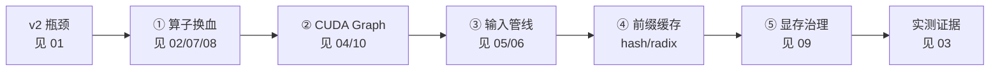

# 00 · v3 优化总览（完整线路图）

> 这是全文档的**导航中枢**。按此顺序读，可以完整复刻 v3 的优化路径。
> 配套代码：`vllm-v3/src/`（约 12 个模块），性能基准：`vllm-v3/bench/`。

## 一、v3 的核心叙事

**一句话：v2 的调度已经对了，慢在算子；v3 专治数据面（算子/内存/发射）的性能瓶颈。**

把 LLM 推理引擎拆成三个层面：

| 层面 | 职责 | v2 | v3 |
| --- | --- | --- | --- |
| **控制面** | 调度器 / 连续批处理 / chunked prefill / PD 混合 | ✅ 已正确 | **不变**（同构） |
| **数据面** | 算子、KV 布局、内存管理、kernel 发射 | ❌ 慢 | **换血** |
| **计算面** | 底层 kernel | PyTorch 通用算子 | FlashInfer / Triton / CUDA Graph |

**v3 的全部收益几乎都来自数据面换血。**

---

## 二、完整优化线路图



### 阶段 ①：算子换血（最大单点收益）

| 优化点 | v2 | v3 | 知识点 | 文档 | 代码 |
| --- | --- | --- | --- | --- | --- |
| Attention 后端 | SDPA + gather | FlashInfer paged / FA2 | PagedAttention、CSR 索引、causal mask | [07](./07-Attention优化.md) | `layers/attention.py` |
| Decode 合批 | for 循环逐样本 | 整批一次 kernel | kernel launch 开销、batch 语义 | [07](./07-Attention优化.md) | `layers/attention.py` |
| KV 写入 | `index_copy_` | Triton `store_kvcache` | 特化 kernel、scatter | [07](./07-Attention优化.md) | `memory/kv_ops.py` |
| RMSNorm | 7 个 kernel 拆分 | 单个 Triton kernel | 算子融合、SRAM | [08](./08-RMSNorm.md) | `layers/layernorm.py` |
| RoPE | 多步拆分 | 单 Triton kernel | 旋转位置编码 | — | `layers/rotary.py` |

### 阶段 ②：CUDA Graph（消除发射串行化）

| 优化点 | 解决什么 | 知识点 | 文档 | 代码 |
| --- | --- | --- | --- | --- |
| **Decode CG** | 每步 360 次 kernel 发射 | 图捕获/重放、静态 buffer、graph pool | [04](./04-CUDA-Graph.md) | `core/cuda_graph.py` |
| **Piece Prefill CG** | 短 prompt 的 CPU 发射地板 | 固定形状分片、padding、workspace 共享 | [10](./10-Prefill-CUDA-Graph.md) | `core/prefill_cuda_graph.py` |

> 注：早期版本的 **Continuation Prefill CG**（前缀命中续 chunk 的 q_len 网格图）因
> `len(seqs)==1` 限制导致并发前缀命中几乎不命中，收益/成本比差，已从 v3 移除。
> 前缀命中续 chunk 现在直接走 eager（radix 已跳过 KV 重算，剩余 token 较少）。

### 阶段 ③：输入管线

| 优化点 | 知识点 | 文档 | 代码 |
| --- | --- | --- | --- |
| pin_memory + non_blocking | DMA 直传、与计算重叠 | [05](./05-Input.md) | `engine/input_builder.py` |
| 采样整批一次 | Gumbel-max、同步次数 | [06](./06-Sampler.md) | `engine/sampler.py` |

### 阶段 ④：前缀缓存

hash / radix 两种后端，复用已计算的 KV，缓解长文本多轮对话的 TTFT。

### 阶段 ⑤：显存治理（本次新增）

**piece CG workspace 共享**：29 个 piece 从不同时运行，却各自持有 64MB FlashInfer workspace（共 ~1.86 GiB）。改为全 runner 共享一块 → **piece CG 增量从 +2.3 GiB 降到 +0.47 GiB**。见 [09](./09-显存优化.md)。

---

## 三、每个优化点的收益量化

> 全部在 RTX 4090 D + Qwen3-0.6B 实测。详细数据见 [03](./03-实测证据.md)。

| 优化 | 收益 |
| --- | --- |
| 算子换血（eager） | decode 吞吐 v2→v3：37 → 58 tok/s（1.6×） |
| + Decode CG | 58 → 415 tok/s（**7.1×**） |
| + Piece Prefill CG | 短 prompt TTFT：20ms → 3.4ms（**6×**） |
| 并发 batch=8 | v2 eager 144.9 → v3 CG 2385 tok/s（**16.5×**） |
| 显存治理（本次） | piece CG 增量 -1.86 GiB，性能零损失 |

---

## 四、阅读路径

```text
新手（想理解 v3 为什么快）
  01-v2性能瓶颈 → 02-v3如何消除瓶颈 → 03-实测证据 → 00（本页）

进阶（想理解每个优化怎么做）
  07-Attention优化 → 08-RMSNorm → 04-CUDA-Graph → 10-Prefill-CUDA-Graph
  → 05-Input → 06-Sampler → 09-显存优化

贡献者（想改代码）
  每个文档末尾都有对应源码路径，按 02 的映射表定位。
```

## 五、核心设计原则

1. **控制面与数据面解耦**：调度器不关心算子；算子不关心调度。v2 的调度合同在 v3 原样保留。
2. **静态内存 + 动态注入**：所有 CG 都遵循"预分配静态 buffer + 每步异步覆盖数据 + 一次 replay"。
3. **只优化 CPU-bound 区间**：CG 有收益 ⇔ `piece_gpu_ms < eager_floor_ms`（发射地板）。GPU-bound 的长 prefill 不硬套 CG。
4. **共享一切可共享的资源**：workspace、graph pool、input buffer——只要语义上不同时运行，就共享（本次优化的核心思想）。
