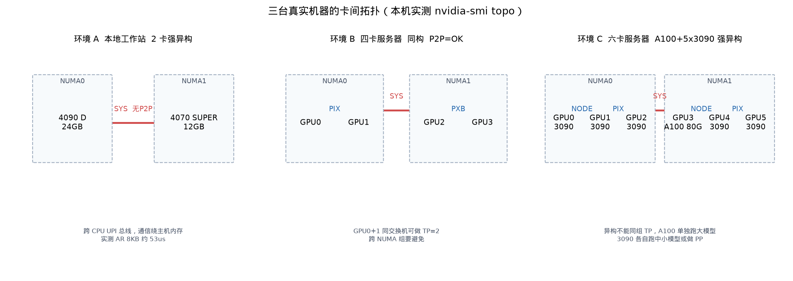

# 服务器通信测量（4×A100）

本文记录一台四卡 A100 服务器上的卡间通信实测，并与开发用双卡工作站对照。拓扑标签只能说明路径类型，带宽和延迟必须以测量为准。

硬件分类见 [01-硬件互联.md](01-硬件互联.md)。并行策略见 [00-并行环境.md](00-并行环境.md)。

---

## 1. 被测机器


| 项      | 值                                   |
| ------ | ----------------------------------- |
| 主机     | root11-SYS-420GP-TNR（主板 X12DPG-OA6） |
| GPU    | 4× NVIDIA A100-SXM4-40GB            |
| CPU    | 双路，两个 NUMA 节点                       |
| PCIe   | Gen4 ×16                            |
| P2P    | 全 OK（`nvidia-smi topo -p2p r`）      |
| NVLink | inactive，拓扑矩阵无 NV#                  |


SKU 名含 SXM4，但本机卡间实际走 PCIe fabric，不是 NVLink 全互联。单卡显存内 copy（GPU0，256MB）约 596 GB/s，远高于任何卡间通道。

### 1.1 拓扑矩阵

```
        GPU0    GPU1    GPU2    GPU3    CPU Affinity      NUMA
GPU0     X      PIX     SYS     SYS     0-31,64-95        0
GPU1    PIX      X      SYS     SYS     0-31,64-95        0
GPU2    SYS     SYS      X      PXB     32-63,96-127      1
GPU3    SYS     SYS     PXB      X      32-63,96-127      1
```


| 路径  | 代表卡对            | 含义                |
| --- | --------------- | ----------------- |
| PIX | 0↔1             | 同一 PCIe 桥内        |
| PXB | 2↔3             | 同 NUMA，经多个 PCIe 桥 |
| SYS | 0↔2、0↔3、1↔2、1↔3 | 跨 NUMA            |


同 NUMA 优先用 0+1 或 2+3；跨 NUMA 路径用于对照，不作为延迟敏感通信的首选。

---


## 2. 测量方法


| 项目    | 说明                                  |
| ----- | ----------------------------------- |
| 点对点   | 单向 D2D copy；主机侧计时，两端 synchronize    |
| 小消息延迟 | 4B，多次取中位数                           |
| 带宽曲线  | 消息 2KB 起倍增至 64MB                    |
| 集合通信  | NCCL all-reduce，world=2；关注延迟与 busbw |
| 主脚本   | `bench/micro/bench_bandwidth.py`（micro，不进 run_matrix） |
| 体检    | `bench/probe_server.py`（拓扑 + 延迟曲线 + TP 判语） |


在 `vllm-v4` 下复现本机三类路径：

```bash
python bench/micro/bench_bandwidth.py --pairs PIX:0,1;PXB:2,3;SYS:0,2 --skip-nccl
python bench/micro/bench_bandwidth.py --pairs PIX:0,1   # 含 NCCL
python bench/probe_server.py --devices 0,1 --hidden 1024 --layers 28 --batch 1
```

测量时 GPU1/2/3 上常有其它作业（约 60%到90% util），中等消息可能抖动。饱和带宽与空闲窗口下的小消息延迟仍可读。多租户忙时的 NCCL 数字不要直接用于 TP 决策。

---


## 3. 点对点实测


### 3.1 小消息延迟（4B，中位数）


| 路径  | 卡对              | 延迟 (us) |
| --- | --------------- | ------- |
| PIX | 0→1             | 30.9    |
| PXB | 2→3             | 24.4    |
| SYS | 0→2 / 0→3 / 1→2 | 26到31   |


三类路径都在 25到31 us。没有 NVLink 时，P2P=OK 只是去掉绕主机内存的 bounce，延迟仍落在 PCIe 量级。

### 3.2 带宽随消息大小（GB/s，单向 copy）


| 消息     | PIX 0→1 | PXB 2→3 | SYS 0→2 | SYS 0→3 |
| ------ | ------- | ------- | ------- | ------- |
| 2 KB   | 0.06    | 0.08    | 0.06    | 0.06    |
| 32 KB  | 0.99    | 1.20    | 0.98    | 0.98    |
| 256 KB | 5.78    | 4.62    | 5.22    | 5.16    |
| 1 MB   | 11.96   | 12.56   | 11.55   | 11.61   |
| 4 MB   | 16.87   | 16.38   | 1.57    | 15.04   |
| 16 MB  | 18.55   | 18.15   | 6.28    | 6.41    |
| 64 MB  | 13.60   | 13.71   | 13.62   | 13.88   |


说明：


| 观察           | 数据                                              |
| ------------ | ----------------------------------------------- |
| PIX 与 PXB 峰值 | 约 18.0到18.5 GB/s，接近 PCIe 4.0 x16 有效上限，实用上接近     |
| SYS 稳态（64MB） | 约 13.5到14 GB/s；4MB到16MB 曾因对端占满掉速，解读以峰值与 64MB 为准 |
| 相对单卡 HBM     | 卡间约为 596 GB/s 的 1/30到1/40                       |


小消息段带宽无意义（延迟主导）；256KB 以后进入带宽主导区。

---


## 4. NCCL all-reduce 实测

集合通信有协议开销，且 all-reduce 双向争用同一链路，大消息 busbw 通常约为裸 copy 峰值的一半。

### 4.1 world=2，PIX（0,1），相对空闲窗口


| 消息     | 延迟 (us) | busbw (GB/s) |
| ------ | ------- | ------------ |
| 2 KB   | 92.6    | 0.02         |
| 8 KB   | 90.5    | 0.08         |
| 128 KB | 89.6    | 1.36         |
| 256 KB | 111.5   | 2.19         |
| 1 MB   | 190.7   | 5.12         |
| 16 MB  | 2308    | 6.77         |


### 4.2 world=2，SYS（0,2），含负载抖动


| 消息     | 延迟 (us) | busbw (GB/s) |
| ------ | ------- | ------------ |
| 8 KB   | 40.6    | 0.19         |
| 256 KB | 87.3    | 2.80         |
| 4 MB   | 488     | 8.01         |
| 16 MB  | 1806    | 8.65         |


PXB 与 world=4 在共置负载下未得到干净全曲线，此处不报。

读数要点：


| 区间              | 现象                                       |
| --------------- | ---------------------------------------- |
| 数 KB（decode 量级） | 固定开销约 90 us，与无 P2P 工作站同量级                |
| 大消息             | busbw 约 7到9 GB/s，约为裸 copy 峰值 18 GB/s 的一半 |
| 忙时              | 小消息可劣化到约 10 ms；勿用忙时曲线做规划                 |


对比硬件标称或裸 copy 时用 busbw，不要用 algbw。对 all-reduce：busbw = algbw × 2(n−1)/n。

---


## 5. 与双卡工作站对照

对照机（下称环境 A）：RTX 4090 D + RTX 4070 SUPER，拓扑 SYS，P2P=NS，通信绕主机内存。本节本机记为环境 B。


| 维度             | 环境 A           | 环境 B（4×A100）                         |
| -------------- | -------------- | ------------------------------------ |
| 卡              | 2，强异构          | 4，同构 40GB                            |
| 拓扑             | SYS            | PIX / PXB / SYS                      |
| P2P            | NS             | 全 OK                                 |
| 卡间链路           | PCIe，绕主机       | PCIe，无 NVLink                        |
| 4B 延迟          | 约 37 us        | 约 25到31 us                           |
| 裸 copy 饱和      | 约 16.7 GB/s    | PIX/PXB 峰值约 18.5 GB/s；SYS 约 14 GB/s  |
| NCCL 小消息       | 约 77到90 us     | 空闲窗口 PIX 约 90 us                     |
| NCCL 大消息 busbw | 约 8.3到8.5 GB/s | 约 7到9 GB/s                           |
| 单卡 HBM 对照      | 消费级 GDDR       | 显存内 copy 约 596 GB/s                  |
| TP 建议          | 不做 TP          | 可做同 NUMA 的 TP=2 实验；TP=4 / 跨 NUMA 不推荐 |


环境 B 相对 A：去掉 host bounce，同构，同 NUMA 内带宽略高。相对单卡 HBM：卡间仍慢一到两个数量级。相对 NVLink 机器：本机不能按数百 GB/s 编预算。

环境 A 上点对点与 NCCL 完整曲线（便于复现方法）见附录 A。

---


## 6. 对本机并行的建议


| 场景       | 建议                                    |
| -------- | ------------------------------------- |
| TP=2     | 优先 0+1（PIX）或 2+3（PXB）；两者带宽接近，选空闲对即可   |
| TP=4     | 必经 SYS，且无 NVLink，预期差；优先两路 TP=2 或单卡    |
| 跨 NUMA   | 可通信，但不稳；延迟敏感路径避开                      |
| PP / 单卡池 | 跨 NUMA 卡更适合 PP 或独立任务，而不是同一 TP 组       |
| 决策依据     | 同 NUMA 两卡跑通后，与单卡 decode 吞吐对比，用端到端数据确认 |


---


## 7. 新机器快速流程

```bash
nvidia-smi -L
nvidia-smi --query-gpu=index,name,memory.total,pcie.link.gen.max,pcie.link.width.max --format=csv
nvidia-smi topo -m
nvidia-smi topo -p2p r
nvidia-smi nvlink -s
lscpu | grep -E "Model name|Socket|NUMA node\(s\)"
```


| 步骤     | 看什么                                          |
| ------ | -------------------------------------------- |
| 清单     | 卡数、型号、显存、NUMA                                |
| 拓扑     | NV# 最好；PIX/PXB/NODE 次之；SYS 跨 CPU             |
| P2P    | OK 可直连；NS / CNS 需绕主机                         |
| NVLink | 有无 NV#、链路是否 active                           |
| 实测     | 点对点延迟与饱和带宽；空闲时 NCCL 小消息与大消息 busbw            |
| 决策     | 显存够则单卡；不够再按 P2P 与同 NUMA 组 TP，跨 NUMA 或异构优先 PP |


端到端吞吐对照见 [03-性能对比.md](03-性能对比.md)。

拓扑类型由好到差：NV#、PIX、PHB、NODE、PXB、SYS。

---


## 附录 A. 环境 A 测量曲线（方法参考）

工具：`bench/micro/bench_bandwidth.py`。

```bash
python bench/micro/bench_bandwidth.py --devices 0,1 -b 2048 -e 268435456 -f 2
```


### A.1 点对点裸传输


| 消息大小   | 带宽 (GB/s) | 说明    |
| ------ | --------- | ----- |
| 4 B    | 延迟 37 us  | 固定开销  |
| 2 KB   | 0.05      | 延迟主导  |
| 32 KB  | 0.83      | 延迟主导  |
| 256 KB | 6.08      | 进入带宽区 |
| 4 MB   | 13.30     | 接近饱和  |
| 64 MB  | 16.48     | 饱和    |
| 256 MB | 16.69     | 上限    |


### A.2 NCCL all-reduce（world=2）


| 消息大小   | 延迟 (us) | busbw (GB/s) |
| ------ | ------- | ------------ |
| 2 KB   | 77.3    | 0.02         |
| 128 KB | 84.4    | 1.45         |
| 256 KB | 82.9    | 2.94         |
| 1 MB   | 153.1   | 6.38         |
| 4 MB   | 458.3   | 8.52         |
| 64 MB  | 7436.8  | 8.40         |
| 256 MB | 29982.0 | 8.34         |


2KB到256KB 延迟约 77到86 us，被跨卡固定开销主导。饱和 busbw 约 8.5 GB/s，约为裸 copy 16.7 GB/s 的一半。

---


## 附录 B. 其它对照机（简述）


| 代号   | 配置                 | P2P    | 备注                       |
| ---- | ------------------ | ------ | ------------------------ |
| 环境 A | 4090 D + 4070 S    | NS     | 见第 5 节与附录 A              |
| 环境 B | 4×A100-40G（本机）     | 全 OK   | 本文主体                     |
| 环境 C | A100 80G + 多张 3090 | NS/CNS | 强异构；宜拆池，A100 单独用，不宜混组 TP |





| 机器  | 卡数  | 异构  | P2P    | 链路                        | TP               |
| --- | --- | --- | ------ | ------------------------- | ---------------- |
| A   | 2   | 强   | NS     | SYS，绕主机                   | 负收益；单卡 4090 + CG |
| B   | 4   | 无   | 全 OK   | PCIe PIX/PXB/SYS，无 NVLink | 同 NUMA TP=2 可做实验 |
| C   | 6   | 强   | NS/CNS | 跨 NUMA                    | 基本不可行；拆池         |


---


## 附录 C. 读数约定


| 步骤   | 做法                                          |
| ---- | ------------------------------------------- |
| 看延迟  | 小消息中位数；决定每层 all-reduce 下限                   |
| 看饱和  | 大消息 busbw / 裸 copy 峰值；对照 PCIe 或 NVLink 预期   |
| 折算业务 | 用目标模型每层通信量代入曲线，与单卡计算时间比                     |
| 异常   | 远低于预期时查驱动、NVLink、NCCL 路径（`NCCL_DEBUG=INFO`） |


官方集合通信基准也可用 NVIDIA nccl-tests（all_reduce_perf 等）。对比标称带宽用 busbw。