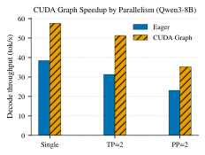
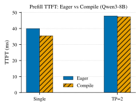
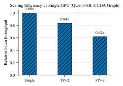
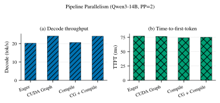
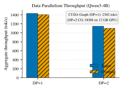
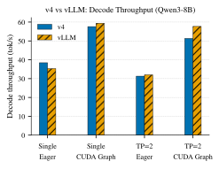

# v4 性能对比

环境 A 上 v4 与官方 vLLM（0.26.0）的实测矩阵。覆盖 Qwen3-0.6B / 4B / 8B / 14B，布局含单卡、TP、PP、DP，开关含 eager、CUDA Graph（CG）、`torch.compile`。

硬件与并行背景：[00-并行环境.md](00-并行环境.md)、[01-硬件互联.md](01-硬件互联.md)。通信测量：[02-服务器通信测量.md](02-服务器通信测量.md)。

---

## 1. 测试条件

### 1.1 硬件


| 项   | 值                                                     |
| --- | ----------------------------------------------------- |
| 机器  | 环境 A：RTX 4090 D（24 GB）+ RTX 4070 SUPER（12 GB），双路 Xeon |
| 拓扑  | 两卡无 P2P（`nvidia-smi topo -p2p r` = NS），跨 NUMA，通信绕主机内存 |
| 设备序 | `cuda:0` = 4090 D，`cuda:1` = 4070 SUPER               |
| 精度  | bfloat16                                              |


### 1.2 模型与可行布局


| 模型         | 权重大约    | 可行布局             | 备注                                         |
| ---------- | ------- | ---------------- | ------------------------------------------ |
| Qwen3-0.6B | ~1.2 GB | 单卡 / TP=2 / PP=2 | 小模型基线                                      |
| Qwen3-4B   | ~7.6 GB | DP=1 / DP=2      | 验证数据并行                                     |
| Qwen3-8B   | ~16 GB  | 单卡 / TP=2 / PP=2 | 单卡用 `--device-ids 0`（4090）                 |
| Qwen3-14B  | ~29 GB  | PP=2             | `--pp-layer-counts 12,28`（12→4070，28→4090） |


官方 vLLM（`.venv-vllm`，V1）已移除离线 PP：对照仅含 0.6B / 8B 的单卡与 TP=2。

### 1.3 指标与场景


| 指标             | 含义         | 测法                       |
| -------------- | ---------- | ------------------------ |
| TTFT (ms)      | 首 token 延迟 | 单请求提交到首 token 的墙钟        |
| decode (tok/s) | 单请求解码吞吐    | 128 token 去掉首 token      |
| batch8 (tok/s) | 8 路并发吞吐    | 总生成 token / 墙钟           |
| DP 吞吐 (tok/s)  | 数据并行聚合吞吐   | 32 路并发（bench_v4.py --dp） |


公共参数：prompt = 256 token，贪心，ignore_eos，max_tokens=128，dtype=bfloat16。  
v4：bench/bench_v4.py（--tp --pp --dp --cg --compile），max_num_seqs=16，context_len=4096。  
官方：bench/bench_vllm.py。矩阵：bench/run_matrix.py。

均为单次测量。TTFT 噪声约 5%到10%；decode / batch 对 100+ token 平均，较稳定。结论以 decode 与 batch 为主。

---


## 2. Qwen3-0.6B


### 2.1 全量矩阵（v4）


| 布局   | 模式         | TTFT (ms) | decode (tok/s) | batch8 (tok/s) |
| ---- | ---------- | --------- | -------------- | -------------- |
| 单卡   | eager      | 19.43     | 65.3           | 487.3          |
| 单卡   | CG         | 18.70     | 433.9          | 2734.4         |
| 单卡   | compile    | 4.78      | 63.9           | 484.1          |
| 单卡   | CG+compile | 4.53      | 432.2          | 2664.6         |
| TP=2 | eager      | 25.74     | 42.5           | 324.8          |
| TP=2 | CG         | 25.74     | 354.4          | 2156.9         |
| TP=2 | compile    | 29.43     | 39.5           | 331.4          |
| TP=2 | CG+compile | 27.96     | 348.7          | 2041.1         |
| PP=2 | eager      | 15.55     | 90.5           | 664.8          |
| PP=2 | CG         | 27.15     | 257.9          | 1540.5         |
| PP=2 | compile    | 13.06     | 92.9           | 662.9          |
| PP=2 | CG+compile | 29.78     | 236.2          | 1477.6         |


### 2.2 CG 收益


| 布局   | eager decode | CG decode | 倍率   | batch8 倍率 |
| ---- | ------------ | --------- | ---- | --------- |
| 单卡   | 65.3         | 433.9     | 6.6x | 5.6x      |
| TP=2 | 42.5         | 354.4     | 8.3x | 6.6x      |
| PP=2 | 90.5         | 257.9     | 2.8x | 2.3x      |


0.6B 每步 decode 计算量小，时间主要花在 Python 调度与 kernel 启动上。CG 固化 decode 路径后，单卡 decode 从 65.3 提到 433.9 tok/s。TP 每步有大量小消息 all-reduce，eager 下启动开销叠加更重，开 CG 后倍率最高（8.3x）。PP 每卡层数减半，eager 本身已较快，CG 倍率最低（2.8x）。

### 2.3 compile 收益


| 布局   | eager TTFT (ms) | compile TTFT (ms) | 倍率    |
| ---- | --------------- | ----------------- | ----- |
| 单卡   | 19.43           | 4.78              | 4.1x  |
| TP=2 | 25.74           | 29.43             | 0.87x |
| PP=2 | 15.55           | 13.06             | 1.2x  |


compile 只作用于 prefill；decode 吞吐几乎不变（63.9 vs 65.3）。单卡 TTFT 从 19.43 ms 降到 4.78 ms。TP=2 下编译对象含 all-reduce，走 `max-autotune`，TTFT 反而变差（25.74 → 29.43 ms）。

### 2.4 并行扩展

CG 模式：


| 布局   | decode (tok/s) | 相对单卡  |
| ---- | -------------- | ----- |
| 单卡   | 433.9          | 1.00x |
| TP=2 | 354.4          | 0.82x |
| PP=2 | 257.9          | 0.59x |


eager 模式：


| 布局   | decode (tok/s) | 相对单卡  |
| ---- | -------------- | ----- |
| 单卡   | 65.3           | 1.00x |
| TP=2 | 42.5           | 0.65x |
| PP=2 | 90.5           | 1.39x |


无 P2P、跨 NUMA 时，CG 下 TP/PP 均为负扩展；eager 下 PP=2 因层数减半、启动次数减少，decode 高于单卡（1.39x），TP 仍为负。

---


## 3. Qwen3-8B


### 3.1 全量矩阵（v4）


| 布局   | 模式         | TTFT (ms) | decode (tok/s) | batch8 (tok/s) |
| ---- | ---------- | --------- | -------------- | -------------- |
| 单卡   | eager      | 39.99     | 38.4           | 363.0          |
| 单卡   | CG         | 40.82     | 57.6           | 400.2          |
| 单卡   | compile    | 35.47     | 50.3           | 354.9          |
| 单卡   | CG+compile | 35.47     | 58.0           | 399.5          |
| TP=2 | eager      | 47.88     | 31.3           | 229.9          |
| TP=2 | CG         | 72.84     | 51.3           | 334.3          |
| TP=2 | compile    | 47.33     | 33.7           | 240.1          |
| TP=2 | CG+compile | 62.48     | 51.0           | 333.3          |
| PP=2 | eager      | 59.08     | 23.1           | 165.6          |
| PP=2 | CG         | 75.63     | 35.2           | 247.3          |
| PP=2 | compile    | 53.43     | 20.9           | 152.4          |
| PP=2 | CG+compile | 66.11     | 35.4           | 247.5          |


PP=2 纯 compile 曾因误用 `max-autotune-no-cudagraphs` 超时（>15 min）。现仅 `tp>1` 使用该 mode，PP-only 用 `reduce-overhead`，约 1 min 内完成。

### 3.2 CG / compile 收益




| 布局   | eager decode | CG decode | 倍率   |
| ---- | ------------ | --------- | ---- |
| 单卡   | 38.4         | 57.6      | 1.5x |
| TP=2 | 31.3         | 51.3      | 1.6x |
| PP=2 | 23.1         | 35.2      | 1.5x |





| 布局   | eager TTFT (ms) | compile TTFT (ms) | 倍率    |
| ---- | --------------- | ----------------- | ----- |
| 单卡   | 39.99           | 35.47             | 1.13x |
| TP=2 | 47.88           | 47.33             | 1.01x |
| PP=2 | 59.08           | 53.43             | 1.11x |


8B 每步需搬运约 16 GB 权重，时间由访存与算力主导，CG / compile 相对收益明显低于 0.6B。

### 3.3 并行扩展（CG，batch8）




| 布局   | batch8 (tok/s) | 相对单卡  |
| ---- | -------------- | ----- |
| 单卡   | 400.2          | 1.00x |
| TP=2 | 334.3          | 0.84x |
| PP=2 | 247.3          | 0.62x |


8B 可装入 4090（24 GB）。在本机拓扑下，TP/PP 未带来吞吐增益。

---


## 4. Qwen3-14B（PP=2 不均分）

14B 单卡放不下。布局：`--pp-layer-counts 12,28 --device-ids 1,0`（12 层 → 4070，28 层 → 4090）。




| 布局   | 模式         | TTFT (ms) | decode (tok/s) | batch8 (tok/s) |
| ---- | ---------- | --------- | -------------- | -------------- |
| PP=2 | eager      | 77.26     | 20.2           | 145.8          |
| PP=2 | CG         | 76.72     | 24.1           | 171.7          |
| PP=2 | compile    | 74.41     | 20.6           | 147.9          |
| PP=2 | CG+compile | 75.21     | 24.0           | 171.2          |


CG 倍率约 1.2x，compile 约 1.04x。等分 20/20 会使 4070 超显存；不均分是本机跑通 14B 的必要条件。

---


## 5. Qwen3-4B（DP）

DP=1：单卡 4090。DP=2：4090 + 4070，请求 round-robin。吞吐为 32 路并发聚合 tok/s。




| 布局              | eager (tok/s) | compile (tok/s) | CG (tok/s) |
| --------------- | ------------- | --------------- | ---------- |
| DP=1（4090）      | 1432.8        | 1403.6          | 2302.5     |
| DP=2（4090+4070） | 1146.7        | 1100.1          | OOM        |


DP=2 低于 DP=1：慢卡限制 round-robin 聚合吞吐，且每副本独立加载权重与 KV。DP=2 + CG 在 4070（12 GB）上 OOM：模型与 CUDA 上下文约占 10.8 GB，再叠加按 `max_num_seqs` 捕获的图内存超出容量。

---


## 6. 跨模型汇总


### 6.1 CG decode 倍率（单卡）


| 模型        | eager decode | CG decode | 倍率   |
| --------- | ------------ | --------- | ---- |
| 0.6B      | 65.3         | 433.9     | 6.6x |
| 8B        | 38.4         | 57.6      | 1.5x |
| 14B（PP=2） | 20.2         | 24.1      | 1.2x |


### 6.2 compile TTFT 倍率（单卡 / 14B 为 PP=2）


| 模型        | eager TTFT (ms) | compile TTFT (ms) | 倍率    |
| --------- | --------------- | ----------------- | ----- |
| 0.6B      | 19.43           | 4.78              | 4.1x  |
| 8B        | 39.99           | 35.47             | 1.13x |
| 14B（PP=2） | 77.26           | 74.41             | 1.04x |


### 6.3 CG 下相对单卡扩展（batch8；0.6B 用 decode）


| 模型           | 单卡    | TP=2  | PP=2  |
| ------------ | ----- | ----- | ----- |
| 0.6B（decode） | 1.00x | 0.82x | 0.59x |
| 8B（batch8）   | 1.00x | 0.84x | 0.62x |


在本机（无 P2P、异构）上：模型越大，CG/compile 相对收益越低；显存够用时 TP/PP 不提升吞吐；显存不够时 PP 用于装入模型（如 14B）。

---


## 7. v4 vs 官方 vLLM


### 7.1 Qwen3-0.6B


| 布局   | 模式      | 引擎   | TTFT (ms) | decode (tok/s) | batch8 (tok/s) |
| ---- | ------- | ---- | --------- | -------------- | -------------- |
| 单卡   | eager   | v4   | 19.43     | 65.3           | 487.3          |
| 单卡   | eager   | vLLM | 23.36     | 60.9           | 469.3          |
| 单卡   | CG      | v4   | 18.70     | 433.9          | 2734.4         |
| 单卡   | CG      | vLLM | 23.20     | 231.8          | 1335.9         |
| 单卡   | compile | v4   | 4.78      | 63.9           | 484.1          |
| 单卡   | compile | vLLM | 23.23     | 61.8           | 474.7          |
| TP=2 | eager   | v4   | 25.74     | 42.5           | 324.8          |
| TP=2 | eager   | vLLM | 27.09     | 45.1           | 298.8          |
| TP=2 | CG      | v4   | 25.74     | 354.4          | 2156.9         |
| TP=2 | CG      | vLLM | 24.33     | 205.9          | 1108.9         |


eager：双方接近。CG：v4 单卡 decode 约 1.9x、batch8 约 2.0x。compile：v4 单卡 TTFT 4.78 ms；v4 仅编译 prefill，官方为全模型编译，语义不完全对等。

### 7.2 Qwen3-8B




| 布局   | 模式    | 引擎   | TTFT (ms) | decode (tok/s) | batch8 (tok/s) |
| ---- | ----- | ---- | --------- | -------------- | -------------- |
| 单卡   | eager | v4   | 39.99     | 38.4           | 363.0          |
| 单卡   | eager | vLLM | 36.36     | 35.3           | 349.3          |
| 单卡   | CG    | v4   | 40.82     | 57.6           | 400.2          |
| 单卡   | CG    | vLLM | 55.89     | 59.4           | 403.0          |
| TP=2 | eager | v4   | 47.88     | 31.3           | 229.9          |
| TP=2 | eager | vLLM | 51.69     | 32.0           | 263.6          |
| TP=2 | CG    | v4   | 72.84     | 51.3           | 334.3          |
| TP=2 | CG    | vLLM | 52.05     | 57.7           | 363.8          |


8B 上双方 decode / batch 差距多在个位数百分比。权重访存成为主因后，实现差异被摊薄。

compile TTFT：单卡 v4 35.47 vs vLLM 38.56；TP=2 v4 47.33 vs vLLM 51.36。

### 7.3 对照边界


| 项       | 说明                                                        |
| ------- | --------------------------------------------------------- |
| 场景      | 贪心 decode、单机；不含投机解码、多模态等                                  |
| KV      | v4 多为显式块数；vLLM 按 `gpu_memory_utilization` 自适应；batch8 均未触顶 |
| compile | v4 只编译 prefill；官方 `VLLM_COMPILE` 为全模型                     |
| PP      | 官方 V1 离线路径无 PP，无 0.6B/8B/14B 的 PP 对照                      |
| 测量      | 单次；TTFT 噪声 5%–10%                                         |


---


## 8. 与矩阵相关的实现说明


### 8.1 PP compile mode


| 条件      | compile mode                 |
| ------- | ---------------------------- |
| `tp>1`  | `max-autotune-no-cudagraphs` |
| 单卡或仅 PP | 配置默认（`reduce-overhead`）      |


| 配置              | 修复前        | 修复后                                           |
| --------------- | ---------- | --------------------------------------------- |
| 8B PP=2 compile | >15 min 超时 | ~1 min；TTFT 53.43 ms，decode 20.9，batch8 152.4 |


### 8.2 PP + CUDA Graph

piecewise CG：recv/send 在图外，图内仅本 stage forward，写入静态 `_pp_send` / `_decode_out`（对齐 vLLM #35162）。正确性：`test/test_parallel.py --tp 1 --pp 2`。

---


## 9. 复现

在 vllm-v4 目录下。详见 bench/README.md。

```
# 冒烟：0.6B 单卡 / TP / PP
../.venv2/bin/python bench/run_matrix.py --suite smoke --reset-jsonl

# 完整矩阵（对齐本文主表）
../.venv2/bin/python bench/run_matrix.py --suite full --reset-jsonl

# 与官方对照
../.venv2/bin/python bench/run_matrix.py --suite vs-vllm --reset-jsonl
../.venv2/bin/python bench/report.py

# 单配置示例
../.venv2/bin/python bench/bench_v4.py --model ~/huggingface/Qwen3-0.6B --tp 1 --pp 1 --dp 1 --cg
../.venv2/bin/python bench/bench_v4.py --model ~/shared/models/Qwen3-8B --tp 1 --pp 1 --dp 1 --device-ids 0 --cg
../.venv2/bin/python bench/bench_v4.py --model ~/shared/models/Qwen3-14B --tp 1 --pp 2 --dp 1 \
    --pp-layer-counts 12,28 --device-ids 1,0 --num-kvcache-blocks 32
../.venv2/bin/python bench/bench_v4.py --model ~/huggingface/Qwen3-4B --tp 1 --pp 1 --dp 2 \
    --n-reqs 32 --num-kvcache-blocks 48
../.venv-vllm/bin/python bench/bench_vllm.py --model ~/shared/models/Qwen3-8B --tp 1 --cg --cuda-devices 0
```

---


## 10. 结论（按本机数据）


| 问题                | 结果                                                             |
| ----------------- | -------------------------------------------------------------- |
| CG / compile 何时有用 | 小模型收益大（0.6B CG 6.6x、compile 4.1x）；随规模增大衰减（8B CG 1.5x、14B 1.2x） |
| 显存够时要不要 TP/PP     | 本机无 P2P：CG 下多为负扩展；eager 下仅 PP 在 0.6B 上为正（1.39x）                |
| 显存不够怎么办           | 14B 用不均分 PP 装入；目标是能跑，不是加速                                      |
| DP 是否加速           | 异构双卡上 DP=2 低于单 4090；CG 在 12 GB 卡上 OOM                          |
| 与官方 vLLM          | 0.6B CG 上 v4 明显更高；8B 上双方接近                                     |


待改进：CG 捕获 batch 上限（缓解 DP=2 OOM）；TTFT 多次取中位数。