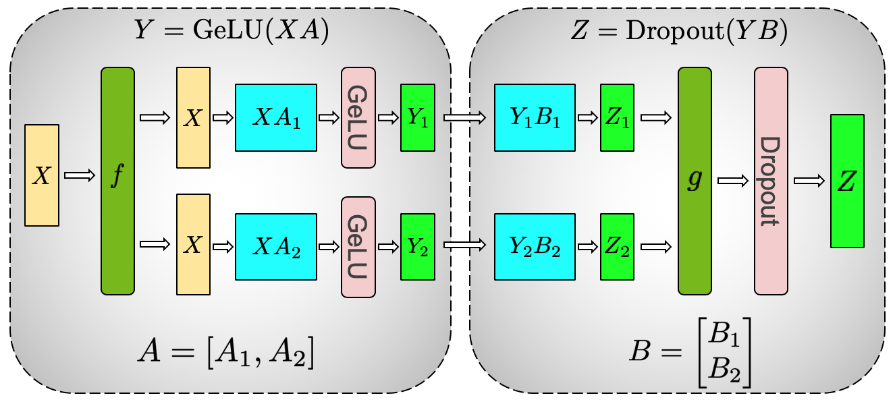

# 线性层并行 从原理到实现

这篇文档完整讲解 vllm-v4 里张量并行线性层的设计与实现。我将从宏观设计出发，一直讲解到代码的具体实现。并且把 v4 版本实现和 vLLM 官方进行对比，通过实测数据说明每一项设计选择的代价和收益。

## 1. 线性层为什么要并行？

### 1.1 线性层与矩阵乘

模型处理文本时最频繁的基本运算就是把一个向量变换成另一个向量。变换由一个权重矩阵完成，数学形式是 y 等于 x 乘 W 的转置再加 b。这个运算在代码里就是 `torch.nn.functional.linear(x, w, b)`，在 GPU 上对应一次矩阵乘，也就是 GEMM。

线性层的形状由输入维和输出维决定。输入 x 的形状是 `[token 数, in_size]`，权重 W 的形状是 `[out_size, in_size]`，输出 y 的形状是 `[token 数, out_size]`。
一次前向把 in_size 维的向量映射成 out_size 维的向量。
词向量输入维度和词表分数的维度相差很远，靠的就是这若干线性变换。

Transformer 的每一层里，绝大多数参数和算力都花在线性层上。
以 Qwen3-0.6B 为例，attention 里的 qkv 投影、o 投影，MLP 里的 gate 投影、up 投影、down 投影等都是线性层。
如果对于线性层有很好的性能提升，那么对于整个模型来说也会有更好的性能提升方案。

### 1.2 沿输出维的列并行

当一张卡装不下权重，或者一张卡算不完矩阵乘的时候，自然的想法是把矩阵切成几块分给多张卡。上边我们提到线性层的形状是由输入维度和输出维度决定的，那自然而然就产生了两种并行的方案，

- 沿着输出维切分
- 沿着输入维切分

沿输出维切分，也就是把 W 的 out_size 行分成 tp 份，每张卡持有 out_size 除以 tp 行。tp 是 tensor parallel 的缩写，意思是张量并行。

$$
\begin{aligned}
Y &= X \cdot W^T
\\
&= X \cdot \begin{bmatrix} W_0  W_1 \end{bmatrix}^T 
\\
&= X \cdot \begin{bmatrix} W_0^T & W_1^T \end{bmatrix}
\\
&= \begin{bmatrix} X \cdot W_0^T & X \cdot W_1^T \end{bmatrix}
\\
&= \begin{bmatrix} Y_0 & Y_1 \end{bmatrix}
\end{aligned}
$$

输出并行可以很好地解决单张卡的显存占用，因为每张卡存储的权重减少了。
但是对于输入 x 来说是完整的，每张卡都需要一份完整的输入，需要用各自的权重算出 `[token 数, out_size/tp]` 的局部输出。
之后三张卡拼起来就可以得到完整的 `[token 数, out_size]` 输出。
由于每段各占一段输出维，各自没有重叠，拼起来的数学结果和一次大矩阵乘完全相同。
这个拼接操作就叫 all-gather。

这种切法叫列并行，英文是 Column Parallel。输出维在权重矩阵里是行，所以列并行的切分发生在矩阵的行方向上。代码里的 `ColumnParallelLinear` 就是这个含义。

### 1.3 沿输入维的行并行

列并行能解决输出维太大的问题。但如果上一层的输出本来就切好了，假设紧挨着又有一层需要相同的计算，就需要把他们拼起来再送到下一层，这样子会产生通信开销。
更巧的做法是沿输入维切分，让权重矩阵直接进行分片的输入。

沿输入维切分，也就是把 W 的 in_size 列分成 tp 份，每张卡持有 in_size 除以 tp 列。
对应的，输入 x 也要沿最后一维切成 tp 段，每张卡拿自己那段。每张卡用 `[token 数, in_size/tp]` 的输入段乘 `[out_size, in_size/tp]` 的权重段，算出一个 `[token 数, out_size]` 的局部结果。

$$
\begin{aligned}
Y &= X \cdot W^T 
\\
&= \begin{bmatrix} X_0 & X_1 \end{bmatrix} \cdot \begin{bmatrix} W_0 & W_1 \end{bmatrix}^T 
\\
&= \begin{bmatrix} X_0 & X_1 \end{bmatrix} \cdot \begin{bmatrix} W_0^T  W_1^T \end{bmatrix} 
\\
&= X_0 \cdot W_0^T + X_1 \cdot W_1^T 
\\
&= Y_0 + Y_1 
\end{aligned}
$$

问题来了。列并行拼起来的是不同段的输出，而这里每张卡算的 `[token 数, out_size]` 覆盖的是同一段输出范围，只是各自由输入的不同段贡献。要得到正确结果，必须把多张卡的局部结果按位置相加。这个相加操作叫 **all-reduce**。

这种切法叫行并行。它把输入维切碎分给多张卡，最后用一次 all-reduce 把部分和聚合成完整输出。代码里的 `RowParallelLinear` 就是这个形态。

列并行和行并行是一对对偶的切法，前者切输出、后者切输入，通信原语恰好互为相反操作。下图是 Megatron-LM 论文里的 MLP 块张量并行示意图，第一层 GEMM 沿输出维列切分，每卡独立做完 GeLU 后，第二层 GEMM 沿输入维行切分，最后由 all-reduce 汇总，正好把两种切法放在一起对照。



### 1.4 张量并行的适用边界

这一节我们来看一下张量并行是如何应用在Qwen3中的。

#### 1.4.1 并行特性分析

张量并行的加速收益高度依赖于矩阵乘法的计算形状与负载特征。prefill 和 decode 对张量并行的敏感度存在显著差异。

- **预填充阶段**：该阶段需并行处理完整的Prompt，矩阵乘法的批次维度通常达到数百至数千。将权重按张量并行切分后，单卡的浮点运算量呈线性下降，张量并行的加速收益最为显著。这也是 Megatron-LM 等框架引入模型并行的核心动机。
- **解码阶段**：每一步的批次维度 $M=1$。此时矩阵乘法退化为矩阵-向量乘法，负载转变为访存密集型或Launch-bound，而非算力受限。在此阶段切分权重无法使计算时间减半，反而会在每一层引入额外的集合通信开销。在常规硬件环境下，单次 All-Reduce 操作存在固定延迟，实测表明，在缺乏 NVLink 等超低延迟互联技术的节点内，$TP=2$ 的解码速度慢于 $TP=1$。

综上所述，线性层的张量并行主要服务于预填充阶段。
在解码阶段启用张量并行的主要目的在于突破单卡显存容量限制，其代价是承受较高的通信延迟。若要使解码阶段从张量并行中获益，需依赖节点间的高速互联技术。

#### 1.4.2 Qwen3 模型架构与模块组成

Qwen3 采用仅包含 Decoder-only 的 Transformer 架构。根据官方技术报告，其稠密模型系列的配置参数如表 1 所示。本实现以 Qwen3-0.6B 模型为基准。


| 模型         | 层数  | 头数（Q / KV） | 权重绑定 | 上下文长度 |
| ---------- | --- | ---------- | ---- | ----- |
| Qwen3-0.6B | 28  | 16 / 8     | 是    | 32K   |
| Qwen3-1.7B | 28  | 16 / 8     | 是    | 32K   |
| Qwen3-4B   | 36  | 32 / 8     | 是    | 128K  |
| Qwen3-8B   | 36  | 32 / 8     | 否    | 128K  |
| Qwen3-14B  | 40  | 40 / 8     | 否    | 128K  |
| Qwen3-32B  | 64  | 64 / 8     | 否    | 128K  |


> *数据来源：[Qwen3 Technical Report](https://arxiv.org/abs/2505.09388) Table 1*

从系统实现的角度，Qwen3 模型主要由以下三类核心模块构成：

1. **Embedding & LM Head**：包含输入嵌入层与输出语言模型头。前者将离散的词元索引映射为连续的隐藏状态向量，后者将顶层隐藏状态投影回词表空间以计算逻辑值。这一块是 TP 并行的重要模块。
2. **Decoder Layers**：模型主体由 $N$ 个堆叠的 `Qwen3DecoderLayer` 组成（Qwen3-0.6B 中 $N=28$）。每个解码器层包含注意力与前馈神经网络两个子模块。

综上，模型中涉及大规模参数存储与矩阵运算的线性层主要集中在四个位置：注意力机制的 `qkv_proj` 与 `o_proj`，MLP 的 `gate_up_proj` 与 `down_proj`，以及首尾的词表映射层。

#### 1.4.3 TP 应用策略

在分布式推理系统中，张量并行的应用遵循严格的数学等价性原则：**参数密集型模块**（如线性层与嵌入层）的计算本质为矩阵乘法或查表操作，其权重与激活值可按特定维度切分，且切分后的分布式计算结果与单卡全量计算在数学上严格等价；而**逐元素操作模块**（如 RMSNorm、残差连接、激活函数）通常作用于聚合后的完整隐藏状态，各计算节点的局部结果完全一致，无需进行分布式切分。

基于上述原则，Qwen3 各模块的张量并行策略如表 2 所示。


| 模块                  | 计算类型   | 张量并行切分策略             | 集合通信原语        |
| ------------------- | ------ | -------------------- | ------------- |
| `embed_tokens`      | 词表嵌入映射 | 沿词表维度切分（列并行）         | All-Reduce    |
| `qkv_proj`          | 线性投影   | 按注意力头沿输出维度切分         | 无（本地拆分 Q/K/V） |
| `q_norm` / `k_norm` | 逐元素归一化 | 按注意力头本地执行            | 无             |
| `rotary_emb`        | 旋转位置编码 | 按注意力头本地执行            | 无             |
| `attn`              | 注意力计算  | 按注意力头切分，本地独立计算       | 无             |
| `o_proj`            | 线性投影   | 沿输入维度切分（行并行）         | All-Reduce    |
| `gate_up_proj`      | 融合线性投影 | 沿输出维度切分，Gate/Up 矩阵融合 | 无（本地拆分输出段）    |
| `act_fn`            | 逐元素激活  | 本地执行                 | 无             |
| `down_proj`         | 线性投影   | 沿输入维度切分（行并行）         | All-Reduce    |
| `RMSNorm` / 残差      | 逐元素操作  | 不切分，各节点冗余计算          | 无             |
| `lm_head`           | 线性投影   | 沿词表维度切分（列并行）         | All-Gather    |


针对上述并行策略，可总结出以下特征：

1. **通信与计算对齐**：张量并行的切分点严格对应矩阵乘法的边界。以Attention模块为例，`qkv_proj` 采用列并行切分后，各计算节点持有局部的 QKV 向量并直接输入至注意力计算内核。由于注意力计算按头独立进行。随后，`o_proj` 采用行并行切分，通过单次 All-Reduce 操作恢复完整的隐藏状态维度。此设计避免中间状态的 `All-Gather` 操作，使得单个 Transformer 层仅需执行两次集合通信（分别位于注意力子模块的 `o_proj` 与 MLP 子模块的 `down_proj`）。
2. **列并行与行并行交替耦合**：在 Qwen3 的层间数据流中，列并行与行并行呈现交替出现的拓扑结构，且前序模块的局部输出直接作为后序模块的局部输入。例如，`qkv_proj`（列并行）的局部输出直接按头分配给注意力内核，随后 `o_proj`（行并行）接收已按特征维度切分的输入，并通过 All-Reduce 输出完整的隐藏状态；该完整状态经残差连接后，作为 `gate_up_proj`（列并行）的输入，其局部输出再经激活函数处理后，直接输入至 `down_proj`（行并行）。
3. **词表映射层的特殊处理机制**：词表两端的模块具有特殊的并行逻辑。输入嵌入层 `embed_tokens` 采用“词表维度切分+All-Reduce”的策略：各节点仅存储部分词表的嵌入向量，对于越界索引返回零向量，通过 All-Reduce 聚合各节点的局部结果以获取完整的嵌入表示。输出层 `lm_head` 采用列并行切分，其局部逻辑值需通过 All-Gather 拼接为完整的词表概率分布。在推理阶段的贪心解码中，可通过仅传递局部最大值及其索引的优化路径，将词表维度的通信数据量降低数个数量级。


## 2. 整体架构


### 2.1 行列Linear并行类

整个[线性层代码](../src/compute/layers/linear.py)里有四个类。


| 类                            | 用途                       | 切分维度   | 输出通信           |
| ---------------------------- | ------------------------ | ------ | -------------- |
| `ColumnParallelLinear`       | 通用列并行                    | 输出维    | 可选的 all-gather |
| `RowParallelLinear`          | 通用行并行，如 o_proj、down_proj | 输入维    | 必选的 all-reduce |
| `QKVParallelLinear`          | qkv 融合投影，专为 attention 准备 | 输出维按头切 | 无              |
| `MergedColumnParallelLinear` | 多阵纵向融合，如 gate_up_proj    | 输出维    | 无              |


权重分片这个动作本身，统一由 `_shard` 这个函数完成。它根据 tp 的 rank 算出本卡持有的范围，返回一个不拷贝数据的切片视图。

### 2.2 分片维度与通信原语

模块里只有两种通信原语，all-gather 和 all-reduce，都来自 `distributed` 包。列并行的输出端拼回完整形状用 all-gather，行并行的输出端求和用 all-reduce。

有一个细节值得说明。`ColumnParallelLinear` 的 `gather_output` 参数控制输出要不要拼回。attention 之前的第一层列并行要拼回，因为归一化需要完整维度。但 qkv_proj 不拼回，因为每张卡只需要自己那一段 qkv。同理，`RowParallelLinear` 的 `input_is_parallel` 参数告诉它输入是不是已经按 head 切好，决定要不要再次切分输入维。o_proj 的输入是 attention 输出的各卡自己的 head，已经是切好的，所以这个参数为真。

### 2.3 与 vLLM 官方的整体对照

vLLM 官方在 `vllm/model_executor/layers/linear.py` 里实现了同样的四个类。模块职责一致，但设计取向有明显差异。


| 维度         | vLLM 官方                        | 本实现                          |
| ---------- | ------------------------------ | ---------------------------- |
| 参数类型       | BasevLLMParameter，带通用分片元数据     | 普通 nn.Parameter，加载器属性直挂      |
| 计算路径       | LinearMethodBase 可插拔，支持量化 LoRA | 固定 F.linear，eager            |
| 分片机制       | shard_id 加 WeightSpec 通用框架     | _shard 加 _shard_qkv 专用函数     |
| QKV 头复制    | 同样的 num_kv_head_replicas 复制策略  | 相同                           |
| gate up 融合 | MergedColumnParallelLinear 同款  | 相同                           |
| bias 加载    | weight_loader 统一入口             | 各类独立处理，bias 也挂加载器            |
| SwiGLU 激活  | MLP 内 F.silu 或 fused 算子        | flashinfer silu_and_mul 融合算子 |


vLLM 是面向数千个模型、数百种部署形态的通用引擎，所以把可插拔的量化、LoRA、编译都做进这一层。v4版本实现是一个面向 Qwen3 的推理引擎，所以针对这条模型的形状和推理形态做了定向优化，只保留必要的抽象。

## 3. 权重切分和加载


### 3.1 _shard 与分片的范围

加载阶段的任务，是把 checkpoint 里的完整权重按 rank 切分，写进各卡的参数。切分的核心是 `_shard`。

```python
def _shard(weight: torch.Tensor, dim: int) -> torch.Tensor:
    tp = get_tp_group()
    size = weight.shape[dim] // tp.size
    offset = size * tp.group_rank
    return weight.narrow(dim, offset, size)
```

第 rank 张卡负责的范围是 `[size * rank, size * (rank + 1))`。`narrow` 返回的是切片视图，不拷贝数据。`dim` 决定沿哪个维切，列并行传 0，行并行传 1。

### 3.2 消除双重拷贝

最初的实现里，`_shard` 的末尾有一句 `.contiguous()`。这带来一个隐患。`.contiguous()` 会在内存里分配一块新空间，把切片的数据拷贝一遍。紧接着在 `weight_loader` 里，`param.data.copy_()` 又把这块数据拷贝进参数。两次拷贝，一次多余的临时分配。对于几十 GB 的大模型权重，这个峰值内存和加载耗时开销很大。

优化方案是去掉 `.contiguous()`，直接让 `copy_` 吃切片视图。PyTorch 的 `copy_` 对不连续张量有处理路径，只是能不能快过先 contiguous 再拷贝，需要进一步测试。

bench 脚本里用四种典型场景实测，tp 等于 2，结果如下。


| 场景                        | view 直接 copy | contiguous 再 copy | 速度比  |
| ------------------------- | ------------ | ----------------- | ---- |
| gate_up [6144,1024] dim=0 | 0.038 ms     | 0.036 ms          | 1.0x |
| qkv [6144,1024] dim=0     | 0.037 ms     | 0.038 ms          | 1.0x |
| down [1024,3072] dim=1    | 0.025 ms     | 0.042 ms          | 1.7x |
| o_proj [1024,1024] dim=1  | 0.018 ms     | 0.031 ms          | 1.7x |


结论分两种情况。dim=0 切分时，切片视图的每一行内部连续，`copy_` 就是逐行 memcpy，去掉 contiguous 只是少一次临时分配，速度持平。dim=1 切分时，视图的行与行之间跳跃，但 PyTorch 的 strided copy_ 依旧比先 contiguous 再拷贝快 1.7 倍，因为省去了整块临时缓冲区的分配与写入。dim=1 正是 `RowParallelLinear` 的切分方式，o_proj 和 down_proj 都在用，所以这个优化对实际加载路径有直接的收益。

### 3.3 QKV 的按头分片

`QKVParallelLinear` 的权重是 qkv 三段纵向拼成的一个大矩阵，加载时不能像普通列并行那样整块切。它面对的是 Hugging Face checkpoint 里分开的 q_proj、k_proj、v_proj 三个文件。

`_shard_qkv` 按 shard_id 切出本卡对应的段，返回两样东西，本地参数里的起始行偏移，以及要拷贝的数据段。q 段从第 0 行开始，k 段从 q_size 行开始，v 段从 q_size 加 kv_size 行开始。

KV 头的复制规则在这里体现。当 `num_kv_head_replicas` 大于 1 时，同一条键值头被连续多个 rank 复制。例如键值头 2 个、tp 4 个的时候，头 0 归 rank 0 和 rank 1，头 1 归 rank 2 和 rank 3。所以取片用的是整除分组，`head_idx = tp_rank // num_kv_head_replicas`，再乘上 kv_size 得到起始行。这是 Megatron-LM 的标准约定，vLLM 官方也遵循同样的下标规则。

### 3.4 gate 与 up 的融合分片

`MergedColumnParallelLinear` 接受一个 `output_sizes` 列表，每个元素是一个子阵的全量输出维。构造参数时，它先算出每个子阵切分后的行数，再加起来作为本地权重总行数。

```python
self.output_sizes_per_partition = [
    divide(s, get_tp_group().size) for s in output_sizes
]
total = sum(self.output_sizes_per_partition)
self.weight = nn.Parameter(torch.empty(total, in_size))
```

加载时，`shard_id` 指向第几个子阵，本卡在这个子阵里的行偏移由前面子阵的行数累加得出。对 gate_up_proj 来说，output_sizes 是 `[intermediate, intermediate]`，本地权重就是 `[2 * intermediate/tp, hidden]`。一次矩阵乘算出 gate 和 up 两段，这正是 SwiGLU 需要的布局。

## 4. 前向计算


### 4.1 列并行的 all-gather

`ColumnParallelLinear` 的前向先做一次本地矩阵乘。

```python
out = torch.nn.functional.linear(x, self.weight, self.bias)
if self.gather_output:
    return tensor_model_parallel_all_gather(out, dim=-1)
return out
```

`gather_output` 为真时，局部输出沿最后一维拼回，得到完整输出。为假时，输出保持分片。qkv_proj 就是为假的例子，它的输出各卡自己用。

### 4.2 行并行的 all-reduce

`RowParallelLinear` 的前向在本地矩阵乘之后做 all-reduce。

```python
out = torch.nn.functional.linear(x, self.weight)
out = tensor_model_parallel_all_reduce(out)
if self.bias is not None:
    out = out + self.bias
return out
```

这里有个细节，bias 在 all-reduce 之后才加。这是有意的。bias 是全量的，如果在矩阵乘时就加，all-reduce 会把 bias 多算 tp 遍。所以 bias 放在通信之后加，尽管只有一次加法，但结果仍正确。

### 4.3 QKV 的不分片输出

`QKVParallelLinear` 的前向就是一次矩阵乘，没有通信。

```python
def forward(self, x: torch.Tensor) -> torch.Tensor:
    return torch.nn.functional.linear(x, self.weight, self.bias)
```

输出是各卡自己的 qkv 段，形状为 `[token 数, q_size + 2*kv_size]`。模型层负责把它拆成 q、k、v 三部分，直接喂给 attention。这也是少一次通信的关键。

### 4.4 通信开销的实测占比

前向里通信在 tp 等于 2、batch 等于 64 的 decode 场景下实测通信占比，结果如下。


| 操作                | 耗时       | 通信占比      |
| ----------------- | -------- | --------- |
| 纯 GEMM            | 0.012 ms |           |
| GEMM 加 all-reduce | 0.084 ms | 84% 到 87% |
| GEMM 加 all-gather | 0.15 ms  | 90% 到 93% |


