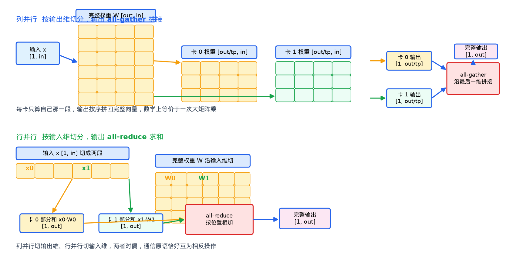
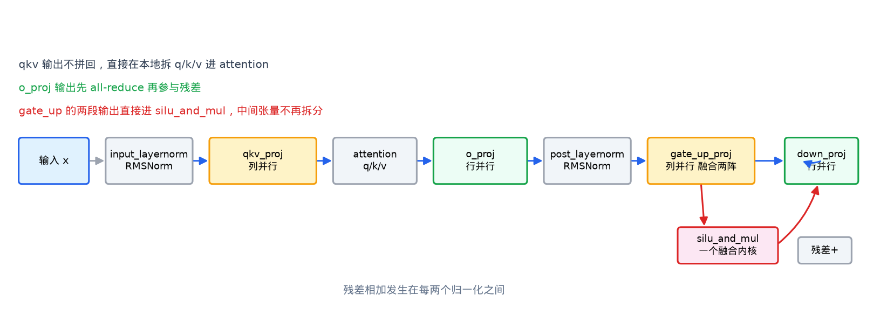

# 线性层并行 从原理到实现

这篇文档完整讲解 vllm-v4 里张量并行线性层的设计与实现。我将从宏观的设计出发，最终讲解到代码的具体实现，并且把本实现和 vLLM 官方的实现方案进行对比，通过实测数据说明每一项设计选择的代价和收益。

整篇文档的结构自顶向下。

- [1] 讲解线性层和矩阵乘的基本概念，以及 Qwen3 解码层里的线性层全景。
- [2] 给出模块的整体架构。
- [3] 四到五章分别讲权重加载、前向计算、评审方案的逐项验证。
- [4] 第六章把全部性能实测汇总。

## 1. 线性层是什么，为什么要并行？
### 1.1 线性层与矩阵乘

模型处理文本时最频繁的基本运算，是把一个向量变换成另一个向量。变换由一个权重矩阵完成，数学形式是 y 等于 x 乘 W 的转置再加 b。这个运算在代码里就是 `torch.nn.functional.linear(x, w, b)`，在 GPU 上对应一次矩阵乘，也就是 GEMM。

线性层的形状由输入维和输出维决定。输入 x 的形状是 `[token 数, in_size]`，权重 W 的形状是 `[out_size, in_size]`，输出 y 的形状是 `[token 数, out_size]`。一次前向把 in_size 维的向量映射成 out_size 维的向量。词向量进来的维度和词表分数的维度相差很远，靠的就是这一层层线性变换。

Transformer 的每一层里，绝大多数参数和算力都花在线性层上。以 Qwen3-0.6B 为例，attention 里的 qkv 投影、o 投影，MLP 里的 gate 投影、up 投影、down 投影，每一处都是线性层。显存里放的是这些权重矩阵，计算时占的也是这些矩阵乘。可以这么说，把线性层做快，等于把整个模型做快。

### 1.2 沿输出维切开的列并行

当一张卡装不下权重，或者一张卡算不完矩阵乘的时候，自然的想法是把矩阵切成几块分给多张卡。沿输出维切分，也就是把 W 的 out_size 行分成 tp 份，每张卡持有 out_size 除以 tp 行。tp 是 tensor parallel 的缩写，意思是张量并行。

切开之后，输入 x 是完整的，每一张卡都拿到一份，用自己那份权重算出一个 `[token 数, out_size/tp]` 的局部输出。三张卡拼起来，就得到了完整的 `[token 数, out_size]` 输出。由于每段各占一段输出维，谁也不重叠，拼起来的数学结果和一次大矩阵乘完全相同。这个拼接操作叫 all-gather。

这种切法叫列并行，英文是 Column Parallel。输出维在权重矩阵里是行，所以列并行的切分发生在矩阵的行方向上。代码里的 `ColumnParallelLinear` 就是这个形态。

### 1.3 沿输入维切开的行并行

列并行能解决输出维太大的问题。但如果上一层的输出本来就切好了，直接拼起来再送进下一层，会多一次通信。更巧的做法是沿输入维切分，让权重矩阵直接吃分片的输入。

沿输入维切分，也就是把 W 的 in_size 列分成 tp 份，每张卡持有 in_size 除以 tp 列。对应的，输入 x 也要沿最后一维切成 tp 段，每张卡拿自己那段。每张卡用 `[token 数, in_size/tp]` 的输入段乘 `[out_size, in_size/tp]` 的权重段，算出一个 `[token 数, out_size]` 的局部结果。

问题来了。列并行拼起来的是不同段的输出，而这里每张卡算的 `[token 数, out_size]` 覆盖的是同一段输出范围，只是各自由输入的不同段贡献。要得到正确结果，必须把多张卡的局部结果按位置相加。这个相加操作叫 all-reduce。

这种切法叫行并行，英文是 Row Parallel。它把输入维切碎喂给多张卡，最后用一次 all-reduce 把部分和聚合成完整输出。代码里的 `RowParallelLinear` 就是这个形态。

列并行和行并行是一对对偶的切法，前者切输出、后者切输入，通信原语恰好互为相反操作。下图把两种切法放在一起对照。



### 1.4 Qwen3 解码层里的线性层全景

把概念落到 Qwen3 的具体模型上。解码层的结构是输入先进 input_layernorm 做归一化，然后进 qkv_proj 得到查询、键、值三组向量，attention 用它们做注意力并更新 KV 缓存，输出再经过 o_proj 投影回完整维度。残差相加之后过 post_layernorm，进 MLP。MLP 的结构是 gate_up_proj 融合了 gate 和 up 两个投影，中间做一次 SwiGLU 激活，最后经过 down_proj 回到原维度。

整个流程里，线性层分别是 qkv_proj、o_proj、gate_up_proj、down_proj 四处。它们在张量并行下的角色各不相同。



- qkv_proj 是列并行，但输出不拼回，每张卡拿着自己那一段 qkv 直接进 attention，省掉一次 all-gather。
- o_proj 是行并行，输入是各卡自己 head 的输出，已经按 head 切好，输出做 all-reduce 恢复完整 hidden 维度。
- gate_up_proj 是列并行，它把 gate 和 up 两个投影矩阵纵向拼接成一个大矩阵，一次矩阵乘同时算出两段输出。
- down_proj 是行并行，输入是激活后的分片结果，输出做 all-reduce。

### 1.5 GQA 与 SwiGLU 两个特殊需求

Qwen 系列引入了两个特性，线性层需要专门适配。

第一个是 GQA，分组查询注意力。普通的多头注意力里，查询和键值有同样多的头。GQA 让多个查询头共享同一组键值头，这样 KV 缓存就变小了。Qwen3-0.6B 有 16 个查询头、8 个键值头。张量并行切分时，查询头按 tp 均分，键值头也按 tp 均分。但当 tp 比键值头总数还大的时候，键值头不够分，每张卡只能拿一个键值头，而且多条卡要复制同一条键值头。这个复制逻辑由 `QKVParallelLinear` 里的 `num_kv_head_replicas` 处理。

第二个是 SwiGLU，门控线性单元。它需要两个投影，gate 投影算出门控值，经过 SiLU 激活之后和 up 投影的值逐元素相乘。Qwen 的 MLP 里，gate 和 up 的输入是同一个 x，所以两个投影矩阵可以纵向拼接成一个 `[2*intermediate, hidden]` 的大矩阵，一次矩阵乘同时算完。这个融合就是 `MergedColumnParallelLinear` 做的事，它就是为 gate_up_proj 准备的。

## 2. 整体架构
### 2.1 四个类各司其职

整个[线性层代码](../src/compute/layers/linear.py)里有四个类。

| 类 | 用途 | 切分维度 | 输出通信 |
| --- | --- | --- | --- |
| `ColumnParallelLinear` | 通用列并行，如 qkv 之外的列切分 | 输出维 | 可选的 all-gather |
| `RowParallelLinear` | 通用行并行，如 o_proj、down_proj | 输入维 | 必选的 all-reduce |
| `QKVParallelLinear` | qkv 融合投影，专为 attention 准备 | 输出维按头切 | 无，本地直接拆 |
| `MergedColumnParallelLinear` | 多阵纵向融合，如 gate_up_proj | 输出维 | 无，本地直接拆 |

权重分片这个动作本身，统一由 `_shard` 这个函数完成。它根据 tp 的 rank 算出本卡持有的范围，返回一个不拷贝数据的切片视图。

### 2.2 分片维度与通信原语

模块里只有两种通信原语，all-gather 和 all-reduce，都来自 `distributed` 包。列并行的输出端拼回完整形状用 all-gather，行并行的输出端求和用 all-reduce。

有一个细节值得说明。`ColumnParallelLinear` 的 `gather_output` 参数控制输出要不要拼回。attention 之前的第一层列并行要拼回，因为归一化需要完整维度。但 qkv_proj 不拼回，因为每张卡只需要自己那一段 qkv。同理，`RowParallelLinear` 的 `input_is_parallel` 参数告诉它输入是不是已经按 head 切好，决定要不要再次切分输入维。o_proj 的输入是 attention 输出的各卡自己的 head，已经是切好的，所以这个参数为真。

### 2.3 与 vLLM 官方的整体对照

vLLM 官方在 `vllm/model_executor/layers/linear.py` 里实现了同样的四个类。模块职责一致，但设计取向有明显差异。

| 维度 | vLLM 官方 | 本实现 |
| --- | --- | --- |
| 参数类型 | BasevLLMParameter，带通用分片元数据 | 普通 nn.Parameter，加载器属性直挂 |
| 计算路径 | LinearMethodBase 可插拔，支持量化 LoRA | 固定 F.linear，eager |
| 分片机制 | shard_id 加 WeightSpec 通用框架 | _shard 加 _shard_qkv 专用函数 |
| QKV 头复制 | 同样的 num_kv_head_replicas 复制策略 | 相同 |
| gate up 融合 | MergedColumnParallelLinear 同款 | 相同 |
| bias 加载 | weight_loader 统一入口 | 各类独立处理，bias 也挂加载器 |
| SwiGLU 激活 | MLP 内 F.silu 或 fused 算子 | flashinfer silu_and_mul 融合算子 |

vLLM 是面向数千个模型、数百种部署形态的通用引擎，所以把可插拔的量化、LoRA、编译都做进这一层。v4版本实现是一个面向 Qwen3 的推理引擎，所以针对这条模型的形状和推理形态做了定向优化，只保留必要的抽象。核心差异集中在计算路径的插拔能力和加载机制上。

## 3. 权重切分和加载
### 3.1 _shard 与分片的范围

加载阶段的任务，是把 checkpoint 里的完整权重按 rank 切分，写进各卡的参数。切分的核心是 `_shard`。

```python
def _shard(weight: torch.Tensor, dim: int) -> torch.Tensor:
    tp = get_tp_group()
    size = weight.shape[dim] // tp.size
    offset = size * tp.group_rank
    return weight.narrow(dim, offset, size)
```

第 rank 张卡负责的范围是 `[size * rank, size * (rank + 1))`。`narrow` 返回的是切片视图，不拷贝数据。`dim` 决定沿哪个维切，列并行传 0，行并行传 1。

### 3.2 消除双重拷贝

最初的实现里，`_shard` 的末尾有一句 `.contiguous()`。这带来一个隐患。`.contiguous()` 会在内存里分配一块新空间，把切片的数据拷贝一遍。紧接着在 `weight_loader` 里，`param.data.copy_()` 又把这块数据拷贝进参数。两次拷贝，一次多余的临时分配。对于几十 GB 的大模型权重，这个峰值内存和加载耗时都是实打实的开销。

优化方案是去掉 `.contiguous()`，直接让 `copy_` 吃切片视图。PyTorch 的 `copy_` 对不连续张量有处理路径，只是能不能快过先 contiguous 再拷贝，需要实测才知道。

bench 脚本里用四种典型场景实测，tp 等于 2，结果如下。

| 场景 | view 直接 copy | contiguous 再 copy | 速度比 |
| --- | --- | --- | --- |
| gate_up [6144,1024] dim=0 | 0.038 ms | 0.036 ms | 1.0x |
| qkv [6144,1024] dim=0 | 0.037 ms | 0.038 ms | 1.0x |
| down [1024,3072] dim=1 | 0.025 ms | 0.042 ms | 1.7x |
| o_proj [1024,1024] dim=1 | 0.018 ms | 0.031 ms | 1.7x |

结论分两种情况。dim=0 切分时，切片视图的每一行内部连续，`copy_` 就是逐行 memcpy，去掉 contiguous 只是少一次临时分配，速度持平。dim=1 切分时，视图的行与行之间跳跃，但 PyTorch 的 strided copy_ 依旧比先 contiguous 再拷贝快 1.7 倍，因为省去了整块临时缓冲区的分配与写入。dim=1 正是 `RowParallelLinear` 的切分方式，o_proj 和 down_proj 都在用，所以这个优化对实际加载路径有直接的收益。

### 3.3 QKV 的按头分片

`QKVParallelLinear` 的权重是 qkv 三段纵向拼成的一个大矩阵，加载时不能像普通列并行那样整块切。它面对的是 Hugging Face checkpoint 里分开的 q_proj、k_proj、v_proj 三个文件。

`_shard_qkv` 按 shard_id 切出本卡对应的段，返回两样东西，本地参数里的起始行偏移，以及要拷贝的数据段。q 段从第 0 行开始，k 段从 q_size 行开始，v 段从 q_size 加 kv_size 行开始。

KV 头的复制规则在这里体现。当 `num_kv_head_replicas` 大于 1 时，同一条键值头被连续多个 rank 复制。例如键值头 2 个、tp 4 个的时候，头 0 归 rank 0 和 rank 1，头 1 归 rank 2 和 rank 3。所以取片用的是整除分组，`head_idx = tp_rank // num_kv_head_replicas`，再乘上 kv_size 得到起始行。这是 Megatron-LM 的标准约定，vLLM 官方也遵循同样的下标规则。

### 3.4 gate 与 up 的融合分片

`MergedColumnParallelLinear` 接受一个 `output_sizes` 列表，每个元素是一个子阵的全量输出维。构造参数时，它先算出每个子阵切分后的行数，再加起来作为本地权重总行数。

```python
self.output_sizes_per_partition = [
    divide(s, get_tp_group().size) for s in output_sizes
]
total = sum(self.output_sizes_per_partition)
self.weight = nn.Parameter(torch.empty(total, in_size))
```

加载时，`shard_id` 指向第几个子阵，本卡在这个子阵里的行偏移由前面子阵的行数累加得出。对 gate_up_proj 来说，output_sizes 是 `[intermediate, intermediate]`，本地权重就是 `[2 * intermediate/tp, hidden]`。一次矩阵乘算出 gate 和 up 两段，这正是 SwiGLU 需要的布局。

### 3.5 bias 的加载

早期版本只给 weight 挂了 `weight_loader`，bias 是普通参数，加载器拿到它时走默认的整段拷贝。这在一部分场景是对的，在另一部分场景是错的。整段拷贝对 `RowParallelLinear` 恰好正确，因为行并行的输出维不切分，bias 全量持有。但对列并行就错了，bias 应该和权重一样按输出维切分。

现在的设计是给 bias 也挂上和 weight 同一个加载器。`ColumnParallelLinear` 的加载器里，weight 和 bias 共用同一个 `_shard(loaded_weight, dim=0)`，因为两者的切分模式完全一致。`RowParallelLinear` 的加载器先判断参数是不是 bias，是的话整段拷贝，否则按输入维切分。

`QKVParallelLinear` 的 bias 是最复杂的。checkpoint 里 q/k/v 的 bias 可能是三段分开的，也可能拼成一段完整的。`_load_bias` 处理合并形式，先按头的总数切出 q 段、k 段、v 段，再分别调用 `_shard_qkv` 按头规则切进本地偏置。修正之前的版本，v 段的位置算错，会导致 bias 加载错位，这在单卡上容易忽略，因为单卡时切分退化为全量拷贝。

### 3.6 与 vLLM 加载方式的对比

vLLM 官方的加载器核心是这套机制。每个参数是一个 `BasevLLMParameter`，上面挂着 `weight_loader` 属性和 `shard_id`。加载时框架根据参数和 shard_id 找到对应的加载函数，函数内部按策略分片。列并行用 `_ColumnParallelLinear` 的策略，行并行用 `_RowParallelLinear` 的策略，QKV 用 `_QKVParallelLinear` 的策略，每段按 `shard_id` 是 q 还是 k 还是 v 分别处理。

本实现没有通用分片框架，直接用 `_shard` 加 `_shard_qkv` 两个函数，每个类自己写加载器。两者的数据流是同一套，都是按 rank 和 shard_id 切出本卡的一段，直接 `copy_` 进参数，不再有整表中间缓冲。差别在于 vLLM 为量化、LoRA、多份权重合并付出了额外的元数据复杂度，本实现针对 Qwen3 只需要最直接的分片逻辑。

加载路径两者性能相当，差异主要来自 vLLM 为通用性多付出的结构复杂度。

## 4. 前向计算
### 4.1 列并行的 all-gather

`ColumnParallelLinear` 的前向先做一次本地矩阵乘。

```python
out = torch.nn.functional.linear(x, self.weight, self.bias)
if self.gather_output:
    return tensor_model_parallel_all_gather(out, dim=-1)
return out
```

`gather_output` 为真时，局部输出沿最后一维拼回，得到完整输出。为假时，输出保持分片。qkv_proj 就是为假的例子，它的输出各卡自己用，拼回反而多一次通信。

### 4.2 行并行的 all-reduce

`RowParallelLinear` 的前向在本地矩阵乘之后做 all-reduce。

```python
out = torch.nn.functional.linear(x, self.weight)
out = tensor_model_parallel_all_reduce(out)
if self.bias is not None:
    out = out + self.bias
return out
```

这里有个细节，bias 在 all-reduce 之后才加。这是有意的。bias 是全量的，如果在矩阵乘时就加，all-reduce 会把 bias 多算 tp 遍。所以 bias 放在通信之后加，一次加法，结果正确。

### 4.3 QKV 的不分片输出

`QKVParallelLinear` 的前向就是一次矩阵乘，没有通信。

```python
def forward(self, x: torch.Tensor) -> torch.Tensor:
    return torch.nn.functional.linear(x, self.weight, self.bias)
```

输出是各卡自己的 qkv 段，形状为 `[token 数, q_size + 2*kv_size]`。模型层负责把它拆成 q、k、v 三部分，直接喂给 attention。没有 all-gather，是这条路径少一次通信的关键。

### 4.4 SwiGLU 与 silu_and_mul 融合

gate_up_proj 的前向同样是裸矩阵乘，返回的是 gate 和 up 两段拼在一起的结果。真正的激活在[激活算子模块](../src/compute/layers/activation.py)里。

```python
class SiluAndMul(nn.Module):
    def forward(self, x: torch.Tensor) -> torch.Tensor:
        return torch.ops.vllm.silu_and_mul(x)
```

`torch.ops.vllm.silu_and_mul` 是仓库里注册的自定义算子，底层是 flashinfer 的融合内核。它把三件事合成一个内核，切分 gate 和 up 两段，对 gate 段做 SiLU，再与 up 段逐元素相乘。中间不落盘，正是 AI 评审里瓶颈 1 提到的融合方向，而仓库在激活层就已经做到了。

### 4.5 通信开销的实测占比

前向里通信占多大的比重，在 tp 等于 2、batch 等于 64 的 decode 场景下实测，结果如下。

| 操作 | 耗时 | 通信占比 |
| --- | --- | --- |
| 纯 GEMM | 0.012 ms |  |
| GEMM 加 all-reduce | 0.084 ms | 84% 到 87% |
| GEMM 加 all-gather | 0.15 ms | 90% 到 93% |

decode 场景 token 数少，GEMM 本身只花十微秒，通信却要几十微秒，通信成了大头。这也是为什么贪心解码的快路径值得做，它的思路就是少通信。详细讨论放在第五章。

## 5. AI 评审方案的逐项验证

前面几章讲完实现，这一章把一份外部 AI 评审提出的四点性能瓶颈逐项验证。每一项都先用 bench 脚本实测，再下结论。bench 脚本留在 bench 目录里可以复跑。

### 5.1 SwiGLU 融合是否彻底

评审的第一个瓶颈说，gate 和 up 算完后需要独立的内核算 split、SiLU、逐元素乘，中间大矩阵落盘再读回，浪费访存带宽，方向是做一个把激活合入 GEMM epilogue 的自定义内核。

验证分两层。第一层，激活算子本身。仓库现用的 `silu_and_mul` 已经把 split、SiLU、乘法合成一个内核，中间不落盘。与 naive 写法对比实测，结果如下。

| M(tokens) | naive split+silu+mul | silu_and_mul | 速度比 |
| --- | --- | --- | --- |
| 1 | 0.0399 ms | 0.0563 ms | 0.71x |
| 256 | 0.0488 ms | 0.0678 ms | 0.72x |
| 1024 | 0.1177 ms | 0.1077 ms | 1.09x |
| 4096 | 0.4979 ms | 0.4428 ms | 1.12x |

结论是融合算子只在 token 数大的时候有优势，大 batch 快 9% 到 12%。token 数小的时候反而慢，融合内核的启动和 dispatch 开销压过了省下的读写。decode 场景正是 token 数小的场景。

第二层，更深度的融合，把激活直接写进 GEMM 的内核尾部。这一步实测了 `torch.compile`，它对原生写法生成的 MLP 链路，eager 加 flashinfer 与 compile 原生对比，结果如下。

| M(tokens) | eager 加 flashinfer | compile 原生 | 速度比 |
| --- | --- | --- | --- |
| 1 | 0.0730 ms | 0.0795 ms | 1.09x |
| 256 | 0.0815 ms | 0.0973 ms | 1.19x |
| 4096 | 0.6372 ms | 0.6382 ms | 1.00x |

compile 只能把 silu 加 slice 加 mul 合成一个 pointwise 内核，无法合入 cuBLAS GEMM 的 epilogue。想做到真正的单内核 GemmSwiGLU，需要 CUTLASS 或 Triton 手写。而它的理论收益，中间张量每 token 12KB，M 等于 4096 时一共 48MB 的 HBM 读写，按 2TB/s 大约 25 微秒，相对整个 MLP 链路的几百微秒占比有限。

综合来看，仓库现有的 flashinfer 融合方案已经覆盖了激活算子融合这一层的主要收益。更深一层的 GEMM epilogue 融合收益存在，但需要手写内核，收益幅度不足以抵消维护成本，判断为不落地。

### 5.2 GQA 计算冗余是否触发

评审的第二个瓶颈说，tp 大于键值头总数时，多张卡在算完全相同的 KV 投影，浪费算力。

验证用的是 Qwen3-0.6B 的参数，16 个查询头、8 个键值头、头维 128。逐个 tp 实测复制倍数和冗余占比。

| tp | 每卡键值头 | 复制倍数 | KV 冗余占 qkv 算力 |
| --- | --- | --- | --- |
| 1 | 8 | 1 | 0% |
| 2 | 4 | 1 | 0% |
| 4 | 2 | 1 | 0% |
| 8 | 1 | 1 | 0% |
| 16 | 1 | 2 | 40% |
| 32 | 1 | 4 | 75% |

结论很清楚。tp 小于等于 8 的时候，键值头够分，无冗余。只有 tp 等于 16 或 32 这种大集群配置才触发冗余。本仓库默认 tp 等于 2，不受影响。另外还要指出，vLLM 官方对 tp 大于键值头总数的情况采用完全相同的复制策略，这并不是本实现的缺陷。评审建议的广播 KV 方案需要改动 attention 的数据流和通信原语，复杂度高，只在超大 tp 下才值得考虑。

### 5.3 权重加载双重拷贝是否成立

评审的第三个瓶颈说，`_shard` 里的 `.contiguous()` 加 `copy_` 构成双重拷贝，拖慢加载并放大显存峰值。

这个判断成立，而且已经落地修复。实测数据在 3.2 节，dim=1 切分快 1.7 倍，dim=0 持平。修改后的 `_shard` 返回零拷贝视图，`copy_` 直接消费视图。这是四项验证里唯一一处立竿见影的优化。

### 5.4 通信同步阻塞与异步化

评审的第四个瓶颈说，all-reduce 和 all-gather 是同步的，GPU 必须等通信完成才能进下一层，建议用 CUDA Stream 让通信与计算重叠。

先看这台机器的硬件前提。两张卡是 RTX 4090 D 和 RTX 4070 SUPER，走 PCIe Gen4 x16，没有 NVLink，而且 `can_device_access_peer` 双向都是 False。跨卡拷贝要走主机中转，实测 8MB 拷贝有效带宽只有 3.6 到 15 GB/s，远低于 PCIe Gen4 的理论值。NCCL 的 all-reduce 有效带宽上限实测约 9 GB/s，而且每次调用有 45 到 65 微秒的固定延迟。decode 场景里每个 all-reduce 消息只有 32KB 到 256KB，延迟是瓶颈，带宽反而不是。

用真实的 Qwen3-0.6B 形状做了一次完整的合成 decode 步，28 层，每层两个 all-reduce，结果如下。

| bs | 纯计算 | 计算加通信 | 通信占比 | tp2 相对 tp1 |
| --- | --- | --- | --- | --- |
| 16 | 0.83 ms | 5.35 ms | 84% | 4.8x |
| 32 | 0.86 ms | 5.65 ms | 85% | 4.9x |
| 64 | 1.09 ms | 5.84 ms | 81% | 5.0x |

通信占整个 decode 步的八成左右。更值得注意的是 tp=1 的对照，全量权重无通信只要 1.1 到 1.2ms。在这台机器上 tp=2 比 tp=1 慢 4 到 5 倍。原因在于 decode 的 GEMM 是启动受限而不是算力受限，把权重切开并没有换来时间减半，反而多出 56 次 all-reduce。对 0.6B 这种小模型，本机跑 tp=1 反而更快，tp=2 只在显存放不下或者矩阵足够大的时候才有意义。

异步化的空间被层间的硬依赖卡住。看数据流，o_proj 的 all-reduce 结果必须先就位，残差相加和 post_layernorm 才能做，之后下一个线性层才能开始。通信和后续计算是严格的前后依赖，没有可以并行填进空档的独立计算。实测把两个独立层批次交错到两个 stream 上，重叠版本反而慢 0.4 倍，因为 PCIe 是共享带宽，NCCL 与并发 GEMM 互相挤占。

所以当前 eager 模型下，直接 Stream 异步化不可行。可落地的方向按收益排序如下。

第一，去掉 per-op 启动开销。CUDA Graph 重放实测对计算链有 1.5 到 3.3 倍提升，每个 eager all-reduce 的 45 到 65 微秒固定延迟也被图重放压到接近零，56 个集合通信合计约 2.5ms 的启动开销。仓库 decode 已经用 CUDAGraphRunner 走了这条路径。

第二，让通信本身更快。vLLM 官方在 NVLink 机器上维护了三个后端的动态选择。CustomAllReduce 用 P2P 单发和双发内核覆盖中等尺寸。PushAllReduce 用双缓冲轮换消除小消息的 NVLink 屏障往返。PyNCCL symm_mem 覆盖极小和极大的消息。Hopper 与 Blackwell 上还把 all-reduce 合进 RMSNorm 的 multimem 指令。MSCCL++ 论文报告小消息 all-reduce 相对 NCCL 最高快 4.2 倍，端到端 decode 快 4% 到 15%。这些方案的共同前提是 NVLink 或同构 P2P，本机不具备，所以都不可用。

第三，序列并行。vLLM 的编译 pass 把 AllReduce 加 RMSNorm 改成 ReduceScatter 加局部 RMSNorm 加 AllGather，vLLM 自己承认这个 pass 单独不产生收益，收益来自后续把 ReduceScatter 合入 GEMM epilogue、把 AllGather 合入下一层 GEMM 输入。eager 形态的实测也证实了这一点，本机 SP 比 all-reduce 慢 1.2 到 2.2 倍，因为两次通信换一次通信，且没有内核融合兜底。

第四，减少通信量。仓库的贪心 argmax 快路径就是这个思路，它把 all-gather 的通信量从 `[token 数, vocab]` 降到 `[token 数, tp]`，这是已落地的最大一笔。

跨层 pipeline 并行、attention 并行或异步通信属于更激进的重构，不在本次范围内。

### 5.5 dtype 的显式控制

评审还附带提了一条，说代码里 `torch.empty` 默认 float32，建议显式传入 bf16。

这条不成立。模型加载走 `default_dtype_context`，在构建整个模型期间用 `torch.set_default_dtype` 把默认类型设成模型 dtype。`torch.empty` 用的是全局默认类型，所以实际创建的权重是 bf16，不存在 float32 的浪费。显式传 dtype 参数属于防御性编程，能让模块脱离上下文独立使用，但对当前代码路径没有任何性能影响。

## 6. 性能实测汇总
### 6.1 本模块各优化点的数据

下表汇总线性层模块历次优化和验证的实测数据。

| 项目 | 实测结论 | 状态 |
| --- | --- | --- |
| _shard 去掉 contiguous | dim=1 加载快 1.7 倍，dim=0 持平 | 已合入 |
| bias 挂 weight_loader | 修复列并行 bias 未切分、QKV bias 错位 | 已合入 |
| QKV 按头分片 | 复制规则与 Megatron 和 vLLM 一致 | 已合入 |
| silu_and_mul 融合 | 大 batch 快 9% 到 12%，小 batch 略慢 | 已合入，flashinfer |
| GemmSwiGLU 深度融合 | compile 无法合入 GEMM epilogue，需手写内核 | 不落地 |
| GQA 冗余 | tp 小于等于 8 无冗余，本机 tp 等于 2 | 不受影响 |
| 通信异步化 | 双流重叠实测慢 0.4 倍，eager 下不可行 | 不落地 |
| CUDA Graph 重放 | 计算链快 1.5 到 3.3 倍，集合通信启动开销归零 | 已合入 decode |
| 序列并行 | eager 下比 all-reduce 慢 1.2 到 2.2 倍 | 不落地 |
| 本机 tp=2 decode | 比 tp=1 慢 4 到 5 倍，小模型建议 tp=1 | 部署建议 |

其中通信实测全部来自 `bench/bench_comm_opt.py`，覆盖原始语延迟曲线、合成 decode 步、双流重叠、序列并行与 CUDA Graph 五个场景。

### 6.2 与 vLLM 官方的同场对比

线性层与 vLLM 官方的对比无法像词表模块那样给出逐算子数值，因为两边的算子相同，差距主要来自架构结构而不是内核。同场对比的数据集中在两个点上。

加载路径，两者都是 narrow 切片直接 copy，性能相当。

激活路径，vLLM 官方对 SwiGLU 也提供 fused 的 silu_and_mul 算子，本实现的 flashinfer 内核在同一量级。真正拉开差距的是贪心采样，那是词表模块的 argmax 快路径，通信量差两个数量级。

## 7. 总结

把整个模块的流程连起来。加载阶段，checkpoint 的完整权重进来，`_shard` 按 rank 切出各卡自己的那一段，列并行切输出维、行并行切输入维，QKV 按头分片、Merged 按子阵分片，bias 与权重走同一套加载器。前向阶段，列并行输出 all-gather 拼回，行并行输出 all-reduce 求和，qkv 和 gate_up 不通信直接拆段，SwiGLU 激活由 flashinfer 的融合内核完成。

四个类覆盖了 Qwen3 解码层的全部线性层。`ColumnParallelLinear` 和 `RowParallelLinear` 是通用的两种切分形态，`QKVParallelLinear` 适配 GQA，`MergedColumnParallelLinear` 适配 SwiGLU。和 vLLM 官方相比，本实现用更少的抽象换取了同等的分片能力，并且在加载路径上消除了双重拷贝。

外部评审提出的四点瓶颈，逐项验证下来只有一点成立。权重加载的双重拷贝是真实问题，已经修复。SwiGLU 融合仓库已经做到激活算子层，更深的 GEMM epilogue 融合收益有限。GQA 冗余在本机配置下不触发，且 vLLM 同样如此。通信异步化受层间硬依赖限制，eager 下不可行，方向应转向更快的通信和更少的通信。

最后补一条部署层面的结论。通信的优化上限由硬件决定。本机没有 NVLink 也没有 P2P，NCCL 有效带宽只有 9 GB/s，decode 一步的 56 次 all-reduce 要花 4 到 5ms，实测 tp=2 反而比 tp=1 慢 4 到 5 倍。对小模型，单卡跑比张量并行更快。在带 NVLink 的生产机器上，vLLM 的 CustomAllReduce、PushAllReduce、PyNCCL symm_mem 和 MSCCL++ 这类内核能把小消息延迟再降几倍，那时候张量并行才有意义。线性层代码本身已经足够高效，剩下的瓶颈在通信原语和硬件拓扑，不在这一层。
