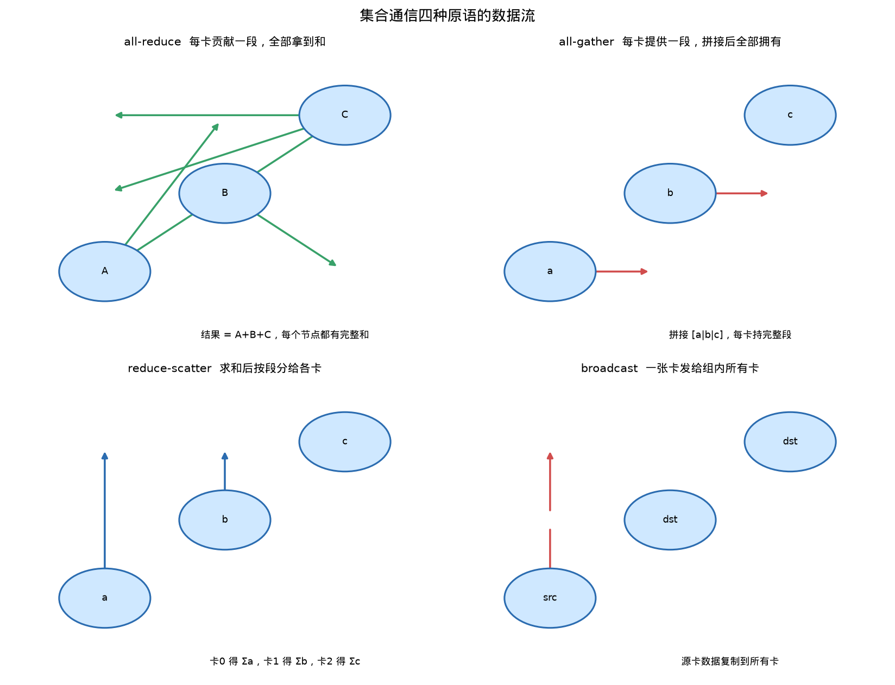

# 并行计算环境 从硬件到通信

这篇文档完整讲解多卡并行背后的整个知识体系。我不只讲某一个模块，而是从拿到一台多卡服务器开始，一路讲到如何分析它的硬件、如何测它的通信、NCCL 到底是什么、除了 NCCL 还有哪些通信手段，以及最终如何决定用单卡、TP 还是 PP。文中用到的三台机器都是真实存在的，拓扑数据和实测延迟都来自这些机器。

整篇文档的结构自顶向下。

- [1] 讲并行计算的基本框架，三类并行策略和它们的代价。
- [2] 讲单机环境的分类，一台机器可以有多少种状态。
- [3] 用三台真实服务器做完整的架构剖析。
- [4] 给出一套拿到新机器时的标准探究流程。
- [5] 深入 NCCL，讲清集合通信的原理和实现。
- [6] 讲 NCCL 之外的通信手段，包括 ZMQ、gRPC、MPI 等。
- [7] 把知识落到决策上，并给出学习路线图。

## 1. 并行计算的框架

### 1.1 为什么要并行

大语言模型越来越大，单张 GPU 有两个天花板。

第一个是显存天花板。模型参数要占显存，bf16 下一个参数占 2 字节。Qwen3-0.6B 有 6 亿参数，权重约 1.2GB。Qwen3-14B 有 140 亿参数，权重约 28GB。一张 RTX 4090 只有 24GB 显存，权重放下之后还要给 KV cache 和中间激活留空间，14B 模型单卡就放不下了。

第二个是算力天花板。就算显存放得下，单卡的矩阵乘算力也是有限的。decode 阶段一次只推一个 token，每次只做很小的矩阵乘，但要求延迟足够低。单卡算不完时，需要多张卡一起算。

这两个天花板，正是并行的理由。要么把模型的参数分到多张卡上，要么把计算任务分到多张卡上。

### 1.2 三类并行策略

并行策略可以按切分的对象分类。

**数据并行 DP**。每张卡持有完整的模型副本，输入数据按 batch 切分，每张卡算不同的样本。梯度更新时需要把各卡的梯度同步，通常用一次 all-reduce 完成。数据并行解决的是吞吐问题，单卡推理用不上，训练才常用。

**张量并行 TP**。把一层内部的参数按维度切分，每张卡持有一块参数，算一块结果，最后用集合通信拼回。例如把权重矩阵的行切开分给两张卡，各自算部分输出，再用 all-gather 拼起来。这是本仓库 `linear.py` 和 `vocab_parallel.py` 的实现方式。TP 的通信发生在每一层，通信频繁。

**流水线并行 PP**。把模型的层按顺序切段，每张卡负责连续的一段层。第 0 卡算完前几层，把中间结果发给第 1 卡，第 1 卡继续算。PP 的通信发生在层与层的边界，次数少，单次传输的是整个 hidden 向量。

三类策略的对比可以总结成一句话，DP 切样本，TP 切层内参数，PP 切层。切法不同，通信的频率和量就不同，适用的场景也不同。

### 1.3 并行的代价是通信

并行不白给。参数和计算分出去之后，每张卡干的活少了，但多了一项开销，通信。

以 TP 为例。列并行每层要 all-gather 一次，行并行每层要 all-reduce 一次。Qwen3 的解码层里，o_proj 是行并行、down_proj 是行并行，每层两次 all-reduce，28 层的模型一整个 decode 步就有 56 次集合通信。每次通信的延迟和消息大小成正比，消息大小又和 batch、hidden 成正比。bs 等于 1 时消息只有 8KB，但一次也有几十微秒的固定开销。56 次乘起来，就是毫秒级的总通信时间。

PP 的通信次数少，每层边界只发一次 hidden 向量，但流水线有气泡问题。前段卡算完传给后段卡时，前段卡可能闲着等下一份输入，利用率不满。

所以判断一个并行方案值不值，核心指标是通信开销和计算时间的比值。如果每层通信的时间远小于每层计算的时间，并行划算。如果通信比计算还贵，并行就是负收益。

### 1.4 本仓库的三台机器

本文分析用的三台机器如下。

| 代号 | 位置 | 配置 | 关系 |
| --- | --- | --- | --- |
| 环境 A | 本地工作站 | RTX 4090 D + RTX 4070 SUPER，双路 CPU | 用户日常开发 |
| 环境 B | 远程服务器 | 4 卡，P2P 全 OK | 并行研究主力 |
| 环境 C | 远程服务器 | A100 80G + 5 张 RTX 3090 | 大模型推理 |

三台机器恰好覆盖了三种不同的硬件互联形态，后面第三章会逐一剖析。

## 2. 单机环境有多少种状态

### 2.1 一台机器的三个关键维度

一台多卡服务器是什么样子，可以用三个维度描述。

**卡数**。单卡还是多卡。单卡没有通信问题，多卡才需要考虑怎么切。

**异构性**。同构是指所有卡型号一样，算力和显存一致。异构是指卡型号混搭，例如 A100 和 RTX 3090 混用。异构的代价是慢的卡拖慢整个组，因为集合通信是同步的，所有卡要等最慢的完成。

**互联方式**。卡之间怎么传输数据，这是决定 TP 效果最重要的因素。互联方式从好到坏排列。

| 互联方式 | 特征 | 适用并行 |
| --- | --- | --- |
| NVLink | 卡间直连高速通道，SXM 形态常见 | TP 首选 |
| PCIe 同交换机 | 卡挂在同一个 PCIe 交换机下，延迟低 | TP 可用 |
| PCIe 跨 NUMA | 卡分属不同 CPU，需走 QPI/UPI 总线 | TP 勉强，PP 更稳 |
| 无 P2P | 数据要绕道主机内存中转 | TP 基本不可行 |

### 2.2 单机状态的完整分类

把三个维度组合起来，一台单机大致有以下状态。

| 状态 | 卡数 | 异构 | 互联 | 例子 | TP 效果 |
| --- | --- | --- | --- | --- | --- |
| 单卡机 | 1 | 无 | 无 | 个人工作站 | 无 TP |
| NVLink 多卡 | 4~8 | 同构 | NVLink | HGX A100 | 最佳 |
| PCIe 同构多卡 | 2~8 | 同构 | PCIe | 8x3090 训练机 | 好或一般 |
| PCIe 异构多卡 | 2~8 | 异构 | PCIe | A100+3090 | 差 |
| 跨 NUMA 多卡 | 2~8 | 任意 | PCIe+UPI | 双路 CPU 服务器 | 差 |

单机状态还可以按机箱形态继续分。普通塔式工作站通常 1 到 2 卡。4U 机架式服务器能放 4 到 8 张卡，走 PCIe。HGX 基板是 NVIDIA 的 8 卡高密度形态，卡直接连 NVSwitch，走 NVLink。云端 GPU 实例则是虚拟化后的形态，通常看不到底层拓扑。

### 2.3 互联带宽的直觉

要给互联方式建立数量级直觉，记住三档数字。

PCIe 一条 gen4 x16 通道的理论双向带宽约 32GB/s，gen3 x16 约 16GB/s。NVLink 单卡接入带宽是百 GB 级别，A100 约 600GB/s，H100 约 900GB/s。主机内存中转走的是 PCIe 加内存总线，实际有效带宽往往只有几个 GB/s，因为中间多跳、延迟高。

用实测说话。环境 A 上测过 NCCL all-reduce，2MB 消息的有效带宽约 4.6GB/s，2KB 小消息的延迟约 73 微秒。对比 NVLink 上的同类操作，延迟可以低一个量级，带宽高一个量级。这就是为什么无 NVLink 的机器上 TP 效果普遍不佳。

## 3. 三台真实机器的架构剖析

### 3.1 环境 A，本地工作站

环境 A 是用户日常开发的机器，配置如下。

- 两张卡，RTX 4090 D（24GB）和 RTX 4070 SUPER（12GB），强异构。
- 双路 Xeon Silver 4310，48 线程，两个 NUMA 节点。
- 卡分挂两个 NUMA 节点，拓扑显示 SYS，即跨 PCIe 加跨 CPU 总线。

关键判据来自两条命令。

`nvidia-smi topo -m` 显示 GPU0 和 GPU1 之间是 SYS，说明两卡之间要穿过 PCIe 交换机和 CPU 间的 UPI 总线。`nvidia-smi topo -p2p r` 显示 NS，即不支持的 P2P，也就是卡之间不能直接对等访问内存。

这两条叠加意味着通信数据要 GPU 0 写到主机内存，再让 GPU 1 从主机内存读，绕一大圈。实测 NCCL all-reduce 2MB 消息约 4.6GB/s，decode 每层 8KB 消息约 53 微秒一次。整步 56 次 all-reduce 折算约 1.5ms，已经超过单卡完整 decode 步的计算时间。所以 TP 在这台机器上是负收益，实测也证实了这一点。

### 3.2 环境 B，四卡服务器

环境 B 是远程的 4 卡服务器，型号 SYS-420GP-TNR。它的拓扑矩阵如下。

```
        GPU0    GPU1    GPU2    GPU3
GPU0     X      PIX     SYS     SYS
GPU1    PIX      X      SYS     SYS
GPU2    SYS     SYS      X      PXB
GPU3    SYS     SYS     PXB      X
```

判读矩阵。GPU0 和 GPU1 之间是 PIX，同一 PCIe 交换机下，距离近延迟低。GPU2 和 GPU3 之间是 PXB，穿过 PCIe 桥，次优。GPU0 组和 GPU2 组之间是 SYS，跨 NUMA 节点，最差。同时 `nvidia-smi topo -p2p r` 显示全 OK，卡间支持对等访问，这意味着通信可以走 P2P 直连而不是绕主机内存。

这台机器的状态是 PCIe 同构多卡，P2P 可用但无 NVLink。最佳组合是 GPU0+1 做 TP=2，GPU2+3 做 TP=2，跨 NUMA 的组合要避免。它适合做 TP 实验，但不如 NVLink 机器。

### 3.3 环境 C，六卡异构服务器

环境 C 是远程的 6 卡服务器，型号 SYS-4029GP-TRT。它的拓扑矩阵如下。

```
        GPU0    GPU1    GPU2    GPU3    GPU4    GPU5
GPU0     X      NODE    NODE    SYS     SYS     SYS
GPU1    NODE     X      PIX     SYS     SYS     SYS
GPU2    NODE    PIX      X      SYS     SYS     SYS
GPU3    SYS     SYS     SYS      X      NODE    NODE
GPU4    SYS     SYS     SYS     NODE     X      PIX
GPU5    SYS     SYS     SYS     NODE    PIX      X
```

这台机器的组成如下。

- GPU3 是 A100 80G，其余五张是 RTX 3090 24G，强异构。
- 双路 Xeon Gold 5218R，80 线程，两个 NUMA 节点。
- GPU0/1/2 挂 NUMA0，GPU3/4/5 挂 NUMA1。
- 同 NUMA 内是 NODE 或 PIX，跨 NUMA 是 SYS。

`nvidia-smi topo -p2p r` 显示 GPU0 全 NS，其余卡之间多为 CNS，即芯片组不支持 P2P。NS 和 CNS 的实际效果都是无法直连，数据要绕主机内存。所以这台机器虽然卡多，但 TP 通信环境比环境 A 还差。

更致命的是异构。A100 和 3090 算力相差数倍，放进同一个 TP 组，每步都要等最慢的卡，A100 被 3090 拖到同一速度。所以环境 C 的正确用法是拆开用，A100 单独跑大模型，五张 3090 各自跑中小模型，最多做 PP，不做 TP。

### 3.4 三台机器的对照

| 机器 | 卡数 | 异构 | P2P | NUMA | TP 评价 | 最佳策略 |
| --- | --- | --- | --- | --- | --- | --- |
| 环境 A | 2 | 强异构 | NS | 跨 NUMA | 负收益 | 单卡 4090D + CUDA Graph |
| 环境 B | 4 | 未知 | OK | 跨 NUMA | 可用，优选同交换机 | 同交换机 TP=2 |
| 环境 C | 6 | 强异构 | NS/CNS | 跨 NUMA | 基本不可行 | 拆池，A100 单独用 |

三台机器给出一条共同的经验，无 NVLink 的机器上 TP 普遍是负收益或勉强可用，单卡往往更快。

下图把三台机器的卡间拓扑画在一起对照。可以看到环境 A 的两卡跨 NUMA 且无 P2P，环境 B 的卡对分挂在两个 NUMA 下但组内是 PIX 或 PXB，环境 C 的六张卡横跨两个 NUMA 且强异构。


## 4. 拿到新机器怎么探究

### 4.1 五条命令看硬件

拿到一台新服务器，先跑下面几条命令。

```bash
nvidia-smi -L                                # 有几张卡，什么型号
nvidia-smi --query-gpu=index,name,memory.total,pcie.link.gen.max,pcie.link.width.max --format=csv
nvidia-smi topo -m                           # 卡间拓扑连接类型
nvidia-smi topo -p2p r                       # 是否支持对等访问
lscpu | grep -E "Model name|Socket|NUMA node\(s\)"
```

第一眼要看的东西是卡数、型号、显存、NUMA 数。这些决定了机器属于第 2 章的哪一类状态。

### 4.2 判读拓扑矩阵

`nvidia-smi topo -m` 输出的矩阵里，连接类型按质量从好到坏排序。

- NV#，NVLink 连接，最好。
- PIX，同一 PCIe 交换机。
- PHB，同一 PCIe 主机桥。
- NODE，同 NUMA 内的 PCIe。
- PXB，穿过多个 PCIe 桥。
- SYS，穿过 PCIe 加 CPU 互联总线，最差。

`nvidia-smi topo -p2p r` 的判定分三档。OK 表示卡间可直接对等访问内存，P2P 可用。NS 表示不支持。CNS 表示芯片组不支持，实际效果和 NS 类似。只有 OK 才说明通信能走直连。

### 4.3 测真实通信延迟

拓扑只是纸面参数，真实延迟要实测。仓库里提供了 `bench/probe_server.py`，拷到任何有 torch 的机器上直接跑，会输出硬件清单、P2P 矩阵和 NCCL all-reduce 延迟曲线，并给出 TP 判语。

```bash
python bench/probe_server.py --devices 0,1 --hidden 1024 --layers 28 --batch 1
```

以环境 A 为例，脚本输出 2KB 消息 73 微秒、8KB 消息 53 微秒、512KB 消息 155 微秒、2MB 消息 430 微秒。把每层通信量代进去，可以得到整个 decode 步的通信总耗时，用它和单卡计算时间比较，就知道 TP 值不值。

### 4.4 形成决策

拿到数据之后按以下顺序决策。

1. 单卡显存放得下模型，直接用单卡，不做任何并行。
2. 放不下再考虑并行。P2P 是 OK 且同 NUMA 的卡优先组 TP。
3. 跨 NUMA 或异构的卡组，优先 PP。
4. 最后用真实引擎跑单卡、TP、PP 的端到端对比，用数据确认。

## 5. NCCL 与集合通信

### 5.1 NCCL 是什么

NCCL 是 NVIDIA Collective Communications Library 的缩写，是 NVIDIA 官方的高性能 GPU 集合通信库。它提供 all-reduce、all-gather、reduce-scatter、broadcast 等操作，针对 GPU 拓扑做了深度优化。PyTorch 的 `torch.distributed`、本仓库的通信层、Megatron-LM、vLLM 底层都依赖它。

NCCL 做的事情，是把多张卡上的数据按照某种规则汇总或分发。它屏蔽了底层是 NVLink、PCIe 还是网卡，向上只暴露集合操作的接口。

### 5.2 五种集合原语

集合通信按参与范围和结果分布分几种。

**all-reduce**。每张卡提供一个张量，结果是对所有卡求和后的相同张量，每张卡都得到完整结果。本仓库 `communication_op.py` 里的 `all_reduce` 就封装它，行并行层用它把部分和聚合。

**all-gather**。每张卡提供一段数据，结果是把所有段沿某维拼接后的完整张量，每张卡都得到完整拼接结果。列并行层用它把分片输出拼回。

**reduce-scatter**。把每张卡上的数据按 chunk 分给各卡，每卡先对所有卡对应 chunk 求和再留下自己的那块。序列并行和部分 TP 方案用它。

**broadcast**。一张卡把数据发给组内所有其他卡。

**send/recv**。两张卡之间的点对点传输。PP 用它传中间张量，本仓库 `send_tensor` 和 `recv_tensor` 就是封装。

每种原语对应一种数据流形状。all-reduce 是全部对全部汇总，all-gather 是分片变整段，broadcast 是一对多，send/recv 是一对一。写并行代码时，先想清楚数据该按哪种形状流动，再选原语。下图把四种常见原语的数据流画在一起，红箭头是发送，绿箭头是汇总，蓝箭头是切分分发。



### 5.3 通信后端与进程组

PyTorch 的分布式通信可以选不同后端。NCCL 面向 GPU，性能最好，是本仓库默认后端。Gloo 面向 CPU 张量和小规模，常用于传输元数据。MPI 是传统 HPC 后端，需要系统安装 MPI 库。

本仓库 `parallel_state.py` 的 `Group` 类为每个逻辑组维护两个物理进程组。`device_group` 用 NCCL 传输 GPU 张量，`cpu_group` 用 Gloo 传输元数据和 CPU 张量。这样集合通信走 NCCL 高速路，元数据（张量形状、dtype）走 Gloo，互不干扰。

进程组的概念是通信的边界。TP 组内做 all-reduce 只在该组内进行，PP 组的 send/recv 只在流水线相邻卡之间进行。`initialize_model_parallel` 里按 tp_size 和 pp_size 划分 TP 组和 PP 组，rank 布局约定为 TP 组内连续、PP 组跨步进，适配机内 NVLink 和跨机网络。

### 5.4 NCCL 的实现要点

NCCL 之所以快，靠的是对消息大小和拓扑做算法选择。

小消息用 ring 算法。所有卡串成一个环，数据沿环传一圈，每个节点收到后累加。延迟和卡数成正比，但每卡只和自己邻居通信，适合延迟敏感的小消息。

大消息用 tree 算法。数据沿树形结构向上汇总再向下分发，可以并行利用多条链路，带宽利用率高，适合跨机大消息。

传输层也分几档。同机卡间优先用 P2P 直接读写对端显存，走 NVLink 或 PCIe。同机同主机内存时可用 SHM 共享内存。跨机则走网络，可以是 InfiniBand RDMA 或 TCP socket。NCCL 会根据拓扑自动选择最优路径。

本仓库 `set_nccl_env` 配置了相关环境变量，`NCCL_SOCKET_IFNAME` 指定机间网卡，`NCCL_P2P_LEVEL` 设为 PXB 限定 P2P 路径在 PCIe 桥内，避免跨交换机。

### 5.5 通信与 CUDA Graph 的配合

CUDA Graph 捕获时，NCCL 集合通信有特殊要求，所有 rank 必须在同一时刻进入捕获，否则会因等待 peer 而死锁。本仓库 `graph_capture` 上下文在进入捕获前对 TP 和 PP 组各做一次 barrier，退出后再同步一次，保证各 rank 的捕获段对齐。这是工程上容易踩坑的地方。

## 6. NCCL 之外还有什么

### 6.1 通信的分层

NCCL 只是通信世界的一层。完整地看，通信分四层。

底层是硬件传输。同卡内不用通信，同机卡间是 NVLink、PCIe P2P 或主机内存中转，跨机是 InfiniBand、RoCE 或 TCP。

中间是通信库。NCCL 管 GPU 集合通信，MPI 管 HPC 消息传递，UCX 是通用网络加速库，ZeroMQ 是通用消息库。

上层是框架。PyTorch distributed、Megatron 提供并行训练框架，Ray 提供通用分布式计算，gRPC 提供远程过程调用。

最上层是应用。推理引擎、训练脚本用这些工具完成自己的任务。

不同层解决不同问题。写模型并行代码时主要碰 NCCL，写控制面（调度、状态同步）时会碰 gRPC 或 ZeroMQ。

### 6.2 ZeroMQ 是什么

ZeroMQ，简称 ZMQ，是一个高性能通用消息库，不依赖中间人 broker，进程之间直接通过 socket 模式通信。

它和 NCCL 是两个世界的东西。NCCL 面向 GPU 张量的集合通信，ZMQ 面向任意进程之间的消息传递。NCCL 只管 all-reduce 这类数据汇总，ZMQ 管的是请求应答、发布订阅、推拉流水线这类消息模式。

ZMQ 的典型用法是分布式系统的控制面。比如推理服务的调度器要和多个 worker 通信，或者数据预处理管道要分发给多个消费者，用 ZMQ 的 PUB-SUB 或 PUSH-PULL 模式就非常合适。它支持 inproc、ipc、tcp 多种传输，本地多进程和跨机都能用。

什么时候用 ZMQ 而不是 NCCL，判断标准是传什么数据。传 GPU 张量并需要集合语义，用 NCCL。传小消息、做控制流、跨进程通信，用 ZMQ。两者不冲突，一个项目里可以同时出现。

### 6.3 其他通信手段

**gRPC** 是 Google 的远程过程调用框架，基于 HTTP/2 和 protobuf。模型服务对外提供接口、集群内部做服务发现和状态同步，常用 gRPC。它传的是结构化消息，不是张量。

**MPI** 是传统 HPC 的消息传递标准。MPI_Allreduce、MPI_Send 等接口是所有并行库的老祖宗。PyTorch 也可以选 MPI 后端，但维护成本高，现在主流是 NCCL。

**UCX** 是底层网络加速库，屏蔽了 InfiniBand、RoCE、TCP 的差异，NCCL 跨机传输就构建在它之上。

**CUDA IPC** 和 **SymmetricMemory** 是显存层面的手段。CUDA IPC 允许进程直接访问其他进程的显存，SymmetricMemory 是 PyTorch 提供的对称显存池，两个进程分配镜像地址，实现零拷贝通信。

### 6.4 全景对照

| 手段 | 传输对象 | 面向场景 | 典型例子 |
| --- | --- | --- | --- |
| NCCL | GPU 张量集合通信 | TP 的 all-reduce，DP 的梯度同步 | 本仓库 TP 层 |
| ZMQ | 任意消息 | 进程间消息、控制面 | 调度器分发任务 |
| gRPC | 结构化消息 | 远程过程调用、服务接口 | 推理服务对外 API |
| MPI | 消息和集合 | 传统 HPC | 科学计算 |
| UCX | 网络字节流 | 底层网络加速 | NCCL 跨机传输 |
| CUDA IPC | GPU 显存 | 进程间显存共享 | 多进程共用缓存 |
| HTTP | 文本消息 | 控制面、监控 | 集群管理接口 |

## 7. 决策与学习路线

### 7.1 真实数据下的决策

用环境 A 的实测数据展示决策过程。模型是 Qwen3-0.6B，decode 单请求吞吐如下。

| 配置 | 单请求 decode tok/s | batch=8 吞吐 tok/s |
| --- | --- | --- |
| 单卡 + CUDA Graph | 433 | 2735 |
| TP=2 + CUDA Graph | 145 | 995 |
| PP=2 + CUDA Graph | 228 | 1039 |
| 单卡 eager | 58 | 481 |
| TP=2 eager | 35 | 280 |
| PP=2 eager | 66 | 495 |

同一台机器，eager 和 CUDA Graph 两种模式下结论不同。eager 模式被 Python 和 kernel 启动开销主导，PP 把每卡层数减半反而更快。CUDA Graph 把启动开销压掉后，瓶颈回到算力和通信，单卡碾压一切并行。

结论是，显存放得下的模型，单卡加 CUDA Graph 永远优先。TP 只有在 NVLink 环境或模型大到单卡放不下时才考虑。PP 在 eager 模式有奇效，在 CG 模式下也不如单卡。

### 7.2 决策树

把整个知识体系浓缩成一颗决策树。

1. 模型显存是否单卡装得下。装得下，单卡加 CUDA Graph，结束。装不下，进下一步。
2. 卡间 P2P 是否 OK。OK 且有 NVLink，TP 优先。只 OK 无 NVLink，同 NUMA 的卡组 TP。NS 或 CNS，TP 不可行，只考虑 PP。
3. 卡是否异构。异构则按型号拆池，绝不同组 TP。
4. 用真实引擎跑端到端对比，确认后再定方案。

### 7.3 入门学习路线

并行计算的知识按以下顺序学，每一步都建立在之前的基础之上。

**第一步，单卡推理**。先弄清单卡上 CUDA Graph 和 eager 的区别，理解启动开销和算力利用。这一步用仓库的 `bench_cg_vs_eager.py` 练习。

**第二步，看懂硬件**。用 `probe_server.py` 和 `nvidia-smi` 把机器的拓扑、P2P、延迟曲线搞清楚。这一步建立对硬件的直觉。

**第三步，掌握集合通信**。把 all-reduce、all-gather、reduce-scatter、send/recv 五个原语在 `communication_op.py` 里逐一对照，理解它们的形状和用法。

**第四步，理解 TP**。读 `docs/linear.md` 和 `docs/词表.md`，这两篇把 TP 的权重切分、前向计算、通信配合讲得很透。

**第五步，理解 PP**。读 `communication_op.py` 里 send/recv 的封装和 `parallel_state.py` 的进程组设计，理解流水线的数据流。

**第六步，做决策实验**。用 `bench_parallel.py` 在单卡、TP、PP 之间跑对照，用数据验证理论判断。

这套路线从单卡到多卡，从硬件到通信，从原理到实验，每一步都落在这个仓库的可运行代码上。

## 8. 总结

- 并行计算围绕三个问题展开，显存放不下怎么办，算力不够怎么办，通信值不值。
- 单机环境按卡数、异构性、互联方式三个维度分类，最常见的状态是 NVLink 多卡、PCIe 同构多卡、PCIe 异构多卡。
- 三台真实机器证明，无 NVLink 的机器上 TP 普遍负收益，单卡加 CUDA Graph 往往是更优解。
- 探究新机器的标准流程是看拓扑、看 P2P、测延迟、做端到端对比。
- NCCL 是 GPU 集合通信的事实标准，掌握 all-reduce 等五个原语就掌握了 TP 的通信基础。
- NCCL 之外还有 ZMQ、gRPC、MPI、UCX 等通信手段，各自服务不同层次，GPU 集合通信用 NCCL，控制面用 ZMQ 或 gRPC。
- 最终决策由数据决定，显存放得下就单卡，放不下再看 P2P 选 TP 还是 PP。
