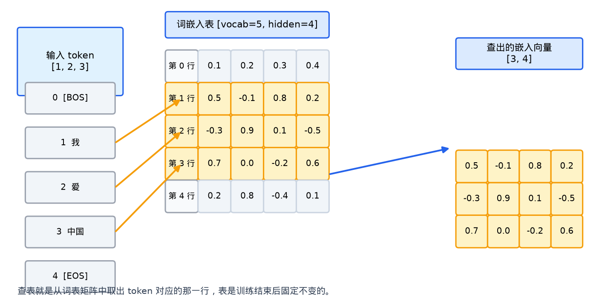
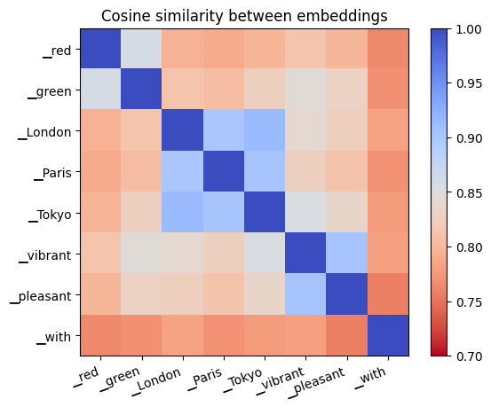
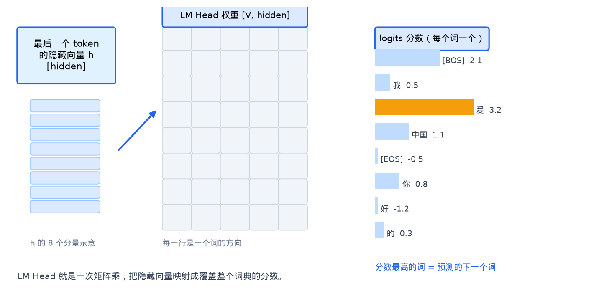
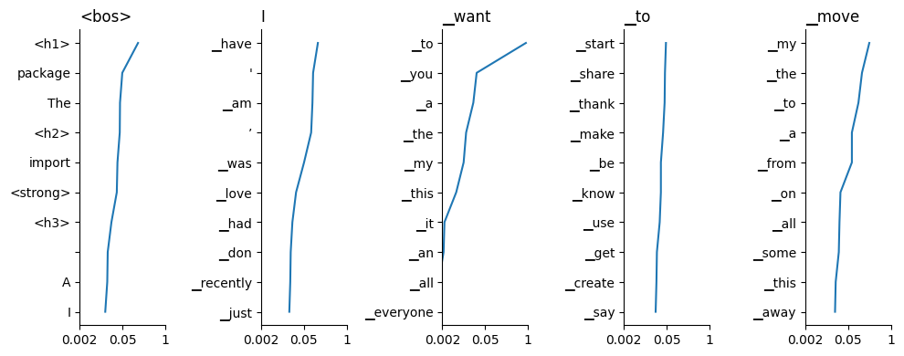

# 词表并行 从原理到实现

这篇文档完整讲解 vllm-v4 里词表并行的设计与实现。我将从宏观的设计出发，最终讲解到代码的具体实现，并且把本实现和vLLM官方的实现方案进行对比，通过实测数据说明每一项设计选择的代价和收益。

整篇文档的结构自顶向下。

- [1] 讲解词表和 LM Head 的基本概念。
- [2] 给出模块的整体架构。
- [3] 三到五章分别讲权重加载、嵌入前向、LM Head 前向
- [4] 第六章把全部差异汇总

## 1. 词表是什么，为什么要并行？
### 1.1 词嵌入表

模型处理文本的第一步，是把 token 变成向量。token 是词典里的一个编号，向量是这个编号对应的稠密表示。完成这个转换的是一张查找表，叫词嵌入表。表的形状是 `[vocab_size, hidden_dim]`。vocab_size 是词典里词的个数，hidden_dim 是每个词向量的长度。输入 [1, 2, 3] 这样的编号序列，模型从表里取出第 1 行、第 2 行、第 3 行，拼成一个形状为 `[3, hidden_dim]` 的张量，这就是 Transformer 拿到的输入。



上图展示了查表的全过程。左侧是输入的 token 编号，中间是词嵌入表，每一行对应一个词的向量，查表就是取出编号对应的那一行。右侧是查出的三行向量拼成的张量。

这张表是训练产物。训练刚开始时，表里的数值是随机的，没有任何含义。训练过程中，反向传播把误差分摊到所有参数上，词嵌入表也在其中。每读一个样本，每个词的向量就被调整一点，慢慢学会了这个词在整门语言里的位置和用法。训练结束当模型发布时，表里的数值就固定下来。推理时表本身不变，所以推理引擎可以让它常驻显存。

训练收敛之后，意思相近的词在向量空间里也离得近。下图是 Graphcore 在一篇 Gemma 拆解文章里画的热图，网格里每一格是两个词向量的余弦相似度。可以看到 red 和 green、London 和 Paris 这些意思相关的词颜色偏红，也就是向量方向接近。



### 1.2 LM Head

模型的另一端是 LM Head，作用与词嵌入表相反。词嵌入表把编号变成向量，LM Head 把向量变回编号上的分数。最后一层 Transformer 输出的隐藏向量和 LM Head 的权重矩阵相乘，得到一组覆盖整个词典的分数，叫 logits。分数最高的编号，就是模型认为最可能的下一个词。



上图把 LM Head 的计算拆成三部分。左侧是最后一个 token 的隐藏向量，中间是 LM Head 权重矩阵，每一行对应一个词的方向。隐藏向量和每一行做点积，得到右侧每个词的分数。分数最高的那个词，就是模型预测的下一个词。

LM Head 的权重形状同样是 `[vocab_size, hidden_dim]`。它的数值同样来自训练。训练过程要求真实下一个词的分数更高、其他词的分数更低，正是在这个目标的驱动下，LM Head 的权重一点点成形。训练结束后它和词嵌入表一样固定下来。

下图是 Graphcore 那篇 Gemma 拆解里模型真正输出的预测结果，展示了模型对每个候选词给出的分数排序。实际推理中，模型就是在这样一组分数上做采样或取最大值。



### 1.3 显存与计算压力

词表是模型里参数最大的部分。以 Qwen3-0.6B 为例，词表大小是 151936，隐藏维度是 4096，一张词嵌入表有约 6.2 亿个参数。词表 15 万、隐藏维度 8192 的模型，一张表就是 1.2GB 的 bf16 权重。LM Head 是同一张形状的矩阵，两份加起来占了模型参数的一大块。模型越大，词表越宽，这张表就越吃显存。

计算压力来自 LM Head 的矩阵乘。每次前向，它要把 [token 数, hidden] 的隐藏向量乘到 [vocab, hidden] 的权重上。token 多的时候，这一次矩阵乘是推理里最重的算子之一。

而我们的词表并行就是把这张大表按行切开，分给多张卡。每张卡只保存 vocab 除以 tp 行。tp 是 tensor parallel 的缩写，意思是张量并行，也就是同一层按维度切分，多张卡各算各的一块。切开之后，每张卡的显存负担变成原来的 tp 分之一，LM Head 的矩阵乘也被摊到了多张卡上。

### 1.4 切开之后的两个问题

切开之后出现两个新问题，恰好一个在模型入口，一个在模型出口。假设词表只有 8 个词，编号从 0 到 7，tp 等于 2，那么每张卡分到 4 行。卡 0 持有编号 0 到 3 的嵌入行，卡 1 持有编号 4 到 7 的嵌入行。

**嵌入方向的问题**

假设这一批输入是 token 序列 [2, 5, 3]。编号 2 和 3 落在卡 0 的范围里，编号 5 落在卡 1 的范围里。两张卡各自查表，结果如下。

| 输入 token | 卡 0 查到的 | 卡 1 查到的 |
| --- | --- | --- |
| 2 | 真实向量 v2 | 查不到，贡献零 |
| 5 | 查不到，贡献零 | 真实向量 v5 |
| 3 | 真实向量 v3 | 查不到，贡献零 |

只看任何一张卡，结果都是残缺的。卡 0 缺了 token 5 的向量，卡 1 缺了 token 2 和 3 的向量。
解决办法是把两张卡的局部结果按 token 位置对齐相加。token 2 的位置上，卡 0 贡献真实向量，卡 1 贡献零，加起来还是 v2。token 5 的位置上反过来，卡 1 贡献真实向量，卡 0 贡献零，加起来还是 v5。这样每个 token 恰好被它的持有卡贡献一次，其他卡贡献零，求和结果就是正确的完整嵌入。

这个按位置相加的操作，正是 all-reduce 求和。它要求"**持有卡贡献真值，非持有卡贡献零**"这个前提。如果零的位置被换成一个非零向量，求和结果就被污染了。如何保证非持有卡真的贡献零，是嵌入前向要解决的核心问题。

**输出方向的问题**

输出方向是镜像的。假设隐藏向量已经算完，每张卡用自己那 4 行权重做矩阵乘。卡 0 算出编号 0 到 3 的分数，卡 1 算出编号 4 到 7 的分数。

| 卡 | 算出的分数段 |
| --- | --- |
| 卡 0 | s0, s1, s2, s3 |
| 卡 1 | s4, s5, s6, s7 |

采样器要在一整张词表上工作，必须看到全部 8 个分数。把两段沿最后一维拼起来，得到 [s0, s1, s2, s3, s4, s5, s6, s7]，这就是 all-gather 拼接。每段各占一段词表，谁也不重叠，拼起来正好是完整的分数。

正是这两个对称的问题，产生了这个模块里的两个类。`VocabParallelEmbedding` 处理嵌入方向的查表和 all-reduce，`ParallelLMHead` 处理输出方向的矩阵乘和 all-gather。

## 2. 整体架构
### 2.1 三个环节

整个[词表代码](../src/compute/layers/vocab_parallel.py)可以概括成三个环节。
- 第一个是加载，把 checkpoint 里的完整权重按 rank 切分，写进各卡的参数。
- 第二个是嵌入前向，处理越界 token 的查表问题，输出完整的嵌入。
- 第三个是 LM Head 前向，算局部 logits，拼回完整的词表分数。

```
checkpoint 完整权重
      │
      ▼  _load_weight 按 rank 切片
  每卡局部权重 [per, dim]
      │
      ├──────────────►  嵌入前向  局部查表 + all-reduce
      │
      └──────────────►  LM Head 前向  局部 GEMM + all-gather
```


### 2.2 代码设计

模块文件里有三个顶层名字。`_pad_vocab_size` 负责把词表对齐到适合切分的尺寸，两个类都调用它。

`VocabParallelEmbedding` 是嵌入层。`ParallelLMHead` 是输出层。
权重分片这个动作本身，统一由 `_load_weight` 这个函数完成。


### 2.3 与 vLLM 官方的整体对照

vLLM 官方在 `vllm/model_executor/layers/vocab_parallel_embedding.py` 里实现了同样的两个类。模块职责一致，但设计取向有明显差异。


| 维度           | vLLM 官方                   | 本实现                       |
| ------------ | ------------------------- | ------------------------- |
| 对齐尺寸         | 固定 64                     | 先 tp 等分，再对齐 16            |
| 越界 token 处理  | 输出侧 [B,S,H] 掩码            | 第 0 行 Dummy，无输出掩码             |
| 掩码部分编译       | torch.compile(dynamic) 融合 | 无依赖，eager                 |
| LM Head 计算位置 | LogitsProcessor 里做        | ParallelLMHead.forward 里做 |
| 贪心采样         | 无专门优化                     | argmax 快路径                |
| LoRA 增量词表    | 完整支持                      | 不支持                       |
| 量化嵌入         | 支持                        | 不支持                       |
| 权重绑定         | 直接共享 Parameter            | 切片拷贝                      |


vLLM 是面向的数千个模型、数百种部署形态的通用引擎，所以把可插拔的量化、LoRA、编译都做进这一层。
v4版本实现是一个面向 Qwen3 的推理引擎，所以针对这条模型的形状和推理形态做了定向优化。两个方向的核心差异集中体现在 Embedding 前向和 LM Head 的采样路径上。

## 3. 权重切分和加载
### 3.1 对齐的规则

词表矩阵按行切，每个 token 一行。切之前要把词表对齐，让每个 rank 拿到等大的一块。

在对齐的过程中，主要有两个步骤。

```python
def _pad_vocab_size(vocab_size: int, tp_size: int, *, multiple: int = 16) -> int:
    per = (vocab_size + tp_size - 1) // tp_size
    per = ((per + multiple - 1) // multiple) * multiple
    return per * tp_size
```

第一步，向上取整到 tp 的整数倍。很多模型的词表并不是 tp 的整数倍，向上取整之后每张卡拿到等大的一块，最后一块超出真实词表的部分用零补上。第二步，把每块的行数对齐到 16。这涉及矩阵乘的硬件特性。bf16 矩阵乘的输出维如果不是 16 的倍数，cuBLAS 会选到慢的分支。实测同样的矩阵乘，输出维 18993 行要 0.40ms，对齐到 19008 行只要 0.30ms。而 Qwen3 的 151936 除以 tp 之后本来就 16 对齐，所以这个对齐对 Qwen3 是无代价的，属于保护其他模型的措施。

vLLM 官方用 `pad_vocab_size(vocab, pad_to=64)`，直接对整体词表向上取整到 64 的倍数。两种写法在效果上是等价的，都是把分块对齐到 16 或 64 的倍数。本实现把"tp 等分"和"硬件对齐"写成两步，语义更明确。

### 3.2 分片的范围

对齐之后，第 rank 张卡负责的范围是

```python
per_partition = padded // tp.size
start = per_partition * tp.group_rank
end = per_partition * (tp.group_rank + 1)
```

也就是 [start, end) 这 per_partition 行。分片要落在哪一行，是每个类的职责。`VocabParallelEmbedding` 的分片落在第 1 行到第 per 行，第 0 行让给 Dummy，这个偏移由 row_offset 参数控制。`ParallelLMHead` 的分片落在第 0 行到第 per 行，没有偏移。

### 3.3 加载器的两轮改造

加载器 `_load_weight` 经历了两次优化。最初的版本先把 checkpoint 读进来的完整权重补零成一张 padded 大小的表，再从表里切出自己那一段。但是问题出在内存上。如果词表不能整除 tp，就相当于需要占两份大表的显存。实测 vocab 等于 151937、tp 等于 8、hidden 等于 4096 的时候，旧实现峰值分配 2374MB，其中绝大部分行最后根本用不上。

因此第一次优化先切片，再看切出来的这一段够不够。

```python
per_partition = padded_vocab // tp.size
start = per_partition * tp.group_rank
seg = loaded_weight[start : start + per_partition]
if seg.shape[0] < per_partition:
    seg = torch.cat([seg, seg.new_zeros(per_partition - seg.shape[0], seg.shape[1])], dim=0)
param.data[row_offset : row_offset + per_partition].copy_(seg)
```

绝大多数 rank 的切片都是完整的，直接拷贝就行。只有最后一个 rank，当词表不整除 tp 的时候，切片会越过真实权重的末尾，这时候才补一小段零。这一轮把内存峰值从 2374MB 优化到 296MB，rank0 加载从 498.9ms 降到 22.4ms，末 rank 从 443.5ms 降到 58.9ms。

但是第一次优化针对补零采用的仍然是拷贝，拷贝就会产生临时变量。

因此第二次优化进一步去掉了补零时的临时张量。最早的版本在切片不够长时用 torch.cat 拼一段 new_zeros，等于先复制出一段零再拷贝进 param，多了一次分配和一次拷贝。现在的写法是直接往 param 的空位里写。

```python
per_partition = padded_vocab // tp.size
start = per_partition * tp.group_rank
seg_len = max(0, min(per_partition, loaded_weight.shape[0] - start))
if seg_len > 0:
    param.data[row_offset : row_offset + seg_len].copy_(
        loaded_weight[start : start + seg_len]
    )
if seg_len < per_partition:
    param.data[row_offset + seg_len : row_offset + per_partition].zero_()
```

现在的写法不构造中间张量，只有一次必要的拷贝和一次可能发生的原地清零。实测末 rank 加载从 58ms 降到 25ms。

### 3.4 与 vLLM 加载方式的对比

vLLM 官方的加载器核心是这段代码

```python
start_idx = shard_indices.org_vocab_start_index
shard_size = shard_indices.org_vocab_end_index - start_idx
loaded_weight = loaded_weight.narrow(output_dim, start_idx, shard_size)
param[: loaded_weight.shape[0]].data.copy_(loaded_weight)
param[loaded_weight.shape[0] :].data.fill_(0)
```

它同样绕开了整表 padding，直接 narrow 出本 rank 的有效段拷入，再把剩余部分清零。这与本实现第二轮的思路一致，都是先拷贝有效段、再原地清尾。差别有两处。第一，vLLM 的 shard 下标来自一个统一的 `VocabParallelEmbeddingShardIndices`，它把原始词表和 LoRA 增量词表分开计算范围，这是为 LoRA 预留的结构。第二，vLLM 依赖 Parameter 上的 output_dim 属性来判断沿哪个维切分，这是它的通用分片机制的组成部分。本实现没有 LoRA 也没有通用分片框架，所以直接用 padded_vocab 和 row_offset 两个参数就够了。

加载路径两者性能相当，差异主要来自 vLLM 为通用性多付出的结构复杂度。


## 4. 嵌入的前向计算
### 4.1 越界 token 的困境

前向的时候，每张卡只持有 [start, end) 范围内的嵌入行。输入的一批 token 里，有一部分落在别的卡的范围里。

在 TP 分片下，前向的最后一步是 all-reduce 求和。这一步要求每个 token 恰好被它的持有卡贡献一次，其他卡必须贡献零。问题就出在这里。如果一张卡对越界 token 查出了非零向量，这些向量在 all-reduce 求和的时候会污染结果。

最直接的做法，是查完表之后把越界的行整体置零。这个方法是对的，代价是每次前向都要对 [token 数, hidden] 这样的大张量做一次全量写入。这是所有 TP 实现都要面对的问题，本实现和 vLLM 官方给出了两条不同的解决路线。

### 4.2 v4版本实现
本实现的做法是让越界 token 查表查出来的东西本身就是零，这样就不用在输出上再动一次手。

难点在于，本地权重的每一行都是真实 token 的嵌入，没有哪一行是空的。想让越界 token 落进一个恒为零的行，就必须额外加一行。这就是权重形状变成 [per_partition + 1, hidden] 的原因。

```python
self.weight = nn.Parameter(
    torch.zeros(padded // tp.size + 1, embedding_dim)
)
```

第 0 行是恒为零的占位行。真实的分片权重从第 1 行开始放，由加载函数里的 row_offset 参数控制，跳过第 0 行。前向的时候，本地行号就是 token 减去 start 再加 1，越界 token 统一落到第 0 行。

```python
mask = (x < self.vocab_start_index) | (x >= self.vocab_end_index)
local_idx = x - self.vocab_start_index + 1
local_idx.masked_fill_(mask, 0)
out = torch.nn.functional.embedding(local_idx, self.weight)
return tensor_model_parallel_all_reduce(out)
```

真实 token 查到 weight 里的 [1, per_partition] 区间，正好是它的真实嵌入。越界 token 查到 weight[0]，那是一行恒为零的向量，all-reduce 求和时贡献为零。

这里有两个细节值得说明。
- 第一个是掩码全部作用在 [B, S] 这个整数维度上，也就是 token 编号这一维，和 hidden 维无关。相比之下，输出侧的掩码要作用在 [B, S, H] 三个维度上。把掩码从三维降到一维。
- 第二个细节是 masked_fill 的 in-place 写法。local_idx 是减法新产生的张量，原地修改不会碰到输入 x，比 non-in-place 版本少一个中间张量，实测快约 15%。

这个方案用一行 16KB 的显存，换掉了每次前向一次全量 [B, S, H] 写入。实测 prefill 一次处理 8192 个 token 的时候，嵌入前向从 0.765ms 降到 0.190ms，快了 4 倍。

还要补充一点。输出侧掩码并不是可以省略的，关键就在占位行。如果只是把越界 token 的下标压到 0，而不准备恒零的第 0 行，那越界 token 查到的就是第 0 个真实词的向量，结果依然会被污染。所以占位行和下标平移这两件事必须配套出现。

### 4.3 vLLM 官方的路线
vLLM 官方保留了输出侧掩码。它的前向分两步。第一步用一个独立的函数计算掩码和修正后的下标。

```python
@torch.compile(dynamic=True)
def get_masked_input_and_mask(input_, start, end, num_padding, ...):
    org_mask = (input_ >= start) & (input_ < end)
    added_mask = ...
    valid_offset = (start * org_mask) + (added_offset * added_mask)
    vocab_mask = org_mask | added_mask
    input_ = vocab_mask * (input_ - valid_offset)
    return input_, ~vocab_mask
```

第二步查表，然后把越界的输出行置零。

```python
masked_input, input_mask = get_masked_input_and_mask(...)
output_parallel = self.quant_method.embedding(self, masked_input.long())
output_parallel.masked_fill_(input_mask.unsqueeze(-1), 0)
return tensor_model_parallel_all_reduce(output_parallel)
```

vLLM 的权重是 [per, hidden]，没有哑元行。越界 token 的下标被压到 0，查到的是第 0 个真实词的向量，所以必须在输出侧用 masked_fill_ 把越界的 [B, S, H] 行写回零。注意它用了 in-place 的 masked_fill_，避免再复制一份输出。它同时用 torch.compile 把掩码部分的多个 pointwise 算子融合成一个内核，降低 kernel 启动开销。这两个措施都是在尽力减轻输出掩码路线的代价，但 [B, S, H] 的全量写回本身是绕不开的。

### 4.4 两种路线的实测对比

在同一台机器上，用同一组数据对比两种方案，per_partition 取 18992 行（tp 等于 8 的中间 rank），hidden 等于 4096。结果如下。

decode 场景，256 个 token。

| 方案                      | 耗时        |
| ----------------------- | --------- |
| vLLM 官方 eager           | 0.0702 ms |
| vLLM 官方 + torch.compile | 0.0575 ms |
| 本实现（哑元行，eager）          | **0.0572 ms** |


prefill 场景，8192 个 token。

| 方案                      | 耗时        |
| ----------------------- | --------- |
| vLLM 官方 eager           | 0.4516 ms |
| vLLM 官方 + torch.compile | **0.1653 ms** |
| 本实现（哑元行，eager）          | 0.1892 ms |


可以看到v4版本的实现存在明显优势。
- 第一，本实现不需要任何编译手段，eager 下就达到了 vLLM 加 torch.compile 的水平。decode 场景两者打平，本实现还略快一点点。
- 第二，prefill 大 token 场景下，vLLM 的 torch.compile 把多个 [B, S] 的 pointwise 融合成一个内核，省掉了本实现中这几个 kernel 的启动开销，所以领先约 14%。
- 第三，vLLM 的 eager 版本是最慢的，因为输出侧 [B, S, H] 的写回是全量拷贝，而它的掩码 pointwise 又没有被融合。

这个对比说明本实现的哑元行设计本身是成立的。它用一个恒零行消除了输出侧的全量写回，代价是前向里多几个 [B, S] 的 pointwise kernel。在 decode 场景这已经是最优，在 prefill 场景如果想让这几个 kernel 也被融合，可以给嵌入前向单独加 torch.compile。

### 4.5 为什么输出侧用 all-reduce

对比一下就能明白。嵌入方向每个 token 只有一行真实向量，由它的持有卡贡献，其他卡贡献零。多张卡的局部结果按位置相加，才是正确的一行。这正好是 all-reduce 求和的意思。一种常见的想法是把 all-reduce 推迟到下一层做完再合，因为如果下一层是 ColumnParallelLinear，它可以先吃掉分片。实测发现这个思路对 Qwen3 不成立。Qwen3 的嵌入之后第一层是 input_layernorm，也就是 RMSNorm，它要对完整的 hidden 维度求均方。如果输入保持分片，RMSNorm 算出来的结果就是错的，实测最大误差 0.165。所以对 Qwen3 来说，嵌入的 all-reduce 无法省略。


## 5. LM Head 的前向计算
### 5.1 局部 GEMM 与 all-gather

LM Head 的结构和嵌入表对称，权重形状是 `[per_partition, hidden]`，每张卡持有 vocab 的一个小段。

前向的第一步，每张卡用自己那段权重算局部 logits。

```python
logits = torch.nn.functional.linear(hidden_states, self.weight, self.bias)
```

得到的局部 logits 形状是 [token 数, per_partition]，每张卡只覆盖词表的一小段。

第二步，把这些局部 logits 沿最后一维拼回去。因为每段各占一段 vocab，谁也不重叠，拼起来正好是完整的词表分数。

```python
logits = tensor_model_parallel_all_gather(logits, dim=-1)
return logits[..., : self.vocab_size]
```

拼完之后还要裁掉尾部。因为权重是按 padded 词表切的，拼出来的最后一维可能是 padded 大小，比真实词表大，所以要截到 self.vocab_size。这里的 `[: self.vocab_size]` 是一个 view，不拷贝数据。

为什么嵌入用 all-reduce，这里用 all-gather，正好是一对对称的关系。嵌入要合并不同卡对同一个 token 的贡献，所以求和。LM Head 要展开不同卡对词表不同段的输出，所以拼接。

这里还要提一个容易误解的地方。LM Head 的输入隐藏向量是完整的。它来自最后一层 Attention 的 o_proj，而 o_proj 是一个 RowParallelLinear，输出端已经做过 all-reduce，恢复成了完整的 hidden 维度。所以在 LM Head 里需要 all-gather 的只有 logits，输入不需要再聚合。这也意味着另一种常见优化思路，把 all-gather 提前到矩阵乘之前先聚合输入，但是在本架构里没有可聚合的对象，因此该方法在Qwen3模型中没有明显收益。

### 5.2 架构位置差异

一个容易被忽略的架构差异是 LM Head 的计算放在哪里。

本实现把 GEMM、all-gather、截断这三件事都放在 `ParallelLMHead.forward` 里，模型自己负责把隐藏向量变成完整的 logits。调用方拿到 logits 之后，想怎么采样都行。

vLLM 官方把这三件事拆开了。它的 `ParallelLMHead` 只是持有权重，forward 直接抛异常。

```python
def forward(self, input_):
    raise RuntimeError("LMHead's weights should be used in the sampler.")
```

实际的 logits 计算放在 `LogitsProcessor` 里。`LogitsProcessor.forward(lm_head, hidden_states)` 调用 `lm_head.quant_method.apply` 算局部 logits，再 all-gather，再截断到真实词表。这样一个模块解耦让采样器可以自由地决定怎么消费 LMHead 的权重，是 vLLM 为了支持各种采样扩展而做的设计。

本实现把计算留在模型层，对当前需求更直接。两者在性能上没有本质差别，因为算子是一样的。差别在于扩展的灵活性，vLLM 的 LogitsProcessor 可以接入 soft-cap、logits processors、各种采样元数据，而本实现的调用方就是自己的 Sampler。

### 5.3 贪心解码的快路径

采样器需要完整的词表分数才能工作，top-k、top-p、min-p 这些策略都要在完整分布上做。但如果一次请求里所有的序列都是贪心解码，也就是温度为零，那采样结果就只是全局最大的那个 `token id`。为了拿到一个最大值，把一整张 `[token 数, vocab]` 的 logits 从各卡 gather 回来，通信开销显得很浪费。

本实现为此加了一条贪心快路径 `argmax`。每张卡先在自己那一段上算出局部最大值及其下标，只把这两个很小的向量 gather 到一起，再比较出全局最大值。

```python
def argmax(self, hidden_states):
    tp = get_tp_group()
    per = self.output_size_per_partition
    local_logits = torch.nn.functional.linear(hidden_states, self.weight, self.bias)
    pad_start = max(0, self.vocab_size - self.vocab_start_index)
    if pad_start < per:
        local_logits[..., pad_start:] = float("-inf")
    vals, idx = local_logits.max(dim=-1)
    idx = idx + per * tp.group_rank
    vals = tensor_model_parallel_all_gather(vals, dim=-1)
    idx = tensor_model_parallel_all_gather(idx, dim=-1)
    bs = hidden_states.shape[0]
    vals = vals.reshape(tp.size, bs).t()
    idx = idx.reshape(tp.size, bs).t()
    best = vals.argmax(dim=-1)
    return idx.gather(-1, best.unsqueeze(-1)).squeeze(-1)
```

有两个细节必须处理，否则和全量路径不等价。第一是补齐的占位行。全量路径靠 `[: vocab_size]` 把占位行裁掉，快路径要把这一段置成负无穷，防止占位行里的零权重被当成最大值选出来。第二是平局规则。全量 argmax 返回词表里第一个最大值，rank 按词表序号升序排列，所以这里也是取第一个最大，两条路径完全一致。

还有一个实现上的坑值得记录。最初版本把 `[vals, idx]` 两个张量拼接在一块进行 all-gather，结果 idx 是 int64，拼接时被自动提升成 bf16，而 bf16 的尾数只有 8 位，词表序号一大就丢精度，token id 会被舍入错。所以最终拆成两个独立的小 all-gather。

vLLM 官方没有这条快路径。它的采样流程是先用 LogitsProcessor 算出并 gather 完整 logits，再在采样器里对完整 logits 做 argmax。通信量是 [token 数, vocab]，与本实现快路径的 [token 数, tp] 差了两个数量级。这是本实现相对 vLLM 官方在推理路径上最实质的性能差异。

### 5.4 快路径的实测

实测 tp 等于 2、一次 decode 256 个 token 的时候，全量 all-gather 一次要 5.21ms，快路径只要 0.32ms，通信开销降了 16 倍。放到真实引擎里跑批量贪心解码，tp 等于 2、32 条请求，整体吞吐从 694 tok/s 提到 778 tok/s，快了 12%。

## 6. 与 vLLM 官方的综合对比

把前面的分析汇总成一张表。

| 维度 | vLLM 官方 | 本实现 | 是否具有优势 |
| -------------- | -------------------- | ------------- | --------------------------- |
| Embedding 越界处理 | 输出侧 [B,S,H] 写回 | 哑元行，无写回 | 本实现，访存更低 |
| Embedding 掩码编译 | 依赖 torch.compile 融合 | eager，无依赖 | 本实现 decode 持平，prefill 慢 14% |
| 对齐策略 | 固定 64 | 先 tp 等分再对齐 16 | 等价 |
| 加载 | narrow + 清尾，无整表 | 切片 + 清尾，无整表 | 等价 |
| LM Head 位置 | LogitsProcessor 解耦 | 模型 forward 内  | 本实现更直接 |
| 贪心采样 | 全量 gather 后 argmax | argmax 快路径 | 本实现，通信降 16 倍 |
| LoRA 增量词表 | 完整支持 | 不支持           | vLLM |
| 量化嵌入 | 完整支持 | 不支持 | vLLM |
| 权重绑定 | 共享 Parameter | 切片拷贝 | vLLM 更省内存 |
| 通用分片框架 | BasevLLMParameter 机制 | 两个参数直传 | vLLM 更通用 |


简单来说，在纯推理的 Qwen3 架构的前提下，本实现在 Embedding 前向和贪心采样两条热路径上优于 vLLM 官方。两者在加载和常规 LM Head 路径上性能相当。vLLM 的优势集中在功能覆盖，本实现的优势集中在推理效率。

关于权重绑定，vLLM 支持 `tie_weights`，直接把 lm_head 的权重 Parameter 指向嵌入层的权重，共享同一块显存。本实现由于哑元行，嵌入权重是 [per + 1, hidden]，LM Head 是 [per, hidden]，形状不同，无法直接共享，只能用 embed[1:] 切片拷贝。这是哑元行设计的一个固有副作用。

## 7. 性能实测汇总
### 7.1 本实现各优化点的数据

下表汇总本模块历次优化的实测数据。每一项都由独立的 bench 脚本验证，脚本留在 bench 目录里可以复跑。


| 优化点                    | 实测结论                           | 状态  |
| ---------------------- | ------------------------------ | --- |
| 加载整表改切片                | 内存 2374MB 到 296MB，耗时快 7 到 22 倍 | 已合入 |
| 加载去临时张量                | 末 rank 58ms 到 25ms，快 2.3 倍     | 已合入 |
| 占位行消除输出掩码              | 嵌入前向 0.765ms 到 0.190ms，快 4 倍   | 已合入 |
| masked_fill 改 in-place | 少一个中间张量，快约 15%                 | 已合入 |
| per 对齐 16              | 非 16 对齐的 GEMM 慢 25%            | 已合入 |
| 贪心 argmax 快路径          | 通信降 16 倍，tp2 批量吞吐快 12%         | 已合入 |

### 7.2 与 vLLM 官方的同场对比

在同一台机器上直接对比两个方案。

Embedding 前向（per 等于 18992，hidden 等于 4096）。


| 场景             | vLLM eager | vLLM + compile | 本实现       |
| -------------- | ---------- | -------------- | --------- |
| decode bs=256  | 0.0702 ms  | 0.0575 ms      | 0.0572 ms |
| prefill n=8192 | 0.4516 ms  | 0.1653 ms      | 0.1892 ms |


LM Head 贪心采样（tp 等于 2，decode bs=256）。


| 指标       | vLLM 官方（全量 gather） | 本实现（argmax 快路径） |
| -------- | ------------------ | --------------- |
| 单步通信     | 5.21 ms            | 0.32 ms         |
| tp2 批量吞吐 | 694 tok/s          | 778 tok/s       |


## 8. 总结

把整个模块的流程连起来。加载阶段，checkpoint 的完整权重进来，`_load_weight` 按 rank 切出各卡自己的那一段，嵌入层还额外留了一行恒零的占位行。前向阶段，嵌入层用整数掩码加占位行处理越界 token，查表之后 all-reduce 求和得到完整嵌入。中间的 Transformer 层各自处理。最后 LM Head 用局部权重算局部 logits，all-gather 拼回完整词表分数，裁掉 padding。贪心解码时走 argmax 快路径，只聚合局部最大值和索引，跳过完整 logits 的通信。采样就在这组完整的分数上进行。

两个类一进一出，一个 reduce 一个 gather，一个处理越界 token 一个处理词表拼接，再加上加载阶段的分片和占位行，就是 `vocab_parallel.py` 的全部设计。和 vLLM 官方相比，本实现用两处定向优化换取了热路径上的效率优势。对 Qwen3 推理这个目标而言，这些优化是成立的。