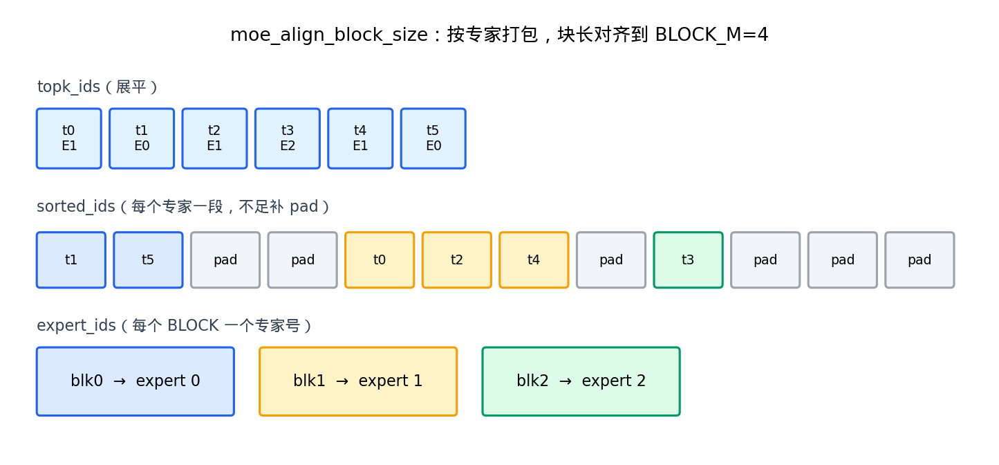
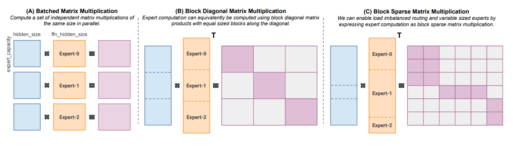
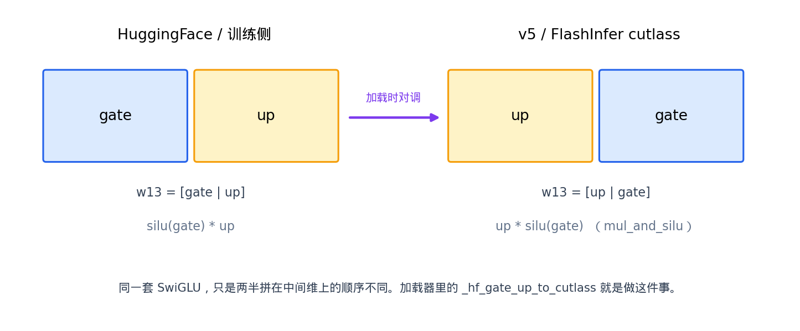

# MoE 模块、基础核与融合计算

这篇文档完整讲解一层 Sparse MoE 由哪些模块组成，基础实现怎么写，以及推理引擎为什么要换成 align + grouped GEMM。数字来自公式和代码形状，本仓库的端到端 tok/s 不在这里编。

- [1] 一层 MoE 的模块
- [2] 公式与张量形状
- [3] 基础核：按 token 做专家 GEMV
- [4] 基础核为什么上不了生产
- [5] 按专家重排并对齐到块
- [6] grouped GEMM、SwiGLU、moe_sum
- [7] v5 前向串起来
- [8] 常考题

## 1. 一层 MoE 的模块

Transformer 里原来是 Attention + 稠密 MLP。MoE 层只替换 MLP。Attention、RMSNorm、残差保持原样。

一层 Sparse MoE 拆成下面几块：

| 模块 | 做什么 | v5 落点 |
| --- | --- | --- |
| gate / router | `[T, H] → [T, E]` 打分 | `ReplicatedLinear` |
| route | softmax + top-k，得到编号和权重 | `route_experts` |
| experts | 被选中的 SwiGLU，加权求和 | `Experts` + fused 核 |
| shared expert（可选） | 每个 token 必算的一支 SwiGLU | `shared_expert_*` |
| all-reduce（多卡） | 把各卡局部结果加齐 | TP 组上的 AR |

数据流：

```
hidden [T, H]
    │
    ├─ gate ─→ logits [T, E] ─→ route ─→ topk_ids / topk_weights [T, K]
    │                                              │
    └──────────────────────────────────────────────┤
                                                   ▼
                                              experts(...)
                                                   │
                              ┌────────────────────┤
                              ▼                    ▼
                         shared（可选）      all-reduce（可选）
                              │                    │
                              └──────────┬─────────┘
                                         ▼
                                    out [T, H]
```


Qwen1.5-MoE / Qwen2-MoE 有共享专家。Qwen3-MoE 的 `shared_expert_intermediate_size=0`，共享支路不建。

## 2. 公式与张量形状

对一个 token 的隐藏向量 $ x \in \mathbb{R}^{D} $：

```math
p = \mathrm{softmax}(x W_g^{\top}),\quad
(w, e) = \mathrm{TopK}(p, K),\quad
w \leftarrow w / \sum w \quad (\text{若 norm\_topk\_prob})
```

```math
y = \sum_{k=1}^{K} w_k \,
W_{\mathrm{down}}[e_k] \,
\bigl(\mathrm{silu}(W_{\mathrm{gate}}[e_k] x) \odot W_{\mathrm{up}}[e_k] x\bigr)
```

有共享专家时再加一项：

```math
y \leftarrow y + \sigma(g_{\mathrm{shared}}^{\top} x) \,
E_{\mathrm{shared}}(x)
```

形状（单卡、未切并行时）：

| 符号 | 形状 | 含义 |
| --- | --- | --- |
| $ x $ | `[T, D]` | token 隐藏 |
| $ W_g $ | `[E, D]` | 门控 |
| $ W_{\mathrm{gate}}, W_{\mathrm{up}} $ | `[E, I, D]` | 第一层两路 |
| $ W_{\mathrm{down}} $ | `[E, D, I]` | 第二层 |
| $ y $ | `[T, D]` | 层输出 |

$ E $ 专家数，$ K $ top-k，$ D $ hidden，$ I $ 专家中间维。Mixtral 常见 $ E=8, K=2 $；Qwen3-MoE 常见 $ E=128, K=8 $。

每 token 算术量大约是 $ 2DE + K \cdot 6ID $：门控一次 $ 2DE $，每个选中专家三次 GEMV（gate / up / down）各约 $ 2ID $。

## 3. 基础核：按 token 做专家 GEMV

先写教科书版本：一个 warp 管一个 token，对每个选中专家做三次 GEMV，中间激活放 shared memory。下面这段是教学核，对应公式，和 v5 生产路径不同。

```text
做法：一个 warp 一个 token。路由先算出 expert[K]、w[K]。
      每个选中专家三次 GEMV：gate、up、down。
      中间 h[I] 放 smem。
启动：block = (32, 8)，grid = CEIL(T, 8)
      动态 smem ≈ 8·(D+I)·sizeof(float)
布局：x[T,D]  Wg[E,D]  Wgate,Wup[E,I,D]  Wdown[E,D,I]  y[T,D]
理论：权重墙。每个 token 各自重读 W，专家间没有复用。
```

```cuda
// 示意：moeBasic，教学用
template <int E, int TOPK>
__global__ void moeBasic(const float* x, const float* Wg,
                         const float* Wgate, const float* Wup,
                         const float* Wdown, float* y,
                         int T, int D, int I) {
    int tok = blockIdx.x * blockDim.y + threadIdx.y;
    int lane = threadIdx.x;
    if (tok >= T) return;

    extern __shared__ float smem[];
    float* xs = smem + threadIdx.y * (D + I);
    float* h = xs + D;
    for (int d = lane; d < D; d += 32) xs[d] = x[(size_t)tok * D + d];
    __syncwarp();

    int expert[TOPK];
    float w[TOPK];
    warpSoftmaxTopk<E, TOPK>(xs, Wg, D, expert, w);

    for (int d = lane; d < D; d += 32) y[(size_t)tok * D + d] = 0.f;
    __syncwarp();

#pragma unroll
    for (int k = 0; k < TOPK; k++) {
        int e = expert[k];

        // gate / up：lane 包中间维 i，内积走完 D
        for (int i = lane; i < I; i += 32) {
            float g = 0.f, u = 0.f;
            const float* wg = Wgate + ((size_t)e * I + i) * D;
            const float* wu = Wup   + ((size_t)e * I + i) * D;
            for (int d = 0; d < D; d++) {
                float xd = xs[d];
                g += xd * wg[d];
                u += xd * wu[d];
            }
            h[i] = silu(g) * u;
        }
        __syncwarp();

        // down：lane 包输出维 d，累加到 y
        for (int d = lane; d < D; d += 32) {
            float a = 0.f;
            const float* wd = Wdown + ((size_t)e * D + d) * I;
            for (int i = 0; i < I; i++) a += h[i] * wd[i];
            y[(size_t)tok * D + d] += w[k] * a;
        }
        __syncwarp();
    }
}
```

Python 对照同样正确，也是 `tests/gpu/test_moe_kernel.py` 里 `_naive` 的语义：

```python
out = hidden.new_zeros(T, D)
for t in range(T):
    for k in range(K):
        e = topk_ids[t, k]
        y = expert_ffn[e](hidden[t])
        out[t] += topk_weights[t, k] * y
```

## 4. 基础核为什么上不了生产

三件事叠在一起。

**启动次数。** 按专家循环时，每个专家 gather / GEMM / scatter 各一次。decode 只有几个 token，启动开销大于算术。

**形状不规则。** 专家 3 分到 40 个位置，专家 7 分到 2 个。cuBLAS / Tensor Core 喜欢大而齐的矩阵乘。

**权重不复用。** 基础核按 token 扫，同一专家的 $ W $ 被多个 token 反复从 HBM 读进。算术强度低，落在权重墙。


生产路径改成：先按专家把 token 排成连续段，再对整段做 grouped GEMM。下一题的教学线也是同一方向：先 pack，再换成大 tile。

## 5. 按专家重排并对齐到块

grouped GEMM 要求同一专家的行在内存里连续，行数最好是 `BLOCK_M` 的倍数。

align / sort 做四件事：

1. 把 `[T, K]` 的专家编号展平成长度 $ T\cdot K $。
2. 统计每个专家的行数，向上取整到 `BLOCK_M`。
3. 写出 `sorted_ids`：同专家的位置挨在一起，空位填 pad。
4. 写出 `expert_ids`：每个 `BLOCK_M` 行块属于哪个专家；空块填 `-1`。



v5 的 CUDA 核 `moe_align_block_size` 做这件事。token 少且专家不超过 64 走 small-batch 核；否则 cub 前缀和 + 原子写槽位。编不出扩展时退回 `torch.bincount` + `argsort`。

v5 只补 pad、不丢 token。`sorted_ids` 长度随负载变，MoE 目前没有进 CUDA Graph。Switch 训练里的 capacity factor 会丢 overflow token，那是另一条训练侧路径。

Megatron / HF 综述里画过三种矩阵乘组织：等容量 batched GEMM、块对角、负载不均时的 block-sparse。推理几乎总是第三种。



## 6. grouped GEMM、SwiGLU、moe_sum

### 6.1 两次 GEMM

重排之后，一颗 kernel 按块读：

- 专家号：`expert_ids[pid]`
- 行对应哪些 token×第几路：`sorted_ids`
- 权重：`w13[expert]` 或 `w2[expert]`

**GEMM1** 用 `w13`，形状 `[n_local, 2I_tp, D]`。输出 `[T·K, 2I]`。

**GEMM2** 用 `w2`，形状 `[n_local, D, I_tp]`。输入是激活后的中间向量；这一次把 `topk_weights` 乘进去，后面求和只剩沿 K 相加。

块大小随 token 数换：少时 `BLOCK_M=16`；多了提到 128。decode 当 `T·K·4 <= E` 时跳过 align，每个 program 一行（`naive=True`），和 vLLM 同一条启发式。

FlashInfer `cutlass_fused_moe` 把 align、两次 GEMM、激活、求和收进一条路径。SM 落在 `{89,90,100,103,110,120,121}` 且能 import 时，`moe_backend=auto` 优先走它。核内 `ep_size=1`：专家并行已在外面用 `expert_map` 做完。

### 6.2 SwiGLU 两半顺序

数学是 `silu(gate) * up`。HuggingFace 存 `[gate | up]`。FlashInfer cutlass 和 v5 的 `mul_and_silu` 按 `[up | gate]` 读。加载时 `_hf_gate_up_to_cutlass` 对调一次。

搞错顺序会变成 `silu(up) * gate`，和 naive 的 `atol=5e-2` 对比会失败。



### 6.3 moe_sum

GEMM2 输出 `[T·K, D]`。还原成 `[T, D]` 是沿 K 求和。CUDA `moe_sum` 对 topk 2/4/8 做向量化展开；其余 k 走循环。没有扩展时用 `view(T, K, D).sum(1)`。

## 7. v5 前向串起来

```
SparseMoeBlock
  gate → route_experts
  Experts.forward          # expert_map 翻译全局→本地，remote = -1
  fused_moe_forward        # cutlass | triton
  （EP）AR → 可选 shared
  （TP）可选 shared → AR
```

Triton 内部：可选 align → GEMM1 → `mul_and_silu` → GEMM2（乘权重）→ `moe_sum`。workspace 按 `(device, 形状, dtype)` 缓存。

路由本身用 fp32 softmax。半精度在专家多、分数接近时更容易糊成相近概率。

## 8. 常考题

**Q：一层 MoE 相对稠密 MLP 多了什么？**  
门控、top-k、多个专家 FFN、可选共享专家。Attention / Norm / 残差与稠密相同。

**Q：为什么 gate 要 ReplicatedLinear？**  
每个 token 要看见全部 $ E $ 个分数才能 top-k。gate 权重按专家切开会缺分数。

**Q：基础核和 fused 核差在哪？**  
基础核按 token 扫，三次 GEMV，权重不复用。fused 先按专家 pack，再 grouped GEMM，同一专家的行共享一次权重读。

**Q：为什么要 align？**  
让每个专家的行数变成 `BLOCK_M` 倍数，好让 Triton / CUTLASS 发整齐 tile；pad 行在核里 mask 掉。

**Q：`[gate|up]` 和 `[up|gate]` 搞反会怎样？**  
激活变成 `silu(up)*gate`，数值对不上 naive。

**Q：稀疏省的是算力还是显存？**  
省的是每次前向的 FLOPs。全部专家权重仍要常驻显存。Mixtral 每次大约算 13B，显存仍按约 47B 准备。

**Q：decode 为什么有时跳过 align？**  
`T·K·4 <= E` 时每个专家行数极少，排序本身比 GEMM 还贵。

下一篇写多卡：切中间维还是切专家编号。
