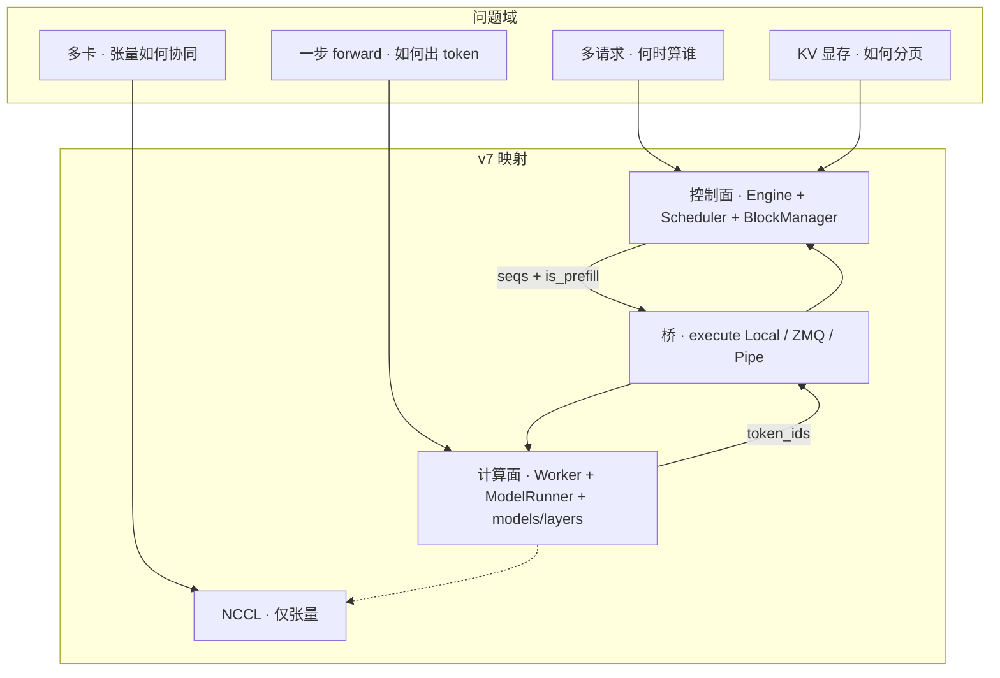
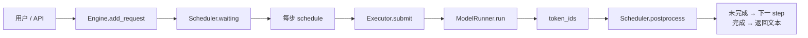
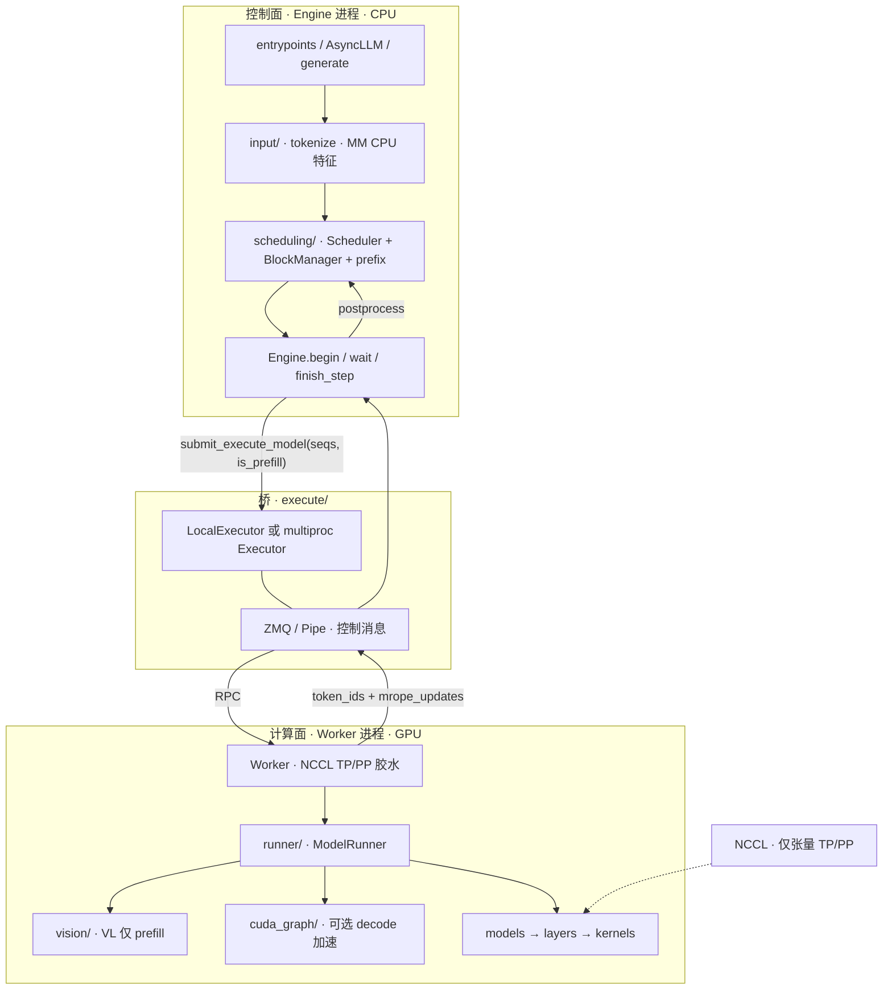
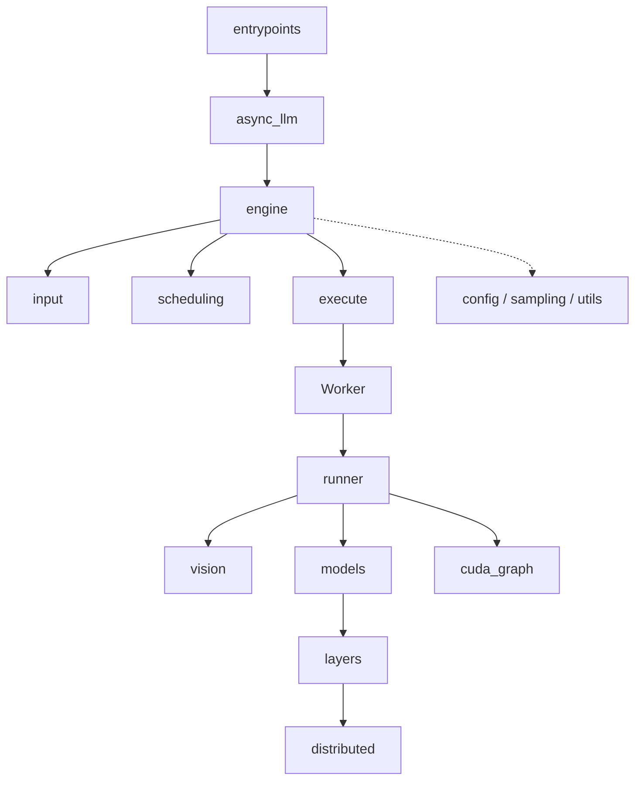
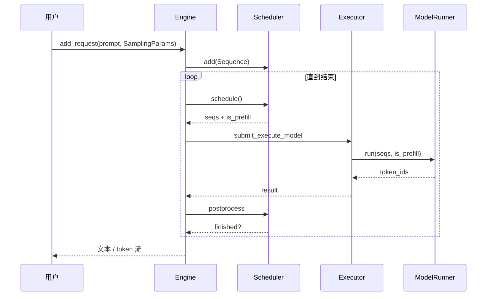
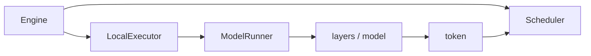

# dzyy-vllm 架构设计

现在市面上有很多关于 vLLM 的教程，例如 [vLLM](https://github.com/vllm-project/vllm)、[nano-vllm](https://github.com/GeeeekExplorer/nano-vllm)，[ullm]()等等。


绝大部分教学版的代码大概都在千余行左右，但实际上官方 vLLM 在 10k行量级，二者之间功能差距很大（包括但不限于多模态、MoE、PP、异步 Serving 等）。为了弥合现在的toy-vllm和serve-vllm之间的差距， 我个人着手设计了更加完整的项目框架**dzyy-vllm**。


本项目参考 vLLM v1 的设计架构，同时保证良好的可读性、可理解性以及完整的profile方案。

> 个人精力有限，如果有任何代码错误或者误差还请见谅。


## 1. vLLM 在干什么？

vllm主要是在有限的 GPU 显存上，用连续批处理高效地为多路请求做自回归解码，并正确管理 KV Cache。

拆开看，引擎只反复做四件事：

| # | 问题 | 朴素答案 | 引擎要做的 |
|---|------|----------|------------|
| 1 | 下一个 token 怎么来？ | 对当前上下文做一次 forward + sample | **计算** |
| 2 | 多请求怎么共享 GPU？ | 不要「一个请求算完再接下一个」 | **连续批处理调度** |
| 3 | 历史状态放哪？ | Attention 的 K/V 要跨步复用 | **分页 KV（PagedAttention）** |
| 4 | 多卡怎么拆？ | 权重 / 层切开 | **TP / PP + NCCL** |

所以 vLLM **不是**「又一个 HuggingFace `generate` 封装」，而是：

```text
请求队列 + KV 内存管理 + 批调度  +  （可选）分布式执行
              ↓
        每步只算「本步该算的那一段」
```

---

## 2. 为什么必须拆「控制」和「计算」？

若把「选谁算」和「怎么算」写在同一个大循环里，会出现：

- 调度逻辑缠进 FlashInfer / NCCL，无法单测、无法换后端；  
- 多进程时不知道该序列化什么、GPU 上该留什么；  
- 听众无法先建立心智模型再读代码。

v7 的总设计因此是 **两面一桥**：

| 面 | 回答的问题 | 典型进程 | 不做什么 |
|----|------------|----------|----------|
| **控制面** | 这一步算谁？算多少？KV 占哪页？ | Engine（CPU） | 不跑 `model.forward` |
| **计算面** | 给定本步序列，如何出 token？ | Worker（GPU） | 不维护全局 waiting 队列 |
| **桥** | 如何把「本步任务」送到 GPU 并收回结果？ | `execute/` | 不实现 attention |



---

## 3. 鸟瞰：一次请求从进到出



对应 Engine 三拍（便于 Async 把「等 GPU」放在锁外）：

```text
begin_step  →  schedule + submit
wait_step   →  future.result()          # 计算面在此发生
finish_step →  mrope 回写 + postprocess
```

单卡时桥退化为 `LocalExecutor`（同进程函数调用），**边界仍在，只是没有 IPC**。

---

## 4. 控制面 vs 计算面（核心图）



### 双信道（不要混用）

| 信道 | 传什么 | 谁用 |
|------|--------|------|
| **ZMQ / Pipe** | 命令、序列元数据、采样结果 | Engine ↔ Worker |
| **NCCL** | hidden / residual / all-reduce | Worker 之间、层内并行 |

原则：**控制消息可以 pickle；激活张量必须走 NCCL。**

### 五条硬原则

1. **调度不进 kernel**：`Scheduler` 不知道 FlashInfer / NCCL。  
2. **计算不决定下一个请求**：`ModelRunner` 不维护 waiting/running。  
3. **状态权威在控制面**：`Sequence`、block 表在 Engine；GPU 侧 KV / mRoPE **按需回写**。  
4. **接口可退化**：`world_size==1` → `LocalExecutor`，语义仍是 submit → run → result。  
5. **增强正交挂接**：CG / VL / MoE(cutlass) 挂在计算面；Scheduler **不感知**并行内核。

---

## 5. 源码地图：从上到下每个模块干什么

依赖方向（**禁止反向**）：

```text
entrypoints → runtime → models → layers → distributed
                 ↘
            scheduling（被 Engine 调用）
config / sampling / utils  = 横向共享，不依赖 Engine
```

### 5.1 横向契约（最先建立）

| 包 | 作用 | 讲解时一句话 |
|----|------|----------------|
| `config/` | `EngineConfig`：模型路径、并行、KV、CG 开关等 | **系统怎么配置** |
| `sampling/` | `SamplingParams`：温度、max_tokens… | **这条请求怎么采** |
| `utils/` | 路径、profiler、CUDA/FlashInfer 环境 | **无业务依赖的工具** |

对外公共导出：`from src import Engine, EngineConfig, SamplingParams`。

### 5.2 控制面

| 包 | 作用 | 讲解时一句话 |
|----|------|----------------|
| `runtime/engine.py` | 步进循环、三拍、持有 Scheduler + Executor | **控制面入口** |
| `runtime/async_llm.py` | 后台 step + 每请求队列 | 同步 Engine 的异步壳 |
| `runtime/input/` | tokenize、HF processor、多模态 CPU 特征 | **进调度之前的 CPU 预处理** |
| `scheduling/` | `Sequence`、`Scheduler`、`BlockManager`、radix/hash | **谁算、KV 哪一页** |
| `entrypoints/` | OpenAI Serving + 薄 HTTP + 离线 `LLM` | 产品边界：`protocol` / `OpenAIServing` / `api_server` 分层，供其它代码直接调用 |

调度流要点（细节见 01）：

- 两队列：`waiting` / `running`；**prefill-first**；  
- 出口只有 `SchedulerOutput(seqs, is_prefill)`；  
- `postprocess` 负责推进 cache、append token、结束时释放 KV。

### 5.3 桥（execute）

| 组件 | 作用 |
|------|------|
| `LocalExecutor` | 单卡：直接调 `ModelRunner.run` |
| `Executor` + `transport` | 多卡：spawn Worker、ZMQ/Pipe 收发 |
| `Worker` | 薄胶水：NCCL 环境 + 调 runner；PP recv/send |
| `futures` / `reply` / `merge` | 异步结果、谁回包、如何合并 |

**execute 不实现算子**；它只保证「调度给出的一步」在正确的 GPU 进程上执行。

### 5.4 计算面

| 包 | 作用 | 讲解时一句话 |
|----|------|----------------|
| `runtime/runner/` | `ModelRunner.run`：prepare → forward → sample | **单卡一步语义** |
| `runtime/vision/` | ViT encode / merge（Worker GPU） | 与 `input/` 刻意拆开 |
| `models/` | Qwen3 / VL / MoE 组装为 `nn.Module` | **图怎么叠** |
| `layers/` | Attention、Linear、RoPE、MoE、ViT… | **零件** |
| `cuda_graph/` | decode（及可选 ViT）图捕获 | **定形加速，旁路 eager** |
| `distributed/` | parallel_state、TP/PP 通信原语 | **只提供集合通信，不调度请求** |

计算流要点（细节见 02）：

```text
prepare_step →（VL encode）→ CG 或 eager forward → sample
PP：仅 last stage 采样；中间 stage 传 IntermediateTensors
```

### 5.5 模块关系（包级）



---

## 6. 一步生命周期（把两面钉在一起）



**交接面唯一且狭窄**（设计上最重要的约束）：

```text
调度 → 计算：seqs（含 block_table / num_scheduled_tokens）+ is_prefill
计算 → 调度：token_ids（对齐 seqs）+ 可选 mrope_updates
```

交接面以外，两边禁止互相调用内部函数。

---

## 7. 并行与增强能力落在哪一层？

这些**不改变**「两面一桥」故事，只加在计算面或配置上：

| 能力 | 落点 | 控制面是否实现 |
|------|------|----------------|
| TP | `layers` 切分 + NCCL all-reduce | 只配置 `tp_size` |
| PP | 层划分 + Worker send/recv | 只配置 `pp_size`（+ 少量合法性校验） |
| MoE | `layers/moe` cutlass + TP shard intermediate | 只配置 `tp_size` / `pp_size` |
| CUDA Graph | `cuda_graph` + runner 旁路 | 只配置 `enforce_eager` |
| 多模态 | `input/`（CPU）+ `vision/`（GPU） | 调度侧带 `mm_features`；图前文本页可 prefix（radix/hash 共用 `prefix_cacheable_full_blocks`）；像素经 `register_mm_pixels` 一次下发；OpenAI chat 走 `chat_messages` + HF chat template |
| Radix 前缀 | `BlockManager` 后端 | 纯控制面优化 |

原则：**并行是计算面内部的事；控制面只配置拓扑，不实现拓扑。**

---

## 8. 单卡退化：教学默认路径

讲解整仓时，**先让听众只看见这条路径**：



再展开：

1. `enforce_eager=False` → CUDA Graph；  
2. `world_size>1` → `Executor` + ZMQ + Worker；  
3. TP → 层内 NCCL；  
4. PP → stage 张量；  
5. VL / MoE → 计算面插件。

这样「1 万行代码」不会在第一课同时砸下来。

---

## 9. 设计取舍（讲架构时要诚实说的）

| 取舍 | 好处 | 代价 |
|------|------|------|
| 一步单相位（整步 prefill **或** decode） | metadata / CG 简单 | 不能同一步混相 |
| Local 与 multiproc 同接口 | 教学平滑升级 | 单卡也付一点分布式样板税 |
| `Sequence` 经桥传递（再 compact） | 实现快、好读 | 不如纯 DTO 演进友好 |
| 功能面铺全（VL/MoE/Async） | 一门课讲完现代引擎 | 部分增强路径成熟度不均 |

主轴（控制/计算分离、双信道、阶段分包）是成功的；边缘能力应在文档里标明「设计支持 / 实现状态」，避免能力表虚假全绿。

---

## 10. 建议讲解顺序（高效、完整）

| 顺序 | 讲什么 | 对应材料 |
|------|--------|----------|
| ⓪ | 三框架对比 nano / dzyy / 官方（§0） | 本节 |
| ① | vLLM 本质四问（§1） | 本节 |
| ② | 两面一桥 + 双信道（§2–4） | 本节核心图 |
| ③ | 源码地图扫一遍（§5） | 只记包职责，不进函数 |
| ④ | 一步生命周期（§6） | 对照 `Engine.step` |
| ⑤ | 调度流细节 | [01-scheduling-flow.md](01-scheduling-flow.md) |
| ⑥ | 计算流细节 | [02-compute-flow.md](02-compute-flow.md) |
| ⑦ | 单卡跑通 → TP → PP → VL → MoE | 代码实验 |
| ⑧ | 工程坑与性能 | `DESIGN.md`、bench 报告 |

**开篇不要从 `transport.py` 或某个 kernel 开始。**  
先建立「引擎在解决什么问题 → 控制/计算如何分工 → 一步如何闭环」，再下钻模块。

---

## 11. 下一篇

- [01-scheduling-flow.md](01-scheduling-flow.md) — 调度流完整图  
- [02-compute-flow.md](02-compute-flow.md) — 计算流完整图  
- 仓库根目录 [`DESIGN.md`](../../DESIGN.md) — 约定与能力表  
