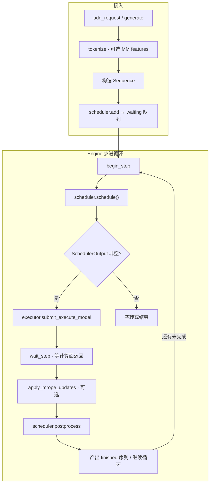
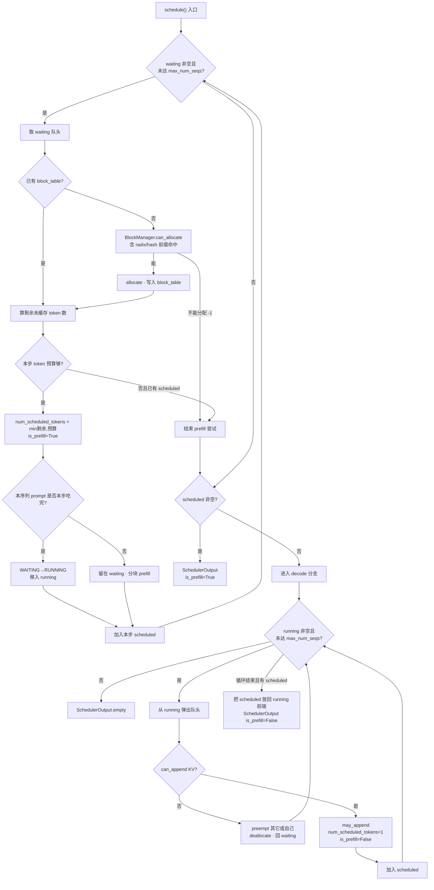
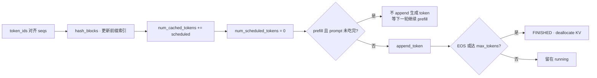
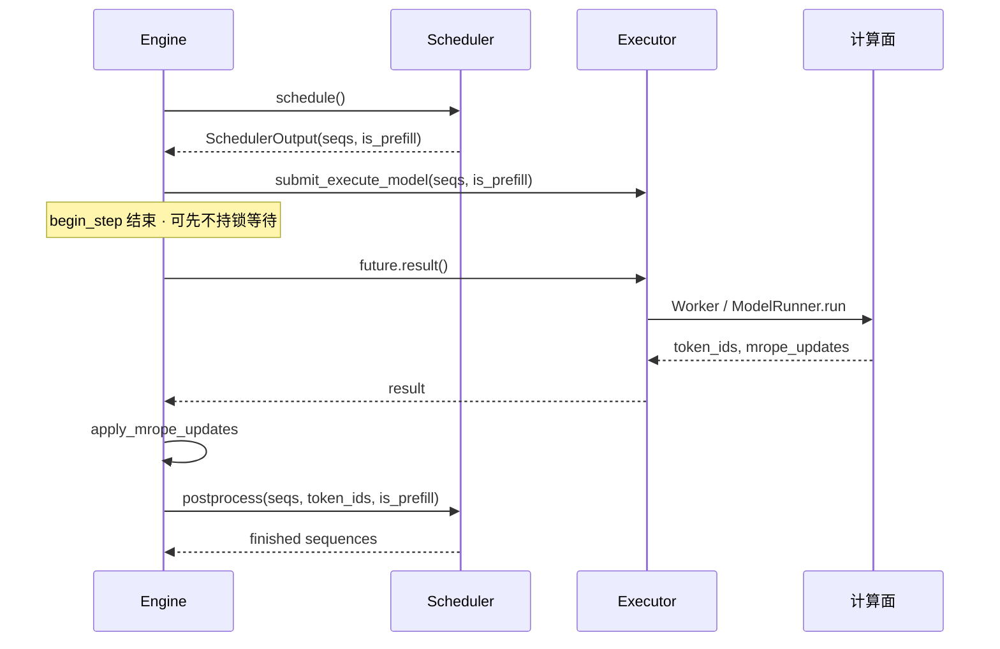

# 调度流（Scheduling Flow）

调度流回答三个问题：

1. **谁**进入本步计算？  
2. **算多少 token**（整段 prefill 窗口，还是 decode 1 token）？  
3. **KV 页**如何分配 / 追加 / 在结束时释放？

它**不**跑模型 forward，也不碰 NCCL。出口只有一个 DTO：`SchedulerOutput(seqs, is_prefill)`，再由 Engine 交给 execute。

---

## 1. 总览图



对应源码主路径：

```text
Engine.add_request
  → Scheduler.add(seq)                    # WAITING
Engine.step
  → begin_step → schedule → submit
  → wait_step  → (计算面，见 02)
  → finish_step → postprocess
```

---

## 2. `schedule()` 决策图（核心）

v7 是 **prefill-first 连续批处理**：

1. 只要 `waiting` 里还能塞进本步，就优先做 **prefill**；  
2. 本步没有任何 prefill 时，再从 `running` 里做 **decode**（每序列 1 token）；  
3. decode 前若 KV 不够，对尾部序列 **preempt**（释放 block，打回 waiting）。



### 两队列语义

| 队列 | 含义 |
|------|------|
| `waiting` | 尚未完成 prompt 缓存，或被 preempt 打回 |
| `running` | prompt 已在 KV 中，等待 decode / 正在参与批 |

### `Sequence` 上调度关键字段

| 字段 | 作用 |
|------|------|
| `block_table` | 物理 KV 页号列表 |
| `num_cached_tokens` | 已写入 KV 的 token 数 |
| `num_scheduled_tokens` | **本步**要算的 token 数 |
| `is_prefill` | 本步是 prefill 还是 decode |
| `status` | WAITING / RUNNING / FINISHED |

---

## 3. `postprocess()` 回流图

计算面只返回「每个 scheduled 序列一个新 token id」（以及可选 mRoPE 快照）。调度流负责**提交状态**：



要点：

- **分块 prefill**：中间步只推进 `num_cached_tokens`，不把采样 token 当 completion。  
- **结束才释放 KV**：`deallocate` 与 prefix 引用计数由 `BlockManager` 处理。  
- **含图序列只缓存首图之前的满页文本 prefix**（`prefix_cacheable_full_blocks`），radix 与 hash 两后端共用该上限，避免用纯 token-id 误命中图像页。

---

## 4. Engine 如何「包住」调度流

调度流本身不含 RPC。Engine 把它嵌进三拍：



`begin_step / wait_step / finish_step` 拆开，是为了 AsyncLLM：**调度与提交可在锁内，等待 GPU 在锁外**。

---

## 5. 调度流应如何设计（分析）

### 已做对的

| 原则 | v7 体现 |
|------|---------|
| 调度与执行解耦 | 出口只有 `SchedulerOutput`，不调用 `model()` |
| Prefill 优先 | 避免 decode 饿死新请求的 prompt |
| KV 与调度同层 | `BlockManager` 与队列在同一控制面，权威状态单一 |
| 可抢占 | decode 前 `preempt`，防止死锁式占满 |
| 前缀缓存下沉 | radix/hash 在 BlockManager，Scheduler 只问 can_allocate |

### 设计时注意的边界

1. **Scheduler 不要感知 TP/PP**  
   并行只改变「算得有多快」，不改变「批谁」。

2. **一步只输出一种相位**  
   本步要么全是 prefill，要么全是 decode（`is_prefill` 单布尔）。简化 FlashInfer metadata / CG 路径；代价是不能同一步混相（与许多教学引擎一致）。

3. **DTO 优于直接共享可变全局**  
   `SchedulerOutput` 冻结本步集合；Engine 用 `PendingEngineStep` 持有所有权。多进程时再 compact，而不是让 Worker 改 waiting 队列。

4. **空调度要可诊断**  
   长时间 `empty` 且仍有请求 → KV 耗尽。Engine 的 idle 计数是控制面健康检查，不应放到 Worker。

5. **教学叙事**  
   先讲两队列 + prefill-first + allocate/append/deallocate，再讲 radix；不要一上来讲 ZMQ。

### 可演进但不推翻的点

- 更细的 chunked prefill 与官方对齐的预算策略；  
- 调度输出进一步 DTO 化（彻底脱离 `Sequence` 对象跨进程）；  
- 同构 PP 优先验证，异构作为高级专题——调度逻辑本身不变。

---

## 6. 和计算流的交接面（唯一）

```text
调度流出：
  seqs[*].block_table / num_scheduled_tokens / …
  is_prefill: bool

计算流入：同上（经 execute）
计算流出：
  token_ids: List[int]          # 与 seqs 对齐
  mrope_updates: optional       # 回写 Sequence 的 GPU 侧状态

调度流再吃：
  postprocess(seqs, token_ids, is_prefill)
```

**交接面以外，两边禁止互相调用内部函数。** 这是整仓最重要的设计约束之一。
