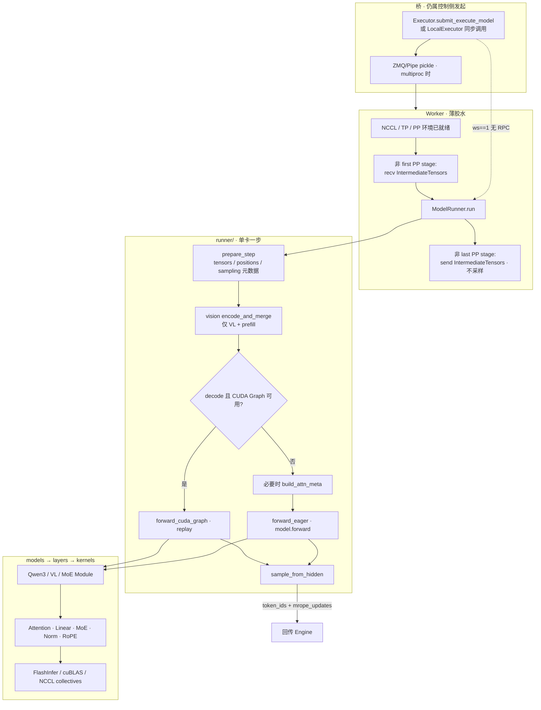
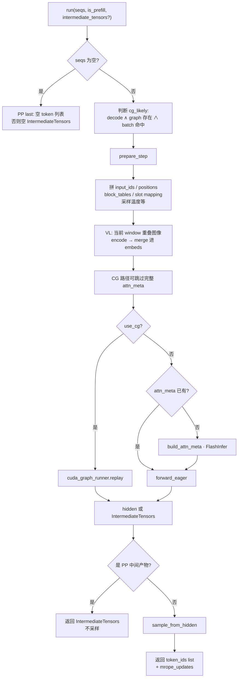
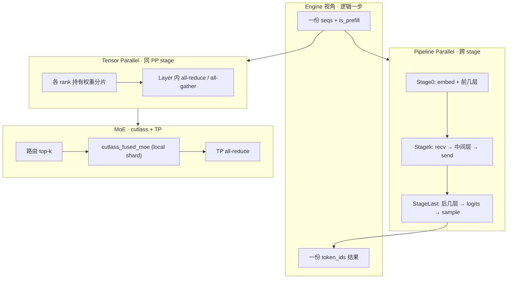
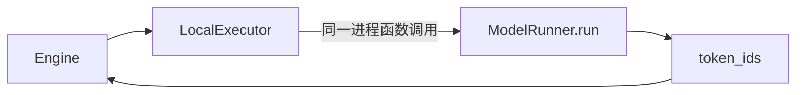
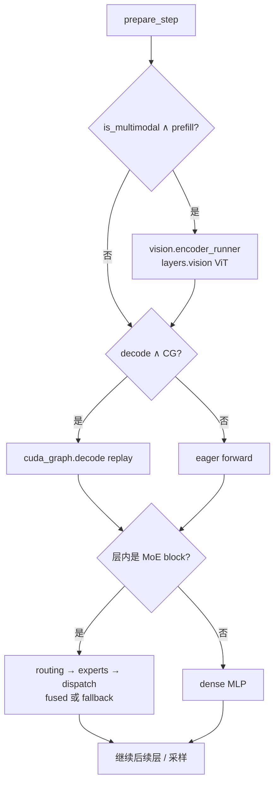

# 计算流（Compute Flow）

计算流回答：

> 拿到「本步要算的序列 + 是否 prefill」之后，**GPU 上如何变成新 token**？

它**不**维护 waiting/running，**不**决定下一个请求是谁。入口来自 execute（或 LocalExecutor 直接调用），出口是 `token_ids`（及可选 mRoPE 快照）。

---

## 1. 总览图（从桥到 kernel）



---

## 2. `ModelRunner.run` 逐步图

这是计算流的心脏。



### 子阶段职责

| 阶段 | 包/文件 | 做什么 |
|------|---------|--------|
| 准备 | `step_prepare.py` | CPU/GPU 张量、页表、是否采样 |
| 视觉 | `runtime/vision/` | 仅 prefill；写 encoder cache |
| 注意力元数据 | FlashInfer wrapper | paged KV 的 indptr / indices |
| 前向 | `models/*` + `layers/*` | 真正 matmul / attn / moe |
| 图捕获 | `cuda_graph/decode.py` | decode 定长 batch 回放 |
| 采样 | `sampler.py` | logits → token id |

---

## 3. 多卡时计算流如何「长」在并行上

计算流内部才出现 NCCL；调度流仍然只看到一份逻辑 `seqs`。



Worker 级伪代码（与实现一致）：

```text
if not first_pp_rank:
    intermediate = NCCL_recv(prev)
output, mrope = ModelRunner.run(seqs, is_prefill, intermediate)
if not last_pp_rank:
    NCCL_send(output, next)
    return (None, mrope)          # 中间 stage 不产生 token
else:
    return (token_ids, mrope)     # 仅 last stage 采样
```

Executor 侧再按 reply 策略 merge（通常 driver / 指定 rank 回包）。

---

## 4. 单卡退化（教学默认路径）



- **没有** ZMQ，**没有** 多进程 spawn；  
- 仍走完整 prepare → forward → sample；  
- 仍可能 init 单卡 process group（统一代码路径的税）。  

讲解计算流时，**先画这张，再展开 Worker/NCCL**。

---

## 5. VL / MoE / CG 挂在计算流哪里



设计约束：

- **VL**：`input/` 只做 CPU 特征；GPU encode 必须在计算流。  
- **CG**：主要加速 decode；prefill / ViT 另算。  
- **MoE**：Scheduler 无感；backend 选择属于计算面配置（当前 SM80 fused 有已知坑，见性能报告）。

---

## 6. 计算流应如何设计（分析）

### 已做对的

| 原则 | v7 体现 |
|------|---------|
| 单入口一步语义 | 只有 `ModelRunner.run` |
| 准备与前向分离 | `prepare_step` vs `forward_*` |
| CG 可旁路 | miss 时只补 attn_meta，不整步重来 |
| PP 采样位置正确 | 仅 last stage sample |
| 视觉与文本运行时拆分 | `vision/` 注入，不把 HF processor 塞进 Worker |
| 桥可替换 | Local / ZMQ / Pipe 不改变 run 契约 |

### 设计时注意的边界

1. **计算流输入应是「已调度快照」**  
   使用本步的 `num_scheduled_tokens` / `block_table`，不要回头改 Scheduler 队列。

2. **控制消息与张量消息分离**  
   token id 可以走 RPC；hidden 必须走 NCCL。中间 PP stage 回 `None` tokens，避免假采样。

3. **图捕获与动态形状**  
   CG 只覆盖 decode 固定 batch 集合；动态 prefill 走 eager——这是正确的能力边界，不是缺陷。

4. **状态回写要显式**  
   mRoPE 等用 `MRopeStateUpdate` 快照回 Engine，禁止 Worker 直接写 Engine 内存。

5. **教学顺序**  
   Local 单卡 eager → 单卡 CG → TP（层内 NCCL）→ PP（stage 张量）→ VL → MoE。

### 可演进但不推翻的点

- MoE fused 按 arch 自动降级，避免能力表与实现脱节；  
- decode RPC 继续瘦身，降低 TTFT；  
- ViT CG 作为可选加速，默认关闭以保持路径简单。

---

## 7. 和调度流并排对照

| | 调度流 | 计算流 |
|--|--------|--------|
| 进程 | Engine | Worker（或同进程 Local） |
| 核心对象 | `Sequence` 队列、`BlockManager` | `ModelRunner`、KV pool、weights |
| 一步输入 | 全局 waiting/running | 本步 `seqs` + `is_prefill` |
| 一步输出 | `SchedulerOutput` | `token_ids` (+ mrope) |
| 通信 | 无（或仅被 Engine 调用） | NCCL +（经桥）RPC |
| 禁止事项 | 调用 `model.forward` | 修改 waiting/running |

完整系统 = **调度流决策 → 桥投递 → 计算流执行 → 调度流提交**。两张图合在一起，就是 v7 的运行时灵魂。
