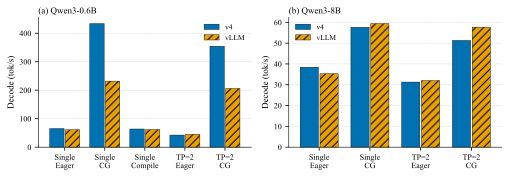
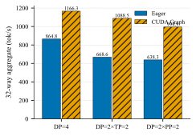

# dzyy-vllm

从零写的 Qwen3 推理引擎。v0 到 v5 每个目录都能跑，每一版只加一类问题，并且把数字测在自己的机器上。

和 [nano-vllm](https://github.com/GeeeekExplorer/nano-vllm) 一样从源码学 vLLM；多出来的是 PP / DP、异构卡切分、MoE / 视觉，以及两台无 NVLink 机器上的完整对照。

安装见 [README.md](README.md)。

```bash
PYTHONPATH=vllm-v3 python vllm-v3/run.py --model Qwen3-0.6B --cg
PYTHONPATH=vllm-v4 python vllm-v4/run.py --model Qwen3-0.6B --tp 2
```

---

## 和谁比

三件事放在一张表里：nano-vllm 把核心想法压进约 1200 行；官方 vLLM 是生产引擎；本仓库是中间这一档——功能按版本摊开，测量写进文档。


|      | [nano-vllm](https://github.com/GeeeekExplorer/nano-vllm) | 本仓库                                  | [vLLM](https://github.com/vllm-project/vllm) 0.26 |
| ---- | -------------------------------------------------------- | ------------------------------------ | ------------------------------------------------- |
| 定位   | 离线最小实现                                                   | 迭代式实现 + 实测                           | 生产 serving                                        |
| 引擎代码 | ~1.2k                                                    | v3 约 3k；v0–v5 合计约 2.5 万              | 十万级                                               |
| 并行   | TP                                                       | TP + PP + DP + EP                    | TP / PP / DP / EP 等完整栈                            |
| 前缀缓存 | 有                                                        | hash和 radix可切换                       | block hash                                        |
| 模型   | 文本 Qwen 等                                                | 稠密模型+MoE模型                           | 覆盖面很宽                                             |
| 服务接口 | `LLM.generate`                                           | v3/v4 离线；v5 有 AsyncLLM 和 OpenAI HTTP | 完整 HTTP / 运维                                      |
| 文档   | README                                                   | 每个版本有设计文档；v4 有两台机器的并行矩阵              | 官方文档                                              |


同一台 RTX 4090 D、Qwen3-0.6B、16 条变长请求（prompt 100–400，temperature=0.6，ignore_eos，输出共 1685 token）：


|                                | tok/s  |
| ------------------------------ | ------ |
| 本仓库 v2（eager）                  | 155.3  |
| nano-vllm（CUDA Graph）          | 2263.1 |
| 本仓库 v3（decode Graph + compile） | 2957.5 |
| 官方 vLLM 0.26.0                 | 3262.2 |


v3 是这一组负载上 nano 的 1.31 倍、官方的 90.7%。换 8B 之后，v4 和官方的 decode / batch-8 差几个百分点——权重大了，实现差异会被访存盖住。



口径和完整表：[vllm-v3/docs/02-实测证据.md](vllm-v3/docs/02-实测证据.md)、[vllm-v4/docs/03-性能对比.md](vllm-v4/docs/03-性能对比.md)。

---


## 版本

仓库里 `vllm-v0/` … `vllm-v5/` 是当时的完整代码，不是 git tag。控制面、数据面、计算面分开，加功能时尽量只动一面。


|                          | 这一版在干什么                                                     | 测到的变化                              |
| ------------------------ | ----------------------------------------------------------- | ---------------------------------- |
| **v0** 615 行             | 加载 Qwen3，GQA + SDPA，采样。没有 KV，每步重算整段历史                       | 基线                                 |
| **v1** 1.7k              | 分页 KV、页表、hash / radix 前缀。Attention 仍是 gather + SDPA         | 对了，比 v0 慢（还没换 fused kernel）        |
| **v2** 1.9k              | 连续批处理、chunked prefill、Prefill/Decode 混跑                     | 0.6B greedy decode 36.5 tok/s      |
| **v3** 2.9k              | FlashAttention paged、Triton KV 写、CUDA Graph、prefill compile | 同上 429.2 tok/s；4B 加载约 29 s → 3.9 s |
| **v4** 5.7k              | vLLM V1 形状的多进程：TP / PP / DP                                 | 见下一节                               |
| **v5** 11.8k + 0.5k CUDA | Qwen3-MoE、Qwen3-VL、OpenAI HTTP。文档未完                         | 单卡和 v3 差 ±3%                       |


v3 换掉的是 v2 里测出来的东西：逐条 gather、`index_copy_`、通用 RMSNorm/RoPE/SiLU、加载时先随机初始化。Triton 写过 RMSNorm，不如 `F.rms_norm`，就没用。采样器不加 `torch.compile`——连续批处理里 batch 会变，编译会被算进稳态吞吐。

v4 的调用链：`Engine → EngineCoreClient → EngineCore → Executor → Worker`。`dp=1,tp=1,pp=1` 也走同一套，避免单卡一套、多卡另一套。

---


## 无 NVLink 机器上怎么切卡

nano-vllm 和多数最小实现停在 TP。实验室常见的是没 NVLink、P2P 不通的 PCIe 机器，v4 把 TP、PP、DP 都跑完，并先测了拓扑和 NCCL 延迟。

**异构双卡（4090 D 24 GB + 4070 SUPER 12 GB）**

- 8B 单卡放得下：TP/PP 不涨 batch-8。
- 14B 单卡放不下：`--pp-layer-counts 12,28`，12 层给 4070。等分 20/20 会 OOM。
- 4B 做 DP=2 比单卡 4090 慢（1146.7 vs 1432.8 tok/s）；再开 Graph，12 GB 卡 OOM。

**四张同构 3090（无 NVLink）**

- 0.6B：单卡 Graph decode 369.2 tok/s，已经快过 4 卡 all-reduce 下限，TP=4 更慢。
- 8B：eager 下 TP 是负的；Graph 下 decode TP=2 / TP=4 为 1.46× / 2.10×，TTFT 仍变差。四卡总吞吐最高是 **DP=4 + Graph，32 路 1166.3 tok/s**（DP×TP 1088.5，DP×PP 994.9）。
- 32B：只有 TP=4 装得进；Graph 后 decode 12.1 → 34.8 tok/s。



0.6B TP=2/PP=2 与 fp32 HuggingFace 逐 token 一致；8B 的 PP=2 与单卡 bit 级一致。

---


## 实现从哪来

向 vLLM 对齐的部分：PagedAttention、连续批处理、chunked prefill、block-hash 前缀、列/行并行线性层、decode CUDA Graph、V1 的 EngineCore / Executor、PP 的 piecewise Graph（send/recv 在图外）。

这边多写或测完才留下的：

- 每个版本一份能跑的代码和文档，改动能对上吞吐。
- 不均分 PP；DP 用独立 Engine + ZMQ，不是 NCCL 数据并行组。
- 前缀 hash / radix 可切换。
- FlashInfer 包成 custom op，prefill 才能 `torch.compile` 全图。
- 先测机器再选 DP 还是 TP，而不是默认切模型。

没做的：投机解码、量化（计划在 v6）、官方那种自适应 KV 和完整 serving 运维。无 NVLink 上的结论不能直接拿到 NVSwitch 机器上用。

---


## 文档


|                |                                                     |
| -------------- | --------------------------------------------------- |
| 安装             | [README.md](README.md)                              |
| 层、KV、调度        | `vllm-v0/docs/` · `vllm-v1/docs/` · `vllm-v2/docs/` |
| 算子和四引擎对照       | [vllm-v3/docs/02-实测证据.md](vllm-v3/docs/02-实测证据.md)  |
| 并行和两台机器        | [vllm-v4/docs/03-性能对比.md](vllm-v4/docs/03-性能对比.md)  |
| MoE / VL / API | `vllm-v5/src/`（文档还在补）                               |


